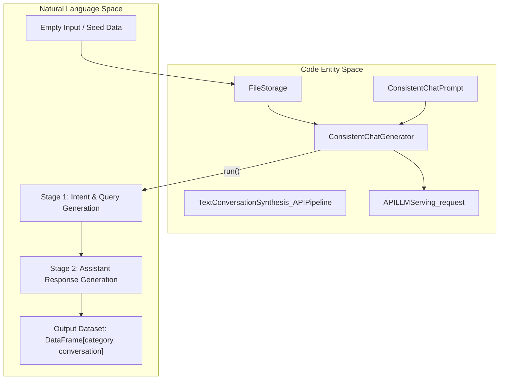
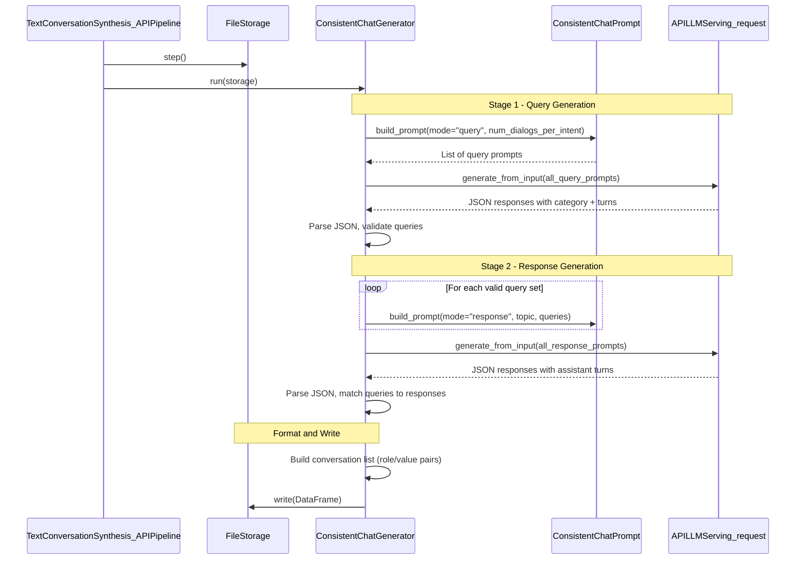
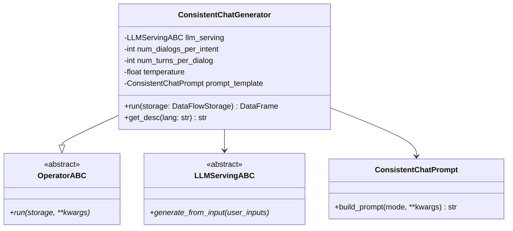

<!-- source: DeepWiki mcp.deepwiki.com · repo OpenDCAI/DataFlow · extra page Conversation Synthesis · fetched 2026-11-02 -->

# Conversation Synthesis

<details>
<summary>Relevant source files</summary>

The following files were used as context for generating this wiki page:

- [dataflow/example/FuncCallPipeline/chat_data.jsonl](dataflow/example/FuncCallPipeline/chat_data.jsonl)
- [dataflow/example/GeneralTextPipeline/empty.jsonl](dataflow/example/GeneralTextPipeline/empty.jsonl)
- [dataflow/operators/conversations/__init__.py](dataflow/operators/conversations/__init__.py)
- [dataflow/operators/conversations/eval/func_call_conversation_sample_evaluator.py](dataflow/operators/conversations/eval/func_call_conversation_sample_evaluator.py)
- [dataflow/operators/conversations/filter/composition_task_filter.py](dataflow/operators/conversations/filter/composition_task_filter.py)
- [dataflow/operators/conversations/generate/consistent_chat_generator.py](dataflow/operators/conversations/generate/consistent_chat_generator.py)
- [dataflow/operators/conversations/generate/func_call_generators.py](dataflow/operators/conversations/generate/func_call_generators.py)
- [dataflow/operators/text_sft/generate/condor_generator.py](dataflow/operators/text_sft/generate/condor_generator.py)
- [dataflow/operators/text_sft/refine/condor_refiner.py](dataflow/operators/text_sft/refine/condor_refiner.py)
- [dataflow/prompts/func_call.py](dataflow/prompts/func_call.py)
- [dataflow/prompts/general_text.py](dataflow/prompts/general_text.py)
- [dataflow/statics/pipelines/__init__.py](dataflow/statics/pipelines/__init__.py)
- [dataflow/statics/pipelines/api_pipelines/func_call_synthesis.py](dataflow/statics/pipelines/api_pipelines/func_call_synthesis.py)
- [dataflow/statics/pipelines/api_pipelines/text_conversation_synthesis_pipeline.py](dataflow/statics/pipelines/api_pipelines/text_conversation_synthesis_pipeline.py)
- [dataflow/statics/pipelines/api_pipelines/text_sft_synthesis_pipeline.py](dataflow/statics/pipelines/api_pipelines/text_sft_synthesis_pipeline.py)
- [dataflow/statics/playground/playground/text_conversation_synthesis_pipeline.py](dataflow/statics/playground/playground/text_conversation_synthesis_pipeline.py)
- [test/test_API_conversations.py](test/test_API_conversations.py)

</details>


## Purpose and Scope

This page documents the conversation synthesis capabilities in DataFlow, specifically the `TextConversationSynthesis_APIPipeline` and its core component, the `ConsistentChatGenerator` [dataflow/operators/conversations/generate/consistent_chat_generator.py:18-18](). This system generates multi-turn dialogue data from scratch using predefined intent categories and topics, producing realistic conversational exchanges suitable for training chat models and dialogue systems.

For generating single-turn instruction-response pairs, see SFT Data Synthesis (5.1.1). For filtering and evaluating text quality, see Text Quality Filtering (5.1.3). For specialized function-calling multi-turn data, see Function Call Pipeline (5.8).

Sources: [dataflow/statics/pipelines/api_pipelines/text_conversation_synthesis_pipeline.py:6-25](), [dataflow/operators/conversations/generate/consistent_chat_generator.py:18-18]()

---

## Pipeline Overview

The conversation synthesis pipeline is implemented in `TextConversationSynthesis_APIPipeline`, which orchestrates a two-stage generation process [dataflow/statics/pipelines/api_pipelines/text_conversation_synthesis_pipeline.py:6-25](). Unlike SFT synthesis that focuses on individual instruction-response pairs, conversation synthesis creates coherent multi-turn dialogues that maintain topic consistency and simulate realistic user interaction patterns.

The pipeline generates conversations across predefined intent categories, each with associated topics that guide the conversation generation [dataflow/prompts/general_text.py:12-30](), [dataflow/operators/conversations/generate/consistent_chat_generator.py:58-84]().

**Pipeline Architecture (Natural Language to Code Entity Mapping)**



Sources: [dataflow/statics/pipelines/api_pipelines/text_conversation_synthesis_pipeline.py:6-25](), [dataflow/operators/conversations/generate/consistent_chat_generator.py:18-58]()

---

## Two-Stage Generation Process

The `ConsistentChatGenerator` operator implements a two-stage approach to ensure conversation quality and consistency [dataflow/operators/conversations/generate/consistent_chat_generator.py:18-18](). This separation allows the model to focus on different aspects of conversation creation independently.

### Stage 1: Query Generation
The first stage generates user queries (conversation turns) based on randomly selected intent categories and topics [dataflow/operators/conversations/generate/consistent_chat_generator.py:60-64](). The operator constructs prompts using `ConsistentChatPrompt.build_prompt(mode="query", num_dialogs_per_intent=N)` to generate JSON-formatted query sequences [dataflow/operators/conversations/generate/consistent_chat_generator.py:61-73]().

### Stage 2: Response Generation
The second stage takes the generated queries and produces corresponding assistant responses [dataflow/operators/conversations/generate/consistent_chat_generator.py:78-84](). Using `ConsistentChatPrompt.build_prompt(mode="response", topic=category, queries=turns)`, the LLM generates contextually appropriate responses that maintain conversation flow [dataflow/operators/conversations/generate/consistent_chat_generator.py:82-84]().

**Execution Flow and Component Interactions**



Sources: [dataflow/operators/conversations/generate/consistent_chat_generator.py:58-143](), [dataflow/statics/pipelines/api_pipelines/text_conversation_synthesis_pipeline.py:6-25]()

---

## Intent Categories and Topics

The `ConsistentChatPrompt` class defines distinct intent categories, each mapped to specific conversation progression patterns and topical domains to ensure diverse and realistic conversation generation [dataflow/prompts/general_text.py:12-30]().

### Intent Category Mapping

| Intent Category | Progression Patterns | Description |
|----------------|---------------------|-------------|
| **Problem Solving Interaction** | Problem Diagnosis → Solution Optimization | Technical support, home repair, troubleshooting |
| **Educational Interaction** | Broad Theory → Specific Scenarios<br/>Basic Concepts → Cross-Domain Connections | Language learning, physics, programming |
| **Health Consultation Interaction** | Problem Diagnosis → Solution Optimization<br/>Hypothesis Testing → Substantive Discussion | Diet tips, symptom analysis, mental health |
| **Exploratory Interaction** | Time Sequence Expansion<br/>Hypothesis Testing → Discussion | Time travel, space exploration, mysteries |
| **Entertainment Interaction** | Single Perspective → Multiple Perspectives<br/>Hypothesis Testing → Discussion | Game design, writing novels, film production |
| **Simulation Interaction** | User Needs → Solutions<br/>Broad Theory → Specific Scenarios | Business negotiations, flight training, emergency response |
| **Emotional Support Interaction** | Single Perspective → Multiple Perspectives<br/>User Needs → Solutions | Grief counseling, stress management, relationship support |
| **Information Retrieval Interaction** | Basic Concepts → Cross-Domain Connections<br/>Time Sequence Expansion | Tech reviews, research, data lookup |
| **Transaction Interaction** | User Needs → Solutions<br/>Problem Diagnosis → Optimization | Online booking, purchasing, scheduling |

Sources: [dataflow/prompts/general_text.py:12-30]()

### Topic Distribution

Each intent category contains predefined topics stored in the prompt registry structures. The total topic pool enables generation of unique conversations when `num_dialogs_per_intent` is scaled appropriately [dataflow/operators/conversations/generate/consistent_chat_generator.py:23-23]().

Sources: [dataflow/operators/conversations/generate/consistent_chat_generator.py:23-23](), [dataflow/prompts/general_text.py:12-30]()

---

## ConsistentChatGenerator Operator

The `ConsistentChatGenerator` class is the core operator responsible for orchestrating the two-stage generation process and formatting the output [dataflow/operators/conversations/generate/consistent_chat_generator.py:18-27]().

### Class Structure



Sources: [dataflow/operators/conversations/generate/consistent_chat_generator.py:18-27](), [dataflow/core/operator.py:1-20]()

### Configuration Parameters

| Parameter | Type | Default | Description |
|-----------|------|---------|-------------|
| `llm_serving` | `LLMServingABC` | Required | LLM serving backend for generation |
| `num_dialogs_per_intent` | `int` | 20 | Number of conversations per intent category [dataflow/operators/conversations/generate/consistent_chat_generator.py:19](). |
| `num_turns_per_dialog` | `int` | 6 | Number of user-assistant turn pairs per conversation [dataflow/operators/conversations/generate/consistent_chat_generator.py:19](). |
| `temperature` | `float` | 0.9 | Sampling temperature for generation randomness [dataflow/operators/conversations/generate/consistent_chat_generator.py:19](). |
| `prompt_template` | `ConsistentChatPrompt` | Required | Prompt template with intent/topic definitions [dataflow/operators/conversations/generate/consistent_chat_generator.py:19](). |

Sources: [dataflow/operators/conversations/generate/consistent_chat_generator.py:19-26]()

### Generation Logic

The `run()` method implements the complete generation workflow [dataflow/operators/conversations/generate/consistent_chat_generator.py:58-143]():

1. **Query Prompt Construction** — Calls `prompt_template.build_prompt(mode="query", num_dialogs_per_intent=N)` to generate prompts for intent categories [dataflow/operators/conversations/generate/consistent_chat_generator.py:61]().
2. **Query Generation** — Invokes `llm_serving.generate_from_input()` with all query prompts [dataflow/operators/conversations/generate/consistent_chat_generator.py:64]().
3. **JSON Parsing and Validation** — Parses JSON responses, extracts `category` and `turns` fields, discards malformed outputs [dataflow/operators/conversations/generate/consistent_chat_generator.py:67-77]().
4. **Response Prompt Construction** — For each valid query set, builds response prompts with `build_prompt(mode="response", topic=category, queries=turns)` [dataflow/operators/conversations/generate/consistent_chat_generator.py:79-82]().
5. **Response Generation** — Generates assistant responses for all conversations [dataflow/operators/conversations/generate/consistent_chat_generator.py:84]().
6. **Conversation Formatting** — Combines queries and responses into structured conversation lists with `role` and `value` fields [dataflow/operators/conversations/generate/consistent_chat_generator.py:102-122]().
7. **Quality Control** — Ensures conversations do not end with user messages and turn counts match [dataflow/operators/conversations/generate/consistent_chat_generator.py:124-129]().

Sources: [dataflow/operators/conversations/generate/consistent_chat_generator.py:58-143]()

---

## Output Format

The `ConsistentChatGenerator` produces structured conversation data containing intent category metadata and conversational turns.

### Conversation Structure

Each conversation is represented as a list of dictionaries following standard dialogue formats:

```json
[
  {"role": "user", "value": "User query text"},
  {"role": "assistant", "value": "Assistant response text"}
]
```

The output DataFrame contains:
- `category`: The intent category string [dataflow/operators/conversations/generate/consistent_chat_generator.py:132]()
- `conversation`: The list of alternating user/assistant message dictionaries [dataflow/operators/conversations/generate/consistent_chat_generator.py:133]()

Sources: [dataflow/operators/conversations/generate/consistent_chat_generator.py:131-134]()

---

## Usage Example

The typical usage pattern instantiates the pipeline with an API serving backend and executes the forward pass [dataflow/statics/pipelines/api_pipelines/text_conversation_synthesis_pipeline.py:6-25]().

### Basic Pipeline Instantiation

```python
from dataflow.operators.conversations import ConsistentChatGenerator
from dataflow.prompts.general_text import ConsistentChatPrompt
from dataflow.utils.storage import FileStorage
from dataflow.serving import APILLMServing_request

class TextConversationSynthesis_APIPipeline():
    def __init__(self):
        self.storage = FileStorage(
            first_entry_file_name="../example_data/GeneralTextPipeline/empty.jsonl",
            cache_path="./cache",
            file_name_prefix="dataflow_cache_step",
            cache_type="jsonl",
        )
        self.llm_serving = APILLMServing_request(
            api_url="https://api.openai.com/v1/chat/completions",
            model_name="gpt-4o",
            max_workers=100
        )
        self.processor = ConsistentChatGenerator(
            llm_serving=self.llm_serving, 
            num_dialogs_per_intent=5, 
            prompt_template=ConsistentChatPrompt()
        )
    
    def forward(self):
        self.processor.run(storage=self.storage.step())
```

Sources: [dataflow/statics/pipelines/api_pipelines/text_conversation_synthesis_pipeline.py:6-25]()

---

## Integration with DataFlow Core

### Operator Registration and Restrictions
- **Registry**: `ConsistentChatGenerator` is registered via `@OPERATOR_REGISTRY.register()` [dataflow/operators/conversations/generate/consistent_chat_generator.py:17-18]().
- **Prompt Restriction**: Uses `@prompt_restrict(ConsistentChatPrompt)` to ensure template compatibility [dataflow/operators/conversations/generate/consistent_chat_generator.py:13-15]().

Sources: [dataflow/operators/conversations/generate/consistent_chat_generator.py:13-18]()

---

