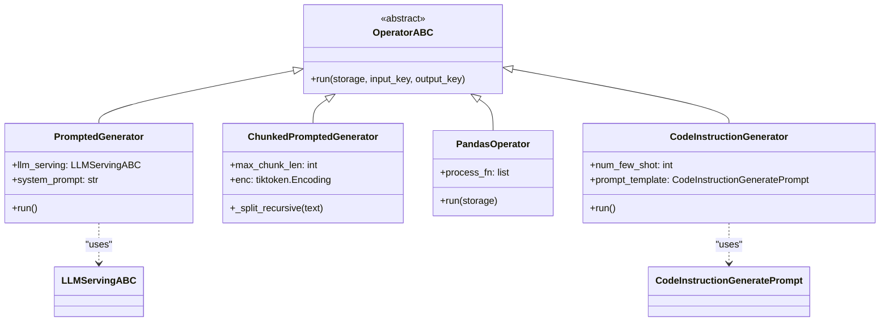
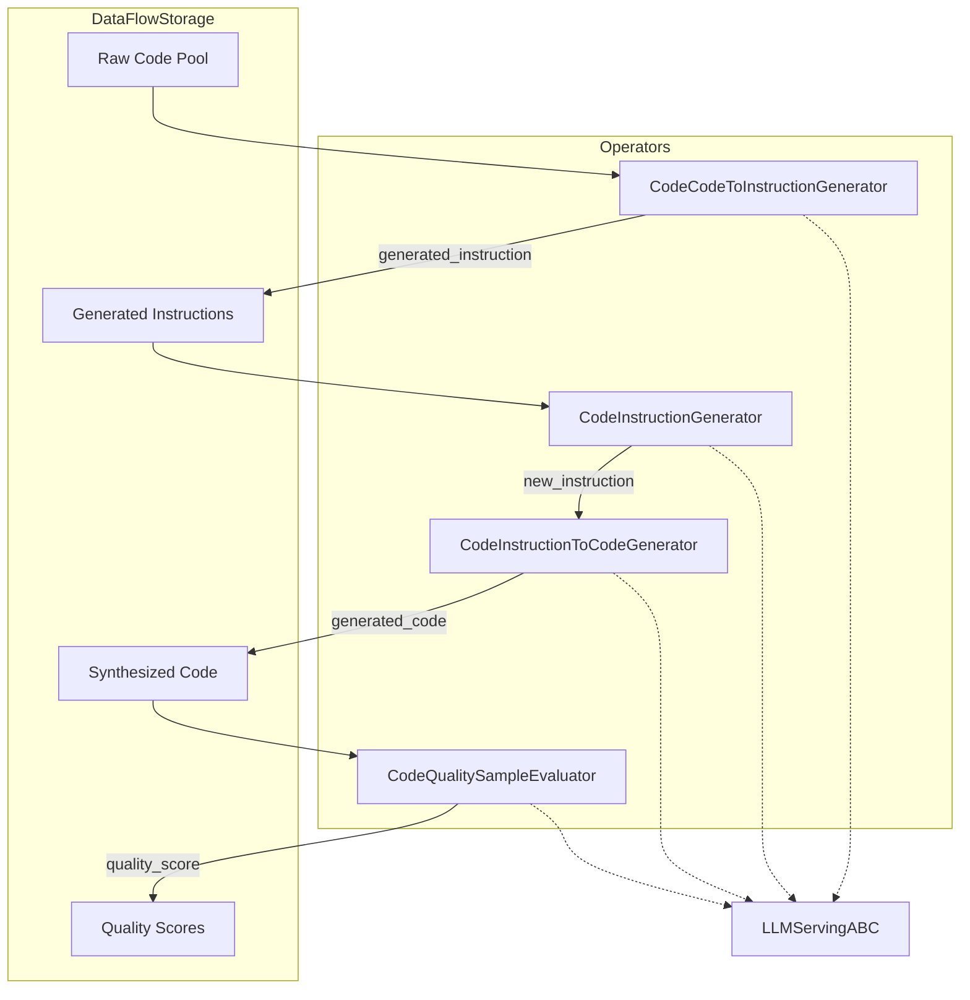

<!-- source: DeepWiki mcp.deepwiki.com · repo OpenDCAI/DataFlow · extra page Core Text and Code Operators · fetched 2026-11-02 -->

# Core Text and Code Operators

Relevant source files

The following files were used as context for generating this wiki page:

- [dataflow/operators/code/__init__.py](dataflow/operators/code/__init__.py)
- [dataflow/operators/code/eval/code_quality_sample_evaluator.py](dataflow/operators/code/eval/code_quality_sample_evaluator.py)
- [dataflow/operators/code/generate/code_code_to_instruction_generator.py](dataflow/operators/code/generate/code_code_to_instruction_generator.py)
- [dataflow/operators/code/generate/code_gen_instruction.py](dataflow/operators/code/generate/code_gen_instruction.py)
- [dataflow/operators/code/generate/code_instruction_to_code_generator.py](dataflow/operators/code/generate/code_instruction_to_code_generator.py)
- [dataflow/operators/core_text/__init__.py](dataflow/operators/core_text/__init__.py)
- [dataflow/operators/core_text/generate/chunked_prompted_generator.py](dataflow/operators/core_text/generate/chunked_prompted_generator.py)
- [dataflow/operators/core_text/generate/prompted_generator.py](dataflow/operators/core_text/generate/prompted_generator.py)
- [dataflow/operators/core_text/refine/pandas_operator.py](dataflow/operators/core_text/refine/pandas_operator.py)
- [dataflow/prompts/code.py](dataflow/prompts/code.py)
- [test/cpu_only/test_chunked_output_paths.py](test/cpu_only/test_chunked_output_paths.py)

This page details the implementation, data flow, and key classes for foundational generation operators within the DataFlow system. These operators handle raw text processing, embedding vector generation, dataframe transformations, and programming language synthesis using Large Language Models (LLMs).

---

## 1. Core Text Generation and Transformation Operators

Core text operators provide flexible utilities for mapping tabular data fields to LLM prompts, handling long-context documents, vectorizing data, and performing arbitrary pandas transformations.

### 1.1 PromptedGenerator
`PromptedGenerator` is a fundamental text generation operator that injects fixed system prompts and static user prompt prefixes into a target input column of a DataFrame [dataflow/operators/core_text/generate/prompted_generator.py:11-25]().

*   **Implementation**: It iterates over DataFrame rows, appends `raw_content` from `input_key` to `user_prompt`, and dispatches the batch to `llm_serving.generate_from_input()` [dataflow/operators/core_text/generate/prompted_generator.py:70-79]().
*   **Data Flow**: Reads a DataFrame from storage, maps input rows into text prompts, executes generation via `LLMServingABC`, and assigns outputs to `output_key` before writing back to storage [dataflow/operators/core_text/generate/prompted_generator.py:58-90]().

Sources: [dataflow/operators/core_text/generate/prompted_generator.py:11-90]()

### 1.2 ChunkedPromptedGenerator
Designed for long-context document processing, `ChunkedPromptedGenerator` automatically breaks inputs exceeding token thresholds into manageable pieces [dataflow/operators/core_text/generate/chunked_prompted_generator.py:12-19]().

*   **Recursive Bisection**: If a document's token count—measured via `tiktoken` or HuggingFace `AutoTokenizer`—exceeds `max_chunk_len`, it recursively splits the text [dataflow/operators/core_text/generate/chunked_prompted_generator.py:74-86]().
*   **Batching & Aggregation**: All chunks across all rows are gathered and processed in a single batch request to maximize serving throughput [dataflow/operators/core_text/generate/chunked_prompted_generator.py:100-124](). Responses are re-grouped per row and joined using a configurable `separator` [dataflow/operators/core_text/generate/chunked_prompted_generator.py:129-144]().

Sources: [dataflow/operators/core_text/generate/chunked_prompted_generator.py:12-147]()

### 1.3 FormatStrPromptedGenerator (PromptTemplatedGenerator)
This operator provides advanced template-based prompt construction using template engines, mapping multiple DataFrame columns to named template placeholders [dataflow/operators/core_text/__init__.py:6]().

*   **Template Resolution**: Iterates through rows, fetches values for fields specified in input keys, and renders prompts via template build interfaces.
*   **Type Restriction**: Enforced via prompt restrictions to guarantee compatibility with template base classes.

Sources: [dataflow/operators/core_text/__init__.py:1-30]()

### 1.4 EmbeddingGenerator
`EmbeddingGenerator` transforms textual fields into dense vector representations [dataflow/operators/core_text/__init__.py:10](). Registered under the core text operator namespace, it interfaces with embedding serving backends to produce vector embeddings for downstream retrieval, vector search, or clustering pipelines.

Sources: [dataflow/operators/core_text/__init__.py:1-30]()

### 1.5 PandasOperator
`PandasOperator` allows arbitrary, custom DataFrame manipulation steps within a pipeline using standard Python functions or lambda expressions [dataflow/operators/core_text/refine/pandas_operator.py:7-27]().

*   **Execution**: Iterates over a user-provided list of callables (`process_fn`), passing the DataFrame sequentially and validating that each function returns a modified `pd.DataFrame` [dataflow/operators/core_text/refine/pandas_operator.py:42-52]().

Sources: [dataflow/operators/core_text/refine/pandas_operator.py:7-52]()

---

## 2. Code Generation and Evaluation Operators

Code operators specialize in the "Self-Instruct" paradigm, synthesizing programming tasks, reverse-engineering instructions from source code, and executing automated code reviews.

### 2.1 CodeInstructionGenerator
A self-instruct operator that synthesizes novel programming instructions by sampling few-shot examples from an existing data pool [dataflow/operators/code/generate/code_gen_instruction.py:19-26]().

*   **Few-Shot Sampling**: Randomly selects `num_few_shot` samples from the DataFrame to provide stylistic and difficulty context [dataflow/operators/code/generate/code_gen_instruction.py:80-101]().
*   **Prompting**: Formats prompts using `CodeInstructionGeneratePrompt` and parses clean instruction strings from LLM responses [dataflow/operators/code/generate/code_gen_instruction.py:103-135]().

Sources: [dataflow/operators/code/generate/code_gen_instruction.py:19-175]()

### 2.2 CodeCodeToInstructionGenerator
Reverse-engineers human-readable programming instructions from raw code snippets, bootstrapping instruction-following datasets from existing code repositories [dataflow/operators/code/generate/code_code_to_instruction_generator.py:19-24]().

Sources: [dataflow/operators/code/generate/code_code_to_instruction_generator.py:1-131]()

### 2.3 CodeInstructionToCodeGenerator
The counterpart to instruction generation, this operator maps natural language programming tasks to executable code solutions, extracting clean code blocks from markdown fences [dataflow/operators/code/generate/code_instruction_to_code_generator.py:20-25]().

Sources: [dataflow/operators/code/generate/code_instruction_to_code_generator.py:1-136]()

### 2.4 CodeEnhancementInstructionGenerator
Standardizes and enhances raw instructions into structured formats containing clear directives and function signatures with docscripts or doctests [dataflow/operators/code/__init__.py:17]().

Sources: [dataflow/operators/code/__init__.py:1-42]()

### 2.5 CodeQualitySampleEvaluator
An "LLM-as-a-Judge" operator that reviews generated (instruction, code) pairs, outputting numerical quality scores and textual feedback parsed via regular expressions [dataflow/operators/code/eval/code_quality_sample_evaluator.py:20-128]().

Sources: [dataflow/operators/code/eval/code_quality_sample_evaluator.py:20-161]()

---

## 3. Architecture and Entity Mapping

The following diagrams bridge natural language generation concepts to concrete Python classes and track execution data flow across storage tiers.

### Diagram 1: Core Operator Class Hierarchy

Sources: [dataflow/operators/core_text/generate/prompted_generator.py:11-15](), [dataflow/operators/core_text/generate/chunked_prompted_generator.py:12-21](), [dataflow/operators/core_text/refine/pandas_operator.py:8-14](), [dataflow/operators/code/generate/code_gen_instruction.py:19-28]()

### Diagram 2: Code Synthesis and Evaluation Data Flow

Sources: [dataflow/operators/code/generate/code_code_to_instruction_generator.py:102-131](), [dataflow/operators/code/generate/code_gen_instruction.py:136-175](), [dataflow/operators/code/generate/code_instruction_to_code_generator.py:108-136](), [dataflow/operators/code/eval/code_quality_sample_evaluator.py:130-161]()

---

## 4. Summary Table of Operators

| Operator Class | Module Path | Primary Purpose | Key Parameters |
| :--- | :--- | :--- | :--- |
| `PromptedGenerator` | `core_text.generate` | Simple prompt-based generation | `system_prompt`, `user_prompt` |
| `ChunkedPromptedGenerator` | `core_text.generate` | Long-context chunked text generation | `max_chunk_len`, `separator` |
| `FormatStrPromptedGenerator` | `core_text.generate` | Multi-field templated generation | `prompt_template`, `input_keys` |
| `EmbeddingGenerator` | `core_text.generate` | Text vector embedding | `llm_serving` |
| `PandasOperator` | `core_text.refine` | Custom DataFrame transforms | `process_fn` |
| `CodeInstructionGenerator` | `code.generate` | Self-instruct task generation | `num_few_shot`, `num_generate` |
| `CodeQualitySampleEvaluator` | `code.eval` | Automated LLM code review | `prompt_template` |

Sources: [dataflow/operators/core_text/__init__.py:4-22](), [dataflow/operators/core_text/generate/prompted_generator.py:15-25](), [dataflow/operators/core_text/generate/chunked_prompted_generator.py:21-29](), [dataflow/operators/core_text/refine/pandas_operator.py:10-13](), [dataflow/operators/code/generate/code_gen_instruction.py:28-38](), [dataflow/operators/code/eval/code_quality_sample_evaluator.py:27-41]()

---

