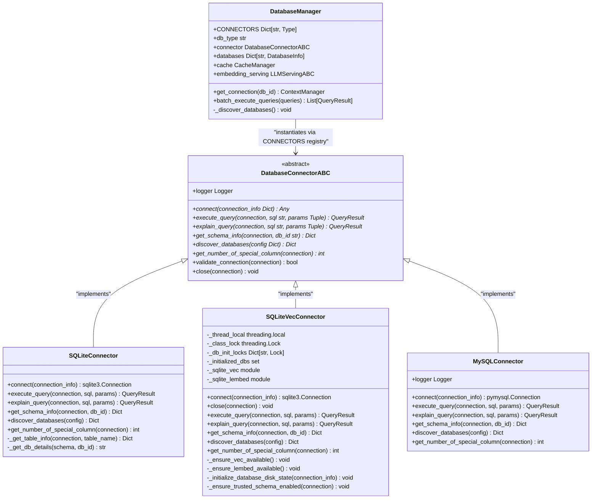
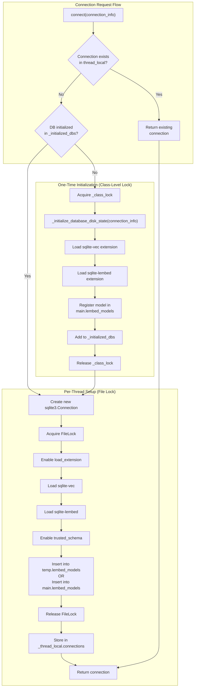
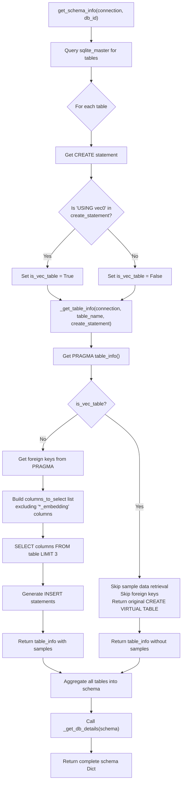
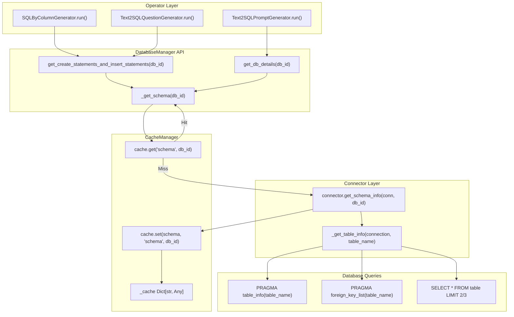

<!-- source: DeepWiki mcp.deepwiki.com · repo OpenDCAI/DataFlow · extra page Database Connectors · fetched 2026-11-02 -->

# Database Connectors

<details>
<summary>Relevant source files</summary>

The following files were used as context for generating this wiki page:

- [dataflow/operators/text2sql/eval/sql_execution_classifier.py](dataflow/operators/text2sql/eval/sql_execution_classifier.py)
- [dataflow/operators/text2sql/filter/sql_execution_filter.py](dataflow/operators/text2sql/filter/sql_execution_filter.py)
- [dataflow/operators/text2sql/generate/sql_generator.py](dataflow/operators/text2sql/generate/sql_generator.py)
- [dataflow/operators/text2sql/generate/sql_variation_generator.py](dataflow/operators/text2sql/generate/sql_variation_generator.py)
- [dataflow/operators/text2sql/generate/text2sql_cot_generator.py](dataflow/operators/text2sql/generate/text2sql_cot_generator.py)
- [dataflow/operators/text2sql/generate/text2sql_prompt_generator.py](dataflow/operators/text2sql/generate/text2sql_prompt_generator.py)
- [dataflow/operators/text2sql/generate/text2sql_question_generator.py](dataflow/operators/text2sql/generate/text2sql_question_generator.py)
- [dataflow/prompts/text2sql.py](dataflow/prompts/text2sql.py)
- [dataflow/statics/pipelines/api_pipelines/text2vecsql_pipeline_gen.py](dataflow/statics/pipelines/api_pipelines/text2vecsql_pipeline_gen.py)
- [dataflow/utils/text2sql/base.py](dataflow/utils/text2sql/base.py)
- [dataflow/utils/text2sql/database_connector/mysql_connector.py](dataflow/utils/text2sql/database_connector/mysql_connector.py)
- [dataflow/utils/text2sql/database_connector/sqlite_connector.py](dataflow/utils/text2sql/database_connector/sqlite_connector.py)
- [dataflow/utils/text2sql/database_connector/sqlite_vec_connector.py](dataflow/utils/text2sql/database_connector/sqlite_vec_connector.py)
- [dataflow/utils/text2sql/database_manager.py](dataflow/utils/text2sql/database_manager.py)

</details>


Database Connectors provide a unified abstraction layer for interacting with different database systems in DataFlow's Text2SQL workflows [dataflow/utils/text2sql/base.py:26-76](). Each connector implements a common interface for connection management, query execution, and schema extraction, enabling operators like `SQLGenerator` [dataflow/operators/text2sql/generate/sql_generator.py:19-25]() and `SQLExecutionFilter` [dataflow/operators/text2sql/filter/sql_execution_filter.py:13-15]() to work seamlessly across SQLite, SQLite-Vec (with vector embeddings and `lembed()` support) [dataflow/utils/text2sql/database_connector/sqlite_vec_connector.py:14-47](), and MySQL databases [dataflow/utils/text2sql/database_manager.py:92-98]().

For information about how these connectors are used by the `DatabaseManager` for parallel query execution and result comparison, see [3.6.2 Query Execution and Comparison](). For the overall database management architecture, see [3.6 Database Management]().

---

## Connector Architecture

All database connectors inherit from `DatabaseConnectorABC` defined in [dataflow/utils/text2sql/base.py:26-76](), which enforces a standard interface for database operations. The concrete implementations are registered in the `DatabaseManager.CONNECTORS` dictionary [dataflow/utils/text2sql/database_manager.py:92-98]().

**Connector Class Hierarchy and Registration**

Title: Database Connector Class Structure

Sources: [dataflow/utils/text2sql/base.py:26-76](), [dataflow/utils/text2sql/database_connector/sqlite_connector.py:12-113](), [dataflow/utils/text2sql/database_connector/sqlite_vec_connector.py:14-163](), [dataflow/utils/text2sql/database_manager.py:84-128]()

---

## Abstract Connector Interface

The `DatabaseConnectorABC` class defines six abstract methods that all concrete connectors must implement:

| Method | Purpose | Return Type |
|--------|---------|-------------|
| `connect()` | Establish connection to database [dataflow/utils/text2sql/base.py:33-35]() | Database-specific connection object |
| `execute_query()` | Execute SQL and return results [dataflow/utils/text2sql/base.py:37-41]() | `QueryResult` |
| `explain_query()` | Get query execution plan [dataflow/utils/text2sql/base.py:43-47]() | `QueryResult` |
| `get_schema_info()` | Extract complete schema information [dataflow/utils/text2sql/base.py:49-53]() | `Dict[str, Any]` |
| `discover_databases()` | Find available databases [dataflow/utils/text2sql/base.py:55-59]() | `Dict[str, DatabaseInfo]` |
| `get_number_of_special_column()` | Count columns with special semantics (e.g., embeddings) [dataflow/utils/text2sql/base.py:76]() | `int` |

Two additional non-abstract methods provide shared functionality:

- `validate_connection()`: Tests if a connection is still active by executing `SELECT 1` [dataflow/utils/text2sql/base.py:61-68]().
- `close()`: Safely closes a connection with error handling [dataflow/utils/text2sql/base.py:70-76]().

Sources: [dataflow/utils/text2sql/base.py:26-76]()

---

## Data Structures

### DatabaseInfo

Stores connection metadata for discovered databases:

```python
@dataclass
class DatabaseInfo:
    db_id: str                      # Unique identifier
    db_type: str                    # 'sqlite', 'sqlite-vec', or 'mysql'
    connection_info: Dict[str, Any] # Connector-specific parameters
    metadata: Dict[str, Any]        # Additional information (file path, size, etc.)
```
Sources: [dataflow/utils/text2sql/base.py:8-14]()

### QueryResult

Standardized format for all query results across all database connectors:

```python
@dataclass
class QueryResult:
    success: bool                    # Whether execution succeeded
    data: List[Dict[str, Any]]       # Result rows as dictionaries
    columns: List[str]               # Column names
    error: Optional[str]             # Error message if failed
    row_count: int                   # Number of rows returned
```
This structure enables uniform error handling and result processing across `DatabaseManager` batch execution methods [dataflow/utils/text2sql/base.py:17-23]().

Sources: [dataflow/utils/text2sql/base.py:17-23]()

---

## SQLite Connector

The `SQLiteConnector` provides standard SQLite database access with read-only enforcement and M-Schema generation.

### Connection Management

Connections are established with safety constraints:
- **Timeout**: 30-second connection timeout to prevent locking [dataflow/utils/text2sql/database_connector/sqlite_connector.py:16]().
- **Row Factory**: `sqlite3.Row` for dict-like access to query results [dataflow/utils/text2sql/database_connector/sqlite_connector.py:17]().
- **Read-Only Mode**: `PRAGMA query_only = ON` prevents unintended write operations during analysis [dataflow/utils/text2sql/database_connector/sqlite_connector.py:18]().

### Query Execution

The `execute_query()` method handles parameterized queries with defensive tuple wrapping and exception logging [dataflow/utils/text2sql/database_connector/sqlite_connector.py:21-58](). Results are converted into dictionaries using column metadata extracted from `cursor.description` [dataflow/utils/text2sql/database_connector/sqlite_connector.py:37-46]().

### Schema Extraction Formats

The connector generates schema information in multiple formats:
1. **DDL Format**: Retrieved directly from `sqlite_master` [dataflow/utils/text2sql/database_connector/sqlite_connector.py:97-108]().
2. **M-Schema Format**: Generated by `_get_db_details()` to structure table columns, types, nullability, primary keys, foreign keys, and sample rows for LLM prompt consumption [dataflow/utils/text2sql/database_connector/sqlite_connector.py:115-172]().

Sources: [dataflow/utils/text2sql/database_connector/sqlite_connector.py:12-181]()

---

## SQLiteVec Connector & Vector Databases with `lembed()` Support

The `SQLiteVecConnector` extends SQLite with vector similarity search capabilities via the `sqlite-vec` and `sqlite-lembed` extensions, supporting in-database model-based vector embedding generation through `lembed()` [dataflow/utils/text2sql/database_connector/sqlite_vec_connector.py:14-47]().

### Thread-Local Connection Architecture

Title: "SQLiteVecThreadSafeConnectionLifecycle"

Sources: [dataflow/utils/text2sql/database_connector/sqlite_vec_connector.py:48-163]()

**Key Components:**
1. **Thread-Local Storage**: Each thread maintains its own connection dictionary via `self._thread_local.connections` [dataflow/utils/text2sql/database_connector/sqlite_vec_connector.py:21, 60-63]().
2. **Class-Level Tracking**: `_initialized_dbs` tracks databases that have completed disk-level setup [dataflow/utils/text2sql/database_connector/sqlite_vec_connector.py:17, 68-72]().
3. **File Locking**: `FileLock` ensures process-safe access during extension loading [dataflow/utils/text2sql/database_connector/sqlite_vec_connector.py:90-94]().

### Extension Loading and `lembed()` Support

The connector lazy-loads `sqlite_vec` and `sqlite_lembed` [dataflow/utils/text2sql/database_connector/sqlite_vec_connector.py:24-46](). When enabled via configuration (`enable_lembed`), it integrates model files (such as GGUF embedding models) directly into SQLite via `lembed_model_from_file()`, registering them into `main.lembed_models` or `temp.lembed_models` [dataflow/utils/text2sql/database_connector/sqlite_vec_connector.py:105-112, 151-159](). This allows executing SQL queries containing `lembed('model_name', 'text')` expressions to dynamically calculate embeddings in-database.

### Schema Extraction with Vector Tables

The `SQLiteVecConnector.get_schema_info()` method detects virtual vector tables by checking for `USING vec0` in CREATE statements [dataflow/utils/text2sql/database_connector/sqlite_vec_connector.py:472, 488]().

Title: "SQLiteVecVectorTableSchemaDetection"

Sources: [dataflow/utils/text2sql/database_connector/sqlite_vec_connector.py:426-545]()

---

## MySQL Connector

The `MySQLConnector` provides enterprise MySQL connectivity with transaction safety. It enforces read-only access via `SET SESSION TRANSACTION READ ONLY` [dataflow/utils/text2sql/database_connector/mysql_connector.py:30]() and uses `pymysql.cursors.DictCursor` for dictionary results [dataflow/utils/text2sql/database_connector/mysql_connector.py:22](). It extracts schema details from `information_schema.columns` and `information_schema.key_column_usage` [dataflow/utils/text2sql/database_connector/mysql_connector.py:123-168]().

Sources: [dataflow/utils/text2sql/database_connector/mysql_connector.py:9-168]()

---

## Schema Information Flow

**Schema Extraction and Caching Architecture:**

Title: "DatabaseSchemaCachingFlow"

Sources: [dataflow/utils/text2sql/database_manager.py:19-80, 315-355](), [dataflow/utils/text2sql/database_connector/sqlite_connector.py:93-187]()

**Cache Behavior:**

| Component | Class | TTL | Max Size |
|-----------|-------|-----|----------|
| `CacheManager` | `CacheManager` [dataflow/utils/text2sql/database_manager.py:19-27]() | 1800s | 100 entries |

Sources: [dataflow/utils/text2sql/database_manager.py:19-81]()

---

## Usage in Pipelines

The `Text2VecSQLGeneration_APIPipeline` demonstrates connector configuration within end-to-end vector SQL generation pipelines [dataflow/statics/pipelines/api_pipelines/text2vecsql_pipeline_gen.py:61-127]():

```python
database_manager = DatabaseManager(
    db_type="sqlite-vec",
    config={
        "root_path": self.db_root_path,
        "model_name": "all-MiniLM-L6-v2",
        "model_path": "./hf_cache/all-MiniLM-L6-v2.e4ce9877.q8_0.gguf",
        "enable_lembed": False
    },
    embedding_serving=embedding_serving
)
```

**Configuration Parameter Mapping:**

| Parameter | Purpose | Used By |
|-----------|---------|---------|
| `root_path` | Directory to search for database files | `DatabaseManager._discover_databases()` [dataflow/utils/text2sql/database_manager.py:125-127]() |
| `model_name` | Identifier for embedding model | `SQLiteVecConnector.connect()` [dataflow/utils/text2sql/database_connector/sqlite_vec_connector.py:84, 105-112]() |
| `enable_lembed` | Toggle in-database embedding via `lembed()` | `SQLiteVecConnector.connect()` [dataflow/utils/text2sql/database_connector/sqlite_vec_connector.py:86, 98-101]() |

Sources: [dataflow/statics/pipelines/api_pipelines/text2vecsql_pipeline_gen.py:118-127](), [dataflow/utils/text2sql/database_connector/sqlite_vec_connector.py:48-163](), [dataflow/utils/text2sql/database_manager.py:100-127]()

---

