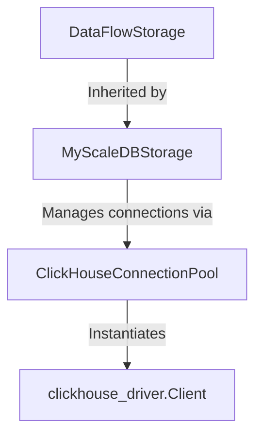
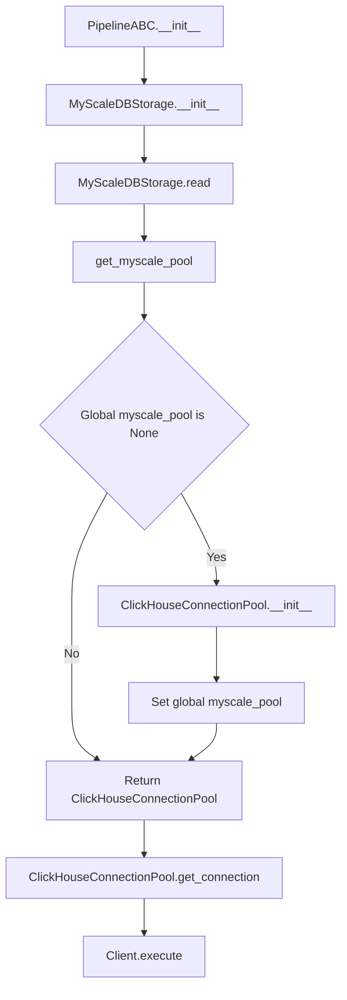
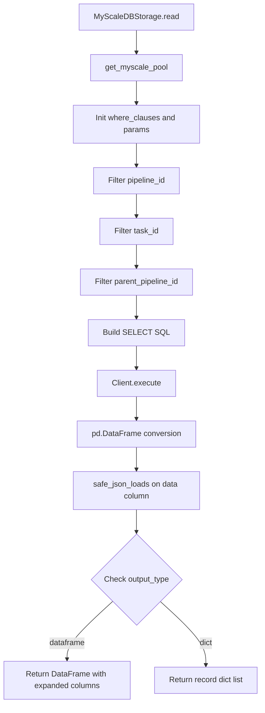
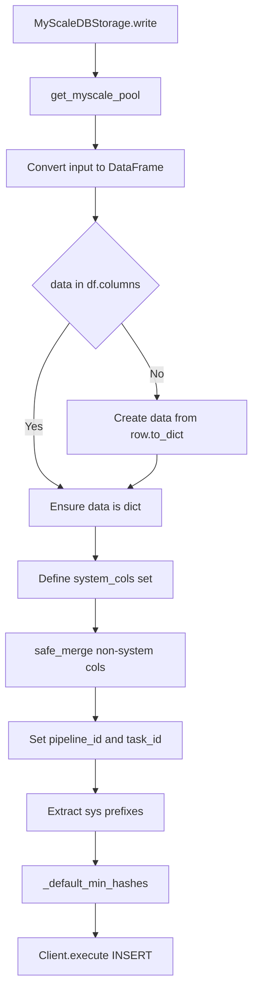
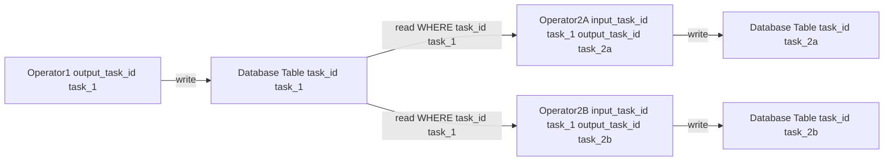

<!-- source: DeepWiki mcp.deepwiki.com · repo OpenDCAI/DataFlow · extra page Database Storage · fetched 2026-11-02 -->

# Database Storage

<details>
<summary>Relevant source files</summary>

The following files were used as context for generating this wiki page:

- [dataflow/pipeline/Pipeline.py](dataflow/pipeline/Pipeline.py)
- [dataflow/pipeline/__init__.py](dataflow/pipeline/__init__.py)
- [dataflow/pipeline/nodes.py](dataflow/pipeline/nodes.py)
- [dataflow/utils/db_pool/__init__.py](dataflow/utils/db_pool/__init__.py)
- [dataflow/utils/db_pool/myscale_pool.py](dataflow/utils/db_pool/myscale_pool.py)
- [dataflow/utils/storage.py](dataflow/utils/storage.py)
- [test/cpu_only/test_lazy_file_storage_flush.py](test/cpu_only/test_lazy_file_storage_flush.py)
- [test/cpu_only/test_remote_batch_slicing.py](test/cpu_only/test_remote_batch_slicing.py)
- [test/test_batched_pipeline.py](test/test_batched_pipeline.py)
- [test/test_batched_stream_pipeline.py](test/test_batched_stream_pipeline.py)
- [test/test_read_xlsx.py](test/test_read_xlsx.py)

</details>


This page documents `MyScaleDBStorage`, a ClickHouse/MyScale-backed storage implementation for DataFlow pipelines. Unlike file-based storage which writes to local disk, `MyScaleDBStorage` persists pipeline data and metadata to a database with explicit pipeline lineage tracking using connection pooling via `ClickHouseConnectionPool`.

For file-based storage implementations (`FileStorage`, `LazyFileStorage`, `BatchedFileStorage`), see page 3.5.1.

---

## Overview and Class Architecture

`MyScaleDBStorage` stores pipeline data in ClickHouse or MyScale databases, tracking pipeline provenance through `pipeline_id`, `task_id`, and `parent_pipeline_id` fields. User data is stored in a JSON `data` column, while system metadata occupies dedicated columns.

**Key Characteristics**:
- Implements the `DataFlowStorage` abstract base class [dataflow/utils/storage.py:14-36]().
- Connection pooling managed via global pool singletons and `get_myscale_pool()` [dataflow/utils/storage.py:704-719]().
- Page-based data retrieval utilizing `page_size` and `page_num` parameters [dataflow/utils/storage.py:832-833]().
- System field extraction using the `sys:` prefix convention [dataflow/utils/storage.py:721-727]().
- Automatic merging of non-system columns into the `data` JSON field [dataflow/utils/storage.py:880-884]().

**Diagram: System-to-Code Mapping for Storage and Connection Classes**

Sources: [dataflow/utils/storage.py:14-36](), [dataflow/utils/storage.py:704-719](), [dataflow/utils/db_pool/myscale_pool.py:11-37]()

---

## Connection Management and Pool Lifecycle

### Connection Pool Implementation
The `ClickHouseConnectionPool` manages a thread-safe pool of `clickhouse_driver.Client` instances [dataflow/utils/db_pool/myscale_pool.py:1-62](). It supports dynamic scaling between `min_connections` and `max_connections` [dataflow/utils/db_pool/myscale_pool.py:26-27]() and features a health check mechanism using `SELECT 1` via `_is_connection_alive()` to drop stale connections [dataflow/utils/db_pool/myscale_pool.py:76-81]().

**Diagram: Connection Acquisition and Lifecycle Flow**


**Global Singleton Pattern**: The module-level variable `myscale_pool` [dataflow/utils/storage.py:705]() is initialized as `None`. The `get_myscale_pool(db_config)` function checks this variable and instantiates a `ClickHouseConnectionPool` only on first access [dataflow/utils/storage.py:707-719](), ensuring all `MyScaleDBStorage` instances sharing identical database configurations leverage the same connection pool.

**Validation Gate**: Before executing database interactions, operators invoke `storage.validate_required_params()` [dataflow/utils/storage.py:757-776](), which asserts that `pipeline_id`, `input_task_id`, and `output_task_id` are populated, while assigning default values for `page_size` (10000) and `page_num` (0) if unassigned.

Sources: [dataflow/utils/storage.py:704-719](), [dataflow/utils/storage.py:757-776](), [dataflow/utils/db_pool/myscale_pool.py:11-31](), [dataflow/utils/db_pool/myscale_pool.py:83-104](), [dataflow/pipeline/Pipeline.py:18-35]()

---

## Data Model and Field Organization

### Database Schema

`MyScaleDBStorage` relies on a denormalized database schema utilizing a JSON `data` column alongside dedicated metadata columns [dataflow/utils/storage.py:860-897]():

| Column | Type | Populated From | Default |
|--------|------|----------------|---------|
| `pipeline_id` | String | `self.pipeline_id` | Required (validated) |
| `task_id` | String | `self.output_task_id` | Required (validated) |
| `raw_data_id` | Integer | `data['sys:raw_data_id']` | 0 |
| `parent_pipeline_id` | String | `data['sys:parent_pipeline_id']` or `self.parent_pipeline_id` | Empty string |
| `file_id` | String | `data['sys:file_id']` | Empty string |
| `filename` | String | `data['sys:filename']` | Empty string |
| `min_hashes` | Array[Int] | `_default_min_hashes(data)` | `[0]` |
| `data` | JSON/String | All user fields merged | Required |

### Field Prefix Convention

Module-level constants define field categorizations [dataflow/utils/storage.py:721-727]():

```python
SYS_FIELD_PREFIX = 'sys:'       # System metadata fields
USER_FIELD_PREFIX = 'user:'     # User data fields (reserved)

RESERVED_SYS_FIELD_LIST = ["raw_data_id"]
RESERVED_USER_FIELD_LIST = []
```

**System Field Extraction**: During `write()`, dictionary fields prefixed with `sys:` within the `data` payload are extracted into designated table columns:
- `data['sys:raw_data_id']` maps to `raw_data_id` [dataflow/utils/storage.py:888]().
- `data['sys:file_id']` maps to `file_id` [dataflow/utils/storage.py:891]().
- `data['sys:filename']` maps to `filename` [dataflow/utils/storage.py:892]().
- `data['sys:parent_pipeline_id']` maps to `parent_pipeline_id` [dataflow/utils/storage.py:893]().

Sources: [dataflow/utils/storage.py:721-727](), [dataflow/utils/storage.py:860-897]()

---

## Read Operations

### SQL Query Construction

The `read(output_type)` method [dataflow/utils/storage.py:815-858]() constructs parameterized SQL queries dynamically:

**Diagram: Read Query Flow**


**Pagination**: The database offset is computed as `(page_num - 1) * page_size` [dataflow/utils/storage.py:832-833](), treating `page_num` as 1-indexed.

**Data Column Parsing**: `safe_json_loads()` [dataflow/utils/storage.py:730-740]() handles JSON string deserialization, dictionaries, and null/NaN values safely.

**DataFrame Expansion**: For `output_type='dataframe'`, if the deserialized `data` entries are dictionaries, they are expanded into columns using `data_series.apply(pd.Series)` [dataflow/utils/storage.py:850]() and concatenated back into the main DataFrame [dataflow/utils/storage.py:852]().

Sources: [dataflow/utils/storage.py:815-858](), [dataflow/utils/storage.py:730-740]()

---

## Write Operations

### Data Normalization and Column Merging

The `write(data)` method [dataflow/utils/storage.py:860-897]() processes records through normalization pipelines:

**Diagram: Write Data Flow**


**safe_merge Helper**: Merges arbitrary non-system columns into the central `data` dictionary [dataflow/utils/storage.py:743-747]() while preventing overwrites if column values evaluate to `NaN`.

**_default_min_hashes**: A placeholder utility function returning `[0]` across records [dataflow/utils/storage.py:750-751]().

Sources: [dataflow/utils/storage.py:860-897](), [dataflow/utils/storage.py:743-747](), [dataflow/utils/storage.py:750-751]()

---

## Integration with Pipeline System

### Task-Based Data Flow

Unlike file-based storage which relies on an incrementing `operator_step` counter [dataflow/utils/storage.py:70-153](), `MyScaleDBStorage` relies on explicit `task_id` strings to track lineage.

**Comparison**:

| Storage Type | Lineage Tracking | Data Access Pattern |
|--------------|------------------|---------------------|
| `FileStorage` | `operator_step` [dataflow/utils/storage.py:70]() | Sequential file reads: `step_0.jsonl`, `step_1.jsonl` |
| `MyScaleDBStorage` | `task_id` [dataflow/utils/storage.py:782]() | Query-based reads: `WHERE task_id = input_task_id` |

**Diagram: Pipeline Task Lineage Routing**


This database architecture enables branching pipelines where multiple downstream operators can concurrently read from a shared source `task_id` without requiring linear step increments.

Sources: [dataflow/utils/storage.py:815-897](), [dataflow/utils/db_pool/myscale_pool.py:11-31](), [dataflow/utils/storage.py:70-153]()

---

