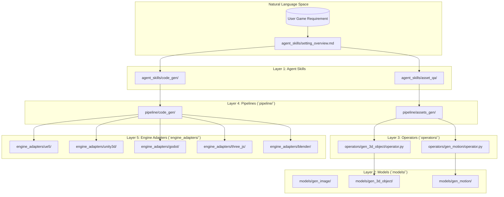

<!-- source: DeepWiki mcp.deepwiki.com · repo OpenDCAI/GameFactory-3A · page 1 Overview · fetched 2026-11-02 -->

# Overview

Relevant source files

The following files were used as context for generating this wiki page:

- [LICENSE](LICENSE)
- [README.md](README.md)
- [README_zh.md](README_zh.md)
- [agent_skills/engine_context/blender_api.md](agent_skills/engine_context/blender_api.md)
- [agent_skills/setting_overview.md](agent_skills/setting_overview.md)
- [engine_adapters/README.md](engine_adapters/README.md)
- [engine_adapters/blender/__init__.py](engine_adapters/blender/__init__.py)
- [engine_adapters/blender/runtime/assets/actions.py](engine_adapters/blender/runtime/assets/actions.py)
- [models/README.md](models/README.md)
- [models/gen_audio/__init__.py](models/gen_audio/__init__.py)
- [operators/README.md](operators/README.md)
- [operators/gen_audio/__init__.py](operators/gen_audio/__init__.py)
- [operators/gen_audio/funcs/__init__.py](operators/gen_audio/funcs/__init__.py)
- [pipeline/README.md](pipeline/README.md)
- [pipeline/assets_gen/gen_audio/__init__.py](pipeline/assets_gen/gen_audio/__init__.py)
- [pipeline/common/paths.py](pipeline/common/paths.py)
- [test/harness/smoke.py](test/harness/smoke.py)
- [test/test_3D_scene_gen.py](test/test_3D_scene_gen.py)
- [test_data/outputs/README.md](test_data/outputs/README.md)
- [test_data/test_samples/README.md](test_data/test_samples/README.md)
- [test_data/test_samples/audio_gen_collect.jsonl](test_data/test_samples/audio_gen_collect.jsonl)
- [third_party/README.md](third_party/README.md)

3AGameFactory is an open-source framework that transforms natural-language game requirements into production-ready game assets and engine-ready game code via coding agents [README.md:15-20](). It covers multi-modality asset generation (images, 3D objects, 3D scenes, motion, audio, and CG video) and game construction across five supported engines: **Unreal Engine 5 (UE5), Blender, Unity, Godot 4, and three.js** [README.md:15-20]().

The system bridges **Natural Language Space** (user briefs and agent guidance) to **Code Entity Space** (Python operators, pipeline runners, model wrappers, and engine clients) [agent_skills/setting_overview.md:1-13](). 

Sources: `README.md:15-20`, `agent_skills/setting_overview.md:1-13`

---

## Architecture & Core Layers

3AGameFactory organizes its codebase into distinct functional layers separating agent instruction, raw model wrappers, task operators, pipeline orchestrators, and engine abstraction layers.

*Figure 1: Architectural progression from natural-language prompts to execution across pipeline runners, operators, model wrappers, and engine adapters.*

Sources: `README.md:15-20`, `models/README.md:1-13`, `operators/README.md:1-13`, `pipeline/README.md:1-11`, `engine_adapters/README.md:1-21`

---

## Core Layers Summary

1. **Agent Skills Layer (`agent_skills/`)** — Entry points, prompt templates, and routing guides (`setting_overview.md`) used by coding agents such as Claude Code or Codex to execute generation tasks [agent_skills/setting_overview.md:1-13]().
2. **Models Layer (`models/`)** — Thin wrappers providing a uniform `load()`, `infer()`, `unload()` lifecycle for local weight models and cloud APIs [models/README.md:1-7]().
3. **Operators Layer (`operators/`)** — Task-specific processing logic (`operator.py`, `funcs/`, `metrics/`) for modalities like 3D objects, motion, and scene reconstruction [operators/README.md:1-18]().
4. **Pipelines Layer (`pipeline/`)** — Execution runners (`run.py`, `eval.py`) divided into asset generation (`pipeline/assets_gen/`) and code generation (`pipeline/code_gen/`) [pipeline/README.md:1-30]().
5. **Engine Adapters Layer (`engine_adapters/`)** — Headless and editor-based transport clients (`UEClient`, `UnityClient`, `GodotClient`, `ThreeClient`, `BlenderClient`) and runtime plugins (`A3GamePlayable`, `A3GameRuntime`) [engine_adapters/README.md:1-35]().

Sources: `agent_skills/setting_overview.md:1-13`, `models/README.md:1-7`, `operators/README.md:1-18`, `pipeline/README.md:1-30`, `engine_adapters/README.md:1-35`

---

## Child Pages

For granular technical documentation, refer to the child pages below:

* **1.1 Getting Started & Environment Setup** — For installing engines, asset environments via `scripts/engine_install` and `scripts/asset_env_setup`, downloading weights, configuring cloud API keys, and executing smoke tests (`test/harness/smoke.py`).
* **1.2 Repository Layout & Core Conventions** — For structural separation between `models/`, `operators/`, `pipeline/`, and `engine_adapters/`, definitions of `game_id`, `run_id`, `task_id`, Layer A/B/C output trees, and `AAAGF_OUTPUT_ROOT`.
* **1.3 Path Resolution & Task Data Contracts** — For APIs in `pipeline/common/paths.py`, JSONL task formats, `test_data/test_samples` layouts, and summary artifacts (`meta.json`, `run_meta.json`, `results`).

Sources: `test/harness/smoke.py:1-30`, `pipeline/common/paths.py:1-39`, `test_data/test_samples/README.md:1-15`

---

