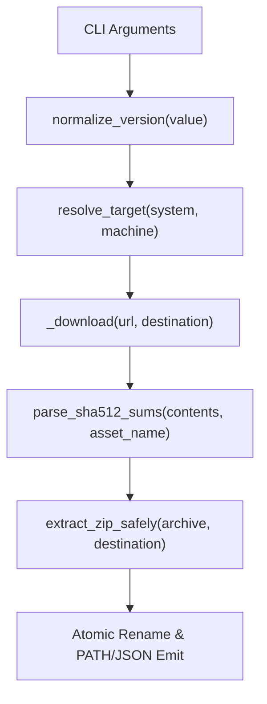
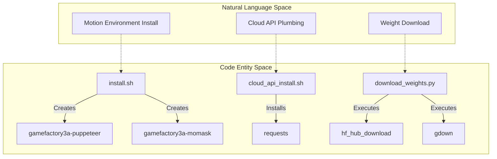

<!-- source: DeepWiki mcp.deepwiki.com · repo OpenDCAI/GameFactory-3A · page 1.1 Getting Started & Environment Setup · fetched 2026-11-02 -->

# Getting Started & Environment Setup

<details>
<summary>Relevant source files</summary>

The following files were used as context for generating this wiki page:

- [agent_skills/asset_qa/motion/SKILL.md](agent_skills/asset_qa/motion/SKILL.md)
- [scripts/asset_env_setup/README.md](scripts/asset_env_setup/README.md)
- [scripts/asset_env_setup/cloud_api_install.sh](scripts/asset_env_setup/cloud_api_install.sh)
- [scripts/asset_env_setup/gen_motion/download_weights.py](scripts/asset_env_setup/gen_motion/download_weights.py)
- [scripts/asset_env_setup/gen_motion/install.sh](scripts/asset_env_setup/gen_motion/install.sh)
- [scripts/asset_env_setup/gen_motion/runtime_env.sh](scripts/asset_env_setup/gen_motion/runtime_env.sh)
- [scripts/asset_env_setup/image/cloud_api_install.sh](scripts/asset_env_setup/image/cloud_api_install.sh)
- [scripts/asset_env_setup/image/qwen_image_install.sh](scripts/asset_env_setup/image/qwen_image_install.sh)
- [scripts/engine_install/README.md](scripts/engine_install/README.md)
- [scripts/engine_install/blender/README.md](scripts/engine_install/blender/README.md)
- [scripts/engine_install/blender/install.sh](scripts/engine_install/blender/install.sh)
- [scripts/engine_install/godot/README.md](scripts/engine_install/godot/README.md)
- [scripts/engine_install/godot/install.py](scripts/engine_install/godot/install.py)
- [scripts/engine_install/unity/README.md](scripts/engine_install/unity/README.md)
- [test/test_godot_adapter.py](test/test_godot_adapter.py)
- [test/test_godot_installer.py](test/test_godot_installer.py)

</details>


## Purpose and Scope
This page details the environment bootstrapping procedures for GameFactory-3A, covering automated engine installation scripts (`scripts/engine_install`), asset model environment provisioning and weight downloads (`scripts/asset_env_setup`), cloud API key configuration, and execution of initial verification smoke tests.

Sources: `scripts/engine_install/README.md:1-12` [scripts/engine_install/README.md:1-12](), `scripts/asset_env_setup/README.md:1-16` [scripts/asset_env_setup/README.md:1-16]()

---

## 1. Automated Engine Installation (`scripts/engine_install`)

GameFactory-3A provides isolated, non-interactive installation tools for engine runtimes under `scripts/engine_install/` [scripts/engine_install/README.md:1-6](). For Godot 4, the installer script `scripts/engine_install/godot/install.py` [scripts/engine_install/godot/install.py:1-29] handles exact stable version normalization, target resolution across platforms, SHA-512 cryptographic verification, and atomic extraction.

The version selection is strictly pinned (defaulting to `4.5.1-stable`) to prevent silent behavioral drift across generation runs [scripts/engine_install/godot/README.md:7-9](). The `normalize_version` function [scripts/engine_install/godot/install.py:55-67]() validates input tags, while `resolve_target` [scripts/engine_install/godot/install.py:74-138]() maps operating system and hardware architecture strings to official release archive labels. Integrity enforcement is handled by `parse_sha512_sums` [scripts/engine_install/godot/install.py:198-202](), which parses official checksum manifests.

For Unreal Engine 5 and Unity, setup checklists and prerequisites (such as enabling the Python Editor Script Plugin or adding `com.unity.cloud.gltfast`) are detailed in `scripts/engine_install/README.md` [scripts/engine_install/README.md:13-44]().

### Diagram: Godot Installation Control Flow

Sources: `scripts/engine_install/godot/install.py:55-202` [scripts/engine_install/godot/install.py:55-202](), `scripts/engine_install/README.md:13-64` [scripts/engine_install/README.md:13-64]()

---

## 2. Asset Model Environment Provisioning (`scripts/asset_env_setup`)

Asset generation environments are segregated by modality under `scripts/asset_env_setup/` [scripts/asset_env_setup/README.md:1-16](). Cloud-backed wrappers utilize lightweight HTTP clients via `scripts/asset_env_setup/cloud_api_install.sh` [scripts/asset_env_setup/cloud_api_install.sh:1-13](), requiring no compiled binaries or local GPUs.

For heavy local inference tasks like human motion, `scripts/asset_env_setup/gen_motion/install.sh` [scripts/asset_env_setup/gen_motion/install.sh:1-36]() establishes pinned Conda environments (`gamefactory3a-puppeteer`, `gamefactory3a-momask`, and `gamefactory3a-retarget-bpy`), clones external repositories (Puppeteer and MoMask) at exact commits, and builds required custom extensions. Weight checkpoints are fetched via `scripts/asset_env_setup/gen_motion/download_weights.py` [scripts/asset_env_setup/gen_motion/download_weights.py:11-33](), and runtime shell variables are exported through `scripts/asset_env_setup/gen_motion/runtime_env.sh` [scripts/asset_env_setup/gen_motion/runtime_env.sh:1-34]().

### Diagram: Asset Environment and Weight Architecture

Sources: `scripts/asset_env_setup/gen_motion/install.sh:1-150` [scripts/asset_env_setup/gen_motion/install.sh:1-150](), `scripts/asset_env_setup/gen_motion/download_weights.py:11-121` [scripts/asset_env_setup/gen_motion/download_weights.py:11-121](), `scripts/asset_env_setup/cloud_api_install.sh:1-36` [scripts/asset_env_setup/cloud_api_install.sh:1-36]()

---

## 3. Cloud API Keys & Authentication Plumbing

Cloud-backed model wrappers rely on specific environment variables for authentication. Once `scripts/asset_env_setup/cloud_api_install.sh` has provisioned the required `requests` library [scripts/asset_env_setup/cloud_api_install.sh:23-31](), keys must be exported in the shell session [scripts/asset_env_setup/cloud_api_install.sh:38-44]():

| Environment Variable | Target Backend Services | Configuration Reference |
|---|---|---|
| `TRIPO_API_KEY` | Tripo 3D mesh and rigging models (`TripoModel`) [scripts/asset_env_setup/cloud_api_install.sh:39]() | `https://platform.tripo3d.ai/api-keys` [scripts/asset_env_setup/cloud_api_install.sh:39]() |
| `MESHY_API_KEY` | Meshy 3D generation wrappers (`MeshyModel`) [scripts/asset_env_setup/cloud_api_install.sh:40]() | `https://www.meshy.ai/api` [scripts/asset_env_setup/cloud_api_install.sh:40]() |
| `SEED_AUDIO_API_KEY` | ByteDance SeedAudio TTS/speech backend [scripts/asset_env_setup/cloud_api_install.sh:41]() | `https://openspeech.bytedance.com` [scripts/asset_env_setup/cloud_api_install.sh:41]() |
| `ARK_API_KEY` | Volcengine / Seedream image models [scripts/asset_env_setup/cloud_api_install.sh:42]() | `https://console.volcengine.com/ark` [scripts/asset_env_setup/cloud_api_install.sh:42]() |
| `MINIMAX_API_KEY` | MiniMax video generation and CG backends [scripts/asset_env_setup/cloud_api_install.sh:43]() | `https://platform.minimax.io` [scripts/asset_env_setup/cloud_api_install.sh:43]() |

Sources: `scripts/asset_env_setup/cloud_api_install.sh:23-57` [scripts/asset_env_setup/cloud_api_install.sh:23-56]()

---

## 4. Running First Smoke Tests

To verify that the environment and API credentials are functional without consuming generation credits or invoking active GPU loads, developers run the CPU-only smoke harness [scripts/asset_env_setup/cloud_api_install.sh:45-46]() and unit test suites [scripts/asset_env_setup/cloud_api_install.sh:47-51]().

```bash
# Verify cloud API connectivity and basic model wiring
python test/harness/smoke.py --kind 3d_object --backend tripo
python test/test_api_3d_object.py
python test/harness/smoke.py --kind tpose --backend seedream
python test/test_api_gen_tpose_image.py

# Query account balances programmatically
python -c "from models.gen_3d_object import TripoModel; print(TripoModel().balance())"
```

Additionally, automated installation routines are validated via standalone unit tests such as `test/test_godot_installer.py` [test/test_godot_installer.py:1-86](), which asserts version mappings, checksum parsers, and safe extraction constraints.

Sources: `scripts/asset_env_setup/cloud_api_install.sh:45-57` [scripts/asset_env_setup/cloud_api_install.sh:45-56](), `test/test_godot_installer.py:31-86` [test/test_godot_installer.py:31-86]()

---

