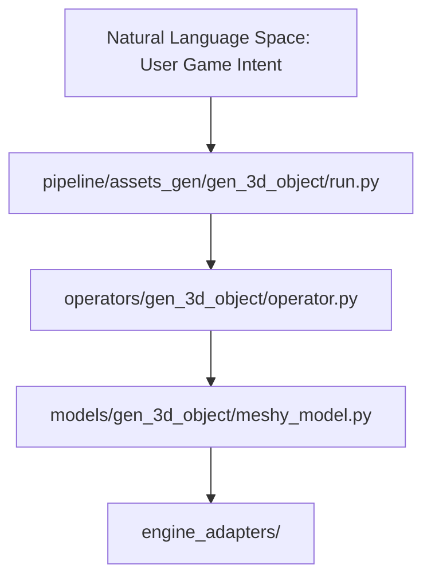
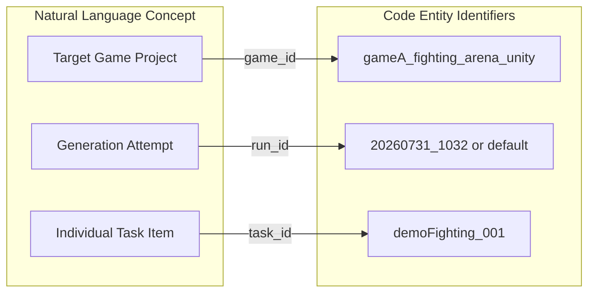
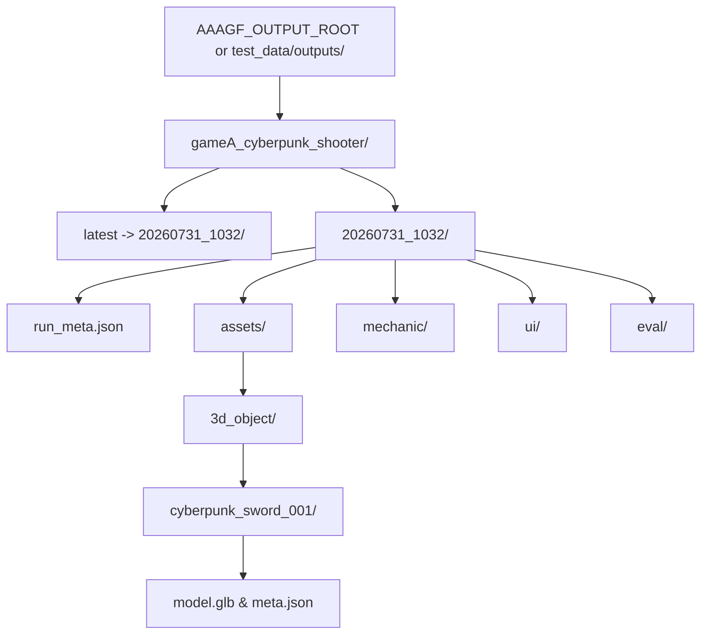

<!-- source: DeepWiki mcp.deepwiki.com · repo OpenDCAI/GameFactory-3A · page 1.2 Repository Layout & Core Conventions · fetched 2026-11-02 -->

# Repository Layout & Core Conventions

<details>
<summary>Relevant source files</summary>

The following files were used as context for generating this wiki page:

- [.gitignore](.gitignore)
- [LICENSE](LICENSE)
- [README.md](README.md)
- [README_zh.md](README_zh.md)
- [models/README.md](models/README.md)
- [models/gen_audio/__init__.py](models/gen_audio/__init__.py)
- [operators/README.md](operators/README.md)
- [operators/gen_audio/__init__.py](operators/gen_audio/__init__.py)
- [operators/gen_audio/funcs/__init__.py](operators/gen_audio/funcs/__init__.py)
- [pipeline/README.md](pipeline/README.md)
- [pipeline/assets_gen/gen_audio/__init__.py](pipeline/assets_gen/gen_audio/__init__.py)
- [pipeline/common/paths.py](pipeline/common/paths.py)
- [test/harness/smoke.py](test/harness/smoke.py)
- [test_data/outputs/README.md](test_data/outputs/README.md)
- [test_data/outputs/gameA_cyberpunk_shooter/default/assets/.gitkeep](test_data/outputs/gameA_cyberpunk_shooter/default/assets/.gitkeep)
- [test_data/outputs/gameA_cyberpunk_shooter/default/mechanic/.gitkeep](test_data/outputs/gameA_cyberpunk_shooter/default/mechanic/.gitkeep)
- [test_data/outputs/gameA_cyberpunk_shooter/default/ui/.gitkeep](test_data/outputs/gameA_cyberpunk_shooter/default/ui/.gitkeep)
- [test_data/test_samples/README.md](test_data/test_samples/README.md)
- [test_data/test_samples/audio_gen_collect.jsonl](test_data/test_samples/audio_gen_collect.jsonl)
- [third_party/README.md](third_party/README.md)

</details>


## Purpose & Scope

This page defines the structural organization, architectural separation boundaries, and naming conventions of the `3AGameFactory` codebase. It establishes how code modules are compartmentalized (`models/`, `operators/`, `pipeline/`, `engine_adapters/`), how execution states and assets are identified (`game_id`, `run_id`, `task_id`), and how the output artifact tree is structured around `AAAGF_OUTPUT_ROOT` via `pipeline/common/paths.py`.

Sources: `pipeline/common/paths.py:1-40`, `test_data/outputs/README.md:1-47`

---

## Core Architectural Separation

The codebase separates concerns into four primary tiers, preventing tight coupling between raw AI backends, task execution logic, end-to-end orchestration, and target engine implementations.



Sources: `models/README.md:1-12`, `operators/README.md:1-13`, `pipeline/README.md:1-30`

### Directory Breakdown

| Directory | Role & Responsibilities | Key Files / Modules |
| :--- | :--- | :--- |
| `models/` | Thin, uniform wrappers around AI models. Exposes standard lifecycle hooks (`load()`, `infer()`, `unload()`). | `models/gen_3d_object/meshy_model.py`, `models/common/cloud_api.py` [models/README.md:1-12]() |
| `operators/` | Domain-specific task logic. Each operator contains sub-steps (`funcs/`) and evaluation metrics (`metrics/`). | `operators/gen_3d_object/operator.py`, `operators/gen_3d_object/funcs/` [operators/README.md:1-13]() |
| `pipeline/` | End-to-end task runners and batch job drivers (`run.py` / `eval.py`), separated into assets and code generation. | `pipeline/common/paths.py`, `pipeline/assets_gen/gen_3d_object/run.py` [pipeline/README.md:1-30]() |
| `engine_adapters/` | Target engine integrations (UE5, Unity, Godot 4, three.js, Blender) for code generation, asset staging, and playtesting. | `engine_adapters/` [README.md:11]() |

Sources: `models/README.md:1-12`, `operators/README.md:1-13`, `pipeline/README.md:1-30`

---

## Identifiers: `game_id`, `run_id`, and `task_id`

Execution tracking, input resolution, and output generation rely on three core identifiers defined across the benchmark test suites and path resolution modules.



Sources: `test_data/test_samples/README.md:9-106`, `pipeline/common/paths.py:62-68`

### Identifier Specifications

*   **`game_id`**: Identifies a distinct game project (e.g., `gameA_fighting_arena_unity`, `gameB_forest_adventure_ue`). The letter denotes the thematic genre, while the suffix designates the target engine [test_data/test_samples/README.md:9-32]. It maps directly to input directories under `test_data/test_samples/<game_id>/` and output directories under `test_data/outputs/<game_id>/` [test_data/test_samples/README.md:3-5].
*   **`run_id`**: Differentiates execution attempts (e.g., `default`, a timestamp like `20260731_1032`, or `_smoke` for test runs) [test_data/outputs/README.md:12-16]. This prevents overwriting artifacts from different seeds, prompts, or model revisions.
*   **`task_id`**: Uniquely identifies a single task within a `(game_id, task_kind)` pair (e.g., `demoFighting_001`) [test_data/test_samples/README.md:99-108]. It dictates the subdirectory name where task artifacts are stored [test_data/outputs/README.md:37-47].

Sources: `test_data/test_samples/README.md:9-108`, `test_data/outputs/README.md:12-47`

---

## Output Tree Layout & `AAAGF_OUTPUT_ROOT`

Generated artifacts, runtime metadata, and evaluation metrics are structured hierarchically under a configurable root directory. By default, this points to `test_data/outputs/`, but it can be relocated to scratch storage via the environment variable `AAAGF_OUTPUT_ROOT` without altering code paths [pipeline/common/paths.py:57-61].



Sources: `pipeline/common/paths.py:12-32`, `test_data/outputs/README.md:9-35`

### Complete Output Tree Structure

```text
test_data/outputs/                         # OUTPUT_ROOT ($AAAGF_OUTPUT_ROOT)
└── gameA_cyberpunk_shooter/               # one dir per generated game project
    ├── latest -> 20260731_1032/           # symlink to the most recent run
    └── <run_id>/                          # "default", or a timestamp
        ├── run_meta.json                  # ckpts · seeds · git sha · argv
        ├── assets/                        # Layer A (asset generation)
        │   ├── 3d_object/<task_id>/       # model.glb        + meta.json
        │   ├── tpose/<task_id>/           # tpose_fg.png     + meta.json
        │   ├── 3d_scene/<task_id>/        # scene mesh       + meta.json
        │   ├── motion/<task_id>/          # animation files  + meta.json
        │   ├── cg_video/<task_id>/        # video.mp4        + meta.json
        │   └── audio/<task_id>/           # audio WAV        + meta.json
        ├── mechanic/<task_id>/            # Layer B: engine project + demo_outputs/ + launch.sh
        ├── ui/<task_id>/                  # Layer C: UI code + screenshots/
        ├── pipeline/<task_id>/            # end-to-end game-slice artifacts
        └── eval/
            ├── <task_kind>/<task_id>/     # metrics.json · build.log · judge_log.json
            └── summary.json               # aggregate over the whole run
```

Sources: `pipeline/common/paths.py:12-32`, `test_data/outputs/README.md:9-35`

---

## Path Resolution & `pipeline/common/paths.py`

Hardcoding file paths is strictly prohibited across pipelines and tests. The module `pipeline/common/paths.py` acts as the single source of truth for all input and output path resolution [pipeline/common/paths.py:1-40].

### Key Path Resolution APIs

*   `paths.resolve_tasks_path(task_kind, tasks, game_id)`: Resolves input task lists, checking explicit CLI paths, per-game `*_tasks.jsonl` files, and cross-game aggregate `*_collect.jsonl` files [pipeline/common/paths.py:164-179].
*   `paths.task_output_dir(game_id, task_kind, task_id, run_id)`: Computes the precise storage directory for task artifacts [pipeline/common/paths.py:200-225].
*   `paths.eval_output_dir(game_id, task_kind, task_id, run_id)`: Resolves evaluation score directories corresponding to a specific run [pipeline/common/paths.py:230-245].
*   `paths.write_results_summary(results, task_kind, run_id)`: Generates aggregate summary JSON files per game project [pipeline/common/paths.py:250-270].

Sources: `pipeline/common/paths.py:164-270`, `pipeline/README.md:98-116`

---

