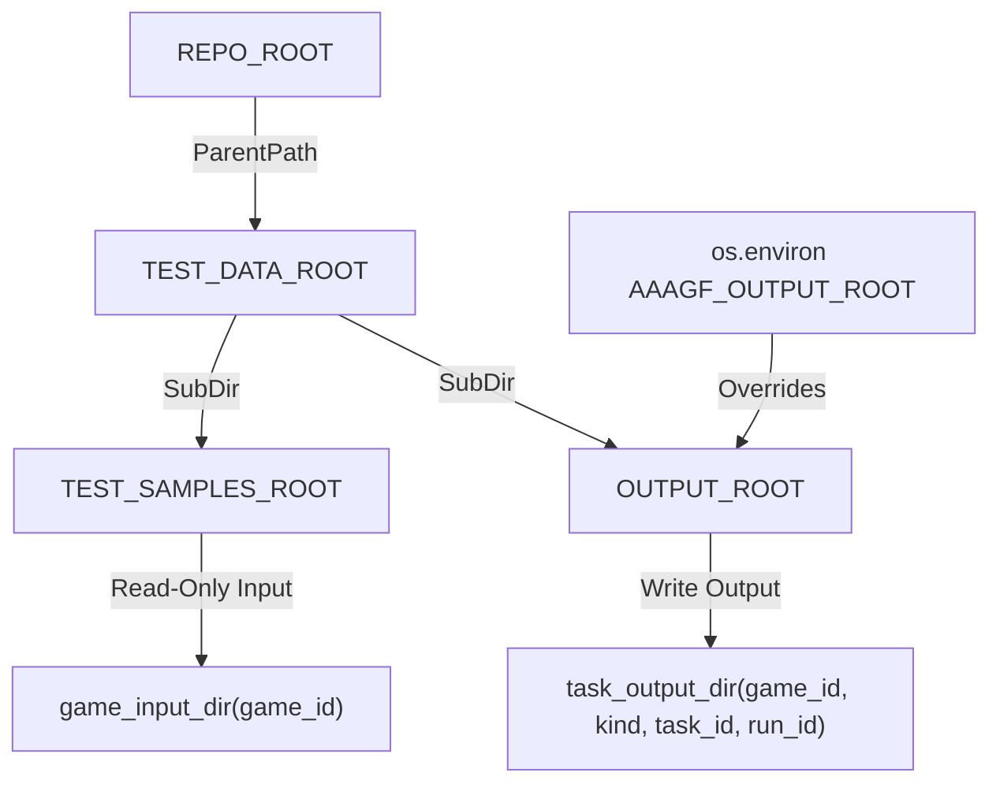
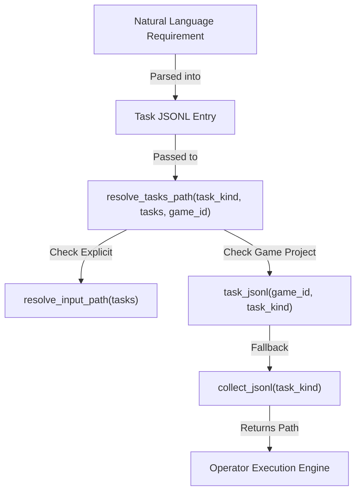

<!-- source: DeepWiki mcp.deepwiki.com · repo OpenDCAI/GameFactory-3A · page 1.3 Path Resolution & Task Data Contracts · fetched 2026-11-02 -->

# Path Resolution & Task Data Contracts

<details>
<summary>Relevant source files</summary>

The following files were used as context for generating this wiki page:

- [LICENSE](LICENSE)
- [README.md](README.md)
- [README_zh.md](README_zh.md)
- [pipeline/common/paths.py](pipeline/common/paths.py)
- [test/harness/smoke.py](test/harness/smoke.py)
- [test_data/test_samples/3D_object_gen_collect.jsonl](test_data/test_samples/3D_object_gen_collect.jsonl)
- [test_data/test_samples/tpose_gen_collect.jsonl](test_data/test_samples/tpose_gen_collect.jsonl)
- [third_party/README.md](third_party/README.md)

</details>


## Purpose and Scope

This page documents the path resolution architecture and task data contracts implemented in `pipeline/common/paths.py` and tested via `test/harness/smoke.py`. The `paths.py` module acts as the single source of truth for every input and output path across the 3AGameFactory framework. Benchmarks and game projects are authored per game, organizing inputs and outputs into consistent directory trees mapped by task kinds, game identifiers (`game_id`), run identifiers (`run_id`), and task identifiers (`task_id`). 

This module contains zero third-party dependencies and imports no models, making it safe to import from lightweight tooling, evaluation scripts, and CPU-only smoke test harnesses `[pipeline/common/paths.py:1-39]()`.

Sources: `[pipeline/common/paths.py:1-39]()`, `[test/harness/smoke.py:1-30]()`

---

## Root Directories & Environment Configuration

The path framework anchors its directory structures relative to the repository root. It defines primary storage roots for read-only test samples and write-heavy generation outputs `[pipeline/common/paths.py:50-61]`:

* `REPO_ROOT`: Resolved via `Path(__file__).resolve().parents[2]` `[pipeline/common/paths.py:52]()`.
* `TEST_DATA_ROOT`: Points to `REPO_ROOT / "test_data"` `[pipeline/common/paths.py:54]()`.
* `TEST_SAMPLES_ROOT`: Points to `TEST_DATA_ROOT / "test_samples"` `[pipeline/common/paths.py:55]()`.
* `OUTPUT_ROOT`: Resolves generation artifacts. Defaults to `test_data/outputs`, but can be relocated by setting the environment variable `AAAGF_OUTPUT_ROOT` (e.g., pointing to a high-performance scratch disk) `[pipeline/common/paths.py:57-60]()`.
* `UNASSIGNED_GAME`: Evaluates to `"_scratch"` when tasks carry no game association `[pipeline/common/paths.py:62-63]()`.
* `DEFAULT_RUN_ID`: Evaluates to `"default"` when no timestamped run ID is provided `[pipeline/common/paths.py:65-66]()`.

### Diagram: Path Roots to Code Entities


Sources: `[pipeline/common/paths.py:50-61]()`

---

## Task Type Mappings & JSONL Contracts

Tasks are categorized by `task_kind` strings, which map to specific architectural layers (Layer A for assets, Layer B for mechanics, Layer C for UI, and pipeline vertical slices) `[pipeline/common/paths.py:73-87]()`:

| `task_kind` | Layer Mapping (`TASK_LAYER`) | Input Directory (`TASK_INPUT_DIR`) | Task List File (`TASK_JSONL`) | Collect File (`TASK_COLLECT_JSONL`) |
| :--- | :--- | :--- | :--- | :--- |
| `3d_object` | `assets` | `3D_object` | `object_tasks.jsonl` | `3D_object_gen_collect.jsonl` |
| `tpose` | `assets` | `tpose` | `tpose_tasks.jsonl` | `tpose_gen_collect.jsonl` |
| `3d_scene` | `assets` | `3D_scene` | `scene_tasks.jsonl` | `3D_scene_gen_collect.jsonl` |
| `motion` | `assets` | `motion` | `motion_tasks.jsonl` | `motion_gen_collect.jsonl` |
| `cg_video` | `assets` | `cg_video` | `cg_tasks.jsonl` | `cg_video_collect.jsonl` |
| `audio` | `assets` | `audio` | `audio_tasks.jsonl` | `audio_gen_collect.jsonl` |
| `mechanic` | `mechanic` | `mechanic` | `mechanic_tasks.jsonl` | `mechanic_collect.jsonl` |
| `ui` | `ui` | `ui` | `ui_tasks.jsonl` | `ui_collect.jsonl` |
| `pipeline` | `pipeline` | `pipeline` | `pipeline_task.jsonl` | `pipeline_collect.jsonl` |

### JSONL Schema & Data Formats

Each line in a task JSONL file represents a self-contained task dictionary (`dict`). For instance, `tpose_gen_collect.jsonl` defines records containing game metadata, task identifiers, reference image paths, prompts, and inference parameters `[test_data/test_samples/tpose_gen_collect.jsonl:1-6]()`:

```json
{"game_id": "gameA_fighting_arena_unity", "task_id": "demoFighting_001", "image_path": "test_data/test_samples/gameA_fighting_arena_unity/tpose/ref_images/warrior_ref.png", "description": "A muscular male warrior...", "seed": 42, "steps": 40, "target_size": 1024}
```

Validation of task kinds is enforced via `check_kind(task_kind)`, which raises a `ValueError` with registered options if an unknown task kind is queried `[pipeline/common/paths.py:132-139]()`.

Sources: `[pipeline/common/paths.py:73-139]`, `[test_data/test_samples/tpose_gen_collect.jsonl:1-6]()`

---

## Path Resolution APIs

The module exposes helper functions to construct filesystem paths for inputs and outputs deterministically.

### Input Path Resolution

* `game_input_dir(game_id)`: Resolves to `test_data/test_samples/<game_id>/` `[pipeline/common/paths.py:144-146]()`.
* `task_input_dir(game_id, task_kind)`: Resolves to `test_data/test_samples/<game_id>/<TaskDir>/` `[pipeline/common/paths.py:149-152]()`.
* `task_jsonl(game_id, task_kind)`: Resolves to `test_data/test_samples/<game_id>/<TaskDir>/<kind>_tasks.jsonl` `[pipeline/common/paths.py:154-157]()`.
* `collect_jsonl(task_kind)`: Resolves to the cross-game aggregate list under `test_data/test_samples/<kind>_collect.jsonl` `[pipeline/common/paths.py:159-162]()`.
* `resolve_tasks_path(task_kind, tasks, game_id)`: Implements standard task-list resolution priority: explicit `--tasks` argument $\rightarrow$ game-specific `*_tasks.jsonl` (if non-empty) $\rightarrow$ cross-game `*_collect.jsonl` fallback `[pipeline/common/paths.py:164-179]()`.

### Diagram: Task Resolution Flow (Natural Language Space to Code Entity Space)


Sources: `[pipeline/common/paths.py:144-179]()`

---

## Output Layout & Summary Contracts

Outputs are structured hierarchically under `OUTPUT_ROOT`. An artifact is uniquely addressed by the tuple `(game_id, run_id, task_kind, task_id)` `[pipeline/common/paths.py:6-11]()`:

```text
test_data/outputs/                         # OUTPUT_ROOT ($AAAGF_OUTPUT_ROOT)
└── gameA_cyberpunk_shooter/               # one directory per generated game project
    ├── latest -> 20260731_1032/           # symlink to the most recent run
    └── <run_id>/                          # "default", or a timestamp
        ├── run_meta.json                  # checkpoints, seeds, git sha, argv
        ├── assets/
        │   ├── 3d_object/<task_id>/       # model.glb + meta.json
        │   ├── tpose/<task_id>/           # tpose_fg.png + meta.json
        │   └── audio/<task_id>/           # dialogue/sound-effect audio + meta.json
        ├── mechanic/<task_id>/            # engine project + demo_outputs/ + launch.sh
        ├── ui/<task_id>/
        ├── pipeline/<task_id>/            # end-to-end game-slice artifacts
        └── eval/
            ├── <task_kind>/<task_id>/     # metrics.json, build.log, judge_log.json
            └── summary.json               # aggregate summary over the whole run
```

### Smoke Test Verification

The smoke harness `test/harness/smoke.py` validates these output contracts by executing stubbed operators in CPU mode without weights or network calls `[test/harness/smoke.py:5-20]()`. It asserts that:
1. Operators execute and return dictionaries containing required result keys (`task_id`, `elapsed_sec`, `game_id`, `task_kind`, `output_dir`) `[test/harness/smoke.py:69-70]()`.
2. Artifacts land at the precise path returned by `paths.task_output_dir(game, kind, task_id, run_id)` `[test/harness/smoke.py:11-13]()`.
3. `meta.json` and aggregate summaries are written correctly across runs `[test/harness/smoke.py:13-16]()`.

Sources: `[pipeline/common/paths.py:10-31]`, `[test/harness/smoke.py:5-30]()`

---

