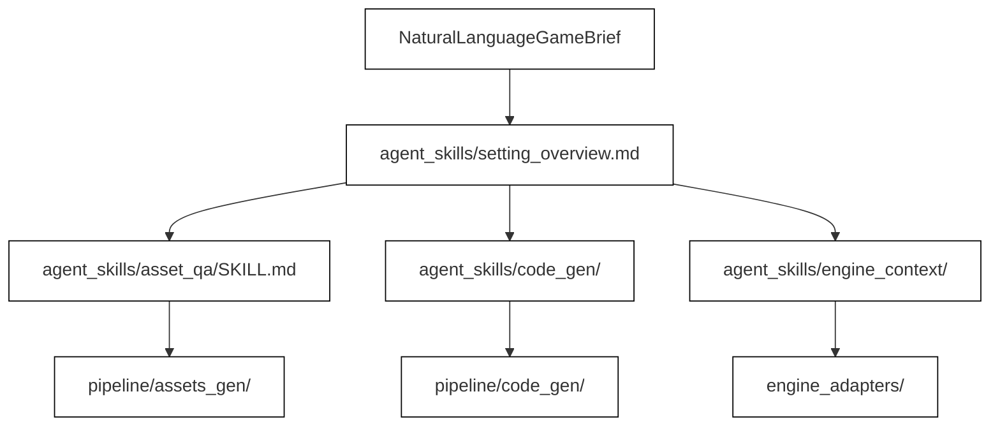
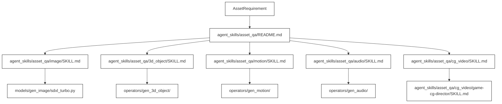
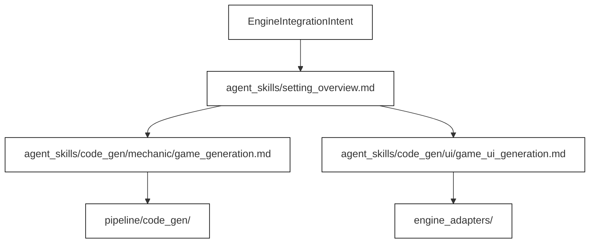
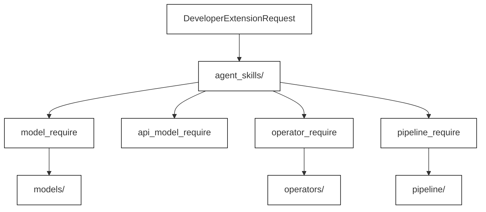

<!-- source: DeepWiki mcp.deepwiki.com · repo OpenDCAI/GameFactory-3A · page 2 Agent Skills Layer · fetched 2026-11-02 -->

# Agent Skills Layer

Relevant source files

The following files were used as context for generating this wiki page:

- [agent_skills/asset_qa/3d_object/orientation_review.md](agent_skills/asset_qa/3d_object/orientation_review.md)
- [agent_skills/asset_qa/README.md](agent_skills/asset_qa/README.md)
- [agent_skills/asset_qa/audio/SKILL.md](agent_skills/asset_qa/audio/SKILL.md)
- [agent_skills/asset_qa/cg_video/SKILL.md](agent_skills/asset_qa/cg_video/SKILL.md)
- [agent_skills/asset_qa/cg_video/game-cg-director/SKILL.md](agent_skills/asset_qa/cg_video/game-cg-director/SKILL.md)
- [agent_skills/asset_qa/image/SKILL.md](agent_skills/asset_qa/image/SKILL.md)
- [agent_skills/engine_context/blender_api.md](agent_skills/engine_context/blender_api.md)
- [agent_skills/setting_overview.md](agent_skills/setting_overview.md)
- [engine_adapters/README.md](engine_adapters/README.md)
- [engine_adapters/blender/__init__.py](engine_adapters/blender/__init__.py)
- [engine_adapters/blender/runtime/assets/actions.py](engine_adapters/blender/runtime/assets/actions.py)
- [test/test_3D_scene_gen.py](test/test_3D_scene_gen.py)

The Agent Skills Layer (`agent_skills/`) serves as the structured guide and prompt repository for vision-capable coding agents operating within 3AGameFactory. It provides the routing entrypoint [agent_skills/setting_overview.md:1-36] that bridges natural-language game requirements to engine-ready assets, mechanics, and UI components across supported game engines (Unreal Engine 5, Unity 3D, Godot 4, Blender, and three.js). 

This parent page summarizes the architecture of agent skills, outlining asset QA procedures, code generation templates, and developer harness contracts. Detailed technical specifications are maintained in the respective child pages.

Sources: `agent_skills/setting_overview.md:1-36`, `agent_skills/asset_qa/README.md:1-32`

---

## Asset QA Skills

The asset QA sub-layer (`agent_skills/asset_qa/`) governs per-modality quality assurance for generated or imported assets. Before an asset is integrated into an engine project, agents must consult modality-specific skills covering image preparation and T-pose generation, 3D objects, 3D scenes, motion rigging and retargeting, audio, and CG video. These skills define visual criteria, orientation rules [agent_skills/asset_qa/3d_object/orientation_review.md:1-30], matting requirements, and cost-aware paid cloud backend safeguards [agent_skills/asset_qa/README.md:68-101].

For detailed per-modality QA workflows, pipeline connections, and the `game-cg-director` sub-skill tree, see [Asset QA Skills](#2.1).

Sources: `agent_skills/asset_qa/README.md:1-50`, `agent_skills/asset_qa/image/SKILL.md:1-30`, `agent_skills/asset_qa/cg_video/SKILL.md:1-24`

---

## Code Generation Skills & Prompts

Code generation skills (`agent_skills/code_gen/`) provide systemic guidance, mechanic templates, and UI generation instructions for agents writing gameplay logic and user interfaces [agent_skills/asset_qa/README.md:33-46]. These directories contain system prompts, task specifications, and repair guidelines that govern how agents interact with engine adapters and adhere to required contracts without introducing UI contamination or broken API calls.

For complete mechanics documentation, UI generation guides, and prompt template hierarchies, see [Code Generation Skills & Prompts](#2.2).

Sources: `agent_skills/setting_overview.md:85-98`, `agent_skills/asset_qa/README.md:33-46`

---

## Develop Harness Contracts

Developer harness contracts specify the rigorous requirements documents that contributors and agents must follow when integrating new models, operators, and execution pipelines. These contracts (`model_require`, `api_model_require`, `operator_require`, and `pipeline_require`) ensure uniform lifecycle wrappers, test coverage, and strict boundary enforcement across Layer A, Layer B, and Layer C outputs.

For full specifications and contract validation checklists, see [Develop Harness Contracts](#2.3).

Sources: `agent_skills/setting_overview.md:1-36`, `engine_adapters/README.md:1-22`

---

