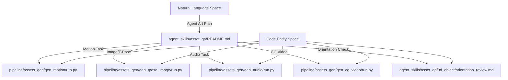
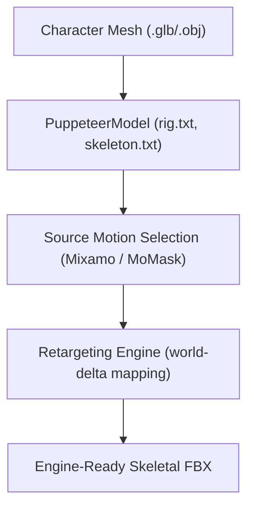
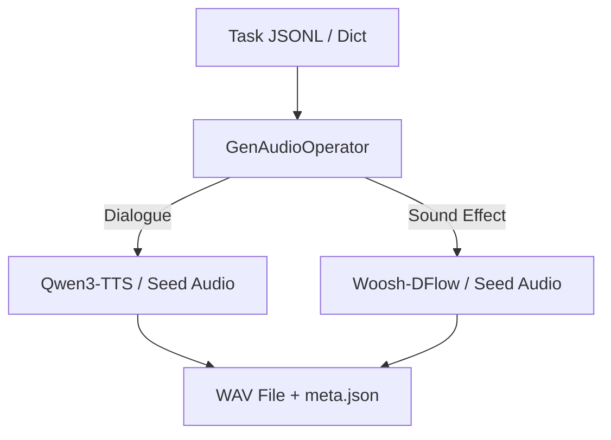
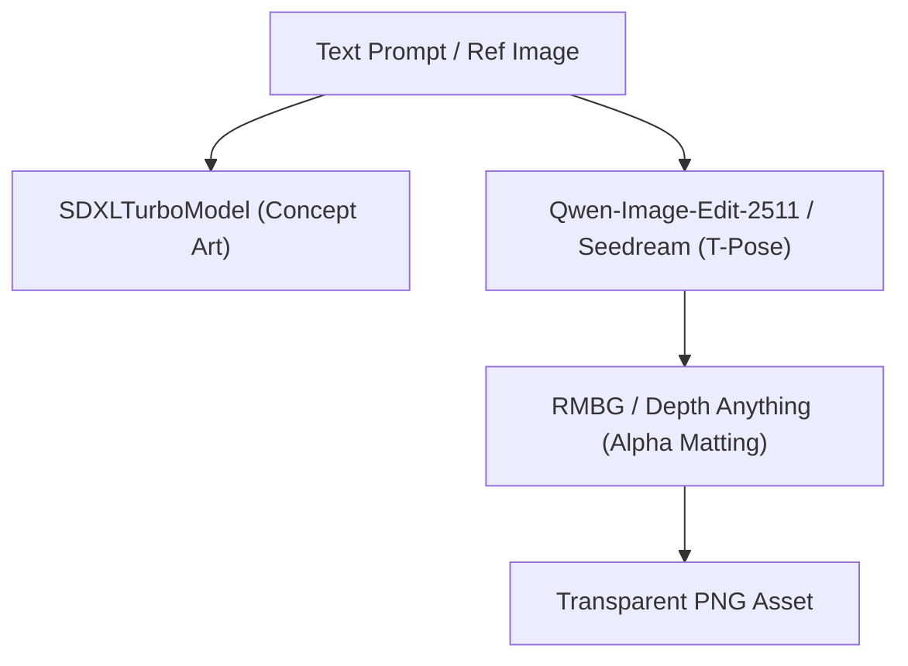
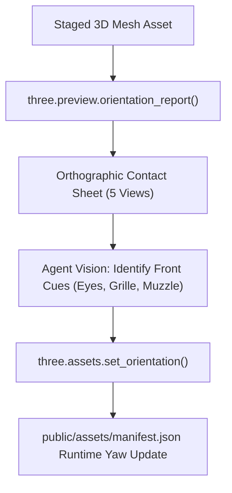
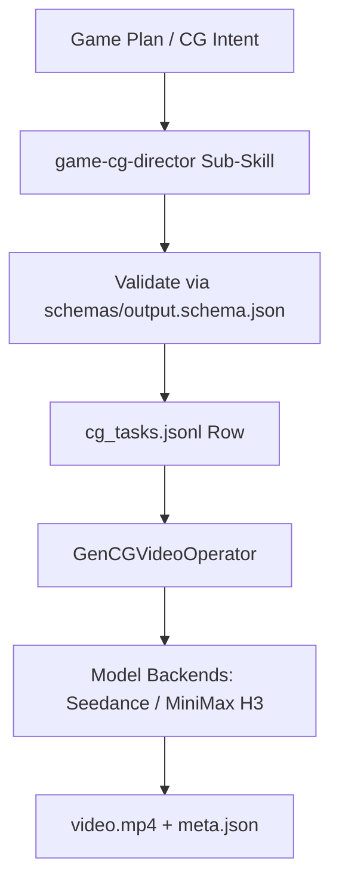

<!-- source: DeepWiki mcp.deepwiki.com · repo OpenDCAI/GameFactory-3A · page 2.1 Asset QA Skills · fetched 2026-11-02 -->

# Asset QA Skills

Relevant source files

The following files were used as context for generating this wiki page:

- [agent_skills/asset_qa/3d_object/orientation_review.md](agent_skills/asset_qa/3d_object/orientation_review.md)
- [agent_skills/asset_qa/README.md](agent_skills/asset_qa/README.md)
- [agent_skills/asset_qa/audio/SKILL.md](agent_skills/asset_qa/audio/SKILL.md)
- [agent_skills/asset_qa/cg_video/SKILL.md](agent_skills/asset_qa/cg_video/SKILL.md)
- [agent_skills/asset_qa/cg_video/game-cg-director/SKILL.md](agent_skills/asset_qa/cg_video/game-cg-director/SKILL.md)
- [agent_skills/asset_qa/cg_video/game-cg-director/common/camera.md](agent_skills/asset_qa/cg_video/game-cg-director/common/camera.md)
- [agent_skills/asset_qa/cg_video/game-cg-director/common/principles.md](agent_skills/asset_qa/cg_video/game-cg-director/common/principles.md)
- [agent_skills/asset_qa/cg_video/game-cg-director/common/sound.md](agent_skills/asset_qa/cg_video/game-cg-director/common/sound.md)
- [agent_skills/asset_qa/cg_video/game-cg-director/common/style-mapping.md](agent_skills/asset_qa/cg_video/game-cg-director/common/style-mapping.md)
- [agent_skills/asset_qa/cg_video/game-cg-director/models/h3.md](agent_skills/asset_qa/cg_video/game-cg-director/models/h3.md)
- [agent_skills/asset_qa/cg_video/game-cg-director/models/seedance.md](agent_skills/asset_qa/cg_video/game-cg-director/models/seedance.md)
- [agent_skills/asset_qa/cg_video/game-cg-director/modes/fl2va.md](agent_skills/asset_qa/cg_video/game-cg-director/modes/fl2va.md)
- [agent_skills/asset_qa/cg_video/game-cg-director/modes/i2va.md](agent_skills/asset_qa/cg_video/game-cg-director/modes/i2va.md)
- [agent_skills/asset_qa/image/SKILL.md](agent_skills/asset_qa/image/SKILL.md)
- [agent_skills/asset_qa/motion/SKILL.md](agent_skills/asset_qa/motion/SKILL.md)
- [scripts/asset_env_setup/gen_motion/download_weights.py](scripts/asset_env_setup/gen_motion/download_weights.py)
- [scripts/asset_env_setup/gen_motion/install.sh](scripts/asset_env_setup/gen_motion/install.sh)
- [scripts/asset_env_setup/gen_motion/runtime_env.sh](scripts/asset_env_setup/gen_motion/runtime_env.sh)

## Purpose and Scope

The Asset QA Skills layer (`agent_skills/asset_qa/`) provides per-modality quality assurance and generation control frameworks used by vision-capable coding agents [agent_skills/asset_qa/README.md:1-16](). This page documents the technical implementation, environment setup, execution data flow, and review protocols for image, audio, motion, 3D object, 3D scene, and CG video modalities, including the specialized `game-cg-director` sub-skill tree.

Sources: [agent_skills/asset_qa/README.md:1-32](), [agent_skills/asset_qa/motion/SKILL.md:1-35](), [agent_skills/asset_qa/image/SKILL.md:1-30]()

---

## 1. Motion Generation & Retargeting Skill

Motion assets require specialized handling due to skeleton naming conventions, coordinate spaces, and skeletal hierarchies. The motion skill coordinates the chain from character mesh to Puppeteer rigging, MoMask or downloaded clip source, and Blender retargeting [agent_skills/asset_qa/motion/SKILL.md:1-30]().

### Technical Chain and Execution Flow

The canonical entry point for motion pipelines is `pipeline/assets_gen/gen_motion/run.py`, invoking the operator defined in `operators/gen_motion/operator.py` [agent_skills/asset_qa/motion/SKILL.md:32-35](). 

Sources: [agent_skills/asset_qa/motion/SKILL.md:16-30]()

### Environment Setup and Weights

Linux environments for Puppeteer, MoMask, and Blender-retargeting are provisioned via shell installers and weight download utilities [scripts/asset_env_setup/gen_motion/install.sh:1-30](). Weights are fetched from HuggingFace and Google Drive into configured runtime roots [scripts/asset_env_setup/gen_motion/download_weights.py:1-40]().

*   Installer script: `scripts/asset_env_setup/gen_motion/install.sh` [scripts/asset_env_setup/gen_motion/install.sh:1-28]()
*   Runtime environment variables script: `scripts/asset_env_setup/gen_motion/runtime_env.sh` [scripts/asset_env_setup/gen_motion/runtime_env.sh:1-15]()
*   Weight downloader: `scripts/asset_env_setup/gen_motion/download_weights.py` [scripts/asset_env_setup/gen_motion/download_weights.py:1-33]()

Sources: [scripts/asset_env_setup/gen_motion/install.sh:1-42](), [scripts/asset_env_setup/gen_motion/download_weights.py:1-35]()

Sources: [agent_skills/asset_qa/motion/SKILL.md:1-154](), [scripts/asset_env_setup/gen_motion/install.sh:1-169]()

---

## 2. Audio Generation & QA Skill

The audio skill governs offline WAV asset creation, voice lines, dialogue, sound effects, and foley [agent_skills/asset_qa/audio/SKILL.md:1-7]().

### Data Flow and Backends

Audio tasks are processed from task dictionaries/JSONLs through `GenAudioOperator` to backend models [agent_skills/asset_qa/audio/SKILL.md:10-15]().

Sources: [agent_skills/asset_qa/audio/SKILL.md:10-21]()

### Backend Routing and Cloud Cost Governance

*   **Dialogue / TTS**: Qwen3-TTS or Seed Audio (Volcengine speech endpoint) [agent_skills/asset_qa/audio/SKILL.md:46-51]()
*   **Natural Sound Effects**: Licence-checked recordings (CC0/CC-BY) preferred over generation for gunshots, thunder, rain, footsteps [agent_skills/asset_qa/audio/SKILL.md:46-75]()
*   **Foley / Ambience**: Sony Woosh-DFlow or Seed Audio [agent_skills/asset_qa/audio/SKILL.md:46-51]()

Before using paid cloud services like Seed Audio (`SEED_AUDIO_API_KEY`), agents must prompt the user with estimated batch costs [agent_skills/asset_qa/audio/SKILL.md:58-67]().

Sources: [agent_skills/asset_qa/audio/SKILL.md:1-158]()

---

## 3. Image & T-Pose Generation Skill

This skill handles single-subject concept images and character T-pose generation for downstream 3D reconstruction [agent_skills/asset_qa/image/SKILL.md:1-8]().

### Component Architecture

Sources: [agent_skills/asset_qa/image/SKILL.md:20-30]()

### Key Classes and Operators

*   Concept Generation: `models/gen_image/sdxl_turbo.py` (`SDXLTurboModel`) [agent_skills/asset_qa/image/SKILL.md:20-25]()
*   Local Image Editor: `models/gen_image/qwen_edit_model.py` (`QwenImageEditModel`) [agent_skills/asset_qa/image/SKILL.md:20-25]()
*   Cloud Editor: `models/gen_image/seedream_model.py` (`SeedreamModel`) [agent_skills/asset_qa/image/SKILL.md:20-25]()
*   Matting Tools: `models/tools/image_matting/rmbg_model.py` [agent_skills/asset_qa/image/SKILL.md:25-30]()
*   Task Operator: `operators/gen_tpose_image/operator.py` [agent_skills/asset_qa/image/SKILL.md:25-30]()
*   Pipeline Runner: `pipeline/assets_gen/gen_tpose_image/run.py` [agent_skills/asset_qa/image/SKILL.md:25-30]()

Sources: [agent_skills/asset_qa/image/SKILL.md:1-154]()

---

## 4. 3D Object & Orientation Review Skill

Imported 3D models require manual or vision-agent verification for facing direction (`forward_axis`), scaling, and ground contact [agent_skills/asset_qa/3d_object/orientation_review.md:1-15]().

### Orientation Review Workflow

Because glTF files omit binding facing data, visual agents must evaluate orthographic contact sheets generated by `three.preview.orientation_report` [agent_skills/asset_qa/3d_object/orientation_review.md:5-59]().

Sources: [agent_skills/asset_qa/3d_object/orientation_review.md:21-120]()

Sources: [agent_skills/asset_qa/3d_object/orientation_review.md:1-152]()

---

## 5. CG Video Generation & `game-cg-director` Sub-Skill Tree

The CG video skill manages text-to-video, image-to-video, and frame-transition pipelines [agent_skills/asset_qa/cg_video/SKILL.md:1-7]().

### Sub-Skill Tree: `game-cg-director`

The `game-cg-director` sub-skill (`agent_skills/asset_qa/cg_video/game-cg-director/`) converts game intent into validated directing envelopes without invoking video generation APIs directly [agent_skills/asset_qa/cg_video/game-cg-director/SKILL.md:1-11]().

Sources: [agent_skills/asset_qa/cg_video/SKILL.md:10-30](), [agent_skills/asset_qa/cg_video/game-cg-director/SKILL.md:1-35]()

### Mode Taxonomy and Routing

*   `text_to_video` (T2VA) [agent_skills/asset_qa/cg_video/game-cg-director/SKILL.md:60-70]()
*   `first_frame_to_video` (I2VA) [agent_skills/asset_qa/cg_video/game-cg-director/SKILL.md:60-70]()
*   `first_last_frame_to_video` (FL2VA) [agent_skills/asset_qa/cg_video/game-cg-director/SKILL.md:60-70]()
*   `reference_to_video` (Ref2VA) [agent_skills/asset_qa/cg_video/game-cg-director/SKILL.md:60-70]()

Sources: [agent_skills/asset_qa/cg_video/SKILL.md:1-345](), [agent_skills/asset_qa/cg_video/game-cg-director/SKILL.md:1-174](), [agent_skills/asset_qa/cg_video/game-cg-director/modes/fl2va.md:1-11](), [agent_skills/asset_qa/cg_video/game-cg-director/common/camera.md:1-33]()

---

