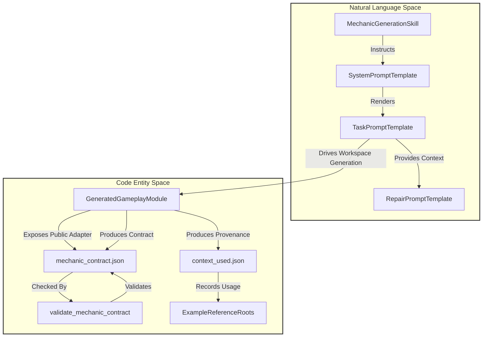
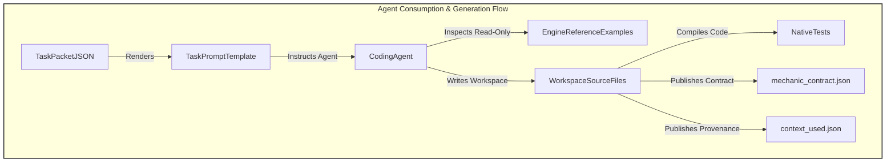

<!-- source: DeepWiki mcp.deepwiki.com · repo OpenDCAI/GameFactory-3A · page 2.2 Code Generation Skills & Prompts · fetched 2026-11-02 -->

# Code Generation Skills & Prompts

Relevant source files

The following files were used as context for generating this wiki page:

- [agent_skills/code_gen/mechanic/game_generation.md](agent_skills/code_gen/mechanic/game_generation.md)
- [agent_skills/code_gen/mechanic/prompts/repair.md](agent_skills/code_gen/mechanic/prompts/repair.md)
- [agent_skills/code_gen/mechanic/prompts/system.md](agent_skills/code_gen/mechanic/prompts/system.md)
- [agent_skills/code_gen/mechanic/prompts/task.md](agent_skills/code_gen/mechanic/prompts/task.md)
- [agent_skills/code_gen/ui/game_ui_generation.md](agent_skills/code_gen/ui/game_ui_generation.md)
- [agent_skills/code_gen/ui/prompts/system.md](agent_skills/code_gen/ui/prompts/system.md)
- [agent_skills/code_gen/ui/prompts/task.md](agent_skills/code_gen/ui/prompts/task.md)
- [agent_skills/engine_context/browser_serving_api.md](agent_skills/engine_context/browser_serving_api.md)
- [engine_adapters/browser_serving/.gitkeep](engine_adapters/browser_serving/.gitkeep)
- [engine_adapters/godot/plugin/A3GamePlayable/README.md](engine_adapters/godot/plugin/A3GamePlayable/README.md)
- [engine_adapters/godot/plugin/A3GamePlayable/capabilities.json](engine_adapters/godot/plugin/A3GamePlayable/capabilities.json)
- [engine_adapters/godot/plugin/A3GamePlayable/tests/framework_smoke.gd](engine_adapters/godot/plugin/A3GamePlayable/tests/framework_smoke.gd)
- [engine_adapters/ue5/assets/client.py](engine_adapters/ue5/assets/client.py)
- [engine_adapters/unity3d/plugin/A3GameRuntime/README.md](engine_adapters/unity3d/plugin/A3GameRuntime/README.md)
- [pipeline/code_gen/gen_mechanic/__init__.py](pipeline/code_gen/gen_mechanic/__init__.py)
- [pipeline/code_gen/gen_mechanic/contracts.py](pipeline/code_gen/gen_mechanic/contracts.py)

## Purpose and Scope

The `agent_skills/code_gen/` directory contains markdown guidelines, workflow constraints, and prompt templates that instruct coding agents on how to generate game-owned mechanical behaviors and user interfaces within the 3AGameFactory-3A pipeline. This layer defines the strict boundary between engine runtimes, adapters, UI modules, and game-owned source code. 

Sources: `agent_skills/code_gen/mechanic/game_generation.md:1-146` [agent_skills/code_gen/mechanic/game_generation.md:1-146](), `pipeline/code_gen/gen_mechanic/contracts.py:1-129` [pipeline/code_gen/gen_mechanic/contracts.py:1-128]()

---

## Natural Language Space to Code Entity Space: Code Generation Architecture

*Figure 1: Mapping natural-language agent instructions to generated code entities, contracts, and provenance files.*

Sources: `agent_skills/code_gen/mechanic/game_generation.md:1-51` [agent_skills/code_gen/mechanic/game_generation.md:1-51](), `pipeline/code_gen/gen_mechanic/contracts.py:32-128` [pipeline/code_gen/gen_mechanic/contracts.py:32-128]()

---

## Mechanic Generation Mechanics and Authority

The core skill governing game mechanic generation is located at `agent_skills/code_gen/mechanic/game_generation.md` [agent_skills/code_gen/mechanic/game_generation.md:1-146](). It establishes strict authority ordering: task packet and requirements, the skill itself, the matching Engine API, and finally educational Engine Examples.

Agents must adhere to a strict dependency direction where UI depends on Mechanic, and Mechanic depends on the runtime framework (`UI -> Mechanic -> runtime framework`) [agent_skills/code_gen/mechanic/game_generation.md:61-65](). The reverse dependency is forbidden; Mechanic modules must compile, test, and execute without any UI module, HUD, widget, menu, renderer, or screenshot [agent_skills/code_gen/mechanic/game_generation.md:67-70]().

Sources: `agent_skills/code_gen/mechanic/game_generation.md:7-71` [agent_skills/code_gen/mechanic/game_generation.md:7-71]()

---

## Prompt Templates: System, Task, and Repair

Agents ingest prompts structured for initialization, task execution, and iterative repair.

### System Prompt
The system prompt establishes the outer game-generation persona for a single Mechanic task, binding the agent to resolved inputs, write boundaries, and read-only paths (`agent_skills/code_gen/mechanic/prompts/system.md:1-27`) [agent_skills/code_gen/mechanic/prompts/system.md:1-26]().

### Task Prompt
The task prompt (`agent_skills/code_gen/mechanic/prompts/task.md:1-142`) [agent_skills/code_gen/mechanic/prompts/task.md:1-141]() injects dynamic payload references into the agent context:
- `{{GAME_GENERATION_SKILL_PATH}}`: Path to the markdown skill specification.
- `{{TASK_PACKET_PATH}}`: Path to the prepared task packet JSON.
- `{{WORKSPACE}}`: Target directory for generated code.
- `{{ENGINE}}`: Canonical target engine identifier.
- `{{ACCEPTANCE_CRITERIA}}`: JSON array of measurable behaviors.
- `{{MECHANIC_EXAMPLE_ROOTS}}`: Validated reference roots for engine patterns.

### Repair Prompt
When validation or testing fails, the repair prompt (`agent_skills/code_gen/mechanic/prompts/repair.md:1-38`) [agent_skills/code_gen/mechanic/prompts/repair.md:1-37]() provides structured execution errors (`{{FAILURES_JSON}}`) and iteration counters (`{{REPAIR_ATTEMPT}} / {{MAX_REPAIR_ATTEMPTS}}`), guiding the agent to apply the smallest coherent repair while preserving working behavior and final contracts.

Sources: `agent_skills/code_gen/mechanic/prompts/system.md:1-27` [agent_skills/code_gen/mechanic/prompts/system.md:1-26](), `agent_skills/code_gen/mechanic/prompts/task.md:1-142` [agent_skills/code_gen/mechanic/prompts/task.md:1-141](), `agent_skills/code_gen/mechanic/prompts/repair.md:1-38` [agent_skills/code_gen/mechanic/prompts/repair.md:1-37]()

---

## Dependency and Execution Flow in Agent Code Generation

*Figure 2: Data flow from task packet compilation to published mechanic contracts and native tests.*

Sources: `agent_skills/code_gen/mechanic/game_generation.md:31-51` [agent_skills/code_gen/mechanic/game_generation.md:31-51](), `agent_skills/code_gen/mechanic/prompts/task.md:105-142` [agent_skills/code_gen/mechanic/prompts/task.md:105-141]()

---

## Mechanic Contracts and Artifact Validation

Upon completing code generation, agents must publish `mechanic_contract.json` at the workspace root adhering to schema version `gamefactory3a.mechanic_contract.v1` (`pipeline/code_gen/gen_mechanic/contracts.py:15-18`) [pipeline/code_gen/gen_mechanic/contracts.py:15-18]().

Deterministic validation is performed by `validate_mechanic_contract(workspace, gameplay_module_name)` (`pipeline/code_gen/gen_mechanic/contracts.py:32-35`) [pipeline/code_gen/gen_mechanic/contracts.py:32-35](), which asserts:
1. Presence of `mechanic_contract.json` (`pipeline/code_gen/gen_mechanic/contracts.py:36-41`) [pipeline/code_gen/gen_mechanic/contracts.py:36-41]().
2. Matching `schema_version` and positive integer `contract_version` (`pipeline/code_gen/gen_mechanic/contracts.py:51-67`) [pipeline/code_gen/gen_mechanic/contracts.py:51-67]().
3. Exact match of `gameplay_module` against expectations (`pipeline/code_gen/gen_mechanic/contracts.py:68-74`) [pipeline/code_gen/gen_mechanic/contracts.py:68-74]().
4. Non-empty collections for `state`, `events`, and `commands` (`pipeline/code_gen/gen_mechanic/contracts.py:75-82`) [pipeline/code_gen/gen_mechanic/contracts.py:75-82]().
5. Valid, non-duplicate workspace-relative paths in `public_api_paths` (`pipeline/code_gen/gen_mechanic/contracts.py:83-127`) [pipeline/code_gen/gen_mechanic/contracts.py:83-127]().

Sources: `pipeline/code_gen/gen_mechanic/contracts.py:1-129` [pipeline/code_gen/gen_mechanic/contracts.py:1-128]()

---

## UI Generation Prompts and Mechanics

Complementing mechanic generation, user interface generation guides located under `agent_skills/code_gen/ui/` (`agent_skills/code_gen/ui/game_ui_generation.md`) instruct agents on binding UI widgets strictly to public mechanic contracts without violating architectural boundaries. System and task prompts (`agent_skills/code_gen/ui/prompts/system.md`, `agent_skills/code_gen/ui/prompts/task.md`) enforce that UI modules consume observable state and dispatch commands exclusively through public adapters.

Sources: `agent_skills/code_gen/ui/game_ui_generation.md` [agent_skills/code_gen/ui/game_ui_generation.md]()

---

