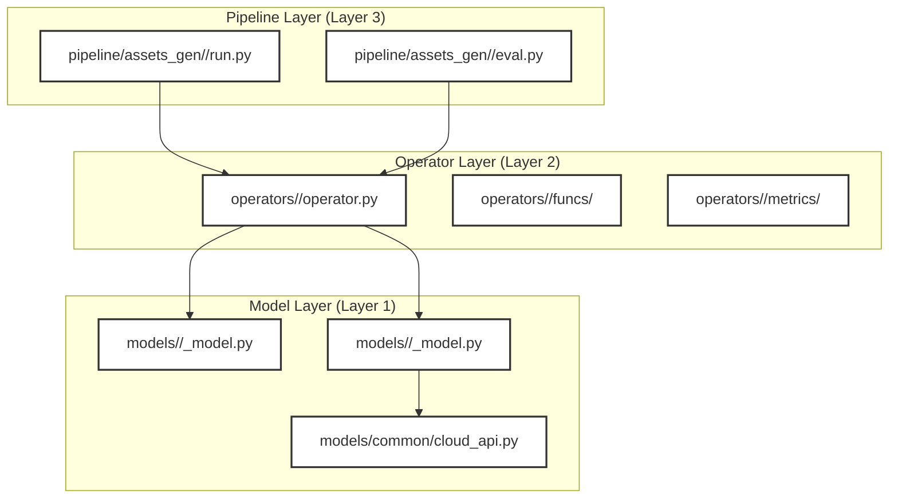
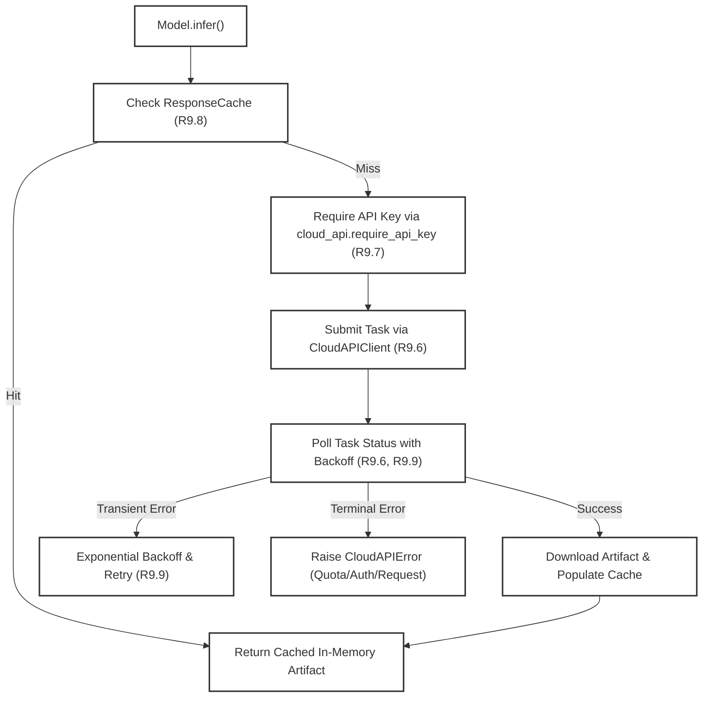

<!-- source: DeepWiki mcp.deepwiki.com · repo OpenDCAI/GameFactory-3A · page 2.3 Develop Harness Contracts · fetched 2026-11-02 -->

# Develop Harness Contracts

<details>
<summary>Relevant source files</summary>

The following files were used as context for generating this wiki page:

- [agent_skills/develop_harness/README.md](agent_skills/develop_harness/README.md)
- [agent_skills/develop_harness/api_model_require.md](agent_skills/develop_harness/api_model_require.md)
- [agent_skills/develop_harness/model_require.md](agent_skills/develop_harness/model_require.md)
- [agent_skills/develop_harness/operatar_require.md](agent_skills/develop_harness/operatar_require.md)
- [agent_skills/develop_harness/pipeline_require.md](agent_skills/develop_harness/pipeline_require.md)
- [models/common/cloud_api.py](models/common/cloud_api.py)
- [models/gen_3d_object/trellis_2_model.py](models/gen_3d_object/trellis_2_model.py)
- [models/gen_audio/seed_audio_model.py](models/gen_audio/seed_audio_model.py)
- [models/gen_audio/seed_audio_utils/__init__.py](models/gen_audio/seed_audio_utils/__init__.py)
- [models/gen_audio/seed_audio_utils/api.py](models/gen_audio/seed_audio_utils/api.py)
- [models/gen_audio/seed_audio_utils/audio.py](models/gen_audio/seed_audio_utils/audio.py)
- [pipeline/assets_gen/gen_audio/run.py](pipeline/assets_gen/gen_audio/run.py)
- [test/test_api_audio.py](test/test_api_audio.py)

</details>


## Purpose and Scope
This page defines the strict technical specifications and requirements documents that govern the three layers of the asset-generation stack: `models/`, `operators/`, and `pipeline/` [agent_skills/develop_harness/README.md:1-10](). These contracts ensure clean architectural separation, enabling developers and coding agents to add new modalities, models, or tasks without breaking existing pipelines, regression tests, or offline execution harnesses.

---

## 1. Architectural Layering & Downward Dependency Rules

The development harness enforces a strict downward dependency hierarchy. Higher layers may depend on lower layers, but lower layers must remain completely agnostic of higher-layer concerns [agent_skills/develop_harness/README.md:33-52]().



**Figure 1:** *Code entity namespace mapping across the three generation layers, illustrating downward dependencies.*

### Layer Responsibilities
* **Layer 1 (`models/`)**: Thin wrappers around a single model backend. Encapsulates weights, device allocation, native model calls, and hardware dtypes. Knows nothing about tasks, JSONL configuration files, game projects, or filesystem output directories [agent_skills/develop_harness/model_require.md:3-5]().
* **Layer 2 (`operators/`)**: Translates a single task dictionary into concrete artifacts on disk. Owns task semantics, prompt templates, multi-step algorithm workflows (`funcs/`), and local evaluation metrics (`metrics/`). Model-agnostic through dependency injection [agent_skills/develop_harness/operatar_require.md:7-11]().
* **Layer 3 (`pipeline/`)**: Manages batch execution, command-line interfaces (`argparse`), checkpoint configuration resolution, JSONL iteration via `pipeline.common.paths`, and summary generation [agent_skills/develop_harness/pipeline_require.md:3-11]().

**Sources:** `agent_skills/develop_harness/README.md:1-160`, `agent_skills/develop_harness/model_require.md:1-32`

---

## 2. Local Model Contract (`model_require.md`)

A file located under `models/<family>/<model_name>_model.py` must define a class named `<Name>Model` that satisfies strict interface and lifecycle rules [agent_skills/develop_harness/model_require.md:1-10]().

### Hard Rules (R1)
1. **No upward imports**: Models must never import from `operators/` or `pipeline/` [agent_skills/develop_harness/model_require.md:22-26]().
2. **No path construction**: Models must return in-memory data (`PIL.Image`, `np.ndarray`, `torch.Tensor`, `trimesh.Scene`). The operator owns artifact placement [agent_skills/develop_harness/model_require.md:22-27]().
3. **No CLI business logic**: No `argparse` or `if __name__ == "__main__"` blocks. CLI execution belongs in `run.py` [agent_skills/develop_harness/model_require.md:22-28]().
4. **No task semantics**: Zero awareness of `task_id`, `game_id`, or task-specific prompt engineering [agent_skills/develop_harness/model_require.md:22-29]().
5. **Lazy heavy imports**: Heavy dependencies (`torch`, `diffusers`, vendored C++ extensions) must be imported inside constructor methods or initialization routines so that CPU smoke tests can import modules without weighting down memory [agent_skills/develop_harness/model_require.md:22-30]().

### Constructor & Inference Standards (R2–R3)
* **Constructor signature**: Must follow `def __init__(self, model_path: str | list[str], device: str = "cuda", **model_specific)` [agent_skills/develop_harness/model_require.md:56-58](). All initialization arguments must be stored on `self` to support round-trip reloading [agent_skills/develop_harness/model_require.md:65-66]().
* **Inference entry point**: Exactly one public method: `infer(self, ...)` [agent_skills/develop_harness/model_require.md:68-72](). Inputs must be objects (e.g., `PIL.Image`, `np.ndarray`) rather than file paths [agent_skills/develop_harness/model_require.md:72-73](). Stochastic models must accept `seed: int = 42` and enforce determinism [agent_skills/develop_harness/model_require.md:73-75]().
* **Inference context**: Inference executions must be wrapped in `@torch.no_grad()` or `torch.inference_mode()` [agent_skills/develop_harness/model_require.md:76-77]().

### Tool Models & Subclassing
Auxiliary tool models (depth estimation, matting, segmentation, keypoints) residing in `models/tools/<group>/` must subclass `BaseToolModel` (`models/tools/base.py`), implementing `_load(self)` and `infer(self, image, **kwargs)` while inheriting automatic lazy loading and VRAM unloading [agent_skills/develop_harness/model_require.md:89-102]().

**Sources:** `agent_skills/develop_harness/model_require.md:1-149`, `models/gen_3d_object/trellis_2_model.py:1-138`

---

## 3. Cloud API Model Contract Supplement (`api_model_require.md`)

Closed-source cloud API wrappers (such as Tripo, Meshy, Seed Audio, or Kling) deviate from local-weight model assumptions. These deviations are governed by rule set **R9** [agent_skills/develop_harness/api_model_require.md:1-16].



**Figure 2:** *Execution flow for closed-source cloud API model wrappers, showing caching, credential checks, and error classification.*

### Core Cloud Requirements (R9)
* **Model Version Identifiers (R9.1)**: `model_path` accepts a version string (e.g., `"v3.1-20260211"`, `"seed-audio-1.0"`) instead of a local weight path [agent_skills/develop_harness/api_model_require.md:21-23]().
* **Device Agnosticism (R9.2)**: `device` is accepted for interface parity but ignored. `device="cpu"` must never raise an error [agent_skills/develop_harness/api_model_require.md:21-24]().
* **Synchronous Task Abstraction (R9.6)**: Asynchronous task lifecycles (submit → poll → download) must be hidden behind a synchronous `infer()` call [agent_skills/develop_harness/api_model_require.md:28-29](). Timeout exceptions must include the provider `task_id` for offline recovery [agent_skills/develop_harness/api_model_require.md:28-29]().
* **Lazy Authentication (R9.7)**: API keys are read from environment variables at execution time rather than instantiation time, ensuring offline test harnesses can import models without credentials [agent_skills/develop_harness/api_model_require.md:29-30]().
* **Response Caching (R9.8)**: Requests filtered by `(model_path, payload_hash, parameters)` utilize `cloud_api.ResponseCache` to prevent redundant billing on pipeline re-runs [agent_skills/develop_harness/api_model_require.md:30-31]().
* **Error Classification (R9.9)**: HTTP errors and response bodies are inspected to categorize failures into retryable server errors (`5xx`, `429`) versus terminal client/quota errors (`400`, `401`, `402`, `403`) [agent_skills/develop_harness/api_model_require.md:31-32]().

### Contract-Deviation Marking
Cloud wrappers must document deviations in three locations:
1. A explicit `CONTRACT DEVIATIONS` section in the file docstring [agent_skills/develop_harness/api_model_require.md:50-67]().
2. Inline `# [CONTRACT-DEVIATION Cx]` comments at the specific line of code [agent_skills/develop_harness/api_model_require.md:68-78]().
3. Mapping to canonical identifiers `C1` through `C9` defined in `api_model_require.md` [agent_skills/develop_harness/api_model_require.md:83-98]().

**Sources:** `agent_skills/develop_harness/api_model_require.md:1-118`, `models/common/cloud_api.py:1-185`, `models/gen_audio/seed_audio_model.py:1-128`

---

## 4. Task Operator Contract (`operatar_require.md`)

Operators located under `operators/<task>/operator.py` transform task dictionaries into durable artifacts on disk [agent_skills/develop_harness/operatar_require.md:1-12].

### Operator Structure
```
operators/<task>/
├── __init__.py
├── operator.py       # Gen<Task>Operator class
├── funcs/            # Decoupled algorithm steps (pure functions)
└── metrics/          # Task-specific evaluation metrics
```

### Key Rules
1. **No Pipeline Imports**: Operators must not import from `pipeline/` except `pipeline.common.paths` inside methods [agent_skills/develop_harness/operatar_require.md:34-36]().
2. **Injected Models**: Models arrive fully loaded via `__init__`. Operators never load weights or perform network downloads [agent_skills/develop_harness/operatar_require.md:37-39]().
3. **Path Management**: Output paths are never hardcoded; operators rely on `pipeline.common.paths` to resolve per-game or legacy flat output structures [agent_skills/develop_harness/operatar_require.md:38-40]().
4. **Public Run Method**: The primary entry point is `run(self, inp: dict) -> dict`, which executes a single task and returns a standardized metrics/artifact dictionary [agent_skills/develop_harness/operatar_require.md:75-81]().
5. **Decoupled Steps (`funcs/`)**: Core algorithmic stages reside in `funcs/` as pure functions accepting PIL images or NumPy arrays without side effects or disk writes [agent_skills/develop_harness/operatar_require.md:124-128]().

**Sources:** `agent_skills/develop_harness/operatar_require.md:1-143`

---

## 5. Pipeline & Runner Contract (`pipeline_require.md`)

Pipelines under `pipeline/assets_gen/<task>/` supply benchmark batch drivers (`run.py`) and scoring modules (`eval.py`) [agent_skills/develop_harness/pipeline_require.md:1-11].

### Standardized `run.py` API
Every pipeline runner must expose five mandatory module-level constructs [agent_skills/develop_harness/pipeline_require.md:39-55]:
* `TASK_KIND`: Registered string identifier [agent_skills/develop_harness/pipeline_require.md:41-42]().
* `load_model(...)`: Loads or reuses required model instances [agent_skills/develop_harness/pipeline_require.md:46-46]().
* `make_operator(...)`: Instantiates and wires models into the operator [agent_skills/develop_harness/pipeline_require.md:47-49]().
* `generate(inp, operator)`: Thin operator wrapper [agent_skills/develop_harness/pipeline_require.md:50-50]().
* `run_from_jsonl(...)`: Batch iteration handler [agent_skills/develop_harness/pipeline_require.md:51-52]().

### Standard CLI Flags & Task Registration
Runners support a uniform set of command-line arguments (`--ckpt`, `--game`, `--tasks`, `--run-id`, `--out-dir`, `--device`) [agent_skills/develop_harness/pipeline_require.md:66-79](). Task kinds must be registered in `pipeline/common/paths.py` across `TASK_LAYER`, `TASK_INPUT_DIR`, `TASK_JSONL`, and `TASK_COLLECT_JSONL` tables [agent_skills/develop_harness/pipeline_require.md:118-128]().

**Sources:** `agent_skills/develop_harness/pipeline_require.md:1-138`, `pipeline/assets_gen/gen_audio/run.py:1-137`

---

## 6. Harness Validation & Stubs

To ensure continuous integration and developer efficiency without requiring dedicated GPU infrastructure or proprietary weights, the codebase supplies offline stubs and test harnesses [agent_skills/develop_harness/README.md:6-10].

* **Stub Harness (`test/harness/stubs.py`)**: Provides mock model instances and fixtures returning synthetic tensors or images in milliseconds [agent_skills/develop_harness/README.md:26-30]().
* **Smoke Testing (`test/harness/smoke.py`)**: Executes end-to-end CPU-only pipeline runs using stubs, asserting correct output directory structure, `meta.json` generation, and summary aggregation [agent_skills/develop_harness/README.md:26-31]().

**Sources:** `agent_skills/develop_harness/README.md:1-160`

---

