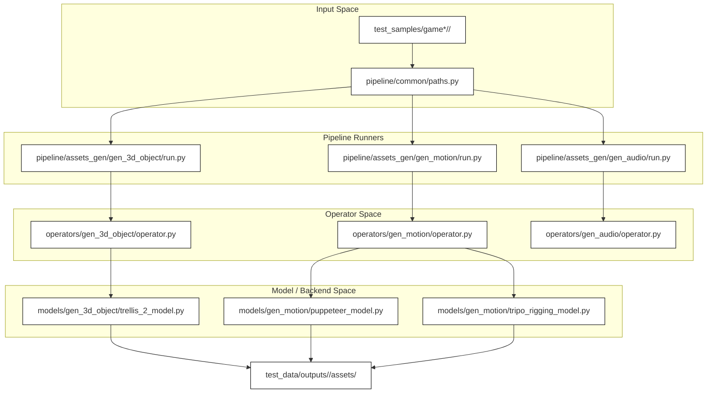
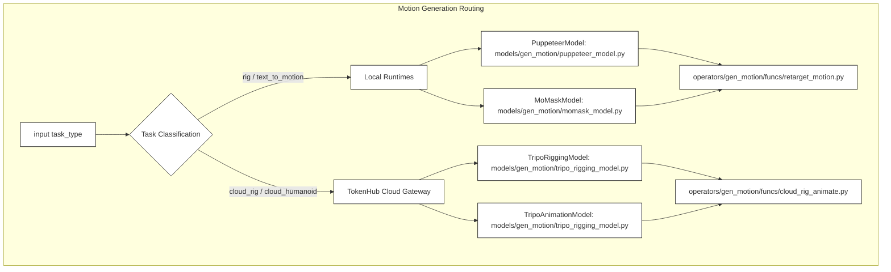

<!-- source: DeepWiki mcp.deepwiki.com · repo OpenDCAI/GameFactory-3A · page 3 Asset Generation (Layer A) · fetched 2026-11-02 -->

# Asset Generation (Layer A)

Relevant source files

The following files were used as context for generating this wiki page:

- [models/README.md](models/README.md)
- [models/gen_audio/__init__.py](models/gen_audio/__init__.py)
- [models/gen_motion/tripo_rigging_model.py](models/gen_motion/tripo_rigging_model.py)
- [operators/README.md](operators/README.md)
- [operators/gen_audio/__init__.py](operators/gen_audio/__init__.py)
- [operators/gen_audio/funcs/__init__.py](operators/gen_audio/funcs/__init__.py)
- [operators/gen_motion/funcs/cloud_rig_animate.py](operators/gen_motion/funcs/cloud_rig_animate.py)
- [operators/gen_motion/operator.py](operators/gen_motion/operator.py)
- [pipeline/README.md](pipeline/README.md)
- [pipeline/assets_gen/gen_audio/__init__.py](pipeline/assets_gen/gen_audio/__init__.py)
- [pipeline/assets_gen/gen_motion/run.py](pipeline/assets_gen/gen_motion/run.py)
- [test/harness/stubs.py](test/harness/stubs.py)
- [test/test_motion_cloud.py](test/test_motion_cloud.py)
- [test_data/outputs/README.md](test_data/outputs/README.md)
- [test_data/test_samples/README.md](test_data/test_samples/README.md)
- [test_data/test_samples/audio_gen_collect.jsonl](test_data/test_samples/audio_gen_collect.jsonl)

## Purpose and Scope

Layer A of 3AGameFactory handles the conversion of raw assets (reference images, text prompts, reference videos, audio snippets) into engine-ready production artifacts (GLBs, FBXs, textures, BVH clips, WAV audio, MP4 cutscenes). The asset generation stack is organized into three decoupled tiers: **Model Wrappers** (`models/`), **Task Operators** (`operators/`), and **Pipeline Runners** (`pipeline/assets_gen/`). 

For complete details on each modality, refer to the child pages:
- Model Wrappers & Cloud API Plumbing: See [Model Wrappers & Cloud API Plumbing](#3.1)
- Image & T-Pose Generation: See [Image & T-Pose Generation](#3.2)
- 3D Object Generation: See [3D Object Generation](#3.3)
- 3D Scene Generation: See [3D Scene Generation](#3.4)
- Motion Generation & Rigging: See [3D Scene Generation](#3.4)
- Audio Generation: See [Audio Generation](#3.6)
- CG Video Generation: See [CG Video Generation](#3.7)

Sources: `models/README.md:1-13`, `pipeline/README.md:1-30`, `test_data/test_samples/README.md:1-5`

---

## Architecture Overview

The asset generation pipeline follows a strict dependency flow where inputs are resolved via `pipeline/common/paths.py`, processed through uniform `run.py` entrypoints, delegated to task operators, and executed by modular model wrappers or cloud APIs.

Sources: `pipeline/README.md:37-48`, `test_data/outputs/README.md:1-27`

---

## 3.1. Model Wrappers & Cloud API Plumbing

Thin wrappers around individual generation models reside in `models/` following a uniform `load()`, `infer()`, and `unload()` lifecycle [models/README.md:1-6](). Local-weight models manage CUDA memory directly, while closed-source cloud APIs delegate shared plumbing (HTTP retry, error classification, response caching, submit-poll-download loops) to `models/common/cloud_api.py` [models/README.md:8-12](). 

For full architectural details, backend inventories, and glb utilities, see [Model Wrappers & Cloud API Plumbing](#3.1).

Sources: `models/README.md:1-13`, `test/harness/stubs.py:1-21`

---

## 3.2. Image & T-Pose Generation

The `gen_tpose_image` pipeline processes character reference images to generate clean, symmetrical T-pose RGBA assets suitable for downstream rigging [operators/README.md:20-23](). It integrates local editing models like `QwenEditModel` alongside matting and depth extraction tools (`RMBGModel`, `DepthAnythingModel`) [models/README.md:25-33]().

For implementation workflows, prompt strategies, and evaluation paths, see [Image & T-Pose Generation](#3.2).

Sources: `models/README.md:25-33`, `operators/README.md:20-23`, `pipeline/README.md:50-79`

---

## 3.3. 3D Object Generation

Single 3D asset generation is driven by `Gen3DObjectOperator` in `operators/gen_3d_object/operator.py` [operators/README.md:20-24](). Backends are swappable via uniform `infer_and_save()` signatures supporting local weights (TRELLIS.2) or cloud mesh generation APIs (Tripo, Meshy) [models/README.md:18-20,42-46](). In parallel, declarative code-spec assets utilize geometric assembly helpers.

For detailed breakdown of cloud mesh generation vs. declarative code assets, see [3D Object Generation](#3.3), including:
- Declarative Code Assets & GLB Writer: See [Declarative Code Assets & GLB Writer](#3.3.1)
- Asset Templates (Assembly, Routing, Humanoids): See [Asset Templates: Assembly, Routing, Humanoids](#3.3.2)

Sources: `models/README.md:18-20,42-46`, `operators/README.md:20-24`

---

## 3.4. 3D Scene Generation

Scene generation handles whole-world creation via `Gen3DSceneOperator` [operators/README.md:20-25](). It bifurcates into a code-driven terrain/greybox editing path (`terrain_code_edit`) and a learned scene reconstruction path leveraging `WorldMirrorModel` and `WorldPlayModel` [models/README.md:21-22]().

For terrain noise baking, layout filters, and learned appearance asset population, see [3D Scene Generation](#3.4), including:
- Terrain Code Pipeline: See [Terrain Code Pipeline](#3.4.1)
- Learned Scene Reconstruction & Scene Assets: See [Learned Scene Reconstruction & Scene Assets](#3.4.2)

Sources: `models/README.md:21-22`, `operators/README.md:20-25`

---

## 3.5. Motion Generation & Rigging

Sources: `pipeline/assets_gen/gen_motion/run.py:100-137`, `operators/gen_motion/operator.py:13-19`, `operators/gen_motion/funcs/cloud_rig_animate.py:1-22`

The `gen_motion` pipeline integrates local rigging/text-to-motion tools (`PuppeteerModel`, `MoMaskModel`) with cloud alternatives through Tencent Cloud TokenHub (`TripoRiggingModel`, `TripoAnimationModel`) [models/README.md:31-32, model/gen_motion/tripo_rigging_model.py:4-10](). Retargeting uses `retarget_utils` mapping presets executed via Blender subprocesses [pipeline/assets_gen/gen_motion/run.py:22-33]().

For detailed workflows on local MoMask pipelines vs. Cloud TokenHub submissions, see [Motion Generation & Rigging](#3.5), including:
- Local Rigging, MoMask & Retargeting: See [Local Rigging, MoMask & Retargeting](#3.5.1)
- Cloud Rigging via Tripo/TokenHub: See [Cloud Rigging via Tripo/TokenHub](#3.5.2)

Sources: `models/README.md:31-32`, `pipeline/assets_gen/gen_motion/run.py:22-63`, `models/gen_motion/tripo_rigging_model.py:1-45`

---

## 3.6. Audio Generation

Audio generation processes text prompts and reference audio into character dialogue or sound effects via `GenAudioOperator` [operators/README.md:20-27](). Supported backends include `SeedAudioModel`, `Qwen3TTSModel`, and `WooshDFlowModel` [models/README.md:28-30]().

For pipeline execution scripts, dialogue/SFX specifications, and evaluation metrics, see [Audio Generation](#3.6).

Sources: `models/README.md:28-30`, `operators/README.md:20-27`, `models/gen_audio/__init__.py:1-8`

---

## 3.7. CG Video Generation

Cinematic and cutscene video assets are generated via `GenCGVideoOperator` using cloud models like MiniMax H3 and Seedance [models/README.md:23-24, operators/README.md:20-28](). Operator flow handles prompt parsing, video interpolation, and installation scripts.

For execution instructions, test cases, and operator details, see [CG Video Generation](#3.7).

Sources: `models/README.md:23-24`, `operators/README.md:20-28`

---

