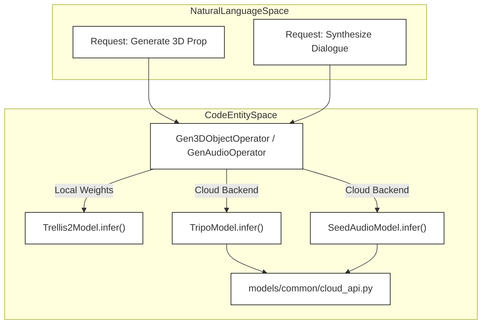
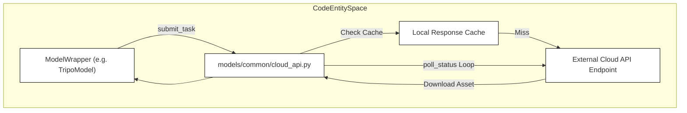
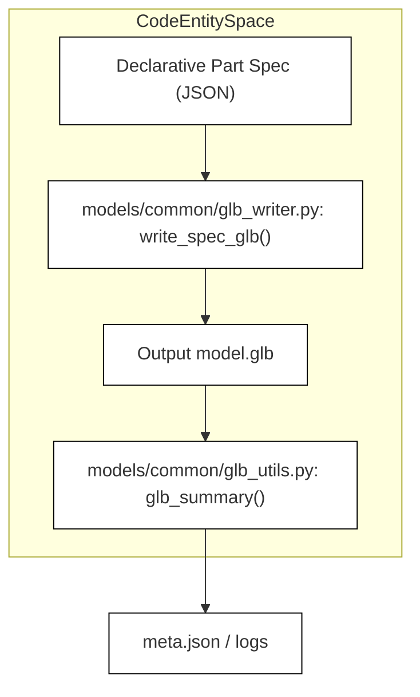

<!-- source: DeepWiki mcp.deepwiki.com · repo OpenDCAI/GameFactory-3A · page 3.1 Model Wrappers & Cloud API Plumbing · fetched 2026-11-02 -->

# Model Wrappers & Cloud API Plumbing

<details>
<summary>Relevant source files</summary>

The following files were used as context for generating this wiki page:

- [agent_skills/asset_qa/3d_object/SKILL.md](agent_skills/asset_qa/3d_object/SKILL.md)
- [agent_skills/asset_qa/3d_object/composition_examples.md](agent_skills/asset_qa/3d_object/composition_examples.md)
- [agent_skills/develop_harness/api_model_require.md](agent_skills/develop_harness/api_model_require.md)
- [models/README.md](models/README.md)
- [models/common/cloud_api.py](models/common/cloud_api.py)
- [models/common/glb_utils.py](models/common/glb_utils.py)
- [models/common/glb_writer.py](models/common/glb_writer.py)
- [models/gen_audio/__init__.py](models/gen_audio/__init__.py)
- [models/gen_audio/seed_audio_model.py](models/gen_audio/seed_audio_model.py)
- [models/gen_audio/seed_audio_utils/__init__.py](models/gen_audio/seed_audio_utils/__init__.py)
- [models/gen_audio/seed_audio_utils/api.py](models/gen_audio/seed_audio_utils/api.py)
- [models/gen_audio/seed_audio_utils/audio.py](models/gen_audio/seed_audio_utils/audio.py)
- [models/gen_image/qwen_edit_model.py](models/gen_image/qwen_edit_model.py)
- [models/tools/image_matting/depth_anything_model.py](models/tools/image_matting/depth_anything_model.py)
- [models/tools/image_matting/rmbg_model.py](models/tools/image_matting/rmbg_model.py)
- [operators/README.md](operators/README.md)
- [operators/gen_3d_object/funcs/code_asset.py](operators/gen_3d_object/funcs/code_asset.py)
- [operators/gen_3d_object/funcs/code_asset_templates/__init__.py](operators/gen_3d_object/funcs/code_asset_templates/__init__.py)
- [operators/gen_3d_object/funcs/code_asset_templates/assembly.py](operators/gen_3d_object/funcs/code_asset_templates/assembly.py)
- [operators/gen_3d_object/funcs/code_asset_templates/rigid_template/__init__.py](operators/gen_3d_object/funcs/code_asset_templates/rigid_template/__init__.py)
- [operators/gen_3d_object/funcs/code_asset_templates/routing.py](operators/gen_3d_object/funcs/code_asset_templates/routing.py)
- [operators/gen_audio/__init__.py](operators/gen_audio/__init__.py)
- [operators/gen_audio/funcs/__init__.py](operators/gen_audio/funcs/__init__.py)
- [pipeline/README.md](pipeline/README.md)
- [pipeline/assets_gen/gen_audio/__init__.py](pipeline/assets_gen/gen_audio/__init__.py)
- [pipeline/assets_gen/gen_audio/run.py](pipeline/assets_gen/gen_audio/run.py)
- [test/test_3d_object_spec.py](test/test_3d_object_spec.py)
- [test/test_api_audio.py](test/test_api_audio.py)
- [test_data/outputs/README.md](test_data/outputs/README.md)
- [test_data/test_samples/README.md](test_data/test_samples/README.md)
- [test_data/test_samples/audio_gen_collect.jsonl](test_data/test_samples/audio_gen_collect.jsonl)

</details>


This leaf page details the architecture and implementation of the `models/` layer within 3AGameFactory. It covers the uniform model lifecycle (`load()`, `infer()`, `unload()`), the distinction between local weight wrappers and cloud-backed adapters, the shared cloud API plumbing (`models/common/cloud_api.py`), and the dependency-free binary glTF utilities (`glb_utils.py` and `glb_writer.py`) that enable geometry processing and validation on CPU-only environments.

---

## 1. Directory Layout & Uniform Lifecycle (`models/`)

The `models/` directory houses thin wrappers around individual generation and utility models. Each model implementation is self-contained in a single file [models/README.md:1-4](). 

Operators interact with models through a strict uniform interface consisting of three lifecycle methods:
- `load()`: Initializes the model, allocates GPU memory, or establishes API credentials.
- `infer()`: Executes the model forward pass or remote task submission/polling.
- `unload()`: Releases GPU memory or resources, ensuring clean state boundaries between pipeline stages.

```
models/
├── common/
│   ├── cloud_api.py         # Shared HTTP retry, caching, submit-poll logic
│   ├── glb_utils.py         # Stdlib-only binary glTF inspection & vertex decoding
│   └── glb_writer.py        # Stdlib-only binary glTF part spec compiler
├── gen_3d_object/
│   ├── trellis_2_model.py   # Local weights (TRELLIS.2)
│   ├── tripo_model.py       # Cloud API (Tripo)
│   └── meshy_model.py       # Cloud API (Meshy)
├── gen_audio/
│   ├── qwen3_tts_model.py   # Local weights (Qwen3-TTS)
│   ├── woosh_model.py       # Local weights (Woosh-DFlow)
│   └── seed_audio_model.py  # Cloud API (Seed Audio)
└── ...
```

### Local Weight Wrappers vs. Cloud Backends

Models are categorized into two execution paradigms governed by developer harness contracts (`model_require.md` and `api_model_require.md`) [models/README.md:8-12]():

1. **Local Weight Wrappers**: Run locally on CUDA devices. Examples include `Trellis2Model` (`models/gen_3d_object/trellis_2_model.py`), `Qwen3TTSModel` (`models/gen_audio/qwen3_tts_model.py`), and `WooshDFlowModel` (`models/gen_audio/woosh_model.py`). They require explicit checkpoint paths and local GPU resources [models/README.md:14-35]().
2. **Cloud API Backends**: Communicate with external services over HTTPS. Examples include `TripoModel`, `MeshyModel`, and `SeedAudioModel` [models/README.md:14-35](). They depend on environment variables (e.g., `$TRIPO_API_KEY`, `$SEED_AUDIO_API_KEY`) and utilize shared cloud plumbing to manage network requests.


*Sources: `models/README.md:1-40`*, `pipeline/assets_gen/gen_audio/run.py:50-113`()

---

## 2. Cloud API Plumbing (`models/common/cloud_api.py`)

Cloud-backed models share standard HTTP infrastructure to prevent redundant implementations of network error handling, rate limiting, and asynchronous polling [models/README.md:10-12](). 

Key features provided by `models/common/cloud_api.py`:
- **HTTP Retry & Error Classification**: Automatically catches transient network failures and HTTP 429/5xx status codes, applying exponential backoff.
- **Response Caching**: Caches deterministic remote generation responses to disk (`test_data/outputs/_api_cache`), reducing API costs during iterative pipeline testing.
- **Submit-Poll-Download Workflow**: Standardizes asynchronous task lifecycles used by 3D object and video generators (e.g., submitting a task ID, polling status until `SUCCESS`, and streaming the resulting asset buffer).


*Sources: `models/README.md:10-12`*, `models/common/cloud_api.py:1-50`()

---

## 3. GLB Inspection & Writing Utilities (`glb_utils.py` & `glb_writer.py`)

Asset generation pipelines frequently process binary glTF (`.glb`) files. To operate in lightweight, CPU-only environments without heavy scientific Python stacks (`numpy`/`scipy`/`trimesh`), 3AGameFactory implements zero-dependency stdlib parsers and writers [models/common/glb_utils.py:1-23](), [models/common/glb_writer.py:1-47]().

### `models/common/glb_utils.py`
Provides dependency-free inspection of binary glTF buffers [models/common/glb_utils.py:1-23]():
- `is_glb(data)`: Validates the 12-byte glTF magic header [models/common/glb_utils.py:58-60]().
- `glb_json_chunk(data)`: Extracts and decodes the embedded JSON document chunk [models/common/glb_utils.py:63-100]().
- `glb_triangle_count(data)`: Computes the asset's total triangle count by evaluating primitive accessors, fulfilling verification requirements (`api_model_require.md` R9.8) [models/common/glb_utils.py:103-131]().
- `glb_summary(data)`: Gathers structural metrics (buffer size, node counts, material counts, generator string) for logging and `meta.json` generation [models/common/glb_utils.py:134-162]().
- `read_glb_mesh(data)`: Decodes vertex buffers, positions, normals, and UVs into normalized coordinate frames for geometry composition [models/common/glb_utils.py:168-192]().

### `models/common/glb_writer.py`
Compiles declarative part specifications into binary glTF files using only the Python standard library [models/common/glb_writer.py:1-11]():
- `write_spec_glb(spec, output_path)`: Evaluates analytic primitives (`box`, `cylinder`, `cone`, `sphere`, `torus`, `lathe`, `extrude`) and external mesh parts (`mesh`), assembling them into a single welded `.glb` file [models/common/glb_writer.py:1-47](), [operators/gen_3d_object/funcs/code_asset.py:110-130]().
- `load_mesh_asset(source, trim)`: Reads and caches external GLBs, normalizing them into unit bounding boxes while supporting vertical trimming (e.g., removing mannequin stands from fetched assets) [models/common/glb_writer.py:77-141]().


*Sources: `models/common/glb_writer.py:1-47`*, `models/common/glb_utils.py:1-23`()

---

## 4. Summary of Implemented Wrappers

| Slot | Class Name | File Path | Type | Key Dependencies |
| :--- | :--- | :--- | :--- | :--- |
| `gen_3d_object` | `Trellis2Model` | `models/gen_3d_object/trellis_2_model.py` [models/README.md:18]() | Local Weights | GPU + o-voxel extension [models/README.md:18]() |
| `gen_3d_object` | `TripoModel` | `models/gen_3d_object/tripo_model.py` [models/README.md:19]() | Cloud API | `$TRIPO_API_KEY` [models/README.md:19]() |
| `gen_3d_object` | `MeshyModel` | `models/gen_3d_object/meshy_model.py` [models/README.md:20]() | Cloud API | `$MESHY_API_KEY` [models/README.md:20]() |
| `gen_audio` | `Qwen3TTSModel` | `models/gen_audio/qwen3_tts_model.py` [models/README.md:29]() | Local Weights | `qwen-tts` package [models/README.md:29]() |
| `gen_audio` | `WooshDFlowModel` | `models/gen_audio/woosh_model.py` [models/README.md:30]() | Local Weights | Checkpoints (`Woosh-DFlow`, `Woosh-AE`) [models/README.md:30]() |
| `gen_audio` | `SeedAudioModel` | `models/gen_audio/seed_audio_model.py` [models/README.md:28]() | Cloud API | `$SEED_AUDIO_API_KEY` [models/README.md:28]() |

*Sources: `models/README.md:14-35`*

---

