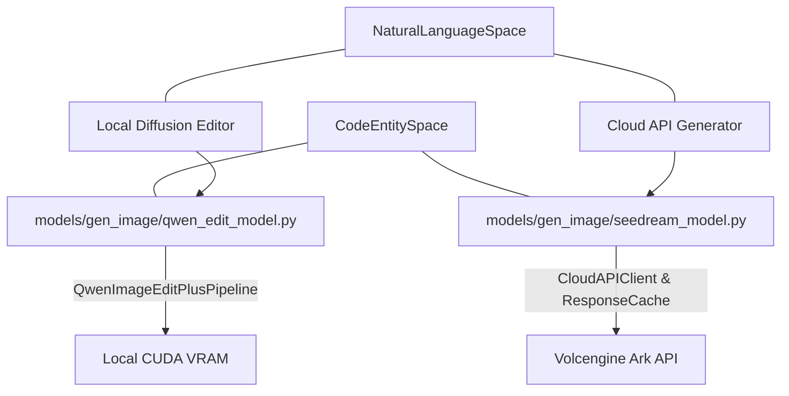

<!-- source: DeepWiki mcp.deepwiki.com · repo OpenDCAI/GameFactory-3A · page 3.2 Image & T-Pose Generation · fetched 2026-11-02 -->

# Image & T-Pose Generation

<details>
<summary>Relevant source files</summary>

The following files were used as context for generating this wiki page:

- [models/gen_image/__init__.py](models/gen_image/__init__.py)
- [models/gen_image/qwen_edit_model.py](models/gen_image/qwen_edit_model.py)
- [models/gen_image/seedream_model.py](models/gen_image/seedream_model.py)
- [models/tools/__init__.py](models/tools/__init__.py)
- [models/tools/base.py](models/tools/base.py)
- [models/tools/image_matting/__init__.py](models/tools/image_matting/__init__.py)
- [models/tools/image_matting/depth_anything_model.py](models/tools/image_matting/depth_anything_model.py)
- [models/tools/image_matting/rmbg_model.py](models/tools/image_matting/rmbg_model.py)
- [operators/gen_tpose_image/__init__.py](operators/gen_tpose_image/__init__.py)
- [operators/gen_tpose_image/funcs/__init__.py](operators/gen_tpose_image/funcs/__init__.py)
- [operators/gen_tpose_image/funcs/gen_tpose_image.py](operators/gen_tpose_image/funcs/gen_tpose_image.py)
- [operators/gen_tpose_image/metrics/__init__.py](operators/gen_tpose_image/metrics/__init__.py)
- [operators/gen_tpose_image/operator.py](operators/gen_tpose_image/operator.py)
- [pipeline/assets_gen/gen_tpose_image/__init__.py](pipeline/assets_gen/gen_tpose_image/__init__.py)
- [pipeline/assets_gen/gen_tpose_image/eval.py](pipeline/assets_gen/gen_tpose_image/eval.py)
- [pipeline/assets_gen/gen_tpose_image/run.py](pipeline/assets_gen/gen_tpose_image/run.py)
- [test/test_api_gen_tpose_image.py](test/test_api_gen_tpose_image.py)
- [test/test_gen_tpose_image.py](test/test_gen_tpose_image.py)

</details>


## Purpose and Scope
This page documents the `gen_tpose_image` pipeline [pipeline/assets_gen/gen_tpose_image/run.py:1-236] and its associated model wrappers, operators, and post-processing tools. The pipeline transforms 2D character reference images or text descriptions into standardized game-CG T-pose reference sheets with transparent backgrounds (`tpose_fg.png`), engineered specifically as downstream inputs for 3D generation pipelines like TRELLIS.2 [operators/gen_tpose_image/funcs/gen_tpose_image.py:1-253].

---

## 1. Pipeline Architecture & Execution Flow

The `gen_tpose_image` pipeline is structured into three distinct execution tiers: the CLI runner script, the stateful operator wrapper, and the functional processing primitives.

```mermaid
graph TD
    sub5["NaturalLanguageSpace"]
    sub5 --- A[""CLI Runner Entrypoint""]
    sub5 --- B[""Operator Wrapper""]
    sub5 --- C[""Generation & Matting Logic""]

    sub6["CodeEntitySpace"]
    sub6 --- D["pipeline/assets_gen/gen_tpose_image/run.py"]
    sub6 --- E["operators/gen_tpose_image/operator.py"]
    sub6 --- F["operators/gen_tpose_image/funcs/gen_tpose_image.py"]

    A --> D
    B --> E
    C --> F

    D -->|"Loads & Invokes"| E
    E -->|"Delegates Tasks"| F
    F -->|"Calls Model Infer"| G[""Model Wrappers (Qwen/Seedream/RMBG)""]

    click D "https://github.com/OpenDCAI/GameFactory-3A"
    click E "https://github.com/OpenDCAI/GameFactory-3A"
    click F "https://github.com/OpenDCAI/GameFactory-3A"
```
*Sources: [pipeline/assets_gen/gen_tpose_image/run.py:1-235](), [operators/gen_tpose_image/operator.py:1-241](), [operators/gen_tpose_image/funcs/gen_tpose_image.py:1-252]()*

### Runner Script (`pipeline/assets_gen/gen_tpose_image/run.py`)
The runner script coordinates batch execution via JSONL task lists [pipeline/assets_gen/gen_tpose_image/run.py:136-145] or single-image demo execution [pipeline/assets_gen/gen_tpose_image/run.py:31-35]. It handles backend selection (`qwen_edit` vs `seedream`) [pipeline/assets_gen/gen_tpose_image/run.py:62-94], matting tool loading [pipeline/assets_gen/gen_tpose_image/run.py:97-105], and maps outputs to either per-game run directories (`test_data/outputs/<game_id>/<run_id>/assets/tpose/<task_id>/`) or legacy flat directories [pipeline/assets_gen/gen_tpose_image/run.py:10-29].

### Operator (`GenTPoseImageOperator`)
Defined in `operators/gen_tpose_image/operator.py`, `GenTPoseImageOperator` accepts any injected image-edit model conforming to the `.infer(image, prompt, seed, steps) -> PIL.Image` contract, alongside an optional foreground extraction model [operators/gen_tpose_image/operator.py:68-89]. It resolves input paths from dictionaries (`image_path` or preloaded `PIL.Image`) [operators/gen_tpose_image/operator.py:110-122] and routes artifact creation [operators/gen_tpose_image/operator.py:125-144].

Sources: [pipeline/assets_gen/gen_tpose_image/run.py:1-235](), [operators/gen_tpose_image/operator.py:1-241]()

---

## 2. Image Generation Backends

The pipeline supports two interchangeable generation backends maintaining interface parity: a local diffusion editing model (`QwenEditModel`) and a cloud API model (`SeedreamModel`) [models/gen_image/qwen_edit_model.py:21-121, models/gen_image/seedream_model.py:43-122].


*Sources: [models/gen_image/qwen_edit_model.py:21-120](), [models/gen_image/seedream_model.py:43-122]()*

### Local Weights: `QwenEditModel`
* **File**: `models/gen_image/qwen_edit_model.py`
* **Class**: `QwenEditModel`
* **Implementation**: Wraps `QwenImageEditPlusPipeline` from Hugging Face Diffusers [models/gen_image/qwen_edit_model.py:45-54]. Operates in `bfloat16` on CUDA [models/gen_image/qwen_edit_model.py:47-51], executing instruction-guided image editing with deterministic generator seeding [models/gen_image/qwen_edit_model.py:101-110]. Implements `unload()` to clear VRAM between pipeline stages [models/gen_image/qwen_edit_model.py:56-73].

### Cloud API: `SeedreamModel`
* **File**: `models/gen_image/seedream_model.py`
* **Class**: `SeedreamModel`
* **Implementation**: Integrates with Volcengine Ark's asynchronous/synchronous image generation endpoints (`doubao-seedream-5-0-260128`) [models/gen_image/seedream_model.py:29-73]. It uses `cloud_api.CloudAPIClient` for authenticated HTTP transport and `cloud_api.ResponseCache` for caching billing-incurred generations [models/gen_image/seedream_model.py:96-113]. Supports text-to-image (when image is `None`) and image-to-image editing via base64 data URIs [models/gen_image/seedream_model.py:50-52, 141-144].

Sources: [models/gen_image/qwen_edit_model.py:21-120](), [models/gen_image/seedream_model.py:43-122]()

---

## 3. Matting & Depth Extraction Tools

To isolate characters from generated white-background renders, the pipeline dispatches to auxiliary tool models inheriting from `BaseToolModel` [models/tools/base.py:23-86, models/tools/image_matting/__init__.py:1-18].

| Tool Class | Module Path | Backend Model | Output Format | Role |
| :--- | :--- | :--- | :--- | :--- |
| `RMBGModel` | `models.tools.image_matting.rmbg_model` | BRIA RMBG-1.4 | `HxW float32` `[0,1]` mask | Direct alpha-mask foreground segmentation [models/tools/image_matting/rmbg_model.py:27-116] |
| `DepthAnythingModel` | `models.tools.image_matting.depth_anything_model` | DepthAnything | `HxW float32` depth map | Depth-based segmentation combined with white-bg thresholding [operators/gen_tpose_image/funcs/gen_tpose_image.py:72-95] |

### Foreground Extraction Logic (`operators/gen_tpose_image/funcs/gen_tpose_image.py`)
1. **RGB Generation**: The reference image and description are processed using `TPOSE_PROMPT` to enforce a pure solid white background (`RGB 255,255,255`) [operators/gen_tpose_image/funcs/gen_tpose_image.py:29-55].
2. **Matting Dispatch**: `_extract_foreground()` checks model type; if a depth estimator is detected, `_extract_foreground_via_depth()` combines normalized depth quantiles with white-background suppression (`white_thresh=235`) and morphological filtering [operators/gen_tpose_image/funcs/gen_tpose_image.py:72-96]. Otherwise, `_extract_foreground_via_mask()` applies `RMBGModel` probabilities directly to the alpha channel [operators/gen_tpose_image/funcs/gen_tpose_image.py:98-131].

Sources: [models/tools/base.py:23-85](), [models/tools/image_matting/rmbg_model.py:27-115](), [operators/gen_tpose_image/funcs/gen_tpose_image.py:29-138]()

---

## 4. Post-Processing & Evaluation Path

### Trellis-Ready Post-Processing
Post-generation outputs undergo rigorous validation and normalization via `_postprocess_for_trellis()` [operators/gen_tpose_image/funcs/gen_tpose_image.py:144-183]:
* **Alpha Sanity Check**: If the generated foreground pixel count is `< 1%` of total canvas pixels, a fallback white-background color thresholding is triggered [operators/gen_tpose_image/funcs/gen_tpose_image.py:153-164].
* **Tight Bounding Box & Padding**: Non-zero alpha rows and columns determine character bounding bounds, expanded by a 5% padding factor (`padding=0.05`) [operators/gen_tpose_image/funcs/gen_tpose_image.py:166-182].
* **Square Canvas Resizing**: Cropped regions are pasted onto a centered square canvas and resized to a canonical target resolution (default `1024x1024`) for downstream 3D object reconstruction pipelines.

### Evaluation Pathways
Integration tests (`test/test_gen_tpose_image.py` and `test/test_api_gen_tpose_image.py`) validate the pipeline end-to-end [test/test_gen_tpose_image.py:33-70, test/test_api_gen_tpose_image.py:49-164]. They iterate over canonical task samples stored in `test_data/test_samples/tpose_gen_collect.jsonl`, asserting that generated PNGs possess valid `RGBA` modes, non-trivial file sizes (>1024 bytes), and non-empty alpha channels [test/test_api_gen_tpose_image.py:108-164].

Sources: [operators/gen_tpose_image/funcs/gen_tpose_image.py:144-183](), [test/test_gen_tpose_image.py:33-70](), [test/test_api_gen_tpose_image.py:49-164]()

---

