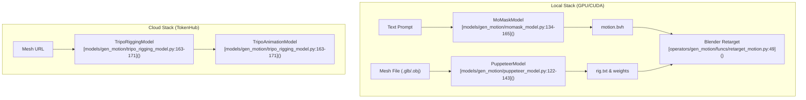

<!-- source: DeepWiki mcp.deepwiki.com · repo OpenDCAI/GameFactory-3A · page 3.5 Motion Generation & Rigging · fetched 2026-11-02 -->

# Motion Generation & Rigging

<details>
<summary>Relevant source files</summary>

The following files were used as context for generating this wiki page:

- [models/gen_motion/momask_model.py](models/gen_motion/momask_model.py)
- [models/gen_motion/puppeteer_model.py](models/gen_motion/puppeteer_model.py)
- [models/gen_motion/tripo_rigging_model.py](models/gen_motion/tripo_rigging_model.py)
- [operators/gen_motion/funcs/cloud_rig_animate.py](operators/gen_motion/funcs/cloud_rig_animate.py)
- [operators/gen_motion/funcs/retarget_utils/__init__.py](operators/gen_motion/funcs/retarget_utils/__init__.py)
- [operators/gen_motion/funcs/retarget_utils/mapping_presets.py](operators/gen_motion/funcs/retarget_utils/mapping_presets.py)
- [operators/gen_motion/operator.py](operators/gen_motion/operator.py)
- [pipeline/assets_gen/gen_motion/run.py](pipeline/assets_gen/gen_motion/run.py)
- [test/harness/stubs.py](test/harness/stubs.py)
- [test/test_gen_motion.py](test/test_gen_motion.py)
- [test/test_motion_cloud.py](test/test_motion_cloud.py)
- [test/test_rigging_retarget.py](test/test_rigging_retarget.py)

</details>


The `gen_motion` pipeline handles character rigging, text-to-motion generation, and motion retargeting for 3AGameFactory. It supports two distinct execution paths: a local high-fidelity stack leveraging **Puppeteer** for skeleton/skinning prediction, **MoMask** for natural-language text-to-motion synthesis, and a **Blender** subprocess backend for retargeting; and a cloud-native stack using **Tripo3D** models accessed through the **Tencent Cloud TokenHub** gateway. 

The entrypoint operator `GenMotionOperator` unifies these workflows under the shared `motion` task kind, managing input validation, fallback logic, and per-task artifact routing (`[operators/gen_motion/operator.py:67-104]()`).

Sources: `operators/gen_motion/operator.py:1-104`, `pipeline/assets_gen/gen_motion/run.py:1-64`

---

## Motion Operator & Task Taxonomy

The pipeline processes diverse motion tasks through `GenMotionOperator` (`[operators/gen_motion/operator.py:67-104]()`), which inspects task payloads and dispatches execution to local wrappers or cloud client models based on the requested `task_type` (`[operators/gen_motion/operator.py:13-19]()`).

```mermaid
graph TD
    A["TaskInput"] --> B["GenMotionOperator"]
    B --> C{"Task Type?"}
    C -->| "rig / humanoid" | D["PuppeteerModel\n[models/gen_motion/puppeteer_model.py:34-62]()"]
    C -->| "text_to_motion" | E["MoMaskModel\n[models/gen_motion/momask_model.py:26-52]()"]
    C -->| "retarget" | F["Blender Retarget Runtime\n[operators/gen_motion/funcs/retarget_motion.py:44-50]()"]
    C -->| "cloud_rig / cloud_humanoid" | G["TripoCloudModels\n[models/gen_motion/tripo_rigging_model.py:163-171]()"]
```
*Figure 1: Natural Language Space to Code Entity Space mapping for local and cloud motion pipelines.*

Sources: `operators/gen_motion/operator.py:13-104`, `models/gen_motion/puppeteer_model.py:34-62`, `models/gen_motion/momask_model.py:26-52`

---

## Local Rigging & Cloud Pipeline Comparison

To bridge high-level asset specifications to concrete code implementations, the system offers two execution modalities for motion generation.


*Figure 2: Component architecture mapping local subprocess runners versus cloud TokenHub endpoints.*

Sources: `models/gen_motion/puppeteer_model.py:122-143`, `models/gen_motion/momask_model.py:134-165`, `models/gen_motion/tripo_rigging_model.py:163-171`

---

## 3.5.1 Local Rigging, MoMask & Retargeting

For details, see [Local Rigging, MoMask & Retargeting](#3.5.1).

The local execution path relies on standalone sub-processes to isolate external dependencies (such as PyTorch environments and Blender `bpy`). `PuppeteerModel` predicts bone structures and skinning weights from 3D character meshes (`[models/gen_motion/puppeteer_model.py:122-143]()`), while `MoMaskModel` generates HumanML3D-compatible BVH motion clips from natural language descriptions (`[models/gen_motion/momask_model.py:134-165]()`). Retargeting utilities normalize bone naming presets and execute animation baking within Blender (`[operators/gen_motion/funcs/retarget_motion.py:44-50]()`).

Sources: `models/gen_motion/puppeteer_model.py:34-143`, `models/gen_motion/momask_model.py:26-165`, `operators/gen_motion/funcs/retarget_motion.py:44-50`

---

## 3.5.2 Cloud Rigging via Tripo/TokenHub

For details, see [Cloud Rigging via Tripo/TokenHub](#3.5.2).

The cloud backend communicates with Tencent Cloud TokenHub endpoints (`[models/gen_motion/tripo_rigging_model.py:1-45]()`) to perform zero-local-weight rigging, classification, and format conversion. Using `TripoRigCheckModel`, `TripoRiggingModel`, `TripoAnimationModel`, and `TripoFormatModel` (`[pipeline/assets_gen/gen_motion/run.py:100-137]()`), tasks are submitted via HTTP POST requests and polled until completion, operating directly on public mesh URLs and server-side skeleton tasks (`[operators/gen_motion/funcs/cloud_rig_animate.py:28-167]()`).

Sources: `models/gen_motion/tripo_rigging_model.py:1-171`, `pipeline/assets_gen/gen_motion/run.py:100-137`, `operators/gen_motion/funcs/cloud_rig_animate.py:28-167`

---

