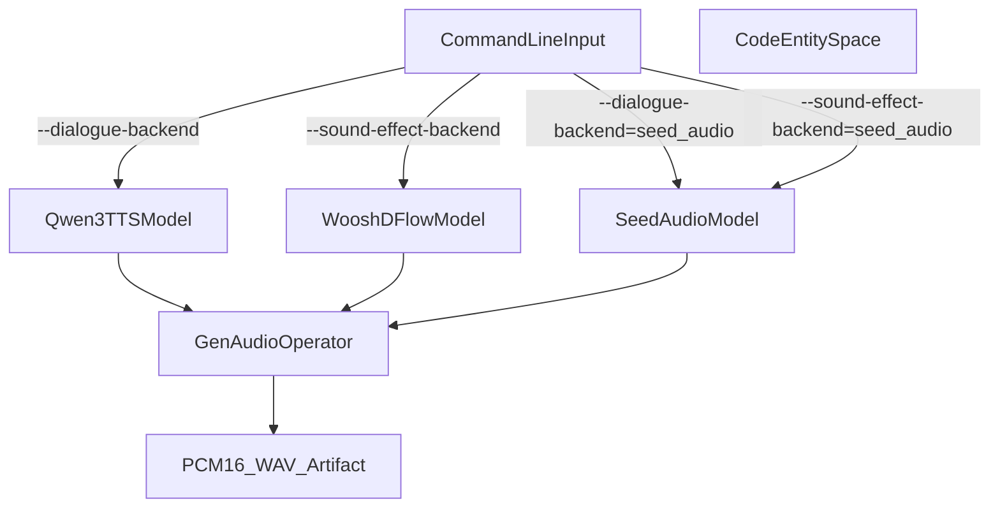
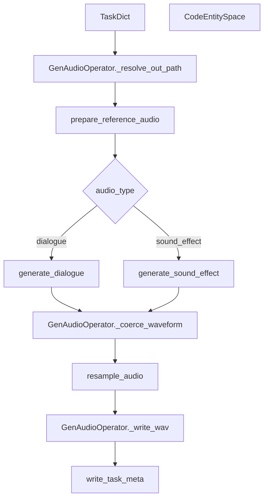

<!-- source: DeepWiki mcp.deepwiki.com · repo OpenDCAI/GameFactory-3A · page 3.6 Audio Generation · fetched 2026-11-02 -->

# Audio Generation

Relevant source files

The following files were used as context for generating this wiki page:

- [agent_skills/develop_harness/api_model_require.md](agent_skills/develop_harness/api_model_require.md)
- [models/common/cloud_api.py](models/common/cloud_api.py)
- [models/gen_audio/qwen3_tts_model.py](models/gen_audio/qwen3_tts_model.py)
- [models/gen_audio/qwen3_tts_utils/__init__.py](models/gen_audio/qwen3_tts_utils/__init__.py)
- [models/gen_audio/qwen3_tts_utils/runtime.py](models/gen_audio/qwen3_tts_utils/runtime.py)
- [models/gen_audio/seed_audio_model.py](models/gen_audio/seed_audio_model.py)
- [models/gen_audio/seed_audio_utils/__init__.py](models/gen_audio/seed_audio_utils/__init__.py)
- [models/gen_audio/seed_audio_utils/api.py](models/gen_audio/seed_audio_utils/api.py)
- [models/gen_audio/seed_audio_utils/audio.py](models/gen_audio/seed_audio_utils/audio.py)
- [models/gen_audio/woosh_model.py](models/gen_audio/woosh_model.py)
- [models/gen_audio/woosh_utils/__init__.py](models/gen_audio/woosh_utils/__init__.py)
- [models/gen_audio/woosh_utils/checkpoints.py](models/gen_audio/woosh_utils/checkpoints.py)
- [operators/gen_audio/funcs/generate_dialogue.py](operators/gen_audio/funcs/generate_dialogue.py)
- [operators/gen_audio/funcs/generate_sound_effect.py](operators/gen_audio/funcs/generate_sound_effect.py)
- [operators/gen_audio/funcs/prepare_reference_audio.py](operators/gen_audio/funcs/prepare_reference_audio.py)
- [operators/gen_audio/metrics/__init__.py](operators/gen_audio/metrics/__init__.py)
- [operators/gen_audio/operator.py](operators/gen_audio/operator.py)
- [pipeline/assets_gen/gen_audio/eval.py](pipeline/assets_gen/gen_audio/eval.py)
- [pipeline/assets_gen/gen_audio/run.py](pipeline/assets_gen/gen_audio/run.py)
- [test/test_api_audio.py](test/test_api_audio.py)
- [test/test_audio_gen.py](test/test_audio_gen.py)

The audio generation pipeline (`gen_audio`) is responsible for producing engine-ready audio assets (PCM16 WAV files) from task definitions or natural language prompts. It supports two primary audio routes: **dialogue** (character lines via Qwen3-TTS or Seed Audio) and **sound effects / SFX** (foley, ambience, or single-shot sounds via Woosh-DFlow or Seed Audio).

Sources: `pipeline/assets_gen/gen_audio/run.py:1-48` [pipeline/assets_gen/gen_audio/run.py:1-48](), `operators/gen_audio/operator.py:1-21` [operators/gen_audio/operator.py:1-21]()

---

## Pipeline Entrypoint & Backend Routing

The batch and demo runner is implemented in `pipeline/assets_gen/gen_audio/run.py`. It provides command-line arguments to select between local-weight models and cloud-backed alternatives, parses task JSONL files, and instantiates the audio operator.

*Figure 1: Natural Language Space to Code Entity Space routing for audio generation backends.*

Sources: `pipeline/assets_gen/gen_audio/run.py:1-158` [pipeline/assets_gen/gen_audio/run.py:1-158]()

---

## Operator & Waveform Processing (`GenAudioOperator`)

The core execution logic resides in `operators/gen_audio/operator.py`. The `GenAudioOperator` class manages path resolution, model dispatch, waveform coercion, peak normalization, and metadata output.

*Figure 2: Execution data flow inside `GenAudioOperator`.*

### Key Operator Responsibilities

- **Path Resolution**: `GenAudioOperator._resolve_out_path()` determines whether output is directed to a per-game task directory or a legacy flat directory based on the presence of `output_dir` [operators/gen_audio/operator.py:42-52]().
- **Waveform Coercion**: `GenAudioOperator._coerce_waveform()` normalizes model returns into a standard `[channels, samples]` float32 numpy array [operators/gen_audio/operator.py:54-68]().
- **Normalization and Encoding**: `GenAudioOperator._write_wav()` checks peak amplitude, applies clipping prevention if peak exceeds `1.0`, scales to `32767.0`, and outputs a standard PCM16 WAV file [operators/gen_audio/operator.py:71-86]().

Sources: `operators/gen_audio/operator.py:23-164` [operators/gen_audio/operator.py:23-164]()

---

## Model Backends

### Local Weight Models

- **Qwen3-TTS**: Implemented in `models/gen_audio/qwen3_tts_model.py` (`Qwen3TTSModel`), handling zero-shot and custom-voice dialogue generation. Loaded via `load_dialogue_model()` [pipeline/assets_gen/gen_audio/run.py:50-54]().
- **Woosh-DFlow**: Implemented in `models/gen_audio/woosh_model.py` (`WooshDFlowModel`), handling diffusion-based sound effects, paired with Woosh-AE autoencoder and TextConditionerA [pipeline/assets_gen/gen_audio/run.py:57-86]().

### Cloud API Models (Seed Audio)

The **Seed Audio** backend is implemented via `models/gen_audio/seed_audio_model.py` (`SeedAudioModel`) and conforms to the cloud-API contract defined in `agent_skills/develop_harness/api_model_require.md` [agent_skills/develop_harness/api_model_require.md:1-32]().

- **Client Isolation**: `models/gen_audio/seed_audio_utils/api.py` provides `SeedAudioAPIClient`, inheriting from `models/common/cloud_api.py`'s `CloudAPIClient`, utilizing an `X-Api-Key` header and injecting a unique `X-Api-Request-Id` UUID per call [models/gen_audio/seed_audio_utils/api.py:11-70]().
- **WAV Boundary Utilities**: `models/gen_audio/seed_audio_utils/audio.py` handles base64 encoding of reference waveforms (`encode_wav_base64`) and robust parsing of uncompressed PCM WAV bytes (`decode_wav_bytes`) across various sample widths (1, 2, 3, or 4 bytes) [models/gen_audio/seed_audio_utils/audio.py:1-81]().

Sources: `models/gen_audio/seed_audio_model.py:1-181` [models/gen_audio/seed_audio_model.py:1-181](), `models/common/cloud_api.py:1-100` [models/common/cloud_api.py:1-100](), `models/gen_audio/seed_audio_utils/api.py:1-71` [models/gen_audio/seed_audio_utils/api.py:1-70](), `models/gen_audio/seed_audio_utils/audio.py:1-82]()`

---

## Evaluation & Testing

Integration and contract tests validate the audio generation stack without requiring full hardware execution:

- **Offline API Tests**: `test/test_api_audio.py` mocks network calls to verify contract compliance, authentication headers, error classification, and response caching for `SeedAudioModel` [test/test_api_audio.py:1-197]().
- **Pipeline Integration Tests**: `test/test_audio_gen.py` exercises the end-to-end `gen_audio` pipeline (`TestGenAudioPipeline`), loading Qwen3-TTS and Woosh-DFlow models over `test_data/test_samples/audio_gen_collect.jsonl` tasks and asserting valid WAV structural properties [test/test_audio_gen.py:1-114]().

Sources: `test/test_api_audio.py:1-47` [test/test_api_audio.py:1-47](), `test/test_audio_gen.py:1-115` [test/test_audio_gen.py:1-114]()

---

