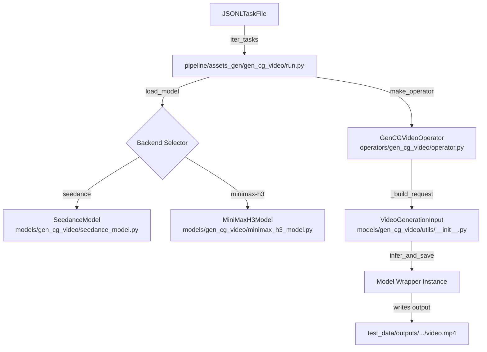
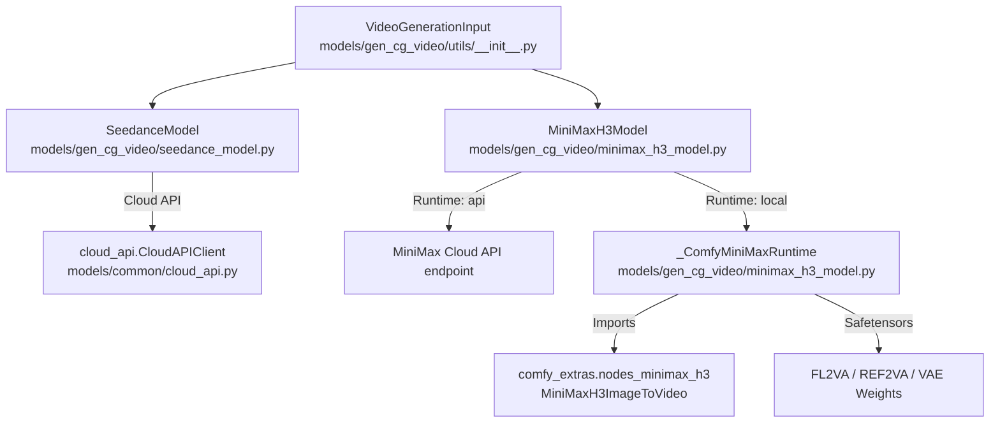

<!-- source: DeepWiki mcp.deepwiki.com · repo OpenDCAI/GameFactory-3A · page 3.7 CG Video Generation · fetched 2026-11-02 -->

# CG Video Generation

Relevant source files

The following files were used as context for generating this wiki page:

- [agent_skills/asset_qa/cg_video/game-cg-director/common/camera.md](agent_skills/asset_qa/cg_video/game-cg-director/common/camera.md)
- [agent_skills/asset_qa/cg_video/game-cg-director/common/principles.md](agent_skills/asset_qa/cg_video/game-cg-director/common/principles.md)
- [agent_skills/asset_qa/cg_video/game-cg-director/common/sound.md](agent_skills/asset_qa/cg_video/game-cg-director/common/sound.md)
- [agent_skills/asset_qa/cg_video/game-cg-director/common/style-mapping.md](agent_skills/asset_qa/cg_video/game-cg-director/common/style-mapping.md)
- [agent_skills/asset_qa/cg_video/game-cg-director/models/h3.md](agent_skills/asset_qa/cg_video/game-cg-director/models/h3.md)
- [agent_skills/asset_qa/cg_video/game-cg-director/models/seedance.md](agent_skills/asset_qa/cg_video/game-cg-director/models/seedance.md)
- [agent_skills/asset_qa/cg_video/game-cg-director/modes/fl2va.md](agent_skills/asset_qa/cg_video/game-cg-director/modes/fl2va.md)
- [agent_skills/asset_qa/cg_video/game-cg-director/modes/i2va.md](agent_skills/asset_qa/cg_video/game-cg-director/modes/i2va.md)
- [models/gen_cg_video/__init__.py](models/gen_cg_video/__init__.py)
- [models/gen_cg_video/minimax_h3_model.py](models/gen_cg_video/minimax_h3_model.py)
- [models/gen_cg_video/seedance_model.py](models/gen_cg_video/seedance_model.py)
- [models/gen_cg_video/utils/__init__.py](models/gen_cg_video/utils/__init__.py)
- [operators/gen_cg_video/__init__.py](operators/gen_cg_video/__init__.py)
- [operators/gen_cg_video/operator.py](operators/gen_cg_video/operator.py)
- [pipeline/assets_gen/gen_cg_video/run.py](pipeline/assets_gen/gen_cg_video/run.py)
- [scripts/asset_env_setup/cg_video/minimax_h3_install.sh](scripts/asset_env_setup/cg_video/minimax_h3_install.sh)
- [test/test_cg_video_gen.py](test/test_cg_video_gen.py)

The `gen_cg_video` pipeline generates cinematic and gameplay video assets (MP4 format) from natural-language descriptions, keyframes, or reference imagery. It supports two primary backend engines: Volcengine Ark's **Seedance** cloud API and **MiniMax H3** (supporting both cloud API and local ComfyUI INT8 weights). The pipeline normalizes inputs into model-agnostic request structures, dispatches execution through unified operators, and manages output directory hierarchies.

---

## 1. Pipeline Architecture & Operator Flow

The execution entry point is defined in `pipeline/assets_gen/gen_cg_video/run.py`, which parses command-line flags and environment variables to select between backend runners `seedance` and `minimax-h3` [pipeline/assets_gen/gen_cg_video/run.py:25-70](). 

Tasks are defined in JSONL task files, parsed iteratively, and passed to `GenCGVideoOperator` in `operators/gen_cg_video/operator.py` [operators/gen_cg_video/operator.py:30-46](). The operator handles input path resolution for images (such as first frames, last frames, or reference images) using `pipeline.common.paths` [operators/gen_cg_video/operator.py:48-112](). It constructs a model-agnostic `VideoGenerationInput` dataclass and delegates transport encoding and inference execution to the injected model wrapper via `infer_and_save()` [operators/gen_cg_video/operator.py:113-154]().

Title: "Pipeline and Operator Execution Flow"

Sources: `pipeline/assets_gen/gen_cg_video/run.py:25-121]`, `operators/gen_cg_video/operator.py:30-163]`, `models/gen_cg_video/utils/__init__.py:21-35]()`.

---

## 2. Model Wrappers: Seedance & MiniMax H3

The codebase implements two distinct providers under `models/gen_cg_video/`:

1. **SeedanceModel (`models/gen_cg_video/seedance_model.py`)**: Wraps Volcengine Ark's Seedance 2.0 API. It manages authenticated HTTP requests via `cloud_api.CloudAPIClient`, handles response caching (`cloud_api.ResponseCache`), and supports text-to-video, first-frame-to-video, first-last-frame-to-video, and reference-to-video modes [models/gen_cg_video/seedance_model.py:49-121]().
2. **MiniMaxH3Model (`models/gen_cg_video/minimax_h3_model.py`)**: Supports a hybrid execution model. When `runtime="api"`, it interacts with the MiniMax cloud API. When `runtime="local"`, it instantiates `_ComfyMiniMaxRuntime`, loading native ComfyUI MiniMax H3 nodes (`comfy_extras/nodes_minimax_h3.py`) and quantized component weights (FL2VA/REF2VA safetensors, text encoder, and video/audio VAEs) [models/gen_cg_video/minimax_h3_model.py:1-175]().

Title: "Model Wrapper and Runtime Architecture"

Sources: `models/gen_cg_video/seedance_model.py:49-121]`, `models/gen_cg_video/minimax_h3_model.py:1-175]`, `models/gen_cg_video/utils/__init__.py:21-35]()`.

---

## 3. Prompt Direction & Agent QA Skills

The `agent_skills/asset_qa/cg_video/game-cg-director/` sub-skill tree provides structured guidance for AI agents writing video generation prompts and managing cinematic composition. 

- **Modes**: Defines specific prompt structures for modes such as `fl2va` (first-last frame to video) [agent_skills/asset_qa/cg_video/game-cg-director/modes/fl2va.md:1-11]() and `i2va`.
- **Camera Vocabulary**: Standardizes terms for camera movement (Zoom In, Push In, Truck Left, Arc Shot, POV) and staging rules [agent_skills/asset_qa/cg_video/game-cg-director/common/camera.md:1-33]().
- **Model Profiles**: Contains specific profile constraints for Seedance [agent_skills/asset_qa/cg_video/game-cg-director/models/seedance.md:1-89]() and H3 models, detailing prompt composition order, sequential shot formatting, and reference token binding (`@Image N`, `@Video N`).

Sources: `agent_skills/asset_qa/cg_video/game-cg-director/modes/fl2va.md:1-12]`, `agent_skills/asset_qa/cg_video/game-cg-director/common/camera.md:1-34]`, `agent_skills/asset_qa/cg_video/game-cg-director/models/seedance.md:1-90]()`.

---

## 4. Integration Testing & Installation

### Integration Testing
Real-generation integration testing is executed via `test/test_cg_video_gen.py`. This script loads the selected backend once, processes every task from a local JSONL file, and verifies the generated MP4 outputs [test/test_cg_video_gen.py:1-38](). It requires explicit environment configuration (`CG_VIDEO_BACKEND`, `CG_VIDEO_TEST_TASKS`, and `MINIMAX_H3_RUNTIME` when applicable) to prevent accidental paid API calls or large model downloads [test/test_cg_video_gen.py:13-38]().

### Environment Setup
Local deployment of the MiniMax H3 runtime requires setting up ComfyUI and cloning native node extensions using the automated installation script `scripts/asset_env_setup/cg_video/minimax_h3_install.sh` [scripts/asset_env_setup/cg_video/minimax_h3_install.sh:1-25](). The script clones ComfyUI, checks out the pinned reference commit, verifies the presence of native MiniMax H3 nodes, and installs required Python packages [scripts/asset_env_setup/cg_video/minimax_h3_install.sh:6-21]().

Sources: `test/test_cg_video_gen.py:1-38]`, `scripts/asset_env_setup/cg_video/minimax_h3_install.sh:1-26]()`.

---

