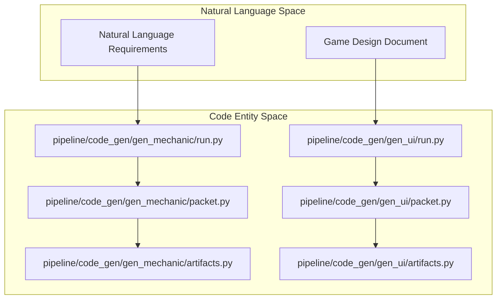
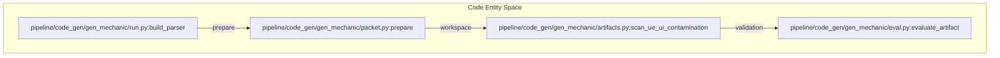
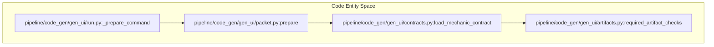

<!-- source: DeepWiki mcp.deepwiki.com · repo OpenDCAI/GameFactory-3A · page 4 Code Generation (Layers B & C) · fetched 2026-11-02 -->

# Code Generation (Layers B & C)

Relevant source files

The following files were used as context for generating this wiki page:

- [engine_adapters/ue5/examples/ArenaFighterExample/mechanic_contract.json](engine_adapters/ue5/examples/ArenaFighterExample/mechanic_contract.json)
- [engine_adapters/ue5/examples/FPSExample/mechanic_contract.json](engine_adapters/ue5/examples/FPSExample/mechanic_contract.json)
- [engine_adapters/ue5/examples/RacingExample/mechanic_contract.json](engine_adapters/ue5/examples/RacingExample/mechanic_contract.json)
- [pipeline/code_gen/gen_mechanic/artifacts.py](pipeline/code_gen/gen_mechanic/artifacts.py)
- [pipeline/code_gen/gen_mechanic/eval.py](pipeline/code_gen/gen_mechanic/eval.py)
- [pipeline/code_gen/gen_mechanic/packet.py](pipeline/code_gen/gen_mechanic/packet.py)
- [pipeline/code_gen/gen_mechanic/run.py](pipeline/code_gen/gen_mechanic/run.py)
- [pipeline/code_gen/gen_ui/artifacts.py](pipeline/code_gen/gen_ui/artifacts.py)
- [pipeline/code_gen/gen_ui/contracts.py](pipeline/code_gen/gen_ui/contracts.py)
- [pipeline/code_gen/gen_ui/packet.py](pipeline/code_gen/gen_ui/packet.py)
- [pipeline/code_gen/gen_ui/run.py](pipeline/code_gen/gen_ui/run.py)
- [pipeline/common/code_mapping.py](pipeline/common/code_mapping.py)

## Purpose and Scope

This page provides a high-level overview of the code generation pipeline (`pipeline/code_gen`), which translates natural-language game requirements and Layer A assets into engine-ready gameplay mechanics (Layer B) and user interfaces (Layer C). The code generation subsystem operates via deterministic task packets, automated artifact validation, contraction bindings, and headless or browser-based playtesting. 

As a parent page, this document outlines the overarching architecture and points to dedicated child pages for deep technical specifications:
- For mechanic compilation and validation, see [Mechanic Generation Pipeline](#4.1).
- For UI binding and scaffolding, see [UI Generation Pipeline](#4.2).
- For CDP capture, playtest recording, and evaluation reporting, see [Playtest Recording & Evaluation](#4.3).

Sources: `pipeline/code_gen/gen_mechanic/run.py:1-41`, `pipeline/code_gen/gen_mechanic/packet.py:1-53`, `pipeline/code_gen/gen_ui/packet.py:1-46`, `pipeline/code_gen/gen_ui/run.py:1-49`.

---

## 4.1 Mechanic Generation Pipeline

The Mechanic Generation Pipeline (`pipeline/code_gen/gen_mechanic`) is responsible for compiling gameplay logic, rule enforcement, and core mechanics for target engines (Unreal Engine, Unity, Godot). It initializes via `pipeline/code_gen/gen_mechanic/run.py` which handles CLI argument parsing for `prepare` and `finalize` commands [pipeline/code_gen/gen_mechanic/run.py:82-160]().

Task packets are structured using `pipeline/code_gen/gen_mechanic/packet.py`, binding engine-specific example roots and system prompts [pipeline/code_gen/gen_mechanic/packet.py:55-117](). Once generated, artifacts undergo stringent inspection via `pipeline/code_gen/gen_mechanic/artifacts.py`, which checks for UI contamination (rejecting native UI types in gameplay code) [pipeline/code_gen/gen_mechanic/artifacts.py:124-205]() and validates `mechanic_contract.json` compliance [pipeline/code_gen/gen_mechanic/artifacts.py:10-12]().

Sources: `pipeline/code_gen/gen_mechanic/run.py:162-232`, `pipeline/code_gen/gen_mechanic/packet.py:55-107`, `pipeline/code_gen/gen_mechanic/artifacts.py:171-205`, `pipeline/code_gen/gen_mechanic/eval.py:43-105`.

For comprehensive details on task preparation CLI flows, required artifact checks, contamination scanners, and evaluation scoring, see [Mechanic Generation Pipeline](#4.1).

---

## 4.2 UI Generation Pipeline

The UI Generation Pipeline (`pipeline/code_gen/gen_ui`) creates user interface layouts, HUD overlays, and browser-play bindings that interface with Layer B mechanics. Entry points are managed by `pipeline/code_gen/gen_ui/run.py`, supporting direct and task-file-driven generation [pipeline/code_gen/gen_ui/run.py:51-167]().

UI generation relies heavily on the `mechanic_contract.json` produced by the mechanic phase. `pipeline/code_gen/gen_ui/contracts.py` parses state, event, and command definitions to enforce strict binding contracts between the UI and game state [pipeline/code_gen/gen_ui/contracts.py:96-148](). Furthermore, `pipeline/code_gen/gen_ui/artifacts.py` inspects source trees to prevent the UI layer from bypassing public adapters or directly accessing unauthorized native gameplay actors [pipeline/code_gen/gen_ui/artifacts.py:50-184]().

Sources: `pipeline/code_gen/gen_ui/run.py:125-167`, `pipeline/code_gen/gen_ui/packet.py:55-114`, `pipeline/code_gen/gen_ui/contracts.py:96-148`, `pipeline/code_gen/gen_ui/artifacts.py:187-210`.

For complete information on delivery modes (`engine_native`, `browser_play`), screenshot plans, binding definitions, and prompt templates, see [UI Generation Pipeline](#4.2).

---

## 4.3 Playtest Recording & Evaluation

Playtesting and evaluation provide closed-loop validation of generated code and assets. This subsystem captures runtime behaviors, records execution traces using fixed-timestep headless drivers or Chrome DevTools Protocol (CDP) scripts like `record.mjs`, and validates action plans against expected game states.

Engines utilize specialized recorders to output standardized telemetry and screenshot reports. These reports are evaluated against defined metrics to determine if the generated game loop meets acceptance criteria or requires entering a repair loop.

For details on the `record_playtest` CLI, Three.js CDP capture mechanics, report schema structures, and engine-specific capture integrations, see [Playtest Recording & Evaluation](#4.3).

---

