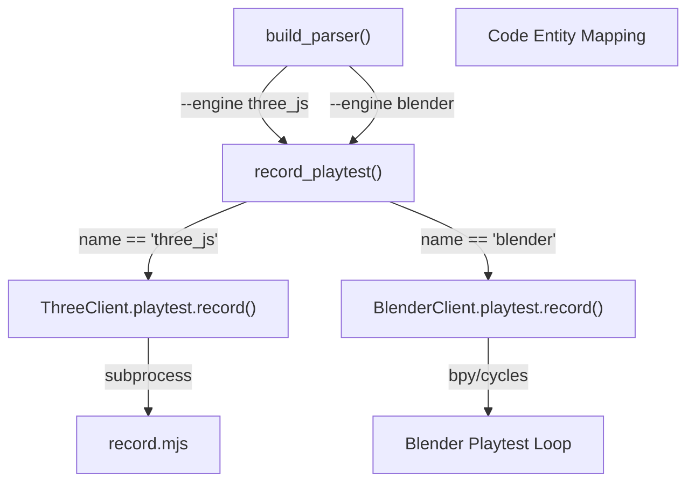
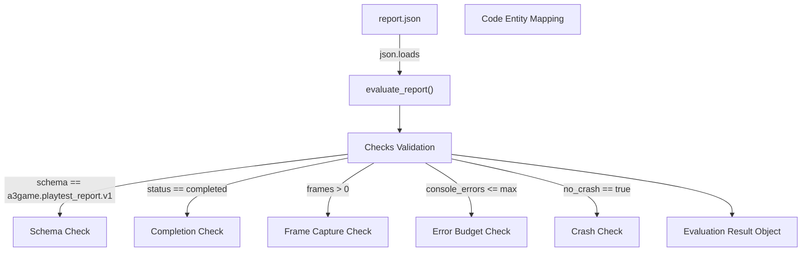

<!-- source: DeepWiki mcp.deepwiki.com · repo OpenDCAI/GameFactory-3A · page 4.3 Playtest Recording & Evaluation · fetched 2026-11-02 -->

# Playtest Recording & Evaluation

Relevant source files

The following files were used as context for generating this wiki page:

- [engine_adapters/three_js/playtest/__init__.py](engine_adapters/three_js/playtest/__init__.py)
- [engine_adapters/three_js/playtest/client.py](engine_adapters/three_js/playtest/client.py)
- [engine_adapters/three_js/playtest/record.mjs](engine_adapters/three_js/playtest/record.mjs)
- [engine_adapters/three_js/three_client.py](engine_adapters/three_js/three_client.py)
- [engine_adapters/ue5/plugin/A3GamePlayable/Source/A3GamePlayable/Public/Playtest/A3GamePlaytestRecorderSubsystem.h](engine_adapters/ue5/plugin/A3GamePlayable/Source/A3GamePlayable/Public/Playtest/A3GamePlaytestRecorderSubsystem.h)
- [engine_adapters/unity3d/import_generated/GameFactory3APlayTestRecorder.cs](engine_adapters/unity3d/import_generated/GameFactory3APlayTestRecorder.cs)
- [engine_adapters/unity3d/playtest/__init__.py](engine_adapters/unity3d/playtest/__init__.py)
- [engine_adapters/unity3d/playtest/client.py](engine_adapters/unity3d/playtest/client.py)
- [engine_adapters/unity3d/unity_client.py](engine_adapters/unity3d/unity_client.py)
- [pipeline/code_gen/playtest/__init__.py](pipeline/code_gen/playtest/__init__.py)
- [pipeline/code_gen/playtest/eval.py](pipeline/code_gen/playtest/eval.py)
- [pipeline/code_gen/playtest/run.py](pipeline/code_gen/playtest/run.py)

## Purpose and Scope
This page details the playtest recording and evaluation infrastructure across engines in GameFactory-3A. It covers the `record_playtest` command-line interface, the headless fixed-timestep CDP (Chrome DevTools Protocol) capture mechanism implemented in three.js (`record.mjs`), declarative action-plan discovery, report schemas, and programmatic evaluation via `evaluate_report`. It also details engine-specific recorder implementations in Unity and Unreal Engine 5.

Sources: `[pipeline/code_gen/playtest/run.py:1-11](), [engine_adapters/three_js/playtest/record.mjs:1-31]()`

---

## 1. Playtest CLI & Engine Dispatch (`record_playtest`)

The `record_playtest` function coordinates playtest capture by routing execution to the appropriate engine adapter (`ThreeClient` or `BlenderClient`), managing recorder root directories, and configuring capture resolution, frame rate, and timeouts [pipeline/code_gen/playtest/run.py:53-134]().

*Diagram 1: CLI dispatch architecture mapping user invocation flags to engine adapter recording implementations.*

Sources: `[pipeline/code_gen/playtest/run.py:53-161]()`

---

## 2. Three.js Fixed-Timestep CDP Capture (`record.mjs`)

Because headless execution environments run WebGL on software renderers (SwiftShader), real-time capture yields slow motion and frame jitter. To bypass this, the three.js recorder (`engine_adapters/three_js/playtest/record.mjs`) drives simulation at a deterministic fixed timestep via `A3GameRuntimeHost.tick(forcedDelta)` [engine_adapters/three_js/playtest/record.mjs:1-10]().

Key implementation choices embedded in `record.mjs` and `ThreePlaytestClient`:
1. **Compositor Synchronization**: The native `requestAnimationFrame` loop is disabled; ticking occurs inside a controlled control flow, waiting for compositor commits to avoid blocking on screenshot captures `[engine_adapters/three_js/playtest/record.mjs:11-16]()`.
2. **Raw CDP Capture**: Leverages raw CDP `Page.captureScreenshot` instead of `page.screenshot()` to bypass stability checks that a stopped render loop cannot satisfy `[engine_adapters/three_js/playtest/record.mjs:17-18]()`.
3. **Real Event Dispatch**: Delivers actual DOM/synthetic events (keys to `window`, pointer actions to `host.container`, and aim angles via `setLook`) rather than mutating internal object transforms directly `[engine_adapters/three_js/playtest/record.mjs:19-21]()`.
4. **Crash Tolerance**: Treats renderer crashes as partial takes (`status: "failed"` with recorded frames preserved) rather than discarding artifacts `[engine_adapters/three_js/playtest/record.mjs:22-23]()`.

Sources: `[engine_adapters/three_js/playtest/record.mjs:1-31](), [engine_adapters/three_js/playtest/client.py:1-35]()`

---

## 3. Action-Plan Discovery & Sustained Inputs

The `DISCOVERY` routine in `engine_adapters/three_js/playtest/record.mjs` inspects the running game environment to determine valid interaction verbs, warmup requirements, camera behavior, and sustained inputs [engine_adapters/three_js/playtest/record.mjs:93-122]().

Discovery order of precedence:
1. `__A3GAME_PLAYTEST__`: Explicit scenario plan declared by the game instance.
2. `input.actionBindings`: Authoritative list of game verbs (e.g., `fire`, `handbrake`, `jump`).
3. `input.keyBindings`: Deduplicated movement keys mapped to canonical actions.
4. `[data-game-action]`: DOM element selectors for menu-driven interfaces.
5. Generic keyboard action fallback plan.

Verbs are filtered against regex rules to categorize them as held actions (e.g., vehicle throttles, charge mechanics, defensive blocks) versus discrete taps (`[engine_adapters/three_js/playtest/record.mjs:138-156]()`).

Sources: `[engine_adapters/three_js/playtest/record.mjs:93-158]()`

---

## 4. Report Schema & Evaluation Engine (`evaluate_report`)

Playtest runs emit a strict JSON report adhering to the schema version `a3game.playtest_report.v1` [engine_adapters/three_js/playtest/record.mjs:64-89](). The evaluation engine (`pipeline/code_gen/playtest/eval.py`) scores recording integrity, captured frame counts, action execution success, and runtime error budgets without re-running the game [pipeline/code_gen/playtest/eval.py:1-27]().

*Diagram 2: Data flow and validation criteria evaluated by `evaluate_report()` on a playtest report JSON file.*

Sources: `[pipeline/code_gen/playtest/eval.py:1-103], [engine_adapters/three_js/playtest/record.mjs:64-89]()`

---

## 5. Engine-Specific Recorders

### Unity 3D Recorder
Unity playtests are driven by `UnityPlaytestClient` which launches a dedicated GUI Editor instance running `-executeMethod GameFactory3APlayTestRecorder.Enter` [engine_adapters/unity3d/playtest/client.py:1-54](). The C# script `GameFactory3APlayTestRecorder` opens the designated play scene, focuses the Game view, enters Play Mode, captures Game-view frames (`frames/f00001.png`), and writes out per-frame engine state snapshots into `diagnostics.jsonl` [engine_adapters/unity3d/import_generated/GameFactory3APlayTestRecorder.cs:1-36]().

Sources: `[engine_adapters/unity3d/playtest/client.py:1-145](), [engine_adapters/unity3d/import_generated/GameFactory3APlayTestRecorder.cs:1-169]()`

### Unreal Engine 5 Recorder
UE5 playtests utilize `UA3GamePlaytestRecorderSubsystem`, a tickable world subsystem (`UTickableWorldSubsystem`) packaged inside `A3GamePlayable` [engine_adapters/ue5/plugin/A3GamePlayable/Source/A3GamePlayable/Public/Playtest/A3GamePlaytestRecorderSubsystem.h:1-36](). It monitors command-line arguments, arms on world initialization, and periodically captures viewport frames and session metadata to disk.

Sources: `[engine_adapters/ue5/plugin/A3GamePlayable/Source/A3GamePlayable/Public/Playtest/A3GamePlaytestRecorderSubsystem.h:1-36]()`

---

