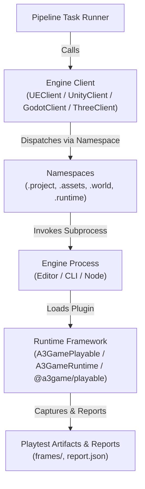
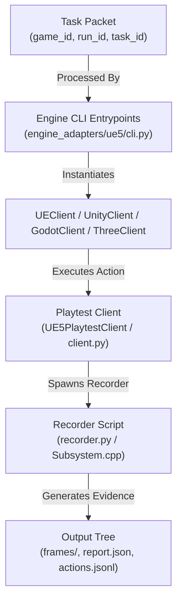

<!-- source: DeepWiki mcp.deepwiki.com · repo OpenDCAI/GameFactory-3A · page 5 Engine Adapters · fetched 2026-11-02 -->

# Engine Adapters

Relevant source files

The following files were used as context for generating this wiki page:

- [agent_skills/engine_context/engine_overview.md](agent_skills/engine_context/engine_overview.md)
- [agent_skills/engine_context/godot_api.md](agent_skills/engine_context/godot_api.md)
- [agent_skills/engine_context/three_js_api.md](agent_skills/engine_context/three_js_api.md)
- [agent_skills/engine_context/ue5_api.md](agent_skills/engine_context/ue5_api.md)
- [agent_skills/engine_context/unity3d_api.md](agent_skills/engine_context/unity3d_api.md)
- [engine_adapters/ue5/cli.py](engine_adapters/ue5/cli.py)
- [engine_adapters/ue5/playtest/__init__.py](engine_adapters/ue5/playtest/__init__.py)
- [engine_adapters/ue5/playtest/client.py](engine_adapters/ue5/playtest/client.py)
- [engine_adapters/ue5/playtest/recorder.py](engine_adapters/ue5/playtest/recorder.py)
- [engine_adapters/ue5/plugin/A3GamePlayable/Source/A3GamePlayable/A3GamePlayable.Build.cs](engine_adapters/ue5/plugin/A3GamePlayable/Source/A3GamePlayable/A3GamePlayable.Build.cs)
- [engine_adapters/ue5/plugin/A3GamePlayable/Source/A3GamePlayable/Private/Media/A3GameMediaSubsystem.cpp](engine_adapters/ue5/plugin/A3GamePlayable/Source/A3GamePlayable/Private/Media/A3GameMediaSubsystem.cpp)
- [engine_adapters/ue5/plugin/A3GamePlayable/Source/A3GamePlayable/Private/Playtest/A3GamePlaytestRecorderSubsystem.cpp](engine_adapters/ue5/plugin/A3GamePlayable/Source/A3GamePlayable/Private/Playtest/A3GamePlaytestRecorderSubsystem.cpp)

## Purpose and Scope

The `engine_adapters/` directory provides a uniform, robust Python interface bridging GameFactory-3A generation pipelines to target game engines and runtime environments [agent_skills/engine_context/engine_overview.md:1-12](). It abstracts away engine-specific CLI tools, editor transport layers, asset staging, and runtime harnesses into consistent Python clients (`UEClient`, `UnityClient`, `GodotClient`, `ThreeClient`, and `BlenderClient`) [agent_skills/engine_context/unity3d_api.md:17-63](), [agent_skills/engine_context/three_js_api.md:32-97](), [agent_skills/engine_context/ue5_api.md:11-92](), [agent_skills/engine_context/godot_api.md:6-96]().

This is a parent overview page. Detailed technical specifications, CLI flags, asset import pipelines, and engine-specific subsystems are documented in the child pages linked below.

Sources: `agent_skills/engine_context/engine_overview.md:1-12`, `agent_skills/engine_context/unity3d_api.md:17-63`, `agent_skills/engine_context/three_js_api.md:32-97`, `agent_skills/engine_context/ue5_api.md:11-92`, `agent_skills/engine_context/godot_api.md:6-96`

---

## Shared Architecture & Design Contracts

### Client and Namespace Architecture
All engine integrations follow a strict client-namespace hierarchy. The host Python process interacts with an engine exclusively through a top-level client instance (e.g., `UEClient` or `UnityClient`) which exposes isolated namespace attributes (`project`, `assets`, `animation`, `world`, `plugin`, `testing`, `runtime`) [agent_skills/engine_context/unity3d_api.md:60-172](), [agent_skills/engine_context/ue5_api.md:89-165](). Direct imports of internal modules or namespace implementation classes are strictly prohibited by the architecture [agent_skills/engine_context/unity3d_api.md:15-34](), [agent_skills/engine_context/ue5_api.md:11-30]().

### Result Contract
Every public operation across all engine adapters returns a uniform, JSON-serializable dictionary conforming to a stable result contract [agent_skills/engine_context/unity3d_api.md:47-59](), [agent_skills/engine_context/three_js_api.md:81-93](), [agent_skills/engine_context/ue5_api.md:76-88](), [agent_skills/engine_context/godot_api.md:114-126]():
- `ok` (`bool`): Whether the operation completed successfully. Zero process exit codes alone do not imply success [agent_skills/engine_context/unity3d_api.md:38-45]().
- `operation` (`str`): Stable operation identifier (e.g., `playtest.record`).
- `artifacts` (`list`): Produced or retained artifact file paths and descriptors.
- `diagnostics` (`list`): Structured engine diagnostic records.
- `warnings` (`list`): Non-fatal problems or fallback notifications.
- `errors` (`list`): Fatal failure messages.
- `payload` (`dict`): Operation-specific result data.

### Layer Boundaries
The adapters maintain a strict boundary between host-side automation, engine editor scripting, and runtime frameworks (`A3GamePlayable` for Unreal/Godot [engine_adapters/ue5/plugin/A3GamePlayable/Source/A3GamePlayable/Private/Media/A3GameMediaSubsystem.cpp:1-13](), `A3GameRuntime` for Unity, and `@a3game/playable` for three.js [agent_skills/engine_context/three_js_api.md:40-44]()):
- **Host Python Layer**: Manages project lifecycle, batch asset resolution, process spawning, and reporting via adapter clients [agent_skills/engine_context/ue5_api.md:37-46]().
- **Engine Editor Layer**: Executes internal commands via headless or interactive editor subprocesses (`UnrealEditor.exe`, Godot CLI, Unity batch mode).
- **Runtime Plugin Layer**: Embedded native game code (`A3GamePlayable` / `A3GameRuntime`) handling media triggers (`UA3GameMediaSubsystem`) [engine_adapters/ue5/plugin/A3GamePlayable/Source/A3GamePlayable/Private/Media/A3GameMediaSubsystem.cpp:1-76]() and playtest recording (`UA3GamePlaytestRecorderSubsystem`) [engine_adapters/ue5/plugin/A3GamePlayable/Source/A3GamePlayable/Private/Playtest/A3GamePlaytestRecorderSubsystem.cpp:1-24]().

Diagram: Engine Adapter Architecture to Code Entities

Sources: `agent_skills/engine_context/unity3d_api.md:15-59`, `agent_skills/engine_context/three_js_api.md:32-93`, `agent_skills/engine_context/ue5_api.md:11-88`, `agent_skills/engine_context/godot_api.md:6-126`, `engine_adapters/ue5/plugin/A3GamePlayable/Source/A3GamePlayable/Private/Media/A3GameMediaSubsystem.cpp:1-76`, `engine_adapters/ue5/plugin/A3GamePlayable/Source/A3GamePlayable/Private/Playtest/A3GamePlaytestRecorderSubsystem.cpp:1-24`

---

## Child Engine Adapter Pages

For deep technical details, configuration parameters, API signatures, and engine-specific workflows, refer to the following child pages:

- **Unreal Engine 5 Adapter (#5.1)** — Covers `UEClient` namespaces, command-line interfaces (`engine_adapters/ue5/cli.py`) [engine_adapters/ue5/cli.py:1-43](), asset/world/runtime clients, the `A3GamePlayable` native plugin (including `UA3GameMediaSubsystem` and `UA3GamePlaytestRecorderSubsystem`) [engine_adapters/ue5/plugin/A3GamePlayable/Source/A3GamePlayable/Private/Media/A3GameMediaSubsystem.cpp:1-30](), [engine_adapters/ue5/plugin/A3GamePlayable/Source/A3GamePlayable/Private/Playtest/A3GamePlaytestRecorderSubsystem.cpp:1-24](), VFX integrations, and gameplay examples.
- **Unity 3D Adapter (#5.2)** — Covers `UnityClient`, editor transport/dispatcher mechanisms, asset import scripts, the `A3GameRuntime` plugin and Media Director, VFX shaders, and FPS/ArenaFighter reference examples [agent_skills/engine_context/unity3d_api.md:60-172]().
- **Godot 4 Adapter (#5.3)** — Covers `GodotClient` CLI and namespace clients, transport configurations, resource inspection utilities, the `A3GamePlayable` GDScript plugin, playtest recorders, and example projects [agent_skills/engine_context/godot_api.md:6-147]().
- **three.js Adapter & @a3game/playable (#5.4)** — Covers `ThreeClient` namespaces, Node/devserver transports, asset staging and orientation rules, the `@a3game/playable` runtime plugin host, visual/motion/vfx kits, and browser-targeted example games [agent_skills/engine_context/three_js_api.md:32-175]().
- **Blender Adapter (#5.5)** — Covers `BlenderClient`, `bpy` transport boundaries, runtime asset actions, game control/HUD/material/camera rig kernels, and playtest recording pipelines [agent_skills/engine_context/engine_overview.md:41-43]().
- **Browser Serving Gateway (#5.6)** — Covers FastAPI gateway endpoints (`engine_adapters/serving/`), `EngineRegistry`, `BrowserServingConfig`, multi-engine backends, player frontend integration, and the `BrowserPlayExample`.

Diagram: Engine Task Execution Flow to Code Entities

Sources: `agent_skills/engine_context/engine_overview.md:41-55`, `agent_skills/engine_context/unity3d_api.md:60-172`, `agent_skills/engine_context/three_js_api.md:32-175`, `agent_skills/engine_context/godot_api.md:6-147`, `engine_adapters/ue5/cli.py:1-43`, `engine_adapters/ue5/playtest/client.py:1-34`

---

