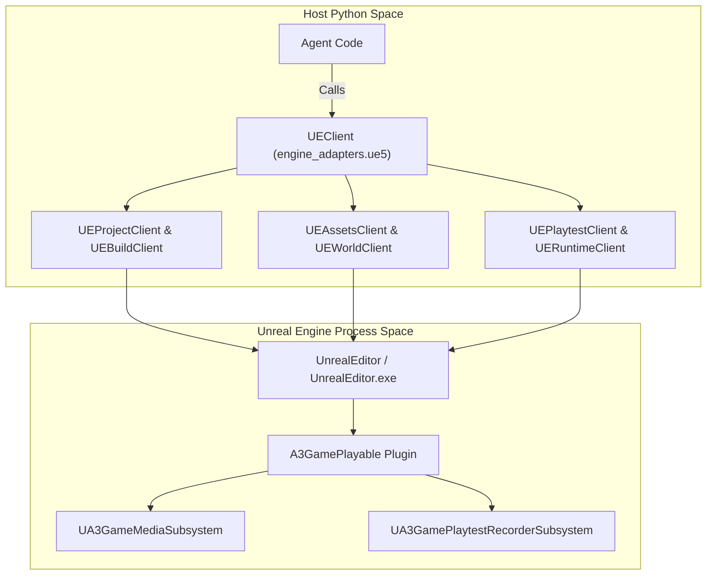
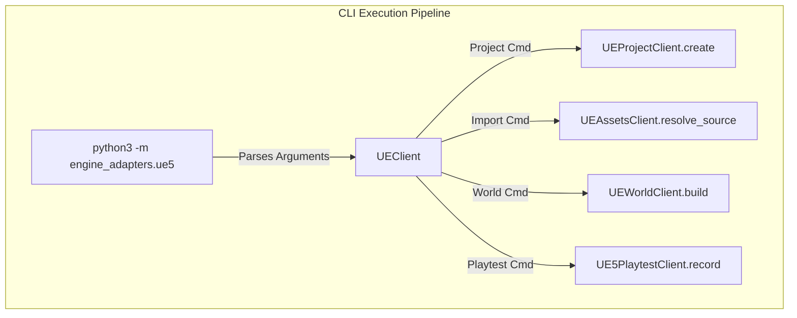
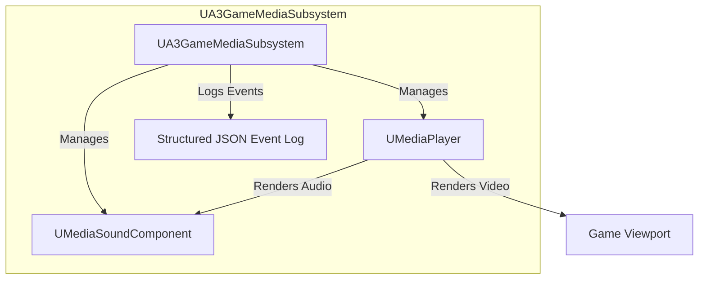

<!-- source: DeepWiki mcp.deepwiki.com · repo OpenDCAI/GameFactory-3A · page 5.1 Unreal Engine 5 Adapter · fetched 2026-11-02 -->

# Unreal Engine 5 Adapter

<details>
<summary>Relevant source files</summary>

The following files were used as context for generating this wiki page:

- [agent_skills/engine_context/engine_overview.md](agent_skills/engine_context/engine_overview.md)
- [agent_skills/engine_context/godot_api.md](agent_skills/engine_context/godot_api.md)
- [engine_adapters/ue5/cli.py](engine_adapters/ue5/cli.py)
- [engine_adapters/ue5/examples/ArenaFighterExample/Source/ArenaFighterExample/Private/ArenaFighterExample.cpp](engine_adapters/ue5/examples/ArenaFighterExample/Source/ArenaFighterExample/Private/ArenaFighterExample.cpp)
- [engine_adapters/ue5/examples/ArenaFighterExample/Source/ArenaFighterExample/Private/Tests/ArenaFighterMechanicAutomationTests.cpp](engine_adapters/ue5/examples/ArenaFighterExample/Source/ArenaFighterExample/Private/Tests/ArenaFighterMechanicAutomationTests.cpp)
- [engine_adapters/ue5/examples/ArenaFighterExample/Source/ArenaFighterExample/Public/ArenaFighterExample.h](engine_adapters/ue5/examples/ArenaFighterExample/Source/ArenaFighterExample/Public/ArenaFighterExample.h)
- [engine_adapters/ue5/examples/ArenaFighterExample/Source/ArenaFighterExample/Public/ArenaFighterMechanicContract.h](engine_adapters/ue5/examples/ArenaFighterExample/Source/ArenaFighterExample/Public/ArenaFighterMechanicContract.h)
- [engine_adapters/ue5/examples/ArenaFighterUIExample/ArenaFighterUIExample.uplugin](engine_adapters/ue5/examples/ArenaFighterUIExample/ArenaFighterUIExample.uplugin)
- [engine_adapters/ue5/examples/ArenaFighterUIExample/Source/ArenaFighterUIExample/ArenaFighterUIExample.Build.cs](engine_adapters/ue5/examples/ArenaFighterUIExample/Source/ArenaFighterUIExample/ArenaFighterUIExample.Build.cs)
- [engine_adapters/ue5/import_generated/README.md](engine_adapters/ue5/import_generated/README.md)
- [engine_adapters/ue5/import_generated/import_mesh.py](engine_adapters/ue5/import_generated/import_mesh.py)
- [engine_adapters/ue5/playtest/__init__.py](engine_adapters/ue5/playtest/__init__.py)
- [engine_adapters/ue5/playtest/client.py](engine_adapters/ue5/playtest/client.py)
- [engine_adapters/ue5/playtest/recorder.py](engine_adapters/ue5/playtest/recorder.py)
- [engine_adapters/ue5/plugin/A3GamePlayable/Source/A3GamePlayable/A3GamePlayable.Build.cs](engine_adapters/ue5/plugin/A3GamePlayable/Source/A3GamePlayable/A3GamePlayable.Build.cs)
- [engine_adapters/ue5/plugin/A3GamePlayable/Source/A3GamePlayable/Private/Media/A3GameMediaSubsystem.cpp](engine_adapters/ue5/plugin/A3GamePlayable/Source/A3GamePlayable/Private/Media/A3GameMediaSubsystem.cpp)
- [engine_adapters/ue5/plugin/A3GamePlayable/Source/A3GamePlayable/Private/Playtest/A3GamePlaytestRecorderSubsystem.cpp](engine_adapters/ue5/plugin/A3GamePlayable/Source/A3GamePlayable/Private/Playtest/A3GamePlaytestRecorderSubsystem.cpp)
- [engine_adapters/ue5/plugin/A3GamePlayable/Source/A3GamePlayable/Public/Media/A3GameMediaSubsystem.h](engine_adapters/ue5/plugin/A3GamePlayable/Source/A3GamePlayable/Public/Media/A3GameMediaSubsystem.h)
- [engine_adapters/ue5/ue_client.py](engine_adapters/ue5/ue_client.py)
- [models/common/__init__.py](models/common/__init__.py)

</details>


The Unreal Engine 5 (UE5) adapter provides the official host-side and in-engine integration layer for controlling Unreal Engine instances, managing asset pipelines, executing world builds, running playtest sessions, and interfacing with the `A3GamePlayable` plugin framework. 

This page details the architecture of `UEClient`, its namespace client breakdown, command-line interfaces, asset and world client pipelines, the `A3GamePlayable` plugin subsystems (media and playtest), VFX integrations, and concrete runtime examples.

---

## 1. Overview and Architecture

The UE5 adapter bridges python-side agent calls (`engine_adapters.ue5`) to Unreal Editor and its standalone packaging runtimes. It handles project creation, build workflows, python RPC execution (`PythonRPCTransport`), and Remote Control API operations (`RemoteControlClient`).



Sources: `engine_adapters/ue5/ue_client.py:27-100]`, `agent_skills/engine_context/engine_overview.md:51-51`

---

## 2. UEClient Namespaces

The main entry point is `UEClient`, initialized via `from engine_adapters.ue5 import UEClient`. It delegates operations to modular namespace clients:

| Namespace Client | Class Name | Responsibilities |
|---|---|---|
| `project` | `UEProjectClient` | Project creation, configuration validation, directory layout setup. |
| `build` | `UEBuildClient` | Compilation of editor targets, game targets, and shipping configurations. |
| `assets` | `UEAssetsClient` | Asset resolution, package generation, importing generated glb/fbx/textures. |
| `world` | `UEWorldClient` | Level construction, terrain baking, scene object population, map saving. |
| `playtest` | `UE5PlaytestClient` | In-editor (PIE) and packaged game playtest session recording. |
| `runtime` | `UERuntimeClient` | Launching standalone game processes, editor instances, and managing process lifecycles. |
| `observe` | `UEObserveClient` | Health checks, Python execution readiness probes, Remote Control reachability. |
| `animation` | `UEAnimationClient` | Skeletal animation mapping and retargeting bindings. |
| `bindings` | `UEBindingsClient` | Mechanic contract binding management. |
| `reflection` | `UEReflectionClient` | Inspecting native UClasses, UProperties, and blueprint functions. |
| `plugin` | `UEPluginClient` | Managing and staging project plugins like `A3GamePlayable`. |
| `testing` | `UETestingClient` | Executing automated automation tests within the engine context. |

Sources: `engine_adapters/ue5/ue_client.py:27-100]`, `engine_adapters/ue5/cli.py:24-43`

---

## 3. Command-Line Interface (CLI)

The CLI exposes public execution wrappers backed exclusively by `UEClient`. It handles structured output emission (JSON format with standard fields: `ok`, `operation`, `artifacts`, `diagnostics`, `warnings`, `errors`, `payload`).

```bash
python3 -m engine_adapters.ue5 --project "/projects/ArenaGame" create-project --name ArenaGame
python3 -m engine_adapters.ue5 --project "/projects/ArenaGame" import-asset --source-json asset.json --asset-type avatar
python3 -m engine_adapters.ue5 --project "/projects/ArenaGame" launch-game
```



Sources: `engine_adapters/ue5/cli.py:1-104]`, `engine_adapters/ue5/cli.py:167-222]`

---

## 4. Assets, World, and Runtime Clients

### Asset Pipeline (`UEAssetsClient`)
Assets generated in Layer A (meshes, textures, animations) are ingested through `UEAssetsClient`. Source descriptors (`game_id`, `run_id`, `task_kind`, `task_id`, `artifact_key`) point to structured outputs. The client resolves paths, validates asset formatting (GLB, FBX, PNG), and invokes Unreal Editor's import pipelines via Python RPC scripts (`engine_adapters/ue5/import_generated/import_mesh.py`).

### World Pipeline (`UEWorldClient`)
`UEWorldClient` constructs levels, populates terrain data, applies materials, and places generated assets into the active world. It communicates via `PythonRPCTransport` to instantiate actors, set transforms, and invoke map serialization.

### Runtime & Playtest Clients (`UERuntimeClient` & `UE5PlaytestClient`)
- **`UERuntimeClient`**: Manages launching Unreal Editor in game mode (`-game`) or launching compiled standalone executables with appropriate command-line flags.
- **`UE5PlaytestClient`**: Records automated playtest sessions. It supports two cooperating execution modes:
  1. **Editor PIE Mode**: Runs `recorder.py` inside the Editor's embedded Python interpreter via `-ExecutePythonScript`. Starts Play-In-Editor (PIE), captures viewport frames using `HighResShot`, and outputs structured reports.
  2. **Packaged Native Mode**: Directly runs staged game builds containing the `A3GamePlayable` plugin, which utilizes `UA3GamePlaytestRecorderSubsystem` for in-engine frame capture.

Sources: `engine_adapters/ue5/ue_client.py:73-94]`, `engine_adapters/ue5/playtest/client.py:1-34]`, `engine_adapters/ue5/playtest/recorder.py:1-16]`

---

## 5. A3GamePlayable Plugin Framework

The `A3GamePlayable` plugin (`engine_adapters/ue5/plugin/A3GamePlayable`) is an integrated runtime module providing essential subsystems for media playback and automated playtesting.

### Build Rules (`A3GamePlayable.Build.cs`)
The plugin depends on core engine modules and media assets:
- Public Dependencies: `"Core"`, `"CoreUObject"`, `"Engine"`, `"MediaAssets"`
- Private Dependencies: `"Json"`, `"Networking"`, `"Sockets"`

### Media Subsystem (`UA3GameMediaSubsystem`)
A world subsystem handling background audio, dialogue, and interactive cinematic video (CG) triggers during gameplay.



Key functions exposed to Blueprints and C++:
- `RegisterMedia(EventKey, SourcePath, bVideo)` [engine_adapters/ue5/plugin/A3GamePlayable/Source/A3GamePlayable/Public/Media/A3GameMediaSubsystem.h:23]()
- `RegisterAudio(EventKey, SourcePath)` [engine_adapters/ue5/plugin/A3GamePlayable/Source/A3GamePlayable/Public/Media/A3GameMediaSubsystem.h:26]()
- `RegisterCG(EventKey, VideoUrl)` [engine_adapters/ue5/plugin/A3GamePlayable/Source/A3GamePlayable/Public/Media/A3GameMediaSubsystem.h:29]()
- `TriggerMedia(EventKey, TriggerSource)` [engine_adapters/ue5/plugin/A3GamePlayable/Source/A3GamePlayable/Public/Media/A3GameMediaSubsystem.h:32]()
- `StopMedia(EventKey)` [engine_adapters/ue5/plugin/A3GamePlayable/Source/A3GamePlayable/Public/Media/A3GameMediaSubsystem.h:41]()

### Playtest Recorder Subsystem (`UA3GamePlaytestRecorderSubsystem`)
A tickable world subsystem (`FTickableGameObject`) activated via command-line arguments (`-A3PlaytestOutput`, `-A3PlaytestFps`, `-A3PlaytestDuration`). It monitors gameplay state, requests screenshots per frame via `FScreenshotRequest::RequestScreenshot`, writes `play_started.json` markers, and automatically terminates the process upon test completion.

Sources: `engine_adapters/ue5/plugin/A3GamePlayable/Source/A3GamePlayable/A3GamePlayable.Build.cs:1-24]`, `engine_adapters/ue5/plugin/A3GamePlayable/Source/A3GamePlayable/Private/Media/A3GameMediaSubsystem.cpp:1-113]`, `engine_adapters/ue5/plugin/A3GamePlayable/Source/A3GamePlayable/Private/Playtest/A3GamePlaytestRecorderSubsystem.cpp:1-138]`

---

## 6. VFX and Examples

The UE5 adapter includes dedicated reference examples and review tooling (such as `ArenaFighterExample` and `ArenaFighterUIExample`) demonstrating mechanic implementation, UI contract binding, automation tests, and VFX setups.

- Automation tests verify damage state transitions and contract version stability:
  - `FAAArenaFighterDamageStateTest` ("`A3Game.ArenaFighterExample.Mechanic.DamageState`") [engine_adapters/ue5/examples/ArenaFighterExample/Source/ArenaFighterExample/Private/Tests/ArenaFighterMechanicAutomationTests.cpp:8-12]()

Sources: `engine_adapters/ue5/examples/ArenaFighterExample/Source/ArenaFighterExample/Private/Tests/ArenaFighterMechanicAutomationTests.cpp:1-43]`

---
Sources: `agent_skills/engine_context/engine_overview.md`, `agent_skills/engine_context/godot_api.md`, `engine_adapters/ue5/playtest/client.py`, `engine_adapters/ue5/plugin/A3GamePlayable/Source/A3GamePlayable/Private/Media/A3GameMediaSubsystem.cpp`, `engine_adapters/ue5/playtest/recorder.py`, `engine_adapters/ue5/plugin/A3GamePlayable/Source/A3GamePlayable/Private/Playtest/A3GamePlaytestRecorderSubsystem.cpp`, `engine_adapters/ue5/cli.py`, `engine_adapters/ue5/playtest/__init__.py`, `engine_adapters/ue5/plugin/A3GamePlayable/Source/A3GamePlayable/A3GamePlayable.Build.cs`, `engine_adapters/ue5/plugin/A3GamePlayable/Source/A3GamePlayable/Public/Media/A3GameMediaSubsystem.h`, `engine_adapters/ue5/ue_client.py`, `engine_adapters/ue5/examples/ArenaFighterExample/Source/ArenaFighterExample/Private/Tests/ArenaFighterMechanicAutomationTests.cpp`

---

