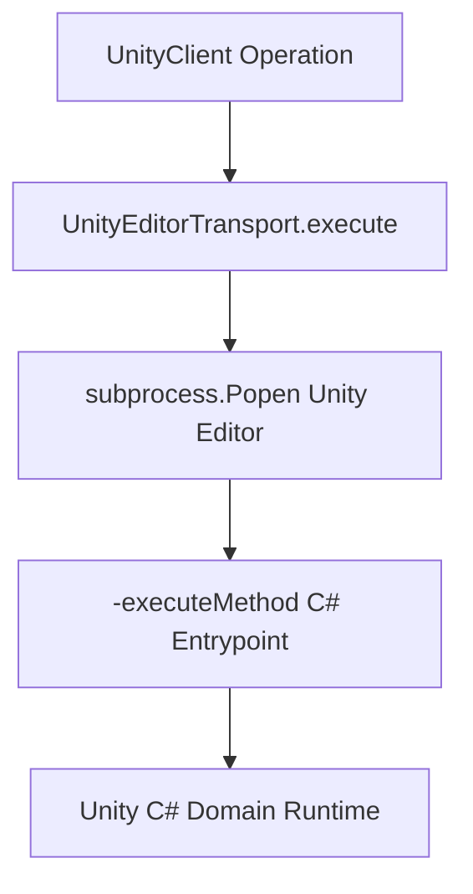

<!-- source: DeepWiki mcp.deepwiki.com · repo OpenDCAI/GameFactory-3A · page 5.2 Unity 3D Adapter · fetched 2026-11-02 -->

# Unity 3D Adapter

<details>
<summary>Relevant source files</summary>

The following files were used as context for generating this wiki page:

- [agent_skills/engine_context/three_js_api.md](agent_skills/engine_context/three_js_api.md)
- [agent_skills/engine_context/ue5_api.md](agent_skills/engine_context/ue5_api.md)
- [agent_skills/engine_context/unity3d_api.md](agent_skills/engine_context/unity3d_api.md)
- [engine_adapters/browser_serving/backends/unity3d_example.py](engine_adapters/browser_serving/backends/unity3d_example.py)
- [engine_adapters/godot/plugin/A3GamePlayable/media_director.gd](engine_adapters/godot/plugin/A3GamePlayable/media_director.gd)
- [engine_adapters/ue5/vfx/__init__.py](engine_adapters/ue5/vfx/__init__.py)
- [engine_adapters/ue5/vfx/action_binding.py](engine_adapters/ue5/vfx/action_binding.py)
- [engine_adapters/ue5/vfx/style_presets.py](engine_adapters/ue5/vfx/style_presets.py)
- [engine_adapters/ue5/vfx/vfx_functions.py](engine_adapters/ue5/vfx/vfx_functions.py)
- [engine_adapters/unity3d/_internal/transport/unity_editor.py](engine_adapters/unity3d/_internal/transport/unity_editor.py)
- [engine_adapters/unity3d/assets/_internal/artifacts/models.py](engine_adapters/unity3d/assets/_internal/artifacts/models.py)
- [engine_adapters/unity3d/assets/_internal/unity/dispatcher.py](engine_adapters/unity3d/assets/_internal/unity/dispatcher.py)
- [engine_adapters/unity3d/assets/client.py](engine_adapters/unity3d/assets/client.py)
- [engine_adapters/unity3d/bindings/client.py](engine_adapters/unity3d/bindings/client.py)
- [engine_adapters/unity3d/cli.py](engine_adapters/unity3d/cli.py)
- [engine_adapters/unity3d/examples/FPSExample/Scripts/FPSDoor.cs](engine_adapters/unity3d/examples/FPSExample/Scripts/FPSDoor.cs)
- [engine_adapters/unity3d/examples/FPSExample/Scripts/FPSEnemy.cs](engine_adapters/unity3d/examples/FPSExample/Scripts/FPSEnemy.cs)
- [engine_adapters/unity3d/examples/FPSExample/Scripts/FPSEnemySpawner.cs](engine_adapters/unity3d/examples/FPSExample/Scripts/FPSEnemySpawner.cs)
- [engine_adapters/unity3d/examples/FPSExample/Scripts/FPSGameRuntimeAdapter.cs](engine_adapters/unity3d/examples/FPSExample/Scripts/FPSGameRuntimeAdapter.cs)
- [engine_adapters/unity3d/examples/FPSExample/Scripts/FPSPhysicsOrder.cs](engine_adapters/unity3d/examples/FPSExample/Scripts/FPSPhysicsOrder.cs)
- [engine_adapters/unity3d/examples/FPSExample/Scripts/FPSPlayerController.cs](engine_adapters/unity3d/examples/FPSExample/Scripts/FPSPlayerController.cs)
- [engine_adapters/unity3d/examples/FPSExample/Tests/FPSTests.cs](engine_adapters/unity3d/examples/FPSExample/Tests/FPSTests.cs)
- [engine_adapters/unity3d/import_generated/ComposeScene.cs](engine_adapters/unity3d/import_generated/ComposeScene.cs)
- [engine_adapters/unity3d/import_generated/GameFactory3APlayTestRecorder.cs](engine_adapters/unity3d/import_generated/GameFactory3APlayTestRecorder.cs)
- [engine_adapters/unity3d/import_generated/ImportUnityPackage.cs](engine_adapters/unity3d/import_generated/ImportUnityPackage.cs)
- [engine_adapters/unity3d/playtest/__init__.py](engine_adapters/unity3d/playtest/__init__.py)
- [engine_adapters/unity3d/playtest/client.py](engine_adapters/unity3d/playtest/client.py)
- [engine_adapters/unity3d/plugin/A3GameRuntime/Runtime/A3GameMediaDirector.cs](engine_adapters/unity3d/plugin/A3GameRuntime/Runtime/A3GameMediaDirector.cs)
- [engine_adapters/unity3d/unity_client.py](engine_adapters/unity3d/unity_client.py)
- [engine_adapters/unity3d/vfx/Runtime/A3Game_SoftParticle.shader](engine_adapters/unity3d/vfx/Runtime/A3Game_SoftParticle.shader)
- [engine_adapters/unity3d/vfx/Runtime/A3Game_VFX.cs](engine_adapters/unity3d/vfx/Runtime/A3Game_VFX.cs)

</details>


## Purpose and Scope
The Unity 3D Adapter integrates 3AGameFactory with Unity 3D (validated against Unity baseline `2022.3.62f3c1`) `[agent_skills/engine_context/unity3d_api.md:1-6]()`. It exposes a stable Python client facade (`UnityClient`), handles editor transport and command dispatching, drives asset and scene imports via C# editor scripts (`ImportUnityPackage.cs`, `ComposeScene.cs`), bundles the `A3GameRuntime` plugin featuring `A3GameMediaDirector`, manages VFX shaders, and powers reference game implementations such as the FPS and Arena Fighter examples `[agent_skills/engine_context/unity3d_api.md:142-147]().`

Sources: `[agent_skills/engine_context/unity3d_api.md:1-6](), [agent_skills/engine_context/unity3d_api.md:142-147]()`

---

## Architecture & UnityClient Facade
The Unity Adapter follows a strict boundary pattern where host-side Python orchestration interacts with Unity exclusively through `UnityClient` and its domain-specific namespace clients (`UnityAssetsClient`, `UnityPlaytestClient`, `UnityWorldClient`, etc.) `[engine_adapters/unity3d/unity_client.py:26-90]()`. 

```mermaid
graph TD
    subcode["Natural Language & Agent Space"]
        NLGame["Game Requirement / Task Spec"]
        NLAsset["Generated Asset Artifacts"]
    end

    subcode2["Code Entity Space"]
        UC["UnityClient<br/>engine_adapters/unity3d/unity_client.py"]
        Config["UnityClientConfig<br/>engine_adapters/unity3d/config.py"]
        Trans["UnityEditorTransport<br/>_internal/transport/unity_editor.py"]
        Assets["UnityAssetsClient<br/>assets/client.py"]
        Play["UnityPlaytestClient<br/>playtest/client.py"]
        World["UnityWorldClient<br/>world/client.py"]
    end

    NLGame --> UC
    NLAsset --> UC
    UC --> Config
    UC --> Trans
    UC --> Assets
    UC --> Play
    UC --> World
```
*Figure 1: Association between high-level generation requests and the `UnityClient` code entity space.*

`UnityClient` resolves configuration through `UnityClientConfig` and instantiates the underlying `UnityEditorTransport` which communicates with the Unity Editor via command-line arguments and batch mode or dedicated GUI processes `[engine_adapters/unity3d/unity_client.py:35-90]`.

Sources: `[engine_adapters/unity3d/unity_client.py:26-90]()`

---

## Editor Transport & Command Dispatcher
The editor transport layer (`UnityEditorTransport`) is responsible for launching the Unity Editor executable with specific `-executeMethod` targets and flags. Because rendering frames (such as during playtest recording) requires an active window surface, batch mode is restricted or forbidden for visual capture tasks `[engine_adapters/unity3d/playtest/client.py:137-143]()`.

The dispatcher translates Python namespace operations into serialized payloads or batch C# script invocations. It manages environment variables such as `A3GAME_UNITY_ROOT` and project paths to locate the `Unity` editor binary.


*Figure 2: Editor Transport command execution path.*

Sources: `[engine_adapters/unity3d/playtest/client.py:137-143](), [engine_adapters/unity3d/unity_client.py:35-58]()`

---

## Asset Import Scripts & Scene Composition
Asset import operations convert raw generated task outputs into Unity-native assets (`.asset`, `.prefab`, `.unity`). 

- **Import Scripts**: C# editor scripts such as `ImportUnityPackage.cs` execute inside the Unity asset database pipeline to ingest assets in dependency-aware order `[agent_skills/engine_context/unity3d_api.md:82-99]()`.
- **Scene Composition**: `ComposeScene.cs` parses structured scene specifications (prefabs, GameObjects, components, and serialized field bindings) to construct and save deterministic Unity scenes (`unity.world.compose_scene`) `[agent_skills/engine_context/unity3d_api.md:126-141]()`.

Sources: `[agent_skills/engine_context/unity3d_api.md:82-141]()`

---

## A3GameRuntime Plugin & Media Director
The `A3GameRuntime` plugin provides the runtime backbone for installed gameplay mechanics and UI assemblies. Centered within this framework is `A3GameMediaDirector`, a `MonoBehaviour` component handling audio playback, video CG cutscenes, animation states, and VFX triggers `[engine_adapters/unity3d/plugin/A3GameRuntime/Runtime/A3GameMediaDirector.cs:8-13]()`.

```mermaid
graph TD
    subcode["Natural Language / Gameplay Event"]
        EventKey["Gameplay Event Key"]
    end

    subcode2["Code Entity Space"]
        MD["A3GameMediaDirector<br/>A3GameMediaDirector.cs"]
        AS["AudioSource / AudioClip"]
        VP["VideoPlayer / RenderTexture"]
        PS["ParticleSystem / VFX"]
        Ani["Animator / State Binding"]
    end

    EventKey --> MD
    MD --> AS
    MD --> VP
    MD --> PS
    MD --> Ani
```
*Figure 3: Media Director mapping gameplay triggers to Unity native runtime components.*

`A3GameMediaDirector` maintains dictionary registries for audio clips, video stream URLs, particle systems, and animator state bindings. When triggered, it executes the underlying Unity component method and logs a structured `MediaEvent` record for audit and evaluation `[engine_adapters/unity3d/plugin/A3GameRuntime/Runtime/A3GameMediaDirector.cs:28-154]()`.

Sources: `[engine_adapters/unity3d/plugin/A3GameRuntime/Runtime/A3GameMediaDirector.cs:8-154]()`

---

## Playtest Recorder & In-Editor Harness
Playtest recording for the Unity adapter is split across a host-side Python client (`UnityPlaytestClient`) and an in-editor C# script (`GameFactory3APlayTestRecorder`) `[engine_adapters/unity3d/playtest/client.py:1-36]()`.

```mermaid
graph TD
    subcode["Playtest Orchestration"]
        HostClient["UnityPlaytestClient<br/>playtest/client.py"]
        Recorder["GameFactory3APlayTestRecorder<br/>GameFactory3APlayTestRecorder.cs"]
    end

    HostClient -->|"-executeMethod GameFactory3APlayTestRecorder.Enter"| Recorder
    Recorder -->|Opens Scene & Focuses Game View| PlayMode["Unity Play Mode"]
    PlayMode -->|Captures Frames & State Snapshots| OutputFiles["output_dir/ (frames/, report.json, actions.jsonl)"]
```
*Figure 4: Playtest recording workflow between host client and editor harness.*

The host client launches a dedicated GUI Editor instance passing `--a3-playtest-*` command-line arguments. The static initialization and execution methods in `GameFactory3APlayTestRecorder` handle phase transitions (`PhaseArmed` to `PhaseInPlay`), coordinate domain reloads via `SessionState`, capture Game view frames, and write evidence reports `[engine_adapters/unity3d/import_generated/GameFactory3APlayTestRecorder.cs:25-106]()`.

Sources: `[engine_adapters/unity3d/playtest/client.py:1-36](), [engine_adapters/unity3d/import_generated/GameFactory3APlayTestRecorder.cs:25-106]()`

---

## VFX Shaders & Runtime Kits
The Unity adapter includes custom VFX shaders and helper scripts located under `engine_adapters/unity3d/vfx/`.
- **Shaders**: `A3Game_SoftParticle.shader` provides particle rendering logic supporting soft particle blending against scene depth buffers.
- **VFX Components**: `A3Game_VFX.cs` manages programmatic particle emission rates and lifecycle behaviors matching the cross-engine VFX specifications.

Sources: `[engine_adapters/unity3d/vfx/Runtime/A3Game_VFX.cs](), [engine_adapters/unity3d/vfx/Runtime/A3Game_SoftParticle.shader]()`

---

## FPS & Arena Fighter Examples
The adapter bundles complete reference gameplay implementations to validate agent code generation and runtime integration:
- **FPS Example**: Implemented via `FPSGameRuntimeAdapter.cs`, `FPSEnemySpawner.cs`, and associated player controllers. It initializes procedural environment colliders, sets up first-person camera perspectives, manages weapon magazines, and spawns navigation-driven enemies `[engine_adapters/unity3d/examples/FPSExample/Scripts/FPSGameRuntimeAdapter.cs:8-158](), [engine_adapters/unity3d/examples/FPSExample/Scripts/FPSEnemySpawner.cs:8-91]()`.
- **Arena Fighter Example**: Leverages the runtime framework and media director to execute combat mechanics, health tracking, and hit reactions.

Sources: `[engine_adapters/unity3d/examples/FPSExample/Scripts/FPSGameRuntimeAdapter.cs:8-158](), [engine_adapters/unity3d/examples/FPSExample/Scripts/FPSEnemySpawner.cs:8-91]()`

---

