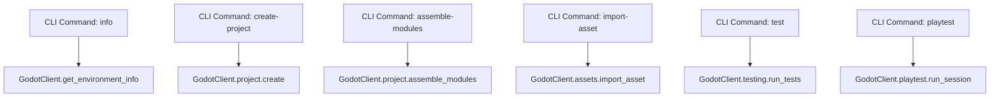
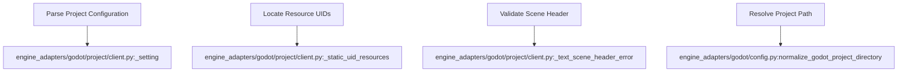

<!-- source: DeepWiki mcp.deepwiki.com · repo OpenDCAI/GameFactory-3A · page 5.3 Godot 4 Adapter · fetched 2026-11-02 -->

# Godot 4 Adapter

Relevant source files

The following files were used as context for generating this wiki page:

- [engine_adapters/godot/README.md](engine_adapters/godot/README.md)
- [engine_adapters/godot/_internal/__init__.py](engine_adapters/godot/_internal/__init__.py)
- [engine_adapters/godot/_internal/managed_state.py](engine_adapters/godot/_internal/managed_state.py)
- [engine_adapters/godot/_internal/transport.py](engine_adapters/godot/_internal/transport.py)
- [engine_adapters/godot/animation/client.py](engine_adapters/godot/animation/client.py)
- [engine_adapters/godot/assets/client.py](engine_adapters/godot/assets/client.py)
- [engine_adapters/godot/bindings/client.py](engine_adapters/godot/bindings/client.py)
- [engine_adapters/godot/build/client.py](engine_adapters/godot/build/client.py)
- [engine_adapters/godot/cli.py](engine_adapters/godot/cli.py)
- [engine_adapters/godot/config.py](engine_adapters/godot/config.py)
- [engine_adapters/godot/examples/ArenaDuel3D/README.md](engine_adapters/godot/examples/ArenaDuel3D/README.md)
- [engine_adapters/godot/examples/ArenaDuel3D/main.tscn](engine_adapters/godot/examples/ArenaDuel3D/main.tscn)
- [engine_adapters/godot/examples/ArenaDuel3D/mechanic/main.gd](engine_adapters/godot/examples/ArenaDuel3D/mechanic/main.gd)
- [engine_adapters/godot/examples/ArenaDuel3D/mechanic/main.gd.uid](engine_adapters/godot/examples/ArenaDuel3D/mechanic/main.gd.uid)
- [engine_adapters/godot/examples/ArenaDuel3D/mechanic/runtime_adapter.gd](engine_adapters/godot/examples/ArenaDuel3D/mechanic/runtime_adapter.gd)
- [engine_adapters/godot/examples/ArenaDuel3D/mechanic/runtime_adapter.gd.uid](engine_adapters/godot/examples/ArenaDuel3D/mechanic/runtime_adapter.gd.uid)
- [engine_adapters/godot/examples/ArenaDuel3D/mechanic_contract.json](engine_adapters/godot/examples/ArenaDuel3D/mechanic_contract.json)
- [engine_adapters/godot/examples/ArenaDuel3D/project.godot](engine_adapters/godot/examples/ArenaDuel3D/project.godot)
- [engine_adapters/godot/examples/ArenaDuel3D/scripts/main.gd](engine_adapters/godot/examples/ArenaDuel3D/scripts/main.gd)
- [engine_adapters/godot/examples/ArenaDuel3D/scripts/smoke.gd](engine_adapters/godot/examples/ArenaDuel3D/scripts/smoke.gd)
- [engine_adapters/godot/examples/ArenaDuel3D/ui/CombatUI.tscn](engine_adapters/godot/examples/ArenaDuel3D/ui/CombatUI.tscn)
- [engine_adapters/godot/examples/FpsArena3D/README.md](engine_adapters/godot/examples/FpsArena3D/README.md)
- [engine_adapters/godot/examples/FpsArena3D/mechanic_contract.json](engine_adapters/godot/examples/FpsArena3D/mechanic_contract.json)
- [engine_adapters/godot/examples/NeonDodge2D/README.md](engine_adapters/godot/examples/NeonDodge2D/README.md)
- [engine_adapters/godot/examples/NeonDodge2D/mechanic_contract.json](engine_adapters/godot/examples/NeonDodge2D/mechanic_contract.json)
- [engine_adapters/godot/examples/OrbitPinball2D/README.md](engine_adapters/godot/examples/OrbitPinball2D/README.md)
- [engine_adapters/godot/examples/OrbitPinball2D/mechanic_contract.json](engine_adapters/godot/examples/OrbitPinball2D/mechanic_contract.json)
- [engine_adapters/godot/examples/README.md](engine_adapters/godot/examples/README.md)
- [engine_adapters/godot/examples/RpgExplorer3D/README.md](engine_adapters/godot/examples/RpgExplorer3D/README.md)
- [engine_adapters/godot/examples/RpgExplorer3D/mechanic_contract.json](engine_adapters/godot/examples/RpgExplorer3D/mechanic_contract.json)
- [engine_adapters/godot/examples/SolarRally3D/README.md](engine_adapters/godot/examples/SolarRally3D/README.md)
- [engine_adapters/godot/examples/SolarRally3D/mechanic_contract.json](engine_adapters/godot/examples/SolarRally3D/mechanic_contract.json)
- [engine_adapters/godot/godot_client.py](engine_adapters/godot/godot_client.py)
- [engine_adapters/godot/playtest/__init__.py](engine_adapters/godot/playtest/__init__.py)
- [engine_adapters/godot/playtest/client.py](engine_adapters/godot/playtest/client.py)
- [engine_adapters/godot/playtest/recorder.gd](engine_adapters/godot/playtest/recorder.gd)
- [engine_adapters/godot/plugin/A3GamePlayable/runtime.gd](engine_adapters/godot/plugin/A3GamePlayable/runtime.gd)
- [engine_adapters/godot/project/assembly.py](engine_adapters/godot/project/assembly.py)
- [engine_adapters/godot/project/client.py](engine_adapters/godot/project/client.py)
- [engine_adapters/godot/runtime/client.py](engine_adapters/godot/runtime/client.py)
- [engine_adapters/godot/testing/client.py](engine_adapters/godot/testing/client.py)

## Purpose and Scope
The Godot 4 Adapter module (`engine_adapters/godot/`) provides a robust integration layer between 3AGameFactory's Python-based orchestration stack and the Godot 4 game engine [engine_adapters/godot/cli.py:1-29](). It supplies a stable agent-facing Python API via `GodotClient` [engine_adapters/godot/godot_client.py:23-58](), a command-line interface for shell and agent execution [engine_adapters/godot/cli.py:28-118](), shell-free subprocess transport [engine_adapters/godot/_internal/transport.py:159-209](), resource inspection and asset import utilities [engine_adapters/godot/project/client.py:1-188](), the `A3GamePlayable` runtime framework, automated playtest recording, and complete example projects adhering to strict modular boundaries [engine_adapters/godot/examples/README.md:1-93]().

Sources: `engine_adapters/godot/cli.py:1-29`, `engine_adapters/godot/godot_client.py:23-58`, `engine_adapters/godot/_internal/transport.py:159-209`, `engine_adapters/godot/project/client.py:1-188`, `engine_adapters/godot/examples/README.md:1-94`

---

## GodotClient CLI and Namespace Clients

The entry point for programmatic engine interaction is `GodotClient`, instantiated with project paths, editor binaries, and timeout configurations [engine_adapters/godot/godot_client.py:23-58](). It exposes domain-specific namespace clients that encapsulate distinct Godot operations:

- `project`: Managed by `GodotProjectClient` for creating, validating, and assembling projects [engine_adapters/godot/godot_client.py:46]().
- `build`: Managed by `GodotBuildClient` for export presets and build output [engine_adapters/godot/godot_client.py:47]().
- `testing`: Managed by `GodotTestingClient` for running test suites and smoke scripts [engine_adapters/godot/godot_client.py:48]().
- `plugin`: Managed by `GodotPluginClient` for installing framework plugins [engine_adapters/godot/godot_client.py:49]().
- `assets`: Managed by `GodotAssetsClient` for asset ingestion [engine_adapters/godot/godot_client.py:50]().
- `animation`, `bindings`, `reflection`, `world`, `runtime`, `observe`, and `playtest`: Dedicated clients handling animations, metadata bindings, scene reflection, world registry, runtime UDP sessions, status observation, and CDP-style playtest recording [engine_adapters/godot/godot_client.py:51-57]().

The CLI parser in `engine_adapters/godot/cli.py` maps command-line arguments directly to these underlying `GodotClient` methods [engine_adapters/godot/cli.py:28-165]().

### Diagram: Natural Language to Code Entity Mapping (Client & CLI)

Sources: `engine_adapters/godot/cli.py:28-165`, `engine_adapters/godot/godot_client.py:23-58`

---

## Transport and Configuration

Configuration resolution is centralized in `GodotClientConfig` [engine_adapters/godot/config.py:84-165](). It reads environment variables such as `A3GAME_GODOT_PROJECT`, `AAAGF_GODOT_PROJECT`, `A3GAME_GODOT_EXECUTABLE`, `A3GAME_GODOT_RUNTIME_HOST`, and `A3GAME_GODOT_RUNTIME_PORT` with defined defaults (`DEFAULT_RUNTIME_PORT = 30050`, `DEFAULT_EDITOR_TIMEOUT = 300`) [engine_adapters/godot/config.py:12-16, 116-164]().

The transport layer (`GodotTransport`) handles execution of shell-free Godot editor processes [engine_adapters/godot/_internal/transport.py:159-209](). It locates the Godot binary via `find_godot_binary()` across custom paths, system PATH variables, and platform-specific defaults (Windows, macOS, Linux) [engine_adapters/godot/_internal/transport.py:99-138](). It manages robust process tree termination (`terminate_process_tree`) using process groups on POSIX and `taskkill` on Windows [engine_adapters/godot/_internal/transport.py:19-96]().

Sources: `engine_adapters/godot/config.py:84-165`, `engine_adapters/godot/_internal/transport.py:19-138, 159-209`

---

## Resource Inspection and Asset Import

Project validation and resource management are handled by `GodotProjectClient` and supporting modules in `engine_adapters/godot/project/client.py` [engine_adapters/godot/project/client.py:1-188](). 

Key inspection mechanisms include:
- `_setting`: Parses `project.godot` configuration sections and keys while safely handling quoted strings and semicolon comments [engine_adapters/godot/project/client.py:47-91]().
- `_static_uid_resources`: Scans `.tscn` headers and `.uid` sidecar files to locate authoritative resource UID declarations [engine_adapters/godot/project/client.py:117-148]().
- `_text_scene_header_error`: Validates scene file headers for the required `[gd_scene]` tag [engine_adapters/godot/project/client.py:151-171]().
- `_assert_directory_chain`: Prevents symlink traversal outside project boundaries while permitting standard system directory aliases on macOS [engine_adapters/godot/project/client.py:174-188]().

Asset import (`GodotAssetsClient`) maps assets (avatars, motions, scenes, props, audio, textures) into predictable destination directories defined in `GODOT_ASSET_TYPE_DEFAULT_DESTS` [engine_adapters/godot/config.py:29-41]() and `PROJECT_DIRECTORIES` [engine_adapters/godot/project/client.py:22-38]().

### Diagram: Natural Language to Code Entity Mapping (Project & Inspection)

Sources: `engine_adapters/godot/project/client.py:22-188`, `engine_adapters/godot/config.py:29-41, 69-81`

---

## A3GamePlayable GDScript Plugin and Framework

The adapter installs the `A3GamePlayable` runtime framework into target Godot projects via `GodotPluginClient` [engine_adapters/godot/godot_client.py:49]() and `cli.py` (`install-framework`) [engine_adapters/godot/cli.py:79-82](). 

The runtime framework component (`plugin/A3GamePlayable/runtime.gd`) provides core services for managing state serialization, event routing, and communication bridges between generated mechanic modules and UI modules.

Sources: `engine_adapters/godot/cli.py:79-82`, `engine_adapters/godot/godot_client.py:49`, `engine_adapters/godot/plugin/A3GamePlayable/runtime.gd:1-1`

---

## Playtest Recorder

Playtest capture is driven by `GodotPlaytestClient` and `engine_adapters/godot/playtest/recorder.gd` [engine_adapters/godot/playtest/client.py:1-1](). The playtest runner executes scenarios over fixed time steps, capturing viewport screenshots, frame timing telemetry, and action plan executions, serializing results into standardized report formats for evaluation.

Sources: `engine_adapters/godot/cli.py:108-117`, `engine_adapters/godot/godot_client.py:57`

---

## Example Projects and Module Boundaries

Godot projects do not utilize `.uplugin` or `.asmdef` manifests. Instead, the adapter enforces a strict module separation between **Mechanic** and **UI** components, composed via an explicit product assembly step [engine_adapters/godot/examples/README.md:62-89]().

As documented in `engine_adapters/godot/examples/README.md`, six reference projects validate different camera models and genres [engine_adapters/godot/examples/README.md:1-15]():

| Project | Camera / Genre | Core Systems |
| --- | --- | --- |
| `NeonDodge2D` | Fixed 2D arcade survival | `CharacterBody2D`, keyboard input, monitored hazards/pickups, HUD, score/shield |
| `SolarRally3D` | Third-person chase racing | `CharacterBody3D`, static collision, ordered checkpoints, chase camera, laps |
| `OrbitPinball2D` | Fixed 2D physics pinball | `RigidBody2D`, static colliders, animated flippers, contact impulses, combo/lives |
| `FpsArena3D` | First-person shooter | Player-owned camera, camera-relative movement, physics hitscan, reload state, crosshair |
| `ArenaDuel3D` | Second-person arena combat | Match-owned framing camera, facing-locked fighters, attack windows, knockback |
| `RpgExplorer3D` | Third-person RPG exploration | Camera-relative movement, follow camera, traversal, quest pickups, skinned glTF actor |

### Mechanic/UI Module Boundary Architecture

The composition root (`res://scenes/Main.tscn`) is generated during module assembly, instantiating sibling `Mechanic` and `UI` nodes where the UI module communicates exclusively through the autoloaded runtime bridge (e.g., `ArenaDuelRuntime` defined in `ArenaDuel3D/project.godot`) [engine_adapters/godot/examples/ArenaDuel3D/project.godot:8-10](), [engine_adapters/godot/examples/ArenaDuel3D/README.md:9-16]().

Sources: `engine_adapters/godot/examples/README.md:1-94`, `engine_adapters/godot/examples/ArenaDuel3D/project.godot:1-25`, `engine_adapters/godot/examples/ArenaDuel3D/scripts/smoke.gd:1-48`

---

