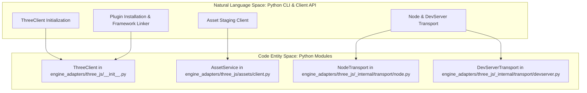
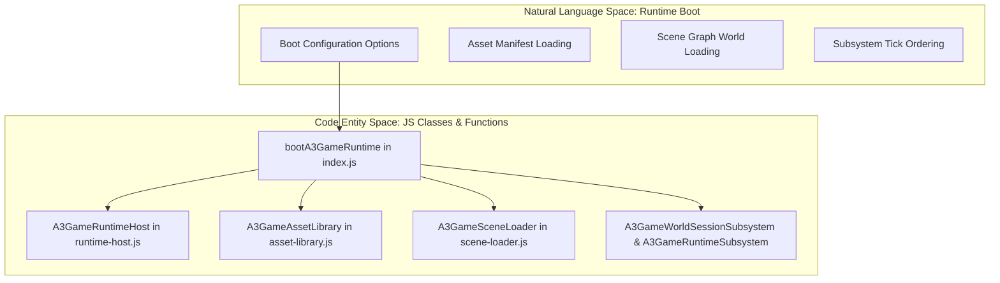

<!-- source: DeepWiki mcp.deepwiki.com · repo OpenDCAI/GameFactory-3A · page 5.4 three.js Adapter & @a3game/playable · fetched 2026-11-02 -->

# three.js Adapter & @a3game/playable

Relevant source files

The following files were used as context for generating this wiki page:

- [engine_adapters/three_js/__init__.py](engine_adapters/three_js/__init__.py)
- [engine_adapters/three_js/_internal/__init__.py](engine_adapters/three_js/_internal/__init__.py)
- [engine_adapters/three_js/_internal/transport/__init__.py](engine_adapters/three_js/_internal/transport/__init__.py)
- [engine_adapters/three_js/_internal/transport/devserver.py](engine_adapters/three_js/_internal/transport/devserver.py)
- [engine_adapters/three_js/_internal/transport/node.py](engine_adapters/three_js/_internal/transport/node.py)
- [engine_adapters/three_js/animation/__init__.py](engine_adapters/three_js/animation/__init__.py)
- [engine_adapters/three_js/animation/client.py](engine_adapters/three_js/animation/client.py)
- [engine_adapters/three_js/assets/_internal/__init__.py](engine_adapters/three_js/assets/_internal/__init__.py)
- [engine_adapters/three_js/assets/_internal/service.py](engine_adapters/three_js/assets/_internal/service.py)
- [engine_adapters/three_js/assets/client.py](engine_adapters/three_js/assets/client.py)
- [engine_adapters/three_js/config.py](engine_adapters/three_js/config.py)
- [engine_adapters/three_js/examples/README.md](engine_adapters/three_js/examples/README.md)
- [engine_adapters/three_js/examples/explorer-example/package.json](engine_adapters/three_js/examples/explorer-example/package.json)
- [engine_adapters/three_js/examples/explorer-example/src/arrow.js](engine_adapters/three_js/examples/explorer-example/src/arrow.js)
- [engine_adapters/three_js/examples/explorer-example/src/entity.js](engine_adapters/three_js/examples/explorer-example/src/entity.js)
- [engine_adapters/three_js/examples/explorer-example/src/explorer.js](engine_adapters/three_js/examples/explorer-example/src/explorer.js)
- [engine_adapters/three_js/examples/explorer-example/src/factory.js](engine_adapters/three_js/examples/explorer-example/src/factory.js)
- [engine_adapters/three_js/examples/explorer-example/src/index.js](engine_adapters/three_js/examples/explorer-example/src/index.js)
- [engine_adapters/three_js/examples/explorer-example/src/terrain.js](engine_adapters/three_js/examples/explorer-example/src/terrain.js)
- [engine_adapters/three_js/examples/explorer-example/src/world.js](engine_adapters/three_js/examples/explorer-example/src/world.js)
- [engine_adapters/three_js/examples/explorer-example/tests/explorer-example.spec.js](engine_adapters/three_js/examples/explorer-example/tests/explorer-example.spec.js)
- [engine_adapters/three_js/examples/fps-example/src/index.js](engine_adapters/three_js/examples/fps-example/src/index.js)
- [engine_adapters/three_js/examples/motion-vfx-example/README.md](engine_adapters/three_js/examples/motion-vfx-example/README.md)
- [engine_adapters/three_js/examples/motion-vfx-example/package.json](engine_adapters/three_js/examples/motion-vfx-example/package.json)
- [engine_adapters/three_js/examples/motion-vfx-example/src/effects.js](engine_adapters/three_js/examples/motion-vfx-example/src/effects.js)
- [engine_adapters/three_js/examples/motion-vfx-example/src/index.js](engine_adapters/three_js/examples/motion-vfx-example/src/index.js)
- [engine_adapters/three_js/examples/motion-vfx-example/src/motion.js](engine_adapters/three_js/examples/motion-vfx-example/src/motion.js)
- [engine_adapters/three_js/plugin/A3GamePlayable/README.md](engine_adapters/three_js/plugin/A3GamePlayable/README.md)
- [engine_adapters/three_js/plugin/A3GamePlayable/src/engine/animation-director.js](engine_adapters/three_js/plugin/A3GamePlayable/src/engine/animation-director.js)
- [engine_adapters/three_js/plugin/A3GamePlayable/src/engine/asset-library.js](engine_adapters/three_js/plugin/A3GamePlayable/src/engine/asset-library.js)
- [engine_adapters/three_js/plugin/A3GamePlayable/src/engine/collision-probe.js](engine_adapters/three_js/plugin/A3GamePlayable/src/engine/collision-probe.js)
- [engine_adapters/three_js/plugin/A3GamePlayable/src/engine/hud-layer.js](engine_adapters/three_js/plugin/A3GamePlayable/src/engine/hud-layer.js)
- [engine_adapters/three_js/plugin/A3GamePlayable/src/engine/index.js](engine_adapters/three_js/plugin/A3GamePlayable/src/engine/index.js)
- [engine_adapters/three_js/plugin/A3GamePlayable/src/engine/input-router.js](engine_adapters/three_js/plugin/A3GamePlayable/src/engine/input-router.js)
- [engine_adapters/three_js/plugin/A3GamePlayable/src/engine/motion-kit.js](engine_adapters/three_js/plugin/A3GamePlayable/src/engine/motion-kit.js)
- [engine_adapters/three_js/plugin/A3GamePlayable/src/engine/runtime-host.js](engine_adapters/three_js/plugin/A3GamePlayable/src/engine/runtime-host.js)
- [engine_adapters/three_js/plugin/A3GamePlayable/src/engine/scene-loader.js](engine_adapters/three_js/plugin/A3GamePlayable/src/engine/scene-loader.js)
- [engine_adapters/three_js/plugin/A3GamePlayable/src/engine/vfx-kit.js](engine_adapters/three_js/plugin/A3GamePlayable/src/engine/vfx-kit.js)
- [engine_adapters/three_js/plugin/A3GamePlayable/src/engine/visual-kit.js](engine_adapters/three_js/plugin/A3GamePlayable/src/engine/visual-kit.js)
- [engine_adapters/three_js/plugin/A3GamePlayable/src/index.js](engine_adapters/three_js/plugin/A3GamePlayable/src/index.js)
- [engine_adapters/three_js/world/_internal/specs.py](engine_adapters/three_js/world/_internal/specs.py)
- [operators/gen_3d_scene/funcs/appearance_assets.py](operators/gen_3d_scene/funcs/appearance_assets.py)
- [operators/gen_3d_scene/funcs/scene_assets.py](operators/gen_3d_scene/funcs/scene_assets.py)

## Purpose and Scope

The three.js adapter and its companion runtime library (`@a3game/playable`) provide a full pipeline and runtime environment for running generated games in web browsers. While Unreal Engine and Unity leverage native toolchains, the three.js adapter bridges Python-driven asset staging, world generation, and code-generation tasks with a zero-install WebGL execution environment. 

The scope encompasses:
- Python client namespaces (`ThreeClient`) and transport layers (`node.py`, `devserver.py`) [engine_adapters/three_js/__init__.py]()
- Asset staging, format normalization, orientation correction, and manifest generation [engine_adapters/three_js/assets/client.py]()
- The `@a3game/playable` runtime extension package (`bootA3GameRuntime`, `A3GameRuntimeHost`, `A3GameAssetLibrary`, `A3GameSceneLoader`) [engine_adapters/three_js/plugin/A3GamePlayable/src/index.js:1-200]()
- Scaffolding kits for visual PBR styling, humanoid motion/auto-rigging, particle/beam VFX, and collision probes [engine_adapters/three_js/plugin/A3GamePlayable/src/engine/index.js:1-78]()
- Reference gameplay examples demonstrating first-person, third-person orbit, and arcade mechanics [engine_adapters/three_js/examples/README.md:1-60]()

Sources: [engine_adapters/three_js/plugin/A3GamePlayable/src/index.js:1-200](), [engine_adapters/three_js/examples/README.md:1-60]()

---

## ThreeClient Namespaces & Transport Architecture

The Python-side `ThreeClient` exposes modular sub-clients that interact with the local filesystem, stage assets, manage plugin dependencies, and spin up test/dev servers.

### Transport Mechanisms
- **Node Transport**: `NodeTransport` executes bundled scripts and test runners headlessly inside a Node.js process to capture metrics or run playtests.
- **DevServer Transport**: `DevServerTransport` manages a Vite/Webpack development server instance for browser-based interactive playtesting and CDP (Chrome DevTools Protocol) recording.

Sources: [engine_adapters/three_js/__init__.py]()

---

## Asset Staging, Manifests & Orientation Contracts

Imported 3D assets (GLTF, GLB, FBX) undergo standard normalization before consumption by the browser runtime. Because GLTF files lack a unified coordinate convention or cast-shadow defaults, the asset pipeline and `A3GameAssetLibrary` handle normalization at load time.

| Challenge | Cause | Resolution in Adapter / Library |
| --- | --- | --- |
| **Scale Mismatch** | Arbitrary units chosen by 3D generators (e.g. 1 unit = 1 cm vs 1 m) | Normalized using `height` hints or `scale_hint_metres` from manifest entries [engine_adapters/three_js/plugin/A3GamePlayable/README.md:138-144]() |
| **Shadow Deficits** | GLTF specifications omit `castShadow` defaults | Forced to `true` during model preprocessing in `A3GameAssetLibrary` [engine_adapters/three_js/plugin/A3GamePlayable/README.md:143-145]() |
| **Facing Inconsistencies** | Identical files rendered facing +Z or -Z | Standardized to local forward `-Z` via `orientModel()` and manifest `orientation.forward_axis` attributes [engine_adapters/three_js/plugin/A3GamePlayable/README.md:146-165]() |

Sources: [engine_adapters/three_js/plugin/A3GamePlayable/README.md:123-169]()

---

## Plugin Runtime Host & Core Subsystems (`@a3game/playable`)

The `@a3game/playable` package exports the public interface for generated three.js gameplay packages [engine_adapters/three_js/plugin/A3GamePlayable/src/index.js:1-18](). Bootstrapping is managed via `bootA3GameRuntime()`, which orchestrates the renderer host, asset library, scene loader, HUD, and session subsystems [engine_adapters/three_js/plugin/A3GamePlayable/src/index.js:151-200]().

### Core Runtime Classes
- **`A3GameRuntimeHost`**: Owns the `THREE.WebGLRenderer`, `THREE.Scene`, camera configurations, render loop, raycasters, and GPU-generated environment presets (`room`, `sky`, `gradient`, `none`) [engine_adapters/three_js/plugin/A3GamePlayable/src/engine/runtime-host.js:27-154]().
- **`A3GameAssetLibrary`**: Fetches `/assets/manifest.json`, caches loaded GLTF/FBX/Audio/Texture assets, and manages prototype instantiation or fallback primitives [engine_adapters/three_js/plugin/A3GamePlayable/src/engine/asset-library.js:21-112]().
- **`A3GameSceneLoader`**: Decodes world scene graphs (`/assets/worlds/<world_id>.json`) into active lights, entities, collision targets, and spawn points [engine_adapters/three_js/plugin/A3GamePlayable/src/engine/scene-loader.js:58-123]().

Sources: [engine_adapters/three_js/plugin/A3GamePlayable/src/index.js:151-200](), [engine_adapters/three_js/plugin/A3GamePlayable/src/engine/runtime-host.js:27-154](), [engine_adapters/three_js/plugin/A3GamePlayable/src/engine/asset-library.js:21-112](), [engine_adapters/three_js/plugin/A3GamePlayable/src/engine/scene-loader.js:58-123]()

---

## Visual, Motion, and VFX Kits

To prevent generated games from looking like unlit programmer art, `@a3game/playable` supplies modular scaffolding kits:

- **Visual Kit (`visual-kit.js`)**: Supplies `createMaterial()` with physically plausible PBR presets (`A3GameMaterialPreset`), bevelled geometry helpers (`createRoundedBox`), and fitted directional lights (`createSunLight`) to eliminate blocky shadow maps and flat plastic surfaces [engine_adapters/three_js/plugin/A3GamePlayable/src/engine/visual-kit.js:35-195]().
- **Motion Kit (`motion-kit.js`)**: Implements avatar auto-rigging and retargeting (`retargetClipToSkeleton`) for generated meshes lacking skeletal hierarchies, mapping canonical bone names (`A3GameHumanoidBone`) to standard motion states (`A3GameMotionState`) [engine_adapters/three_js/plugin/A3GamePlayable/src/engine/motion-kit.js:62-108]().
- **VFX & Collision Probes (`vfx-kit.js`, `collision-probe.js`)**: Provides batched particle systems, beam effects, trail ribbons (`A3GameVfxDirector`), and raycast collision query routines (`A3GameCollisionProbe` for ground sampling, move resolution, hitscan, and sphere sweeps) [engine_adapters/three_js/plugin/A3GamePlayable/src/engine/collision-probe.js:38-198]().

Sources: [engine_adapters/three_js/plugin/A3GamePlayable/src/engine/visual-kit.js:35-195](), [engine_adapters/three_js/plugin/A3GamePlayable/src/engine/motion-kit.js:62-108](), [engine_adapters/three_js/plugin/A3GamePlayable/src/engine/collision-probe.js:38-198]()

---

## Reference Gameplay Examples

Generated gameplay packages reference concrete patterns from five standalone example projects under `engine_adapters/three_js/examples/`. Examples are organized by camera perspective rather than genre:

| Example Package | Camera Mode | Key Demonstrations |
| --- | --- | --- |
| `fps-example` | First Person | Pointer-lock movement, hitscan fire, view models, crosshair HUD [engine_adapters/three_js/examples/README.md:8]() |
| `arena-fighter-example` | Second Person (Duel) | Facing-locked movement, light/heavy attacks, health HUD [engine_adapters/three_js/examples/README.md:9]() |
| `racing-example` | Third Person (Chase) | Arcade vehicle steering, drift, lap/speed HUD [engine_adapters/three_js/examples/README.md:10]() |
| `explorer-example` | Third Person (Orbit) | Heightfield terrain collision, follow camera, stamina [engine_adapters/three_js/examples/README.md:11]() |
| `motion-vfx-example` | — | Character rigging validation, batched particles, trails [engine_adapters/three_js/examples/README.md:12]() |

Sources: [engine_adapters/three_js/examples/README.md:1-60]()

---

