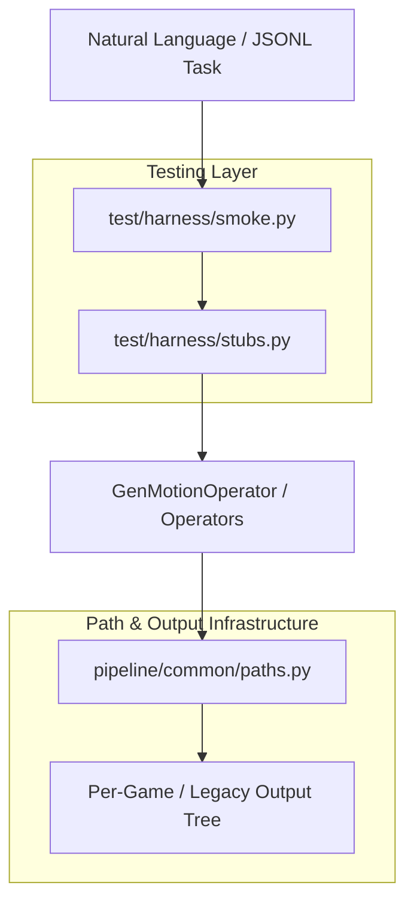

<!-- source: DeepWiki mcp.deepwiki.com · repo OpenDCAI/GameFactory-3A · page 6 Testing & Tooling · fetched 2026-11-02 -->

# Testing & Tooling

Relevant source files

The following files were used as context for generating this wiki page:

- [LICENSE](LICENSE)
- [README.md](README.md)
- [README_zh.md](README_zh.md)
- [models/gen_motion/tripo_rigging_model.py](models/gen_motion/tripo_rigging_model.py)
- [operators/gen_motion/funcs/cloud_rig_animate.py](operators/gen_motion/funcs/cloud_rig_animate.py)
- [operators/gen_motion/operator.py](operators/gen_motion/operator.py)
- [pipeline/assets_gen/gen_motion/run.py](pipeline/assets_gen/gen_motion/run.py)
- [pipeline/common/paths.py](pipeline/common/paths.py)
- [test/harness/smoke.py](test/harness/smoke.py)
- [test/harness/stubs.py](test/harness/stubs.py)
- [test/test_motion_cloud.py](test/test_motion_cloud.py)
- [third_party/README.md](third_party/README.md)

## Purpose & Scope

The testing and tooling subsystem of 3AGameFactory provides robust validation mechanisms, lightweight offline stubs, and utility scripts to ensure that asset generation pipelines, operators, and engine adapters function correctly. Because full-scale generative models require heavy GPU hardware and network backends, the test suite relies on deterministic CPU-only mock stubs [test/harness/stubs.py:1-21]() and a smoke testing framework [test/harness/smoke.py:1-30]() that executes end-to-end checks in milliseconds.

This is a PARENT page. For detailed breakdowns of smoke tests, domain-specific test suites, and import utilities, refer to the child pages:
- [Smoke Harness & Stubs](#6.1)
- [Test Suite by Domain](#6.2)
- [Scripts & Asset Import Utilities](#6.3)

---

## Testing & Tooling Architecture

The following diagram illustrates how the test and verification layers bridge natural-language task specifications to executable operators using lightweight stubs or production runtimes.

**Sources:** `[test/harness/smoke.py:1-53]`, `[test/harness/stubs.py:1-37]`, `[pipeline/common/paths.py:1-39]`

---

## 6.1 Smoke Harness & Stubs

The smoke testing infrastructure allows developers to run end-to-end checks without GPU dependencies or model weights. Defined primarily in `[test/harness/smoke.py:1-30]()` and supported by mock fixtures in `[test/harness/stubs.py:1-21]`, the smoke harness exercises task parsing, game project resolution, artifact naming, and metadata generation under the `_smoke` run identifier.

For details on contract key assertions, per-game vs. legacy flat output modes, and stub operator construction (`stubs.build_operator`), see [Smoke Harness & Stubs](#6.1).

**Sources:** `[test/harness/smoke.py:1-30]`, `[test/harness/stubs.py:1-21]`

---

## 6.2 Test Suite by Domain

The `test/` directory contains modular test scripts covering individual system components. These include asset specification validators, motion/audio/cg integration tests (such as `[test/test_motion_cloud.py:1-32]()`), terrain whitebox viewers, VFX review tooling for Unreal Engine and Unity, and adapter installer tests.

For details on modality-specific test suites, review tools, and validation scripts, see [Test Suite by Domain](#6.2).

**Sources:** `[test/test_motion_cloud.py:1-32]`

---

## 6.3 Scripts & Asset Import Utilities

Operational scripts streamline environment provisioning, weight downloading, engine installation, and asset staging. Utilities such as `scripts/import_generated_asset.py` work alongside engine-side `import_generated` helper functions to bridge generated GLB/FBX files into Unreal Engine, Unity, Godot, and three.js projects.

For details on environment setup shell scripts, engine installers, and asset import flows, see [Scripts & Asset Import Utilities](#6.3).

**Sources:** `[README.md:144-166]`, `[pipeline/common/paths.py:1-39]`

---

