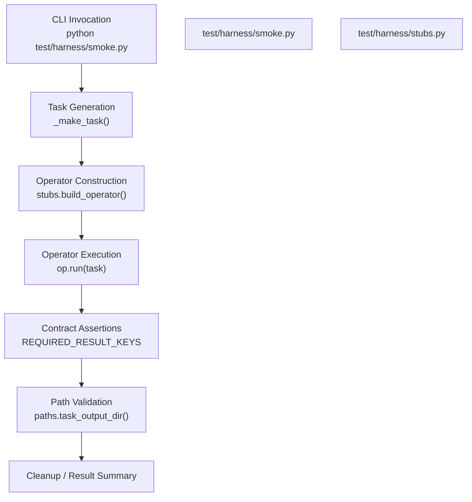
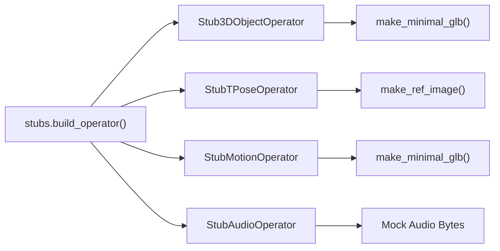
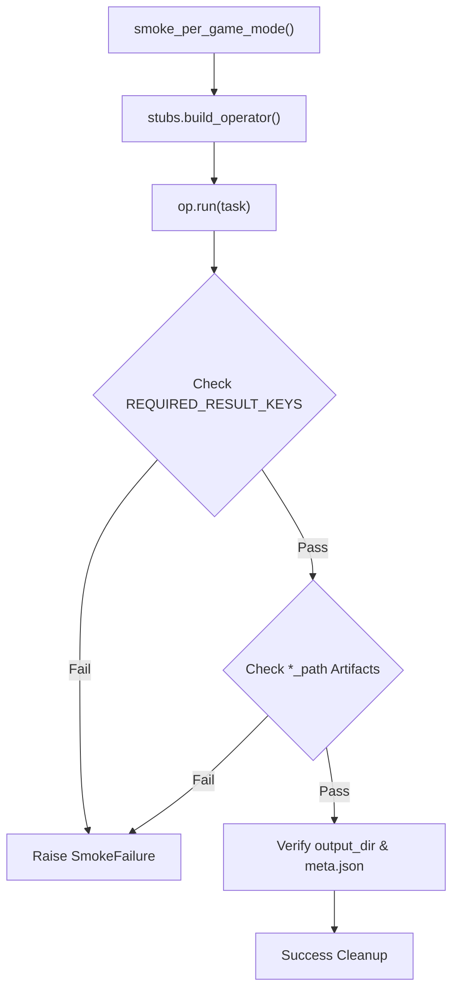
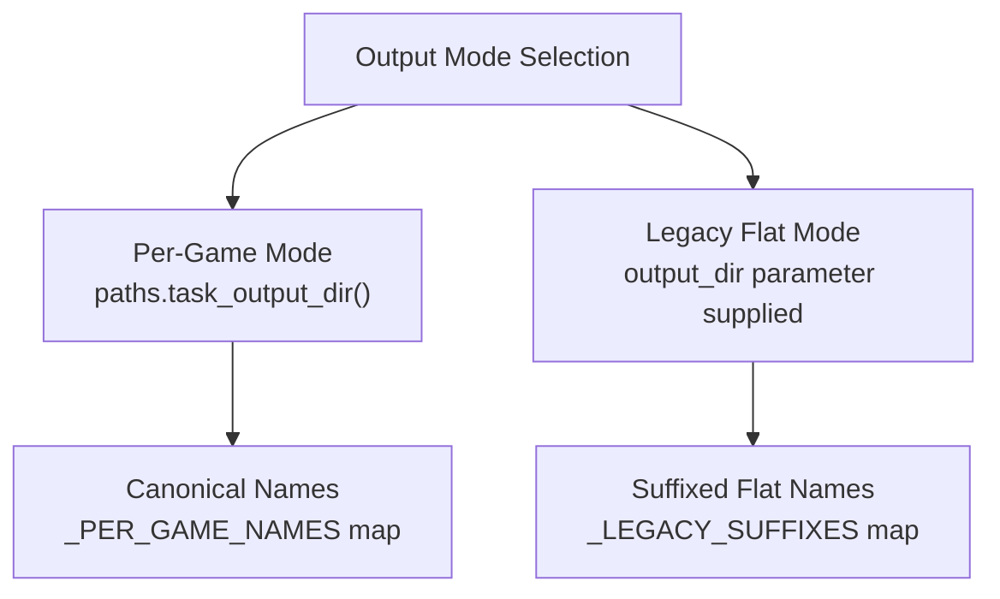
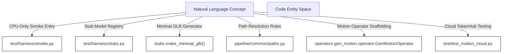

<!-- source: DeepWiki mcp.deepwiki.com · repo OpenDCAI/GameFactory-3A · page 6.1 Smoke Harness & Stubs · fetched 2026-11-02 -->

# Smoke Harness & Stubs

Relevant source files

The following files were used as context for generating this wiki page:

- [LICENSE](LICENSE)
- [README.md](README.md)
- [README_zh.md](README_zh.md)
- [models/gen_motion/tripo_rigging_model.py](models/gen_motion/tripo_rigging_model.py)
- [operators/gen_motion/funcs/cloud_rig_animate.py](operators/gen_motion/funcs/cloud_rig_animate.py)
- [operators/gen_motion/operator.py](operators/gen_motion/operator.py)
- [pipeline/assets_gen/gen_motion/run.py](pipeline/assets_gen/gen_motion/run.py)
- [pipeline/common/paths.py](pipeline/common/paths.py)
- [test/harness/smoke.py](test/harness/smoke.py)
- [test/harness/stubs.py](test/harness/stubs.py)
- [test/test_motion_cloud.py](test/test_motion_cloud.py)
- [third_party/README.md](third_party/README.md)

## Purpose and Scope
This section covers the end-to-end CPU-only validation infrastructure provided by `test/harness/smoke.py` and `test/harness/stubs.py` [test/harness/stubs.py:1-21](), [test/harness/smoke.py:1-30](). The smoke harness enables fast, deterministic execution of asset generation chains in milliseconds without requiring GPU hardware, large model weights, or network access. It validates operator initialization, data contracts, artifact output paths, metadata creation, and compatibility with both per-game and legacy flat output structures.

---

## 1. Harness Architecture & Execution Flow

The smoke harness intercepts real model calls by injecting lightweight, deterministic stubs that mimic the interface requirements of actual wrappers while emitting trivial outputs (such as minimal valid binary glTF files and deterministic RGB blobs).

*Sources: [test/harness/smoke.py:1-333](), [test/harness/stubs.py:1-1224]()*

---

## 2. Stub Framework & Fixtures (`test/harness/stubs.py`)

The stub module supplies mock model implementations and lightweight assets designed to clear structural assertions in the pipeline without incurring model inference overhead [test/harness/stubs.py:1-21]().

### Key Functions and Fixtures
- **`make_ref_image(size, seed)`**: Constructs a deterministic RGB `PIL.Image` featuring a colored geometric foreground element on a white background [test/harness/stubs.py:41-50]().
- **`write_ref_image(path, size, seed)`**: Materializes reference images directly to disk for JSONL-driven smoke runs [test/harness/stubs.py:53-58]().
- **`make_minimal_glb(triangles, pad_to)`**: Generates a valid binary glTF (GLB) file containing unlit triangle primitives [test/harness/stubs.py:61-118](). The JSON chunk is padded with trailing spaces up to `pad_to` bytes to satisfy file-size heuristics in validation checks [test/harness/stubs.py:61-76]().
- **`make_textured_glb(size, texture_size)`**: Produces a PBR-textured cube with embedded textures, normals, and UV coordinates to test engine material parsers [test/harness/stubs.py:169-175]().
- **`build_operator(kind, run_id, model_key)`**: Factory function that registers and returns the stubbed operator corresponding to a specific asset task kind (`3d_object`, `tpose`, `motion`, `audio`, etc.) [test/harness/stubs.py:1-21]().

*Sources: [test/harness/stubs.py:1-175]()*

---

## 3. Smoke Test Suite (`test/harness/smoke.py`)

The script `test/harness/smoke.py` acts as the entry point for end-to-end sanity checks [test/harness/smoke.py:1-30](). It exercises task parsing, game ID resolution, metadata generation, and output directory structures under `SMOKE_RUN_ID = "_smoke"` [test/harness/smoke.py:10-18].

### Core Assertions and Requirements
- **Result Key Verification**: Enforces the presence of `REQUIRED_RESULT_KEYS` (`task_id`, `elapsed_sec`, `game_id`, `task_kind`, `output_dir`) in every operator output [test/harness/smoke.py:69-70], [test/harness/smoke.py:158-159].
- **Artifact Path Checking**: Ensures every generated artifact path ending in `_path` points to an existing non-empty file or an explicitly allowed `None` optional value [test/harness/smoke.py:161-183]().
- **Exception Management**: Utilizes `SmokeFailure` (inheriting from `AssertionError`) to report contract violations with descriptive failure states [test/harness/smoke.py:132-139]().

*Sources: [test/harness/smoke.py:132-183]()*

---

## 4. Contract Key Assertions & Output Path Management

The harness validates output organization by comparing generated directory hierarchies against rules defined in `pipeline/common/paths.py` [pipeline/common/paths.py:1-39]().

### Per-Game vs. Legacy Flat Output Modes
- **Per-Game Mode (Default)**: Organizes outputs under structured project directories using canonical filenames (`test_data/outputs/<game_id>/<run_id>/<layer>/<task_kind>/<task_id>/`) [pipeline/common/paths.py:10-31](). Operators map artifact keys to explicit filenames (e.g., `rig_path` $\rightarrow$ `rig.txt`, `retargeted_fbx_path` $\rightarrow$ `retargeted.fbx`) [operators/gen_motion/operator.py:22-41]().
- **Legacy Flat Mode**: Activated when an explicit `output_dir` override is supplied to the operator [operators/gen_motion/operator.py:110-116](). Artifacts share a single flat destination directory, with filenames carrying task ID suffixes (`_LEGACY_SUFFIXES`) to prevent collisions [operators/gen_motion/operator.py:43-64]().

*Sources: [pipeline/common/paths.py:7-31](), [operators/gen_motion/operator.py:20-64](), [operators/gen_motion/operator.py:105-131]()*

---

## 5. Natural Language Space to Code Entity Space Mapping

The relationship between abstract smoke test concepts and concrete codebase entities is defined below:

*Sources: [test/harness/smoke.py:1-30](), [test/harness/stubs.py:1-21](), [pipeline/common/paths.py:1-39](), [operators/gen_motion/operator.py:67-104](), [test/test_motion_cloud.py:1-32]()*

---

