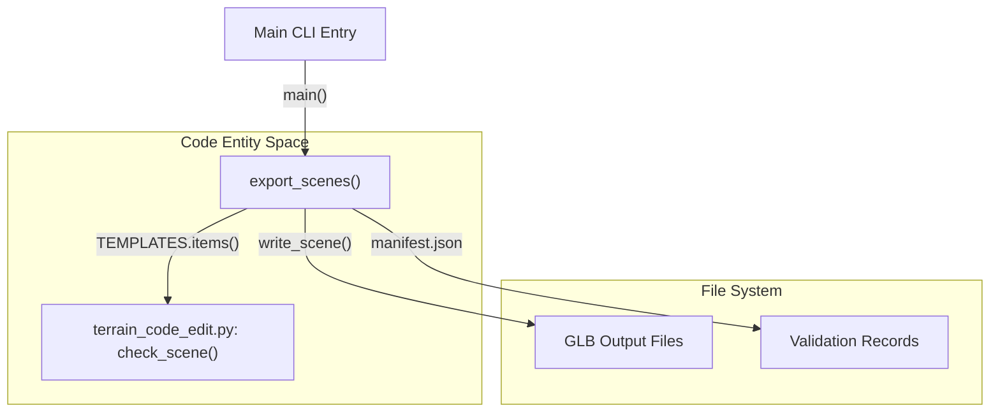
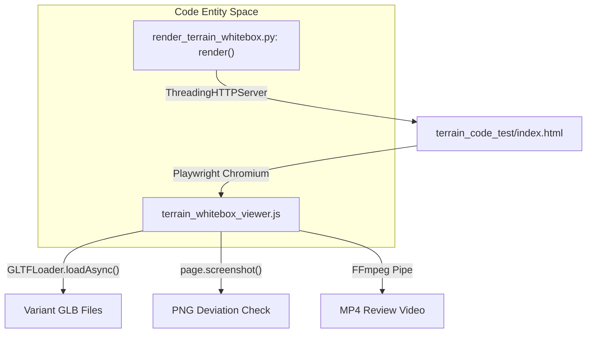
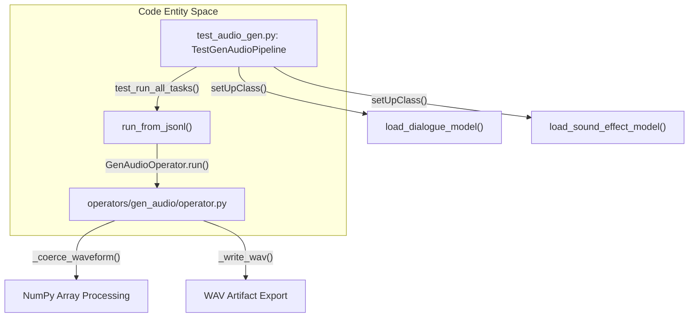

<!-- source: DeepWiki mcp.deepwiki.com · repo OpenDCAI/GameFactory-3A · page 6.2 Test Suite by Domain · fetched 2026-11-02 -->

# Test Suite by Domain

<details>
<summary>Relevant source files</summary>

The following files were used as context for generating this wiki page:

- [operators/gen_audio/metrics/__init__.py](operators/gen_audio/metrics/__init__.py)
- [operators/gen_audio/operator.py](operators/gen_audio/operator.py)
- [pipeline/assets_gen/gen_audio/eval.py](pipeline/assets_gen/gen_audio/eval.py)
- [scripts/engine_install/godot/install.py](scripts/engine_install/godot/install.py)
- [test/terrain_code_test/__init__.py](test/terrain_code_test/__init__.py)
- [test/terrain_code_test/render_terrain_whitebox.py](test/terrain_code_test/render_terrain_whitebox.py)
- [test/terrain_code_test/terrain_whitebox_demo.py](test/terrain_code_test/terrain_whitebox_demo.py)
- [test/terrain_code_test/terrain_whitebox_viewer.html](test/terrain_code_test/terrain_whitebox_viewer.html)
- [test/terrain_code_test/terrain_whitebox_viewer.js](test/terrain_code_test/terrain_whitebox_viewer.js)
- [test/test_audio_gen.py](test/test_audio_gen.py)
- [test/test_godot_installer.py](test/test_godot_installer.py)
- [test/vfx_test/A3Game_VFXPlayerBuilder.cs](test/vfx_test/A3Game_VFXPlayerBuilder.cs)
- [test/vfx_test/A3Game_VFXReviewRenderer.cs](test/vfx_test/A3Game_VFXReviewRenderer.cs)
- [test/vfx_test/A3Game_VFXRuntimeCapture.cs](test/vfx_test/A3Game_VFXRuntimeCapture.cs)
- [test/vfx_test/A3Game_VFXSmoke.cs](test/vfx_test/A3Game_VFXSmoke.cs)
- [test/vfx_test/README.md](test/vfx_test/README.md)
- [test/vfx_test/__init__.py](test/vfx_test/__init__.py)
- [test/vfx_test/encode_vfx_review.py](test/vfx_test/encode_vfx_review.py)
- [test/vfx_test/test_vfx_adapters.py](test/vfx_test/test_vfx_adapters.py)
- [test/vfx_test/ue5_open_vfx_review.py](test/vfx_test/ue5_open_vfx_review.py)
- [test/vfx_test/ue5_vfx_smoke.py](test/vfx_test/ue5_vfx_smoke.py)

</details>


### Purpose and Scope

The `test/` directory contains modality-specific integration tests, domain validation harnesses, installer contract verifications, and visual review tooling across GameFactory-3A. This page details the organization, key test classes, data flow, and visualization pipelines implemented across the test suite domains.

Sources: `test/test_godot_installer.py()`, `test/terrain_code_test/terrain_whitebox_demo.py()`, `test/test_audio_gen.py()`, `test/vfx_test/README.md()`

---

## 1. Terrain Whitebox Studies & Spec Tests

The terrain whitebox domain validates procedural terrain layout generation, schema constraints, and visual rendering fidelity across baseline ("opus") and revision ("gpt6") variants. The entry point `test/terrain_code_test/terrain_whitebox_demo.py` executes scene generation templates, evaluates them via `check_scene`, and exports GLB assets alongside validation manifests.


*Figure 1: Terrain Whitebox Export Pipeline mapping natural-language scene requirements to generated GLB assets and manifests.*

Sources: `test/terrain_code_test/terrain_whitebox_demo.py:16-43()`, `test/terrain_code_test/terrain_whitebox_demo.py:45-57()`

### Viewer and Headless Rendering Plumbing

The exported GLBs can be interactively inspected or batch-rendered into PNG screenshots and MP4 review videos using Playwright and FFmpeg. 

- **Viewer Frontend**: `test/terrain_code_test/terrain_whitebox_viewer.html()` and `test/terrain_code_test/terrain_whitebox_viewer.js()` provide an orthographic/perspective Three.js scene browser (`GLTFLoader`, `OrbitControls`) supporting wireframe toggling, white-clay material overrides, and side-by-side version comparison.
- **Headless Renderer**: `test/terrain_code_test/render_terrain_whitebox.py()` coordinates a local HTTP server (`ThreadingHTTPServer`), launches a headless Chromium instance via Playwright, computes pixel deviation and framing metrics, and produces multi-angle captures.


*Figure 2: Headless Playwright Rendering Architecture for Terrain Whitebox Verification.*

Sources: `test/terrain_code_test/terrain_whitebox_viewer.html:1-62()`, `test/terrain_code_test/terrain_whitebox_viewer.js:1-143()`, `test/terrain_code_test/render_terrain_whitebox.py:67-131()`

---

## 2. Audio Generation Pipeline Tests

The audio test suite validates the integration of Qwen3-TTS (dialogue model) and Woosh-DFlow (sound effect model) through `test/test_audio_gen.py`. It reads task packets from `test_data/test_samples/audio_gen_collect.jsonl`, invokes `GenAudioOperator`, and enforces PCM16 WAV format constraints, channel layouts, and duration limits.


*Figure 3: Audio Generation Test Data Flow and Operator Binding.*

### Key Validation Checks in `TestGenAudioPipeline`
- **JSONL Schema Enforcement**: Asserts that tasks contain both `dialogue` and `sound_effect` audio types [test/test_audio_gen.py:71-80()].
- **WAV Integrity**: Verifies non-zero frame counts, 16-bit sample width (`getsampwidth() == 2`), correct sample rates, and positive duration bounds [test/test_audio_gen.py:82-111()].

Sources: `test/test_audio_gen.py:49-112()`, `operators/gen_audio/operator.py:23-164()`

---

## 3. Installer and Adapter Contract Tests

Engine installer modules undergo strict contract verification without requiring external packages. For example, `test/test_godot_installer.py` tests non-interactive editor installation logic defined in `scripts/engine_install/godot/install.py`.

### Key Test Assertions in `GodotInstallerTests`
- **Version Normalization**: Enforces exact stable 4.x versions (e.g., rejecting `"latest"` or `"3.6.1"`) [test/test_godot_installer.py:32-38()].
- **Platform Mapping**: Resolves operating system and machine architectures (Linux, macOS universal, Windows ARM64/x64) to official archive labels and executable relative paths [test/test_godot_installer.py:39-57()].
- **Checksum Parsing & Safety**: Validates SHA512 sum parser failure modes and ensures `extract_zip_safely` rejects directory traversal payloads and symbolic links [test/test_godot_installer.py:87-119()].

Sources: `test/test_godot_installer.py:31-166()`, `scripts/engine_install/godot/install.py:1-138()`

---

## 4. VFX Review and Adapter Tooling (`test/vfx_test/`)

The `test/vfx_test/` suite provides integration testing and review tooling for visual effects across Unreal Engine 5 and Unity.

### Environment Configuration & Runners
- **Review Content Roots**: Unreal integration scripts resolve project-specific review assets via `AAAGF_VFX_TEST_CONTENT_ROOT` pointing to directories containing `Maps`, `Preview`, `Review`, and `Sequences` [test/vfx_test/README.md:9-14()].
- **Filesystem Output Variables**: File output paths are configured via `AAAGF_VFX_REVIEW_ROOT`, `AAAGF_PUNCH_FIRE_OUTPUT_DIR`, and `AAAGF_PUNCH_FIRE_PLAYER_PATH` [test/vfx_test/README.md:12-14()].
- **Test Suite Execution**: The offline adapter suite is invoked via unittest discovery [test/vfx_test/README.md:3-7()]:
  ```bash
  python -m unittest test.vfx_test.test_vfx_adapters -v
  ```

Sources: `test/vfx_test/README.md:1-15()`

---

