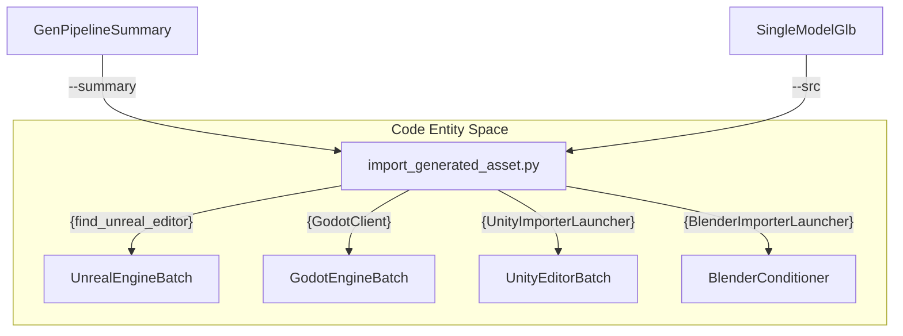
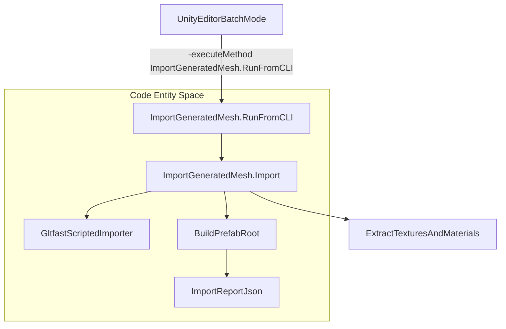

<!-- source: DeepWiki mcp.deepwiki.com · repo OpenDCAI/GameFactory-3A · page 6.3 Scripts & Asset Import Utilities · fetched 2026-11-02 -->

# Scripts & Asset Import Utilities

Relevant source files

The following files were used as context for generating this wiki page:

- [engine_adapters/unity3d/import_generated/ImportGeneratedMesh.cs](engine_adapters/unity3d/import_generated/ImportGeneratedMesh.cs)
- [engine_adapters/unity3d/import_generated/README.md](engine_adapters/unity3d/import_generated/README.md)
- [scripts/asset_env_setup/3d_object/trellis2_install.sh](scripts/asset_env_setup/3d_object/trellis2_install.sh)
- [scripts/engine_install/unity/create_project.cmd](scripts/engine_install/unity/create_project.cmd)
- [scripts/engine_install/unity/create_project.sh](scripts/engine_install/unity/create_project.sh)
- [scripts/engine_install/unity/generate_game.cmd](scripts/engine_install/unity/generate_game.cmd)
- [scripts/import_generated_asset.py](scripts/import_generated_asset.py)

## Purpose and Scope

This section covers the host-side launching utilities, engine-side asset importers, and environment setup scripts that bridge the gap between generated model assets (`models/gen_3d_object`) and target game engines (Unreal Engine 5, Unity, Godot, and Blender). The core utility `scripts/import_generated_asset.py` acts as the host-side orchestrator, discovering engine binaries via environment variables or host paths, and driving batch-mode importers residing in `engine_adapters/<engine>/import_generated/`. Additionally, environment setup shell scripts (`scripts/asset_env_setup/`) and engine installation wrappers (`scripts/engine_install/`) configure the runtime and training dependencies required to execute generation and import pipelines.

Sources: `scripts/import_generated_asset.py:1-57()`, `engine_adapters/unity3d/import_generated/README.md:1-22()`

---

## Host-Side Asset Import Launcher (`scripts/import_generated_asset.py`)

The script `scripts/import_generated_asset.py` functions as the host-side launcher for the final leg of the asset generation pipeline: taking generated outputs (such as `model.glb`) and ingesting them into game engine projects or conditioning them through Blender [scripts/import_generated_asset.py:5-16()]. 

### Engine Discovery and Environment Variables

The launcher dynamically discovers engine executables by checking explicit CLI arguments, followed by fallback environment variables and standard installation paths across Windows, macOS, and Linux [scripts/import_generated_asset.py:140-183()]. 

Key environment variables recognized by the launcher include:
- `AAAGF_UE_EDITOR` / `AAAGF_UPROJECT`: Unreal Engine editor binary (`UnrealEditor-Cmd.exe`) and project paths [scripts/import_generated_asset.py:47-48()].
- `AAAGF_UNITY` / `AAAGF_UNITY_PROJECT`: Unity editor executable and project root [scripts/import_generated_asset.py:49-50()].
- `A3GAME_GODOT_EXECUTABLE` / `A3GAME_GODOT` / `AAAGF_GODOT`: Godot 4 editor executable fallbacks [scripts/import_generated_asset.py:51-53()].
- `A3GAME_GODOT_PROJECT` / `AAAGF_GODOT_PROJECT`: Godot project root paths [scripts/import_generated_asset.py:54-55()].
- `AAAGF_BLENDER`: Path to `blender` executable or a Python environment capable of importing `bpy` [scripts/import_generated_asset.py:56()].

### Data Flow and Batch Summaries

Inputs to the launcher can be specified directly via `--src` or ingested in bulk using a `<kind>_results_summary.json` report generated by pipeline operators (e.g., `pipeline/assets_gen/gen_3d_object/run.py`) [scripts/import_generated_asset.py:18-20(), 42-45()].

*Figure 1: Host-side routing and engine discovery flow.*

Sources: `scripts/import_generated_asset.py:1-57()`, `scripts/import_generated_asset.py:140-183()`

---

## Engine-Side Importer Contracts (Unity Example)

Engine-side import scripts implement the strict contract expected by the host launcher. For Unity, `engine_adapters/unity3d/import_generated/ImportGeneratedMesh.cs` executes inside the Unity Editor during batch mode to transform raw `.glb` files into project assets and prefabs [engine_adapters/unity3d/import_generated/ImportGeneratedMesh.cs:3-24()].

### Editor-Side Execution & Usage Tiers

Because Unity requires edit-time compilation to support dependencies for VFX Graph, particle systems, and prefabs, the script is copied automatically into `<UnityProject>/Assets/Editor/` by the host launcher [engine_adapters/unity3d/import_generated/ImportGeneratedMesh.cs:6-9(), engine_adapters/unity3d/import_generated/README.md:29-32()]. 

The `ImportGeneratedMesh` class defines an `Usage` enum controlling scale, pivot adjustments, and validation criteria [engine_adapters/unity3d/import_generated/ImportGeneratedMesh.cs:37-50()]:
- `Usage.Asset`: Ordinary props, weapons, and characters with untouched scales and pivots [engine_adapters/unity3d/import_generated/ImportGeneratedMesh.cs:41-42()].
- `Usage.VfxStandalone`: Single-mesh visual effects (shields, beams) requiring pivot re-centering [engine_adapters/unity3d/import_generated/ImportGeneratedMesh.cs:43-45()].
- `Usage.VfxParticle`: Instanced particle meshes requiring triangle budgeting, normalized sizing, and origin-centered pivots [engine_adapters/unity3d/import_generated/ImportGeneratedMesh.cs:46-50()].

*Figure 2: Unity asset import execution pipeline.*

### Import Report Structure

The import process serializes an `ImportReport` structure containing vertex counts, triangle counts, bound sizes, material bindings, and warnings [engine_adapters/unity3d/import_generated/ImportGeneratedMesh.cs:52-75()]. This ensures that silent failures (e.g., successfully importing a mesh but dropping embedded textures) are caught and reported via structured JSON [engine_adapters/unity3d/import_generated/README.md:90-95()].

Sources: `engine_adapters/unity3d/import_generated/ImportGeneratedMesh.cs:1-134()`, `engine_adapters/unity3d/import_generated/README.md:1-99()`

---

## Environment Setup Shell Scripts & Installers

To prepare the hosting machine and execution environments for asset generation models and engine wrappers, the repository includes targeted shell scripts and project creation command-line wrappers.

### Asset Environment Setup (`scripts/asset_env_setup/`)
Model environments like TRELLIS.2 require isolated Conda environments, specific PyTorch builds with CUDA support, and compiled C++ extensions (`o-voxel`, `nvdiffrast`) [scripts/asset_env_setup/3d_object/trellis2_install.sh:1-43()]. The installation script handles environment creation, dependency pinning, and in-place C++ builds [scripts/asset_env_setup/3d_object/trellis2_install.sh:18-41()]:
- Creates a `trellis2` Conda environment with Python 3.10 [scripts/asset_env_setup/3d_object/trellis2_install.sh:19()].
- Installs PyTorch 2.6.0 with CUDA 12.4 support (`--index-url https://download.pytorch.org/whl/cu124`) [scripts/asset_env_setup/3d_object/trellis2_install.sh:23()].
- Clones and builds third-party requirements such as Eigen and Flash-Attention [scripts/asset_env_setup/3d_object/trellis2_install.sh:26-31()].

### Engine Installers & Project Wrappers (`scripts/engine_install/`)
Engine project generation and game building wrappers (such as `scripts/engine_install/unity/create_project.sh`, `scripts/engine_install/unity/create_project.cmd`, and `scripts/engine_install/unity/generate_game.cmd`) configure python paths and delegate execution directly to engine adapter CLIs (e.g., `-m engine_adapters.unity3d.cli`) [scripts/engine_install/unity/create_project.cmd:1-10(), scripts/engine_install/unity/create_project.sh:1-9(), scripts/engine_install/unity/generate_game.cmd:1-10()].

Sources: `scripts/asset_env_setup/3d_object/trellis2_install.sh:1-43()`, `scripts/engine_install/unity/create_project.sh:1-9()`, `scripts/engine_install/unity/create_project.cmd:1-10()`

---

