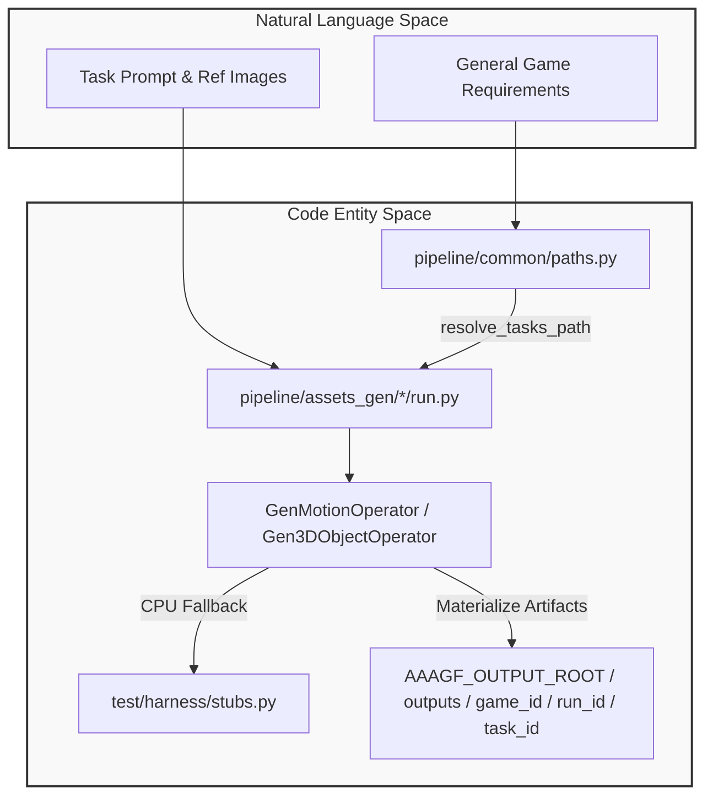
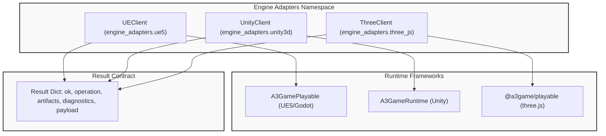

<!-- source: DeepWiki mcp.deepwiki.com · repo OpenDCAI/GameFactory-3A · page 7 Glossary · fetched 2026-11-02 -->

# Glossary

Relevant source files

The following files were used as context for generating this wiki page:

- [LICENSE](LICENSE)
- [README.md](README.md)
- [README_zh.md](README_zh.md)
- [agent_skills/engine_context/three_js_api.md](agent_skills/engine_context/three_js_api.md)
- [agent_skills/engine_context/ue5_api.md](agent_skills/engine_context/ue5_api.md)
- [agent_skills/engine_context/unity3d_api.md](agent_skills/engine_context/unity3d_api.md)
- [engine_adapters/ue5/examples/ArenaFighterExample/mechanic_contract.json](engine_adapters/ue5/examples/ArenaFighterExample/mechanic_contract.json)
- [engine_adapters/ue5/examples/FPSExample/mechanic_contract.json](engine_adapters/ue5/examples/FPSExample/mechanic_contract.json)
- [engine_adapters/ue5/examples/RacingExample/mechanic_contract.json](engine_adapters/ue5/examples/RacingExample/mechanic_contract.json)
- [models/README.md](models/README.md)
- [models/gen_audio/__init__.py](models/gen_audio/__init__.py)
- [models/gen_motion/tripo_rigging_model.py](models/gen_motion/tripo_rigging_model.py)
- [operators/README.md](operators/README.md)
- [operators/gen_audio/__init__.py](operators/gen_audio/__init__.py)
- [operators/gen_audio/funcs/__init__.py](operators/gen_audio/funcs/__init__.py)
- [operators/gen_motion/funcs/cloud_rig_animate.py](operators/gen_motion/funcs/cloud_rig_animate.py)
- [operators/gen_motion/operator.py](operators/gen_motion/operator.py)
- [pipeline/README.md](pipeline/README.md)
- [pipeline/assets_gen/gen_audio/__init__.py](pipeline/assets_gen/gen_audio/__init__.py)
- [pipeline/assets_gen/gen_motion/run.py](pipeline/assets_gen/gen_motion/run.py)
- [pipeline/code_gen/gen_mechanic/artifacts.py](pipeline/code_gen/gen_mechanic/artifacts.py)
- [pipeline/code_gen/gen_mechanic/eval.py](pipeline/code_gen/gen_mechanic/eval.py)
- [pipeline/code_gen/gen_mechanic/run.py](pipeline/code_gen/gen_mechanic/run.py)
- [pipeline/common/paths.py](pipeline/common/paths.py)
- [test/harness/smoke.py](test/harness/smoke.py)
- [test/harness/stubs.py](test/harness/stubs.py)
- [test/test_motion_cloud.py](test/test_motion_cloud.py)
- [test_data/outputs/README.md](test_data/outputs/README.md)
- [test_data/test_samples/README.md](test_data/test_samples/README.md)
- [test_data/test_samples/audio_gen_collect.jsonl](test_data/test_samples/audio_gen_collect.jsonl)
- [third_party/README.md](third_party/README.md)

## Purpose and Scope

This page provides exact technical definitions, data flows, and code pointers for core codebase-specific terminology, architectural layers, identifiers, data contracts, and engine runtime components used throughout `3AGameFactory`. Every entry links to its concrete code implementation or specification source.

---

## Identifiers and File System Layout

### `game_id`
* **Definition**: A unique string identifying a specific game project variant (e.g., `gameA_fighting_arena_unity`, `gameC_fps_tactical_ue`). It establishes the output directory axis and indexes task samples and asset requirements.
* **Code Pointer**: `test_data/test_samples/README.md` [test_data/test_samples/README.md:9-11]()

### `run_id`
* **Definition**: An execution run identifier used to isolate output artifacts across different generation attempts or batch test runs. Defaults to `default` or timestamp-based values.
* **Code Pointer**: `pipeline/common/paths.py` [pipeline/common/paths.py:1-50]()

### `task_id`
* **Definition**: A unique string identifying an individual generation task within a given task kind and `game_id` (e.g., `demoFighting_001`). It names the sub-directory where task artifacts are materialized.
* **Code Pointer**: `test_data/test_samples/README.md` [test_data/test_samples/README.md:105-107]()

### `AAAGF_OUTPUT_ROOT`
* **Definition**: The root directory environment variable or configuration path where all generated task artifacts, metadata, and logs are persisted. Structured around `game_id`, task kind, and `run_id`.
* **Code Pointer**: `test_data/test_samples/README.md` [test_data/test_samples/README.md:1-5]()

---

## Architecture & Abstraction Layers

### Layer A / Layer B / Layer C
* **Definition**: 
  * **Layer A (Asset Generation)**: AI models, operators, and pipelines generating raw media assets (3D objects, scenes, motion, audio, images, CG video).
  * **Layer B (Code Generation)**: Agent-driven generation of game mechanics, logic, and UI code via task packets and contracts.
  * **Layer C (Engine Adaptation & Playtesting)**: Engine-specific adapters (`UEClient`, `UnityClient`, etc.), runtime frameworks, and automated playtest recording.
* **Code Pointer**: `README.md` [README.md:17-20]()

### Operator
* **Definition**: A modular orchestration unit that encapsulates a generation pipeline step (e.g., `GenMotionOperator`, `Gen3DObjectOperator`). Operators consume task inputs, manage model wrappers, and write structured outputs.
* **Code Pointer**: `pipeline/assets_gen/gen_motion/run.py` [pipeline/assets_gen/gen_motion/run.py:140-171]()

### Model Wrapper
* **Definition**: A thin wrapper class exposing a uniform lifecycle (`load()`, `infer()`, `unload()`) around local weight models or cloud APIs, enabling backends to be swapped interchangeably.
* **Code Pointer**: `models/README.md` [models/README.md:3-7]()

---

## Asset Generation & 3D Terms

### Spec
* **Definition**: A declarative JSON/YAML schema defining procedural or code-assembled 3D assets, validated via spec inspection utilities.
* **Code Pointer**: `test/harness/stubs.py` [test/harness/stubs.py:61-118]()

### Greybox
* **Definition**: A provisional, code-driven whitebox level or terrain prototype used before detailed asset population occurs.
* **Code Pointer**: `models/README.md` [models/README.md:55-61]()

### Heightfield
* **Definition**: A 2D grid representation used for terrain modeling, manipulated through noise, baking, and terracing primitives.
* **Code Pointer**: `pipeline/README.md` [pipeline/README.md:1-20]()

### Baking
* **Definition**: The computational process of pre-computing textures, lighting, PBR bindings, physics colliders, or skeletal animations into optimized runtime asset formats.
* **Code Pointer**: `models/README.md` [models/README.md:50-54]()

### Rig Type & Rig Spec
* **Definition**: 
  * `rig_type`: Taxonomy classifying character skeletal rigs (e.g., humanoid, quadruped, rigid).
  * `rig_spec`: Configuration specification detailing joint hierarchies, bone mappings, and retargeting targets.
* **Code Pointer**: `models/gen_motion/tripo_rigging_model.py` [models/gen_motion/tripo_rigging_model.py:1-40]()

### TokenHub
* **Definition**: Cloud API abstraction layer and billing/plumbing router handling network authentication, request retries, error classification, and polling for third-party cloud generation models.
* **Code Pointer**: `models/README.md` [models/README.md:9-12]()

---

## Diagram: Task Execution & Data Flow Space

Sources: `pipeline/common/paths.py`, `pipeline/assets_gen/gen_motion/run.py`, `test/harness/stubs.py`

---

## Result Contracts & Engine Frameworks

### Result Contract
* **Definition**: A standardized JSON-serializable dictionary returned by public adapter operations containing stable top-level fields: `ok`, `operation`, `artifacts`, `diagnostics`, `warnings`, `errors`, and `payload`.
* **Code Pointer**: `agent_skills/engine_context/unity3d_api.md` [agent_skills/engine_context/unity3d_api.md:47-59]()

### Media Director
* **Definition**: An adapter subsystem responsible for triggering and managing runtime audio, video CG, animation CG, and visual effects (VFX) across different engine runtimes.
* **Code Pointer**: `agent_skills/engine_context/unity3d_api.md` [agent_skills/engine_context/unity3d_api.md:11-14]()

### A3GamePlayable
* **Definition**: A plugin framework (implemented for Unreal Engine and Godot) providing media playback, playtest recording subsystems, and gameplay integration hooks.
* **Code Pointer**: `agent_skills/engine_context/ue5_api.md` [agent_skills/engine_context/ue5_api.md:26-30]()

### A3GameRuntime
* **Definition**: An adapter-owned Unity runtime framework providing core management services for generated gameplay assemblies.
* **Code Pointer**: `agent_skills/engine_context/unity3d_api.md` [agent_skills/engine_context/unity3d_api.md:29-32]()

### `@a3game/playable`
* **Definition**: The npm package providing the plugin runtime host, visual kits, motion tooling, and visual effects pipelines for the three.js engine adapter.
* **Code Pointer**: `agent_skills/engine_context/three_js_api.md` [agent_skills/engine_context/three_js_api.md:40-44]()

---

## Diagram: Engine Architecture & Layer Mapping

Sources: `agent_skills/engine_context/unity3d_api.md`, `agent_skills/engine_context/ue5_api.md`, `agent_skills/engine_context/three_js_api.md`

---

## Code Generation & Playtesting

### Task Packet
* **Definition**: A structured package containing agent instructions, task requirements, repair payloads, and engine context paths compiled to drive outer-agent code generation.
* **Code Pointer**: `pipeline/code_gen/gen_mechanic/run.py` [pipeline/code_gen/gen_mechanic/run.py:109-144]()

### Contamination Scanning
* **Definition**: Automated static analysis checks running during mechanic finalization that detect and reject accidental leakage or implementation of native UI code inside mechanic modules.
* **Code Pointer**: `pipeline/code_gen/gen_mechanic/artifacts.py` [pipeline/code_gen/gen_mechanic/artifacts.py:124-169]()

### Mechanic Contract
* **Definition**: A specification and JSON schema defining the required API boundaries, methods, and properties that generated game mechanics must expose to integrate with engine test frameworks.
* **Code Pointer**: `pipeline/code_gen/gen_mechanic/run.py` [pipeline/code_gen/gen_mechanic/run.py:23-27]()

### Action Plan
* **Definition**: A discovery structure detailing sequences of simulated player inputs used for automated test playback and validation.
* **Code Pointer**: `README.md` [README.md:1-20]()

### Sustained Input
* **Definition**: Player controller or keyboard input states persisted across multiple simulation ticks during gameplay recording or playtesting.
* **Code Pointer**: `README.md` [README.md:1-20]()

### Playtest Report Schema
* **Definition**: A standardized schema governing structured records of runtime playtest sessions, capturing events, performance metrics, and diagnostic evidence.
* **Code Pointer**: `README.md` [README.md:1-20]()

### Stubs
* **Definition**: Lightweight, CPU-only mock models and fixtures that emulate real model interfaces, enabling entire asset generation pipelines to execute in milliseconds without weights or network access.
* **Code Pointer**: `test/harness/stubs.py` [test/harness/stubs.py:4-11]()

### Browser Serving Backend
* **Definition**: A FastAPI-powered gateway supporting an `EngineRegistry` and per-engine serving backends that host player frontends and interactive browser-based examples (`BrowserPlayExample`).
* **Code Pointer**: `README.md` [README.md:1-20]()