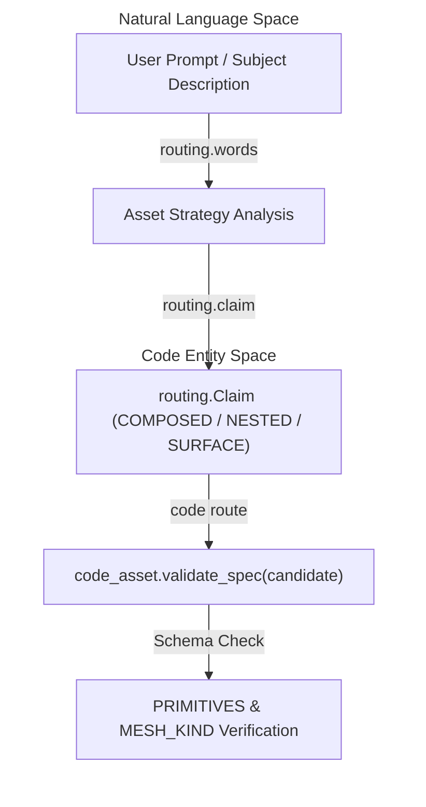
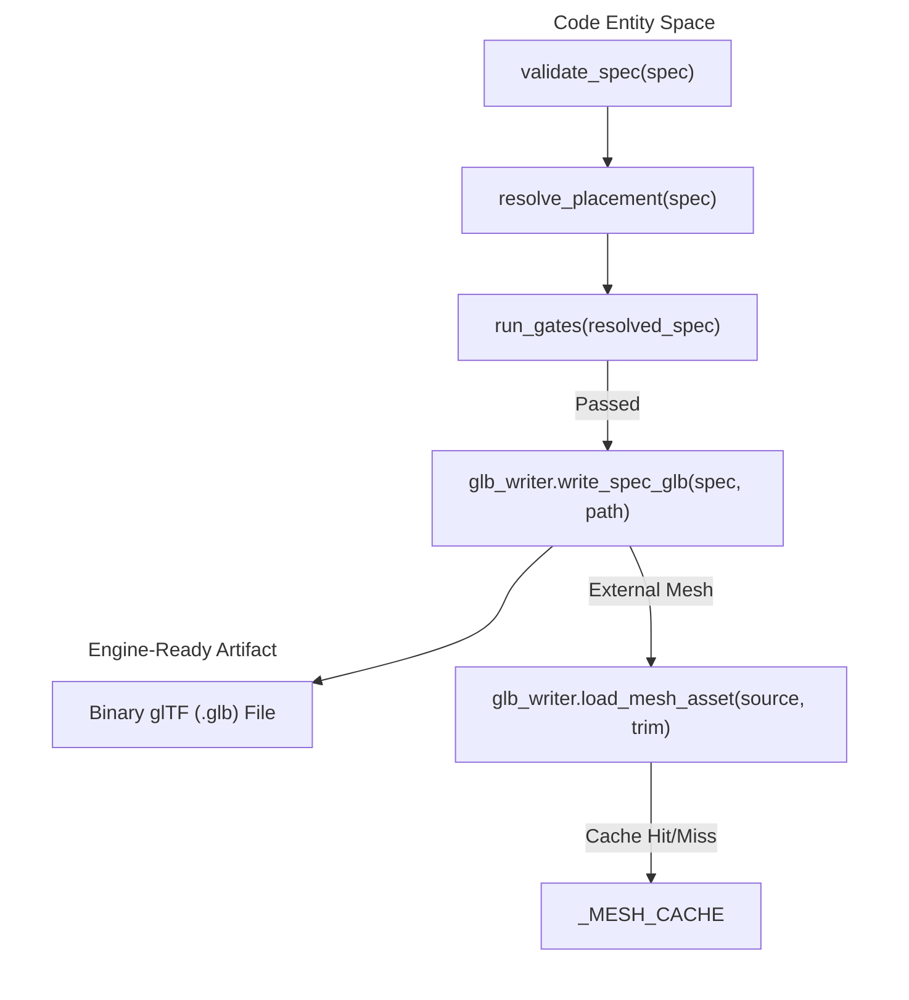

<!-- source: DeepWiki mcp.deepwiki.com · repo OpenDCAI/GameFactory-3A · extra page Declarative Code Assets & GLB Writer · fetched 2026-11-02 -->

# Declarative Code Assets & GLB Writer

Relevant source files

The following files were used as context for generating this wiki page:

- [agent_skills/asset_qa/3d_object/SKILL.md](agent_skills/asset_qa/3d_object/SKILL.md)
- [agent_skills/asset_qa/3d_object/composition_examples.md](agent_skills/asset_qa/3d_object/composition_examples.md)
- [models/common/glb_utils.py](models/common/glb_utils.py)
- [models/common/glb_writer.py](models/common/glb_writer.py)
- [operators/gen_3d_object/funcs/code_asset.py](operators/gen_3d_object/funcs/code_asset.py)
- [operators/gen_3d_object/funcs/code_asset_templates/__init__.py](operators/gen_3d_object/funcs/code_asset_templates/__init__.py)
- [operators/gen_3d_object/funcs/code_asset_templates/assembly.py](operators/gen_3d_object/funcs/code_asset_templates/assembly.py)
- [operators/gen_3d_object/funcs/code_asset_templates/rigid_template/__init__.py](operators/gen_3d_object/funcs/code_asset_templates/rigid_template/__init__.py)
- [operators/gen_3d_object/funcs/code_asset_templates/routing.py](operators/gen_3d_object/funcs/code_asset_templates/routing.py)
- [operators/gen_3d_object/funcs/code_asset_templates/surface.py](operators/gen_3d_object/funcs/code_asset_templates/surface.py)
- [test/test_3d_object_spec.py](test/test_3d_object_spec.py)

## Purpose and Scope

The declarative code asset route and GLB writer provide a deterministic, CPU-only pipeline for building engine-ready 3D assets from human-readable JSON specifications. Rather than relying on cloud-based image-to-3D neural models (which introduce geometric hallucinations, unstated scales, fused unarticulated parts, and arbitrary orientations), hard-surface and manufactured assets are defined via exact parametric primitives or composed external meshes. 

This page covers the spec schema, validation routines (`validate_spec`), placement resolution (`resolve_placement`), geometry and QA gates (`run_gates`), binary glTF serialization (`write_spec_glb`), and dependency-free GLB inspection utilities (`glb_utils`).

Sources: `models/common/glb_writer.py:1-47()`, `operators/gen_3d_object/funcs/code_asset.py:1-96()`

---

## 1. Spec Schema & Validation

Assets are defined using an engine-neutral JSON schema containing metadata (`subject`, `units`, `forward`, `asset_type`, `height_metres`) and a list of structural components (`parts`). The validation engine parses and verifies these specs before any geometry is calculated.

### Primitive Types and Mesh Inclusions
The spec schema supports a strictly limited set of analytic primitives to prevent geometric ambiguity, alongside external mesh references:
* **Analytic Primitives (`PRIMITIVES`)**: `box`, `cylinder`, `cone`, `sphere`, `torus`, `lathe`, `extrude` (`[operators/gen_3d_object/funcs/code_asset.py:113]()`).
* **External Meshes (`MESH_KIND`)**: `mesh` parts read a binary glTF (`.glb`) off disk—typically generated by a cloud model—and fit them into the same bounding constraints as primitives (`[operators/gen_3d_object/funcs/code_asset.py:122]()`).

*Figure 1: Bridging natural language routing concepts to the `code_asset.validate_spec` validation entrypoint.*

Sources: `operators/gen_3d_object/funcs/code_asset.py:100-130()`, `operators/gen_3d_object/funcs/code_asset_templates/routing.py:40-111()`

---

## 2. Placement Resolution

To avoid brittle absolute coordinates that break when component dimensions change, parts are linked relationally using `assembly.chain` or `assembly.group` (`[operators/gen_3d_object/funcs/code_asset.py]()`, `[operators/gen_3d_object/funcs/code_asset_templates/assembly.py:1-145]()`). 

### Relational Attachment Mechanisms
* **`assembly.chain()`**: Attaches each part sequentially from front to back along a designated axis (`x`, `y`, or `z`), inserting relative `attach` rules automatically (`[operators/gen_3d_object/funcs/code_asset_templates/assembly.py:40-106]()`).
* **`assembly.group()`**: Attaches multiple parts to a single central hub or parent part ID rather than chaining them linearly (`[operators/gen_3d_object/funcs/code_asset_templates/assembly.py:109-145]()`).
* **`assembly.mirrored()`**: Duplicates and mirrors symmetric sub-assemblies (e.g., twin barrels, landing skids) across a specific axis while preserving correct internal graph referencing (`[operators/gen_3d_object/funcs/code_asset_templates/assembly.py:147-192]()`).

Sources: `operators/gen_3d_object/funcs/code_asset_templates/assembly.py:1-193()`, `test/test_3d_object_spec.py:62-78()`

---

## 3. QA Gates & Geometry Validation

Before serialization, specifications pass through rigorous algorithmic QA gates implemented in `operators/gen_3d_object/funcs/code_asset.py` and tested via `test/test_3d_object_spec.py` (`[test/test_3d_object_spec.py:74-78]()`). These gates catch structural defects derived from historical failure modes in image-to-3D pipelines:

1. **Chirality Gate**: Prevents mirrored limb errors caused by incorrect axis negation (e.g., negating both $X$ and $Z$ axes results in a $180^\circ$ rotation around $Y$ rather than a proper mirror, preserving handedness erroneously) (`[operators/gen_3d_object/funcs/code_asset.py:55-68]()`).
2. **Hollow Shell Gate**: Detects zero-thickness parts or interior gaps that render invisibly edge-on (`[operators/gen_3d_object/funcs/code_asset.py:69-76]()`).
3. **Scale Sanity Gate**: Cross-references declared global heights (`height_metres`) against aggregated part bounding box extents to flag unrealistic dimensions (`[operators/gen_3d_object/funcs/code_asset.py:78-84]()`).

Sources: `operators/gen_3d_object/funcs/code_asset.py:55-84()`, `test/test_3d_object_spec.py:74-78()`

---

## 4. GLB Writer Pipeline (`glb_writer.py`)

The binary glTF writer (`models/common/glb_writer.py`) operates entirely on the Python standard library, rendering declarative specs directly into `.glb` format without requiring `trimesh`, `numpy`, or `scipy`.

*Figure 2: Data flow from spec validation through geometry gates to binary GLB output.*

### External Mesh Caching & Normalization
When specs incorporate fetched cloud-generated components, `load_mesh_asset` loads, caches, and normalizes external `.glb` files into a unit frame (`[models/common/glb_writer.py:77-141]()`). 
* **Uniform Scaling**: Meshes are centered on their bounds and scaled by a single factor along their longest axis, preserving original proportions (`[models/common/glb_writer.py:79-88]()`).
* **Trimming (`_trim_mesh`)**: Drops triangles outside a specified vertical fraction band (`trim`) to eliminate unwanted support structures, mannequins, or stands generated by cloud backends (`[models/common/glb_writer.py:103-167]()`).

Sources: `models/common/glb_writer.py:1-167()`

---

## 5. Dependency-Free GLB Inspection (`glb_utils.py`)

To satisfy API wrapper requirements and report exact triangle counts on CPU-only worker nodes (`[models/common/glb_utils.py:1-23]()`), `glb_utils.py` parses binary glTF buffers directly from the JSON chunk without relying on external geometry engines.

### Key Inspection APIs
* `is_glb(data)`: Validates the 12-byte `glTF` magic header (`[models/common/glb_utils.py:58-60]()`).
* `glb_json_chunk(data)`: Extracts and decodes the internal JSON payload from binary chunks, raising `GLBParseError` on truncation or invalid formatting (`[models/common/glb_utils.py:63-101]()`).
* `glb_triangle_count(data)`: Computes the asset's total primitive triangle budget by evaluating triangle-mode (`_MODE_TRIANGLES = 4`) accessor indices (`[models/common/glb_utils.py:103-132]()`).
* `glb_summary(data)`: Generates a lightweight telemetry dictionary containing buffer byte size, triangle count, mesh/material/texture/image/node counts, and generator strings for inclusion in `meta.json` (`[models/common/glb_utils.py:134-162]()`).

Sources: `models/common/glb_utils.py:1-163()`

---

