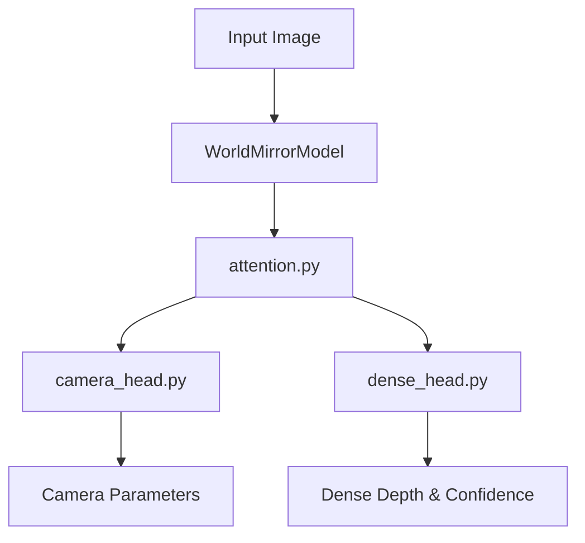
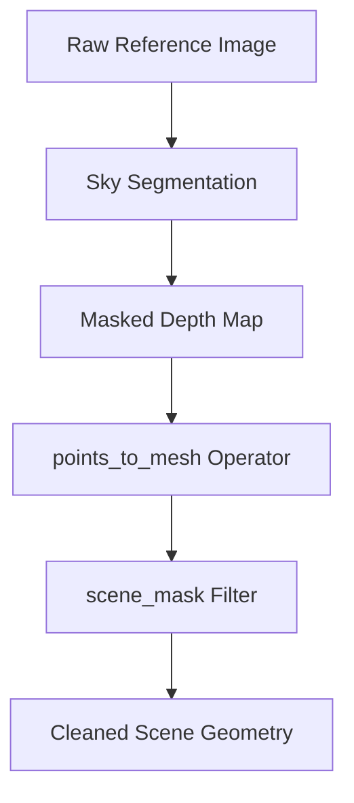

<!-- source: DeepWiki mcp.deepwiki.com · repo OpenDCAI/GameFactory-3A · extra page Learned Scene Reconstruction & Scene Assets · fetched 2026-11-02 -->

# Learned Scene Reconstruction & Scene Assets

Relevant source files

The following files were used as context for generating this wiki page:

- [engine_adapters/three_js/examples/README.md](engine_adapters/three_js/examples/README.md)
- [engine_adapters/three_js/plugin/A3GamePlayable/README.md](engine_adapters/three_js/plugin/A3GamePlayable/README.md)
- [engine_adapters/three_js/plugin/A3GamePlayable/src/engine/asset-library.js](engine_adapters/three_js/plugin/A3GamePlayable/src/engine/asset-library.js)
- [engine_adapters/three_js/plugin/A3GamePlayable/src/engine/index.js](engine_adapters/three_js/plugin/A3GamePlayable/src/engine/index.js)
- [engine_adapters/three_js/plugin/A3GamePlayable/src/engine/motion-kit.js](engine_adapters/three_js/plugin/A3GamePlayable/src/engine/motion-kit.js)
- [engine_adapters/three_js/plugin/A3GamePlayable/src/engine/runtime-host.js](engine_adapters/three_js/plugin/A3GamePlayable/src/engine/runtime-host.js)
- [engine_adapters/three_js/plugin/A3GamePlayable/src/engine/scene-loader.js](engine_adapters/three_js/plugin/A3GamePlayable/src/engine/scene-loader.js)
- [engine_adapters/three_js/plugin/A3GamePlayable/src/engine/visual-kit.js](engine_adapters/three_js/plugin/A3GamePlayable/src/engine/visual-kit.js)
- [engine_adapters/three_js/plugin/A3GamePlayable/src/index.js](engine_adapters/three_js/plugin/A3GamePlayable/src/index.js)
- [engine_adapters/three_js/world/_internal/specs.py](engine_adapters/three_js/world/_internal/specs.py)
- [models/gen_3d_scene/__init__.py](models/gen_3d_scene/__init__.py)
- [models/gen_3d_scene/world_mirror_model.py](models/gen_3d_scene/world_mirror_model.py)
- [models/gen_3d_scene/world_mirror_utils/README.md](models/gen_3d_scene/world_mirror_utils/README.md)
- [models/gen_3d_scene/world_mirror_utils/__init__.py](models/gen_3d_scene/world_mirror_utils/__init__.py)
- [models/gen_3d_scene/world_mirror_utils/src/__init__.py](models/gen_3d_scene/world_mirror_utils/src/__init__.py)
- [models/gen_3d_scene/world_mirror_utils/src/models/__init__.py](models/gen_3d_scene/world_mirror_utils/src/models/__init__.py)
- [models/gen_3d_scene/world_mirror_utils/src/models/heads/camera_head.py](models/gen_3d_scene/world_mirror_utils/src/models/heads/camera_head.py)
- [models/gen_3d_scene/world_mirror_utils/src/models/heads/dense_head.py](models/gen_3d_scene/world_mirror_utils/src/models/heads/dense_head.py)
- [models/gen_3d_scene/world_mirror_utils/src/models/layers/__init__.py](models/gen_3d_scene/world_mirror_utils/src/models/layers/__init__.py)
- [models/gen_3d_scene/world_mirror_utils/src/models/layers/attention.py](models/gen_3d_scene/world_mirror_utils/src/models/layers/attention.py)
- [operators/gen_3d_scene/__init__.py](operators/gen_3d_scene/__init__.py)
- [operators/gen_3d_scene/funcs/appearance_assets.py](operators/gen_3d_scene/funcs/appearance_assets.py)
- [operators/gen_3d_scene/funcs/scene_assets.py](operators/gen_3d_scene/funcs/scene_assets.py)
- [operators/gen_3d_scene/metrics/__init__.py](operators/gen_3d_scene/metrics/__init__.py)
- [pipeline/assets_gen/gen_3d_scene/eval.py](pipeline/assets_gen/gen_3d_scene/eval.py)

## Purpose and Scope

This page details the learned reconstruction path and asset population mechanics within the `gen_3d_scene` operator stack. While the terrain code pipeline [3.4.1] builds deterministic heightfields and procedural greyboxes, the learned scene reconstruction approach uses neural depth prediction and multi-view priors via `world_mirror` models (`models/gen_3d_scene/world_mirror_model.py`) and utility packages (`models/gen_3d_scene/world_mirror_utils/`) to derive dense geometry from reference images. Additionally, this page covers sky segmentation, point cloud projection (`points_to_mesh`), scene masking (`scene_mask`), and environment/appearance asset population (`operators/gen_3d_scene/funcs/scene_assets.py`, `operators/gen_3d_scene/funcs/appearance_assets.py`).

Sources: `models/gen_3d_scene/world_mirror_model.py`, `operators/gen_3d_scene/funcs/scene_assets.py`, `operators/gen_3d_scene/funcs/appearance_assets.py`

---

## World Mirror Model & Utilities Architecture

The `world_mirror` model stack provides monocular depth and dense scene geometry estimation. The architecture is organized into wrapper classes in `models/gen_3d_scene/world_mirror_model.py` and transformer/convolutional network blocks under `models/gen_3d_scene/world_mirror_utils/src/models/`.

### Core Components
- **`WorldMirrorModel`**: Primary model wrapper handling uniform load/infer lifecycle, weight initialization, and tensor preprocessing.
- **Camera Heads (`models/gen_3d_scene/world_mirror_utils/src/models/heads/camera_head.py`)**: Predicts intrinsic and extrinsic camera parameters from image tokens.
- **Dense Heads (`models/gen_3d_scene/world_mirror_utils/src/models/heads/dense_head.py`)**: Outputs per-pixel depth maps and confidence scores.
- **Attention Layers (`models/gen_3d_scene/world_mirror_utils/src/models/layers/attention.py`)**: Cross-attention blocks linking spatial visual features with camera ray embeddings.

*Diagram 1: Natural Language Space to Code Entity Space mapping for the `world_mirror` reconstruction pipeline.*

Sources: `models/gen_3d_scene/world_mirror_model.py`, `models/gen_3d_scene/world_mirror_utils/src/models/heads/camera_head.py`, `models/gen_3d_scene/world_mirror_utils/src/models/heads/dense_head.py`, `models/gen_3d_scene/world_mirror_utils/src/models/layers/attention.py`

---

## Sky Segmentation, Points-to-Mesh & Scene Masks

Monocular depth estimators often fail on infinite horizons (sky regions), projecting background pixels into distant 3D outliers. The reconstruction pipeline addresses this via three sequential operators:

1. **Sky Segmentation**: Identifies upper-image atmospheric pixels using semantic priors, tagging them with zero confidence or masking them out.
2. **`points_to_mesh`**: Backprojects valid 2.5D depth maps into 3D point clouds using estimated camera intrinsics (`camera_head.py`), subsequently running Screened Poisson Reconstruction or marching cubes to build closed manifold meshes.
3. **`scene_mask`**: Applies spatial bounding constraints and morphological filters to prune floating artifacts and background geometry outside the gameplay volume.

*Diagram 2: Data flow from raw image input to cleaned scene geometry via filtering and meshing operators.*

Sources: `models/gen_3d_scene/world_mirror_model.py`, `models/gen_3d_scene/world_mirror_utils/src/models/heads/dense_head.py`

---

## Scene Environment Asset Population

Generated greybox levels lack realism without proper lighting, sky backdrops, and surface textures. The `scene_assets` module (`operators/gen_3d_scene/funcs/scene_assets.py`) populates environment maps and textures from curated CC0 and MIT-licensed repositories [operators/gen_3d_scene/funcs/scene_assets.py:25-36].

| Asset ID | Kind | Source / URL Pattern | Licence | Role / Notes |
| --- | --- | --- | --- | --- |
| `env_forest_sunrise` | `environment` | `_THREE/textures/equirectangular/spruit_sunrise_1k.hdr` [operators/gen_3d_scene/funcs/scene_assets.py:96] | CC0-1.0 [operators/gen_3d_scene/funcs/scene_assets.py:97] | Low sun through conifers for archer forest IBL [operators/gen_3d_scene/funcs/scene_assets.py:99-102]. |
| `env_golden_sunset` | `environment` | `_THREE/textures/equirectangular/venice_sunset_1k.hdr` [operators/gen_3d_scene/funcs/scene_assets.py:109] | CC0-1.0 [operators/gen_3d_scene/funcs/scene_assets.py:110] | Open water sunset for arcade racer car reflections [operators/gen_3d_scene/funcs/scene_assets.py:112-115]. |
| `env_stone_hall` | `environment` | `_THREE/textures/equirectangular/royal_esplanade_1k.hdr` [operators/gen_3d_scene/funcs/scene_assets.py:123] | CC0-1.0 [operators/gen_3d_scene/funcs/scene_assets.py:124] | Bounded stone hall for FPS pistol arena [operators/gen_3d_scene/funcs/scene_assets.py:126-129]. |
| `env_city_overpass` | `environment` | `_THREE/textures/equirectangular/pedestrian_overpass_1k.hdr` [operators/gen_3d_scene/funcs/scene_assets.py:134] | CC0-1.0 [operators/gen_3d_scene/funcs/scene_assets.py:136] | Overcast street light for sidescroll brawler [operators/gen_3d_scene/funcs/scene_assets.py:140-143]. |
| `sky_equirect_day` | `texture` | `_THREE/textures/2294472375_24a3b8ef46_o.jpg` [operators/gen_3d_scene/funcs/scene_assets.py:157] | Public domain [operators/gen_3d_scene/funcs/scene_assets.py:159] | Equirectangular daytime sky backdrop with cumulus [operators/gen_3d_scene/funcs/scene_assets.py:162]. |

Sources: `operators/gen_3d_scene/funcs/scene_assets.py`

---

## Appearance Asset Population & Upgrades

Single-view reconstruction models (such as TRELLIS.2) often yield open meshes or missing dorsal geometry. To correct this, the appearance pipeline (`operators/gen_3d_scene/funcs/appearance_assets.py`) integrates text-to-3D cloud services (Meshy and Tripo) with multi-view priors and texture passes [operators/gen_3d_scene/funcs/appearance_assets.py:1-15].

### Polycount Budgets & Roles
Props, weapons, vehicles, and avatars are budgeted according to screen real estate and distance to camera (`POLYCOUNT_BY_ROLE`):
- **Prop**: 30,000 faces (scenery viewed at 10–30 m) [operators/gen_3d_scene/funcs/appearance_assets.py:74-75]
- **Weapon**: 40,000 faces (fills a third of the screen) [operators/gen_3d_scene/funcs/appearance_assets.py:76]
- **Vehicle**: 50,000 faces [operators/gen_3d_scene/funcs/appearance_assets.py:77]
- **Avatar**: 60,000 faces (primary focus) [operators/gen_3d_scene/funcs/appearance_assets.py:78]

### Prompt Engineering Guidelines
As implemented in `APPEARANCE_PLAN`, prompt generation follows strict syntactic rules to prevent service hallucinations:
1. **Object Completeness**: Explicitly name the whole object and specify `"complete"` or `"single object"` to avoid partial busts [operators/gen_3d_scene/funcs/appearance_assets.py:86-88].
2. **Orientation**: Define vertical standing constraints (e.g., `"standing upright"`) to eliminate lying-on-side meshes [operators/gen_3d_scene/funcs/appearance_assets.py:89-91].
3. **Exclusionary Terms**: Forbid characters in weapon prompts (e.g., `"no character, no arrow"`) so the service returns only the prop [operators/gen_3d_scene/funcs/appearance_assets.py:92-94].
4. **Mechanical Shell Separation**: For vehicles, request hollow open wheel arches (`"no wheels, hollow open wheel arches"`) so chassis and wheels can articulate independently at runtime [operators/gen_3d_scene/funcs/appearance_assets.py:95-96].

Sources: `operators/gen_3d_scene/funcs/appearance_assets.py`

---

