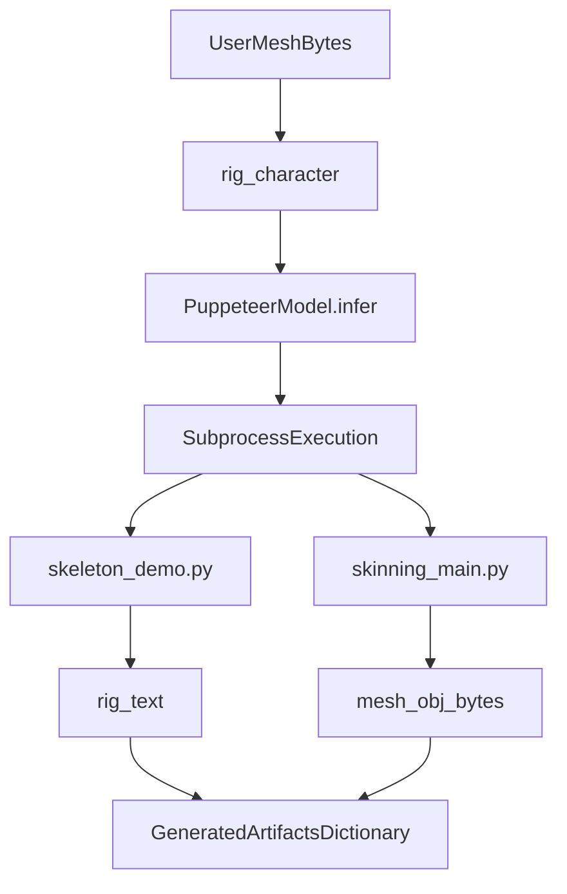
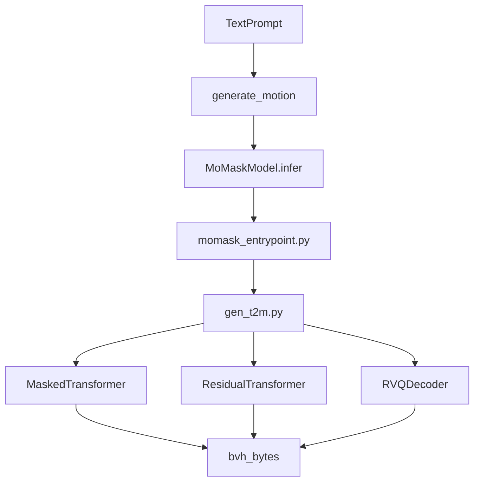
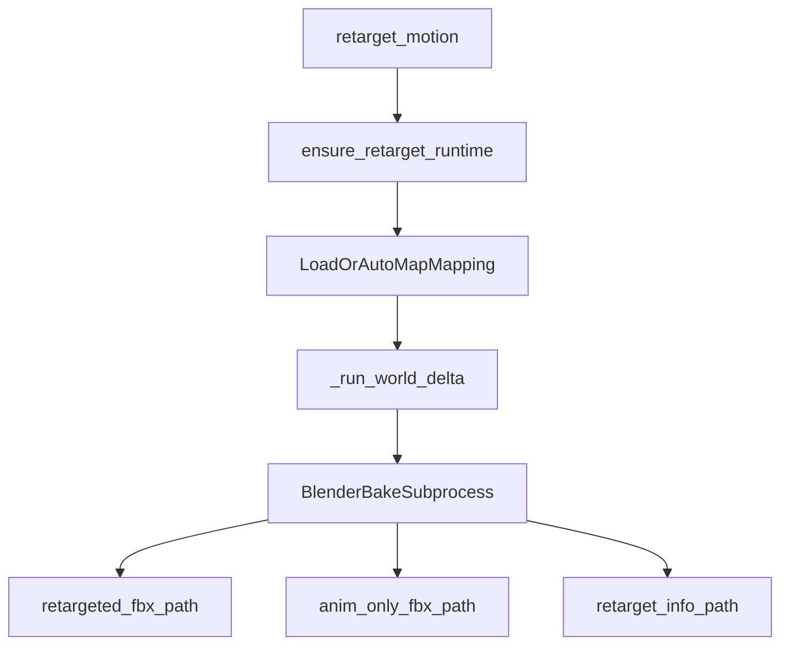

<!-- source: DeepWiki mcp.deepwiki.com · repo OpenDCAI/GameFactory-3A · extra page Local Rigging, MoMask & Retargeting · fetched 2026-11-02 -->

# Local Rigging, MoMask & Retargeting

<details>
<summary>Relevant source files</summary>

The following files were used as context for generating this wiki page:

- [engine_adapters/blender/import_generated/import_motion.py](engine_adapters/blender/import_generated/import_motion.py)
- [engine_adapters/ue5/import_generated/import_motion.py](engine_adapters/ue5/import_generated/import_motion.py)
- [models/gen_motion/momask_model.py](models/gen_motion/momask_model.py)
- [models/gen_motion/momask_utils/__init__.py](models/gen_motion/momask_utils/__init__.py)
- [models/gen_motion/momask_utils/momask_entrypoint.py](models/gen_motion/momask_utils/momask_entrypoint.py)
- [models/gen_motion/puppeteer_model.py](models/gen_motion/puppeteer_model.py)
- [operators/gen_motion/funcs/__init__.py](operators/gen_motion/funcs/__init__.py)
- [operators/gen_motion/funcs/fetch_motion.py](operators/gen_motion/funcs/fetch_motion.py)
- [operators/gen_motion/funcs/generate_motion.py](operators/gen_motion/funcs/generate_motion.py)
- [operators/gen_motion/funcs/retarget_motion.py](operators/gen_motion/funcs/retarget_motion.py)
- [operators/gen_motion/funcs/retarget_utils/__init__.py](operators/gen_motion/funcs/retarget_utils/__init__.py)
- [operators/gen_motion/funcs/retarget_utils/formats.py](operators/gen_motion/funcs/retarget_utils/formats.py)
- [operators/gen_motion/funcs/retarget_utils/inspect_fbx.py](operators/gen_motion/funcs/retarget_utils/inspect_fbx.py)
- [operators/gen_motion/funcs/retarget_utils/mapping_presets.py](operators/gen_motion/funcs/retarget_utils/mapping_presets.py)
- [operators/gen_motion/funcs/rig_character.py](operators/gen_motion/funcs/rig_character.py)
- [test/test_gen_motion.py](test/test_gen_motion.py)
- [test/test_rigging_retarget.py](test/test_rigging_retarget.py)

</details>


This page details the local asset generation stack for character rigging (`PuppeteerModel`), text-to-motion generation (`MoMaskModel`), and skeleton retargeting via Blender subprocesses (`retarget_motion`). It covers model wrappers, subprocess isolation, anatomical mapping presets, validation contracts, and integration baking paths.

---

## 1. Puppeteer Model & Local Character Rigging

`PuppeteerModel` provides automatic skeleton prediction and skinning weight generation for arbitrary 3D meshes `models/gen_motion/puppeteer_model.py:34-36`. Because upstream dependencies (`torchrun`, custom CUDA kernels) enforce strict working directory and interpreter constraints, `PuppeteerModel` executes inference tasks inside isolated subprocesses while exposing an in-memory Python API `models/gen_motion/puppeteer_model.py:6-12`.

The `rig_character` operator function acts as a light adapter passing mesh byte payloads into the model wrapper `operators/gen_motion/funcs/rig_character.py:23-45`.


*Diagram 1: Natural Language Space to Code Entity Space for Rigging Pipeline*
Sources: `models/gen_motion/puppeteer_model.py:122-143`, `operators/gen_motion/funcs/rig_character.py:23-60`

The `load()` method verifies the presence of required local checkpoints, including `DEFAULT_SKELETON_CKPT`, `DEFAULT_SKINNING_CKPT`, Michelangelo ShapeVAE latents, and PartField weights `models/gen_motion/puppeteer_model.py:25-116`. Calling `infer()` checks for CUDA availability, serializes input bytes to temporary directories, converts formats to `.obj` if necessary, and executes the two-stage prediction pipeline `models/gen_motion/puppeteer_model.py:122-187`.

Sources: `models/gen_motion/puppeteer_model.py:34-187`, `operators/gen_motion/funcs/rig_character.py:1-67`

---

## 2. MoMask Model & Text-to-Motion Generation

`MoMaskModel` generates HumanML3D text-to-motion animations from natural language prompts using the official MoMask repository layout `models/gen_motion/momask_model.py:26-28`. Like the rigging wrapper, it isolates execution in a subprocess to avoid namespace collisions with top-level package names (`models`, `utils`) defined by upstream code `models/gen_motion/momask_model.py:6-9`.


*Diagram 2: Subprocess and Namespace Boundaries for MoMask*
Sources: `models/gen_motion/momask_model.py:134-198`, `operators/gen_motion/funcs/generate_motion.py:10-55`

The `generate_motion` function validates input text constraints, seed values, and repeat counts before invoking `MoMaskModel.infer()` `operators/gen_motion/funcs/generate_motion.py:10-43`. It ensures that returned dictionaries contain valid `bvh_bytes` and populates a default frame rate (`DEFAULT_FPS = 20`) when unsupplied `operators/gen_motion/funcs/generate_motion.py:6-55`.

Sources: `models/gen_motion/momask_model.py:26-198`, `operators/gen_motion/funcs/generate_motion.py:1-58`

---

## 3. Retargeting Mapping Presets, Slots & Formats

To map motion clips (such as Mixamo, MoMask BVH, or CMU mocap) onto arbitrary character rigs, `mapping_presets.py` defines standardized anatomical slots and source skeleton layouts `operators/gen_motion/funcs/retarget_utils/mapping_presets.py:1-43`.

The standard humanoid slot sequence (`SLOTS`) covers 22 anatomical keypoints from `hips` through spine vertebrae, limbs, hands, and feet `operators/gen_motion/funcs/retarget_utils/mapping_presets.py:20-43`. `SourceSkeleton` dataclasses capture library-specific naming patterns (e.g., `mixamorig:` prefixes or unprefixed HumanML3D names) `operators/gen_motion/funcs/retarget_utils/mapping_presets.py:46-67`.

```json
{
  "name": "mixamo",
  "slot_count": 22,
  "bones": {
    "hips": "mixamorig:Hips",
    "left_thigh": "mixamorig:LeftUpLeg",
    "left_shin": "mixamorig:LeftLeg"
  }
}
```

Supported mesh extensions (`.glb`, `.gltf`, `.obj`, `.ply`, `.stl`, `.fbx`) and motion formats (`.bvh`, `.fbx`) are enforced by validation helpers across the retargeting utilities `operators/gen_motion/funcs/retarget_utils/formats.py:1-10`.

Sources: `operators/gen_motion/funcs/retarget_utils/mapping_presets.py:1-226`, `operators/gen_motion/funcs/retarget_utils/formats.py:1-10`

---

## 4. Host Retarget Driver, FBX Inspection & Blender Bake Path

The host-side retarget driver (`retarget_motion.py`) validates input paths and coordinates Blender (`bpy`) subprocess modules (`world_delta.py` and `mapping_auto.py`) `operators/gen_motion/funcs/retarget_motion.py:1-24`.


*Diagram 3: Host Driver Flow and Artifact Generation*
Sources: `operators/gen_motion/funcs/retarget_motion.py:26-137`

The driver executes automated bone mapping if an explicit `mapping_path` is omitted, validates the resulting mapping schema, runs world-space delta calculations, and optionally exports an animation-only FBX file alongside the fully skinned character export `operators/gen_motion/funcs/retarget_motion.py:66-137`.

Once written, generated animation assets can be imported into Blender via `import_motion.py` to verify armature attachment, non-zero keyframe counts, action datablocks, and pose displacement bounds `engine_adapters/blender/import_generated/import_motion.py:43-192`.

Sources: `operators/gen_motion/funcs/retarget_motion.py:1-289`, `engine_adapters/blender/import_generated/import_motion.py:1-208`, `test/test_gen_motion.py:89-182`

---

