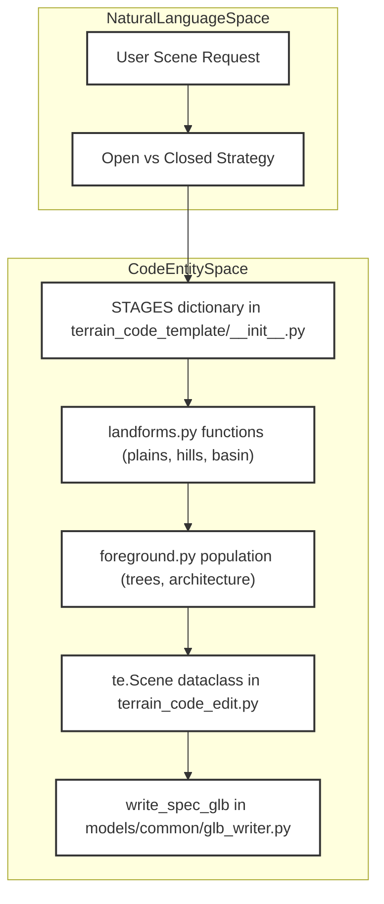
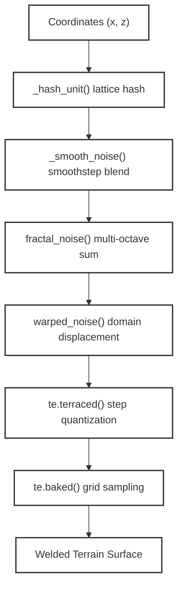
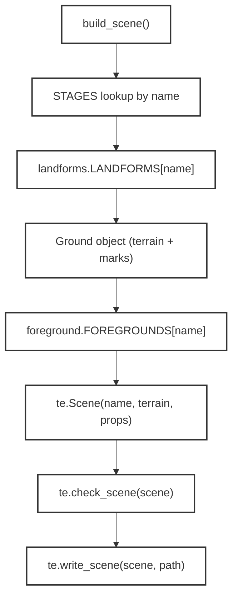

<!-- source: DeepWiki mcp.deepwiki.com · repo OpenDCAI/GameFactory-3A · extra page Terrain Code Pipeline · fetched 2026-11-02 -->

# Terrain Code Pipeline

Relevant source files

The following files were used as context for generating this wiki page:

- [agent_skills/asset_qa/3d_scene/SKILL.md](agent_skills/asset_qa/3d_scene/SKILL.md)
- [operators/gen_3d_scene/funcs/__init__.py](operators/gen_3d_scene/funcs/__init__.py)
- [operators/gen_3d_scene/funcs/terrain_code_edit.py](operators/gen_3d_scene/funcs/terrain_code_edit.py)
- [operators/gen_3d_scene/funcs/terrain_code_template/__init__.py](operators/gen_3d_scene/funcs/terrain_code_template/__init__.py)
- [operators/gen_3d_scene/funcs/terrain_code_template/foreground.py](operators/gen_3d_scene/funcs/terrain_code_template/foreground.py)
- [operators/gen_3d_scene/funcs/terrain_code_template/landforms.py](operators/gen_3d_scene/funcs/terrain_code_template/landforms.py)
- [test/terrain_code_test/__init__.py](test/terrain_code_test/__init__.py)
- [test/terrain_code_test/render_terrain_whitebox.py](test/terrain_code_test/render_terrain_whitebox.py)
- [test/terrain_code_test/terrain_whitebox_demo.py](test/terrain_code_test/terrain_whitebox_demo.py)
- [test/terrain_code_test/terrain_whitebox_viewer.html](test/terrain_code_test/terrain_whitebox_viewer.html)
- [test/terrain_code_test/terrain_whitebox_viewer.js](test/terrain_code_test/terrain_whitebox_viewer.js)
- [test/test_3d_scene_code.py](test/test_3d_scene_code.py)

## Purpose and Scope

The Terrain Code Pipeline provides a programmatic, code-driven approach to constructing 3D outdoor and open-world scenes (`3d_scene`) without relying on unstable generative reconstruction models for open terrain [agent_skills/asset_qa/3d_scene/SKILL.md:42-53](). Implemented primarily under `operators/gen_3d_scene/funcs/` [operators/gen_3d_scene/funcs/__init__.py:22-32](), this subsystem treats scene creation as four separable, ordinary value domains: **terrain** (ground shape), **layout** (spatial distribution), **sizing** (dimensions), and **materials** (surface identifiers) [operators/gen_3d_scene/funcs/terrain_code_edit.py:6-14](). 

This page details the implementation of `terrain_code_edit` primitives, multi-octave warped noise generation, baking and terracing mechanics, landform/foreground template orchestration, scene building via `build_scene`, and layout validation checks.

Sources: `agent_skills/asset_qa/3d_scene/SKILL.md:42-53`, `operators/gen_3d_scene/funcs/__init__.py:22-32`, `operators/gen_3d_scene/funcs/terrain_code_edit.py:6-14`

---

## 1. Core Architecture & Primitives (`terrain_code_edit.py`)

The foundational primitive library is defined in `operators/gen_3d_scene/funcs/terrain_code_edit.py` (abbreviated as `te`). It establishes data structures for scenes, terrain configurations, procedural spots, and primitives [operators/gen_3d_scene/funcs/terrain_code_edit.py:26-37]().

*Diagram 1: Bridging natural-language scene requirements to code entities in `terrain_code_template` and `terrain_code_edit`.*

Sources: `operators/gen_3d_scene/funcs/terrain_code_edit.py:26-37`, `operators/gen_3d_scene/funcs/terrain_code_template/__init__.py:43-72`

---

## 2. Noise, Baking, and Terracing Operations

Relief generation avoids uniform grids or repeating lattice artifacts by combining layered value noise, domain warping, and step-based terracing [operators/gen_3d_scene/funcs/terrain_code_edit.py:21-24]().

*Diagram 2: Data flow for procedural relief generation, terracing, and baking.*

### Key Noise Functions
* `_hash_unit(x: int, z: int, seed: int) -> float`: Computes a repeatable pseudo-random value between 0 and 1 for a given lattice point using bitwise hashing [operators/gen_3d_scene/funcs/terrain_code_edit.py:110-115]().
* `_smooth_noise(x: float, z: float, seed: int) -> float`: Evaluates value noise in range `[-1, 1]` using a smoothstep interpolation curve (`fx * fx * (3.0 - 2.0 * fx)`) to prevent grid creasing along cell boundaries [operators/gen_3d_scene/funcs/terrain_code_edit.py:117-137]().
* `fractal_noise(...) -> float`: Sums multiple octaves (`NOISE_OCTAVES = 4`) with geometrically scaling frequency (`scale *= 2.17`) and diminishing amplitude to produce non-repeating organic relief [operators/gen_3d_scene/funcs/terrain_code_edit.py:96-162]().
* `warped_noise(...) -> float`: Evaluates fractal noise at positions already displaced by secondary noise queries (`WARP_SHARE = 0.38`), stretching and folding features to simulate natural weathering [operators/gen_3d_scene/funcs/terrain_code_edit.py:164-180]().

Sources: `operators/gen_3d_scene/funcs/terrain_code_edit.py:96-180`

---

## 3. Landform and Foreground Templates (`terrain_code_template/`)

Scene templates decouple the ground morphology from foreground object placement. The package `operators/gen_3d_scene/funcs/terrain_code_template/` is split into two complementary modules [operators/gen_3d_scene/funcs/terrain_code_template/__init__.py:4-13]():

| Module | Core Responsibility | Key Code Entities |
| :--- | :--- | :--- |
| `landforms.py` | Defines terrain geometry and extracts spatial measurements (`marks`, `ways`, `lines`) | `plains()`, `hills()`, `basin()`, `canyon()`, `walled_town()`, `city()`, `Ground` dataclass [operators/gen_3d_scene/funcs/terrain_code_template/landforms.py:56-119]() |
| `foreground.py` | Populates the ground with circulation routes, landmarks, vegetation, and architecture | `_architecture()`, `_trees()`, `plains()`, `basin()` [operators/gen_3d_scene/funcs/terrain_code_template/foreground.py:84-152]() |

Sources: `operators/gen_3d_scene/funcs/terrain_code_template/__init__.py:4-13`, `operators/gen_3d_scene/funcs/terrain_code_template/landforms.py:56-119`, `operators/gen_3d_scene/funcs/terrain_code_template/foreground.py:84-152`

---

## 4. Scene Compilation & Layout Validation (`build_scene`, `check_scene`)

Scenes are instantiated via `build_scene(name, ground_args, foreground_args, **kwargs)` in `operators/gen_3d_scene/funcs/terrain_code_template/__init__.py`, which looks up the registered landform and foreground pairing in `STAGES` [operators/gen_3d_scene/funcs/terrain_code_template/__init__.py:43-71]().

*Diagram 3: Pipeline execution flow from template lookup to scene validation and GLB export.*

### Layout Filters and Validation Checks
Before generating detailed assets, `check_scene(scene)` inspects the greybox arrangement for structural defects, floating geometry, or scale violations (such as structures exceeding `TALLEST_STRUCTURE = 120.0` meters or violating `HUMAN_HEIGHT = 1.8` scaling references) [operators/gen_3d_scene/funcs/terrain_code_edit.py:52-59]() [test/test_3d_scene_code.py:16-18]().

Sources: `operators/gen_3d_scene/funcs/terrain_code_template/__init__.py:43-71`, `operators/gen_3d_scene/funcs/terrain_code_edit.py:52-59`, `test/test_3d_scene_code.py:16-18`

---

