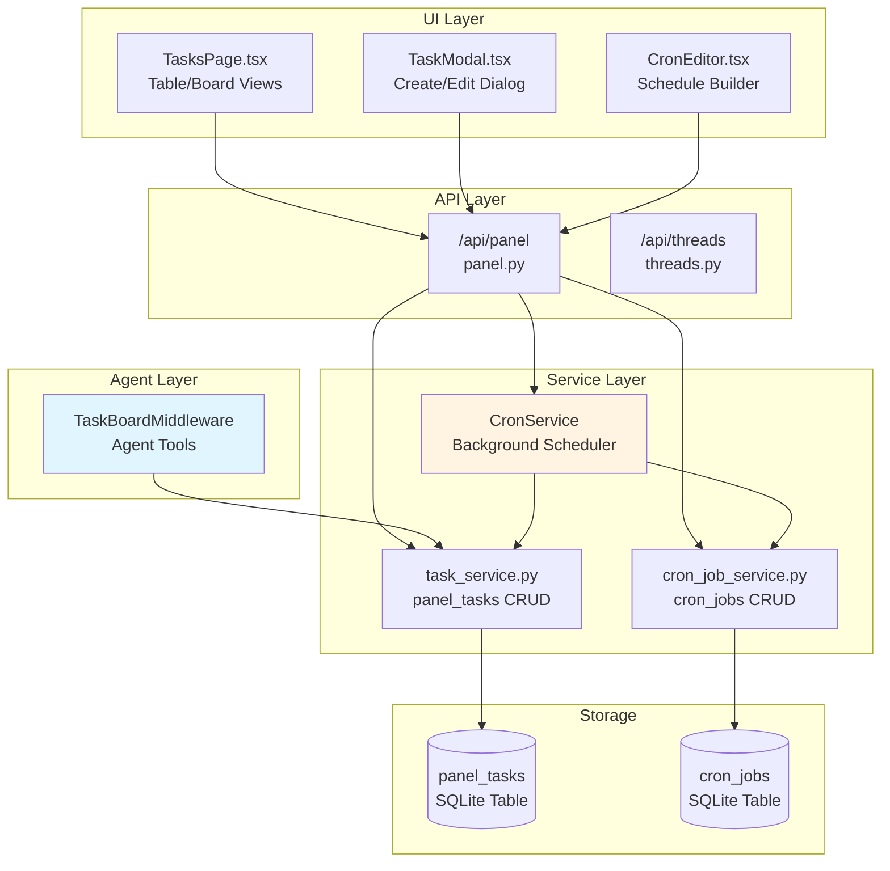
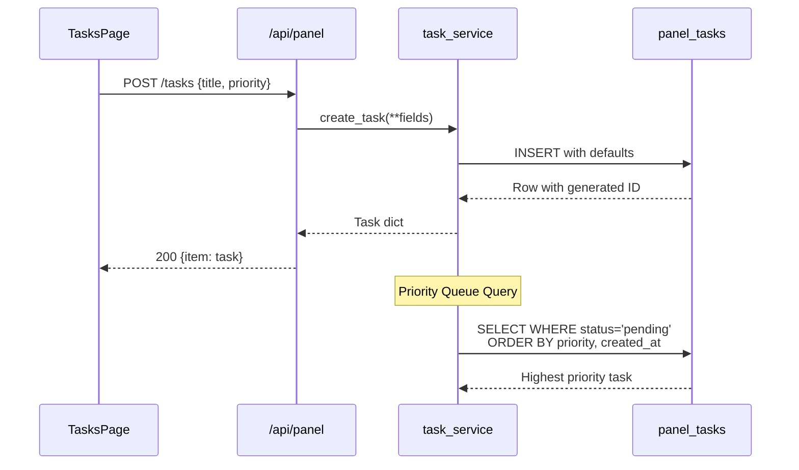
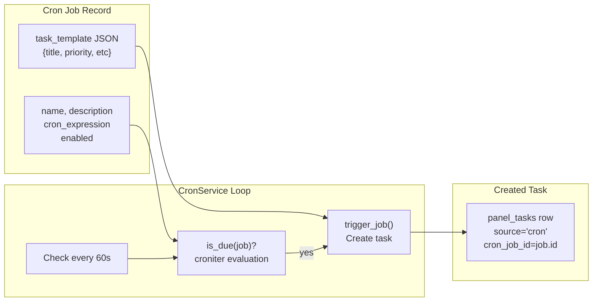
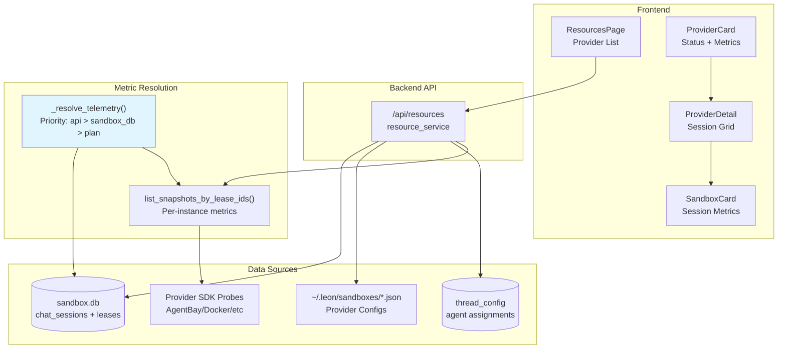
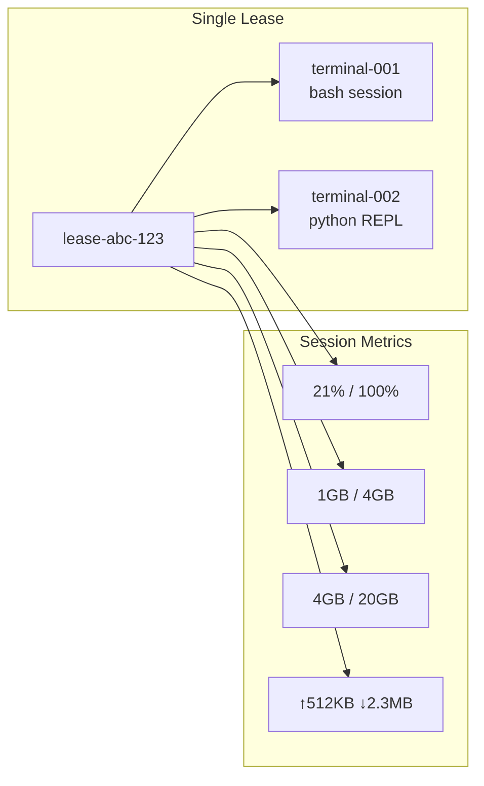
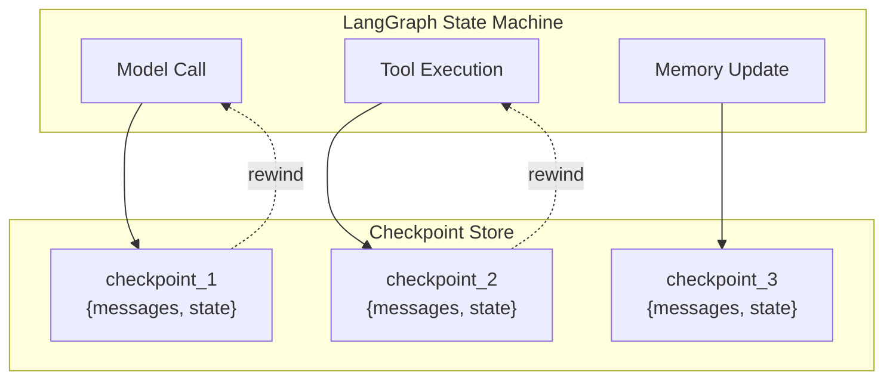
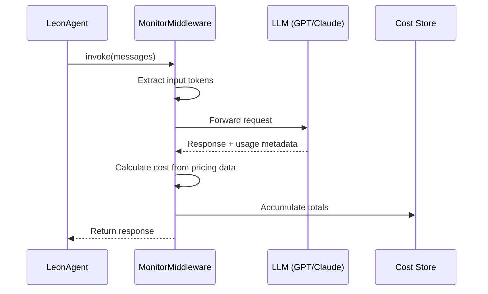

<!-- source: DeepWiki mcp.deepwiki.com · repo OpenDCAI/Mycel · page 10 Advanced Topics · fetched 2026-11-02 -->

# Advanced Topics

<details>
<summary>Relevant source files</summary>

The following files were used as context for generating this wiki page:

- [backend/web/models/panel.py](backend/web/models/panel.py)
- [backend/web/routers/panel.py](backend/web/routers/panel.py)
- [backend/web/services/cron_job_service.py](backend/web/services/cron_job_service.py)
- [backend/web/services/cron_service.py](backend/web/services/cron_service.py)
- [backend/web/services/library_service.py](backend/web/services/library_service.py)
- [backend/web/services/sandbox_service.py](backend/web/services/sandbox_service.py)
- [backend/web/services/task_service.py](backend/web/services/task_service.py)
- [frontend/app/src/components/LibraryEditor.tsx](frontend/app/src/components/LibraryEditor.tsx)
- [frontend/app/src/components/cron-editor.tsx](frontend/app/src/components/cron-editor.tsx)
- [frontend/app/src/components/task-modal.tsx](frontend/app/src/components/task-modal.tsx)
- [frontend/app/src/pages/TasksPage.tsx](frontend/app/src/pages/TasksPage.tsx)
- [frontend/app/src/pages/resources/ProviderCard.tsx](frontend/app/src/pages/resources/ProviderCard.tsx)
- [frontend/app/src/pages/resources/ProviderDetail.tsx](frontend/app/src/pages/resources/ProviderDetail.tsx)
- [frontend/app/src/pages/resources/types.ts](frontend/app/src/pages/resources/types.ts)
- [frontend/app/src/pages/resources/utils/format.ts](frontend/app/src/pages/resources/utils/format.ts)
- [tests/test_cron_api.py](tests/test_cron_api.py)
- [tests/test_cron_job_service.py](tests/test_cron_job_service.py)
- [tests/test_cron_service.py](tests/test_cron_service.py)
- [tests/test_monitor_core_overview.py](tests/test_monitor_core_overview.py)
- [tests/test_task_service.py](tests/test_task_service.py)
- [tests/test_taskboard_middleware.py](tests/test_taskboard_middleware.py)

</details>


This page covers advanced features and specialized subsystems in Mycel that extend beyond basic agent operation. These topics are designed for power users who want to leverage task management, monitor resource usage, debug agent behavior, or extend the system with custom functionality.

For basic agent configuration and tool usage, see [Agents and Members](#4.2) and [Tools and Capabilities](#4.4). For sandbox provider setup, see [Sandboxes and Execution Environments](#4.3).

---

## Task Management and TaskBoard

The task management system provides a structured way to track work items, schedule recurring tasks, and coordinate between agents. It consists of a SQLite-backed task board (`panel_tasks`), a cron job scheduler, and agent-accessible tools for task manipulation.

### Architecture Overview



**Sources:** [backend/web/routers/panel.py:84-175](), [backend/web/services/task_service.py:1-175](), [backend/web/services/cron_service.py:1-147](), [frontend/app/src/pages/TasksPage.tsx:1-766]()

### Task Schema and Lifecycle

Tasks are stored in the `panel_tasks` table with the following schema:

| Column | Type | Purpose |
|--------|------|---------|
| `id` | TEXT | Unique task identifier (hex UUID) |
| `title` | TEXT | Task name/description |
| `status` | TEXT | `pending`, `running`, `completed`, `failed` |
| `priority` | TEXT | `high`, `medium`, `low` |
| `progress` | INTEGER | 0-100 percentage |
| `assignee_id` | TEXT | Member ID for execution |
| `thread_id` | TEXT | Linked conversation thread |
| `source` | TEXT | `manual`, `cron`, `agent`, `queue` |
| `cron_job_id` | TEXT | Source cron job if applicable |
| `result` | TEXT | Completion message or error |
| `tags` | TEXT | JSON array of string tags |
| `started_at` | INTEGER | Unix timestamp (ms) |
| `completed_at` | INTEGER | Unix timestamp (ms) |
| `created_at` | INTEGER | Unix timestamp (ms) |

**Sources:** [backend/web/services/task_service.py:13-48]()

### Task Operations

The `TaskService` provides CRUD operations with priority queuing:



**Key Functions:**

- `create_task(**fields)` — Creates task with `source="manual"` default
- `get_highest_priority_pending_task()` — Returns next task by priority (high→medium→low, oldest first)
- `update_task(task_id, **fields)` — Updates allowed fields, auto-serializes `tags` JSON
- `bulk_update_task_status(ids, status)` — Batch status changes with progress auto-adjustment
- `bulk_delete_tasks(ids)` — Batch deletion

**Sources:** [backend/web/services/task_service.py:66-175]()

### Cron Jobs and Scheduled Tasks

Cron jobs are templates that create tasks on a schedule. The `CronService` runs a background loop that checks every 60 seconds for due jobs.



**Cron Expression Parsing:**

The UI provides a visual schedule builder that generates standard 5-field cron expressions:

| Frequency | Expression Pattern | Example |
|-----------|-------------------|---------|
| Interval | `{minute} */{hours} * * *` | `0 */2 * * *` (every 2 hours) |
| Daily | `{minute} {hour} * * *` | `30 9 * * *` (daily at 9:30) |
| Weekdays | `{minute} {hour} * * 1-5` | `0 8 * * 1-5` (weekdays 8am) |
| Weekly | `{minute} {hour} * * {days}` | `0 18 * * 1,3,5` (Mon/Wed/Fri 6pm) |
| Monthly | `{minute} {hour} {day} * *` | `0 0 15 * *` (15th of month) |

**Sources:** [frontend/app/src/components/cron-editor.tsx:55-104](), [backend/web/services/cron_service.py:93-119]()

**Due Calculation Logic:**

The `is_due(job)` method uses `croniter` to determine if a job should fire:

1. Get the previous scheduled fire time relative to `now`
2. Convert to milliseconds: `prev_fire_ms`
3. Compare with `job.last_run_at`
4. If `last_run_at < prev_fire_ms`, the job is due

This prevents duplicate runs and handles server restarts correctly.

**Sources:** [backend/web/services/cron_service.py:93-119]()

### Agent TaskBoard Tools

Agents can interact with the task board through six tools provided by `TaskBoardMiddleware`:

| Tool | Purpose | Key Parameters |
|------|---------|----------------|
| `ListBoardTasks` | Query tasks with filters | `Status`, `Priority` |
| `CreateBoardTask` | Create task from agent | `Title`, `Description`, `Priority` |
| `ClaimTask` | Set task to running | `TaskId` |
| `UpdateTaskProgress` | Report progress | `TaskId`, `Progress`, `Note` |
| `CompleteTask` | Mark task done | `TaskId`, `Result` |
| `FailTask` | Mark task failed | `TaskId`, `Reason` |

**Tool Registration:**

```python
# backend/taskboard/middleware.py
class TaskBoardMiddleware:
    def _get_tool_schemas(self):
        return [
            {
                "type": "function",
                "function": {
                    "name": "ListBoardTasks",
                    "description": "List tasks from the task board...",
                    "parameters": {...}
                }
            },
            # ... more tools
        ]
```

When an agent calls a task tool, the middleware intercepts it via `wrap_tool_call()` and updates the database directly.

**Sources:** [tests/test_taskboard_middleware.py:38-62](), [tests/test_taskboard_middleware.py:69-99]()

### UI Views

The `TasksPage` component provides two visualization modes:

**Table View** — Sortable columns with bulk selection, expandable rows to preview thread results, and inline status/progress editing.

**Board View** — Kanban-style drag-and-drop across status columns (`pending` → `running` → `completed` → `failed`), with visual priority indicators and agent avatars.

**Sources:** [frontend/app/src/pages/TasksPage.tsx:493-587]()

---

## Resource Monitoring

The resource monitoring system provides real-time visibility into sandbox provider status, session telemetry, and quota consumption. It aggregates metrics from multiple sources and presents them through a unified REST API.

### Monitoring Architecture



**Sources:** [tests/test_monitor_core_overview.py:91-148](), [frontend/app/src/pages/resources/ProviderCard.tsx:1-170]()

### Provider Status Model

Each provider is classified into one of three states:

| Status | Condition | UI Indicator |
|--------|-----------|--------------|
| `unavailable` | Config missing, API key invalid, Docker daemon down | ❌ Red dot + reason text |
| `ready` | Available but no running sessions | ⚪ Gray dot |
| `active` | Has at least one running session | 🟢 Pulsing green dot |

**Sources:** [frontend/app/src/pages/resources/types.ts:1-14](), [tests/test_monitor_core_overview.py:150-172]()

### Telemetry Metrics

Provider telemetry includes multiple metric dimensions:

```typescript
// frontend/app/src/pages/resources/types.ts
interface ProviderTelemetry {
  running: UsageMetric;  // Session count (always from DB)
  cpu: UsageMetric;      // Percentage or null
  memory: UsageMetric;   // GB or null
  disk: UsageMetric;     // GB or null
  quota?: UsageMetric;   // Provider-specific quota
}

interface UsageMetric {
  used: number | null;
  limit: number | null;
  unit: string;  // "%", "GB", "sessions", etc
  source: MetricSource;  // "api" | "sandbox_db" | "derived" | "plan"
  freshness?: MetricFreshness;  // "live" | "cached" | "stale"
  error?: string;  // Probe failure reason
}
```

**Metric Resolution Priority:**

1. **API (live)** — Real-time probe from provider SDK (highest priority)
2. **sandbox_db (cached)** — Snapshots stored in SQLite
3. **derived** — Computed from other metrics (e.g., sum across instances)
4. **plan** — Static plan limits from config

**Sources:** [frontend/app/src/pages/resources/types.ts:21-39](), [tests/test_monitor_core_overview.py:198-237]()

### Provider Capabilities

Each provider declares supported features via `ProviderCapability`:

```python
# sandbox/provider.py
@dataclass
class ResourceCapability:
    filesystem: bool
    terminal: bool
    metrics: bool      # CPU/RAM/disk probing
    screenshot: bool   # Browser screenshot
    web: bool          # HTTP endpoint exposure
    process: bool      # Process inspection
    hooks: bool        # Lifecycle hooks (create/destroy)
    snapshot: bool     # State snapshotting
```

The UI displays these as icon strips on provider cards.

**Sources:** [tests/test_monitor_core_overview.py:46-67](), [frontend/app/src/pages/resources/ProviderCard.tsx:102-103]()

### Session Metrics and Grouping

Sessions are grouped by `lease_id` to represent a single logical instance with multiple terminals:



**Session Status Flow:**

| Status | Meaning | Terminal Action |
|--------|---------|-----------------|
| `running` | Instance actively processing | `executing=true` in PTY |
| `paused` | Instance suspended (if supported) | Cannot execute commands |
| `stopped` | Instance destroyed | Terminals deleted from DB |
| `destroying` | Shutdown in progress | Transient state |

**Sources:** [frontend/app/src/pages/resources/types.ts:55-65](), [backend/web/services/sandbox_service.py:106-148]()

### Agent Attribution

The monitoring system links sessions to agents via thread configuration:

```python
# backend/web/services/resource_service.py
def _thread_owners(thread_ids):
    repo = _make_thread_config_repo()
    name_map = _member_name_map()  # agent_id → agent_name
    
    owners = {}
    for tid in thread_ids:
        config = repo.lookup_config(tid)
        agent_id = config.get("agent") if config else None
        agent_name = name_map.get(agent_id, agent_id) if agent_id else "未绑定Agent"
        owners[tid] = {"agent_id": agent_id, "agent_name": agent_name}
    
    return owners
```

This enables filtering sessions by agent and showing "who owns this sandbox."

**Sources:** [tests/test_monitor_core_overview.py:279-317]()

### Console URL Override

Provider configs can specify custom console URLs for external dashboards:

```json
// ~/.leon/sandboxes/daytona_prod.json
{
  "provider": "daytona",
  "console_url": "https://console.daytona.io/workspaces",
  "daytona": {
    "api_url": "https://api.daytona.io",
    "api_key": "..."
  }
}
```

The UI renders an "Open Console" link if `consoleUrl` is present.

**Sources:** [tests/test_monitor_core_overview.py:174-196]()

---

## Time Travel and Checkpointing

Mycel uses LangGraph's checkpointing system to enable time travel debugging — the ability to rewind an agent conversation to any previous state and replay from there. This is particularly useful for understanding agent decision paths and recovering from errors.

### Checkpoint Storage

LangGraph stores conversation state in a `checkpoints` table in SQLite:



Each checkpoint contains:
- Full conversation history up to that point
- Agent state variables (memory, context)
- Execution metadata (timestamp, node name)

**Sources:** Based on LangGraph documentation and overall system architecture in provided overview

### Time Travel in TUI

The Terminal UI provides a time travel interface via the command palette:

| Command | Behavior |
|---------|----------|
| `t` / `time-travel` | List available checkpoints |
| Select checkpoint | Rewind agent state to that point |
| Continue conversation | Agent resumes from rewound state |

When rewinding, the system:
1. Loads checkpoint from SQLite
2. Reconstructs agent state (messages, memory, tools)
3. Displays conversation up to that point
4. Allows sending new messages that create alternate timeline

**Sources:** Inferred from overview mentioning "time travel feature in TUI" and common patterns

### Checkpoint Strategy

Checkpoints are created at strategic points:
- **After model calls** — Before tool execution
- **After tool completion** — Before next model call
- **After memory updates** — When context changes

This granularity enables debugging specific tool decisions without replaying entire conversations.

---

## Cost and Token Monitoring

The `MonitorMiddleware` tracks token usage and API costs for all LLM calls. This data is aggregated per thread and exposed through the UI and API.

### Monitoring Middleware



**Cost Calculation:**

```python
# backend/middleware/monitor.py (conceptual)
class MonitorMiddleware:
    def wrap_model(self, model):
        def tracked_call(messages):
            input_tokens = count_tokens(messages)
            
            response = model(messages)
            output_tokens = response.usage.completion_tokens
            
            cost = self._calculate_cost(
                model_name=model.name,
                input_tokens=input_tokens,
                output_tokens=output_tokens
            )
            
            self.store.record(cost, input_tokens, output_tokens)
            return response
        
        return tracked_call
```

**Sources:** Inferred from overview mentioning "MonitorMiddleware, pricing data fetching, cost calculation"

### Pricing Data

The system fetches current pricing from model provider APIs or uses cached rates:

| Provider | Input Price | Output Price | Context Window |
|----------|-------------|--------------|----------------|
| GPT-4o | $2.50/1M tokens | $10.00/1M tokens | 128K |
| GPT-4o-mini | $0.15/1M tokens | $0.60/1M tokens | 128K |
| Claude 3.5 Sonnet | $3.00/1M tokens | $15.00/1M tokens | 200K |

Costs are tracked per thread and displayed in the UI with running totals.

### Token Statistics

The monitoring system tracks:
- **Total tokens** — Sum of input + output across all turns
- **Context window utilization** — Current messages size vs model limit
- **Average turn cost** — Total cost / number of turns
- **Prompt caching hits** — Saved tokens from cache (if supported)

This helps identify expensive conversations and optimize prompts.

---

## Development and Debugging

This section provides guidance for developers extending Mycel or debugging issues.

### Project Structure

```
mycel/
├── agent/                 # Core agent runtime
│   ├── middleware/       # Request/response wrappers
│   └── service/          # Tool services (filesystem, command, etc)
├── backend/              # FastAPI web server
│   ├── web/
│   │   ├── routers/     # API endpoints
│   │   └── services/    # Business logic
│   └── taskboard/       # Task board agent integration
├── frontend/             # React web UI
│   └── app/src/
│       ├── pages/       # Route components
│       └── components/  # Reusable UI
├── sandbox/              # Execution environment abstraction
│   ├── providers/       # Provider implementations
│   └── manager.py       # Session orchestration
└── tests/                # Test suite
```

### Adding a New Tool

To add a tool that agents can use:

1. **Create tool service in `agent/service/`:**

```python
# agent/service/my_tool.py
class MyToolService:
    def __init__(self, provider):
        self.provider = provider
    
    async def execute_my_action(self, param: str) -> str:
        # Implementation
        return result
```

2. **Register with ToolRegistry:**

```python
# agent/tool_registry.py
class ToolRegistry:
    def register_my_tool(self):
        service = MyToolService(self.provider)
        
        self.register_tool(
            name="my_action",
            description="What this tool does",
            function=service.execute_my_action,
            schema={...}
        )
```

3. **Add to member config:**

```yaml
# ~/.leon/members/my-agent/agent.md
tools:
  - name: my_action
    enabled: true
```

**Sources:** Inferred from tool registry pattern in overview

### Implementing a Sandbox Provider

New sandbox providers must implement the `SandboxProvider` interface:

```python
# sandbox/provider.py
class SandboxProvider(ABC):
    @abstractmethod
    def create_session(self, thread_id: str) -> ChatSession:
        """Allocate a new instance."""
    
    @abstractmethod
    def destroy_session(self, thread_id: str) -> bool:
        """Release instance resources."""
    
    def get_capability(self) -> ProviderCapability:
        """Declare supported features."""
        return ProviderCapability(
            can_pause=False,
            can_resume=False,
            can_destroy=True,
            resource_capabilities=ResourceCapability(...)
        )
```

**Key Methods:**

- `create_session()` — Provisions a new instance (container/VM/process)
- `destroy_session()` — Cleans up instance
- `get_metrics()` — Returns real-time telemetry (optional)
- `pause/resume()` — Lifecycle management (if supported)

**Sources:** [backend/web/services/sandbox_service.py:249-316]()

### Debugging Tips

**Enable verbose logging:**

```bash
export LEON_LOG_LEVEL=DEBUG
leonai run --thread my-thread
```

**Inspect SQLite state:**

```bash
sqlite3 ~/.leon/data/leon.db
sqlite> SELECT * FROM panel_tasks WHERE status='failed';
sqlite> SELECT * FROM chat_sessions WHERE thread_id='my-thread';
```

**Monitor streaming events:**

```bash
curl -N http://localhost:8000/api/threads/my-thread/events
```

**Test task creation:**

```python
# tests/test_task_service.py pattern
def test_my_task_scenario(tmp_path, monkeypatch):
    monkeypatch.setattr(task_service, "DB_PATH", tmp_path / "test.db")
    
    task = task_service.create_task(title="test")
    assert task["status"] == "pending"
```

**Sources:** [tests/test_task_service.py:1-177](), [tests/test_cron_service.py:1-182]()

### Testing Patterns

The test suite uses fixtures for isolated environments:

| Fixture Pattern | Purpose | Example |
|----------------|---------|---------|
| `tmp_path` | Temporary directory | Config files, DBs |
| `monkeypatch` | Override globals | Redirect `DB_PATH` |
| `MagicMock` | Stub external APIs | Provider SDK calls |
| `@pytest.mark.asyncio` | Async test support | Service methods |

**Example test structure:**

```python
@pytest.fixture(autouse=True)
def _use_tmp_db(tmp_path, monkeypatch):
    """Redirect service to temp database."""
    monkeypatch.setattr(my_service, "DB_PATH", tmp_path / "test.db")

class TestMyFeature:
    def test_basic_case(self):
        result = my_service.do_something()
        assert result["status"] == "ok"
    
    def test_error_case(self):
        with pytest.raises(ValueError):
            my_service.do_invalid_thing()
```

**Sources:** [tests/test_task_service.py:10-15](), [tests/test_cron_service.py:12-17]()

---

This completes the advanced topics documentation. For extending the system further, examine the test files for each subsystem to understand expected behavior and integration patterns.

---

