<!-- source: DeepWiki mcp.deepwiki.com · repo OpenDCAI/Mycel · page 10.1 Task Management and TaskBoard · fetched 2026-11-02 -->

# Task Management and TaskBoard

<details>
<summary>Relevant source files</summary>

The following files were used as context for generating this wiki page:

- [backend/web/models/panel.py](backend/web/models/panel.py)
- [backend/web/routers/panel.py](backend/web/routers/panel.py)
- [backend/web/services/cron_job_service.py](backend/web/services/cron_job_service.py)
- [backend/web/services/cron_service.py](backend/web/services/cron_service.py)
- [backend/web/services/library_service.py](backend/web/services/library_service.py)
- [backend/web/services/task_service.py](backend/web/services/task_service.py)
- [frontend/app/src/components/LibraryEditor.tsx](frontend/app/src/components/LibraryEditor.tsx)
- [frontend/app/src/components/cron-editor.tsx](frontend/app/src/components/cron-editor.tsx)
- [frontend/app/src/components/task-modal.tsx](frontend/app/src/components/task-modal.tsx)
- [frontend/app/src/pages/TasksPage.tsx](frontend/app/src/pages/TasksPage.tsx)
- [tests/test_cron_api.py](tests/test_cron_api.py)
- [tests/test_cron_job_service.py](tests/test_cron_job_service.py)
- [tests/test_cron_service.py](tests/test_cron_service.py)
- [tests/test_task_service.py](tests/test_task_service.py)
- [tests/test_taskboard_middleware.py](tests/test_taskboard_middleware.py)

</details>


The task management system provides a persistent task board for organizing and tracking work items. Tasks can be created manually, scheduled via cron jobs, or generated by agents during execution. The system supports lifecycle management (pending → running → completed/failed), priority levels, assignee tracking, and progress monitoring.

For information about agent tool execution and the ToolRegistry, see [Tool Registry and Execution](#5.2). For information about agent-to-agent communication via SendMessage, see [Sub-agents and Inter-agent Communication](#5.4).

---

## Task Data Model

Tasks are persisted in the SQLite database at the path defined by `backend.web.core.config.DB_PATH`, in the `panel_tasks` table. The schema is managed by `_ensure_tasks_table()` in [backend/web/services/task_service.py:13-49]().

### Task Schema

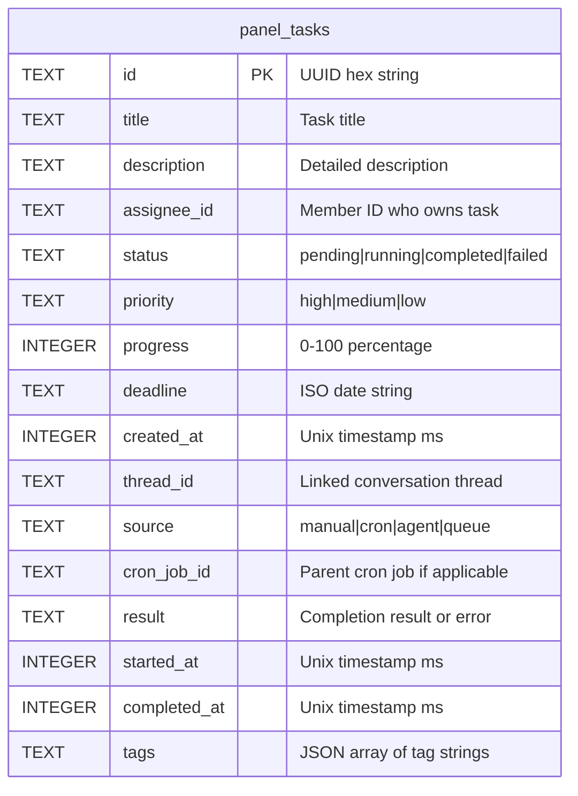

**Sources:** [backend/web/services/task_service.py:13-49]()

### Task Lifecycle States

| Status | Description | Progress | Terminal |
|--------|-------------|----------|----------|
| `pending` | Task created, awaiting execution | 0 | No |
| `running` | Task actively being worked on | 0-99 | No |
| `completed` | Task finished successfully | 100 | Yes |
| `failed` | Task encountered error | any | Yes |

Status transitions are managed by `update_task()` in [backend/web/services/task_service.py:122-139](), with automatic progress adjustments when transitioning to `completed` (→100) or `pending` (→0).

**Sources:** [backend/web/services/task_service.py:122-139](), [frontend/app/src/pages/TasksPage.tsx:19-24]()

### Task Source Types

The `source` field indicates task origin:

- **`manual`**: Created by user via UI
- **`cron`**: Created by scheduled cron job
- **`agent`**: Created by agent using `CreateBoardTask` tool
- **`queue`**: Reserved for future queue-based task generation

**Sources:** [backend/web/services/task_service.py:89-120](), [frontend/app/src/pages/TasksPage.tsx:31-36]()

---

## Task Service Layer

The `task_service` module provides synchronous CRUD operations backed by SQLite with connection pooling via `_tasks_conn()`.

### Core Operations

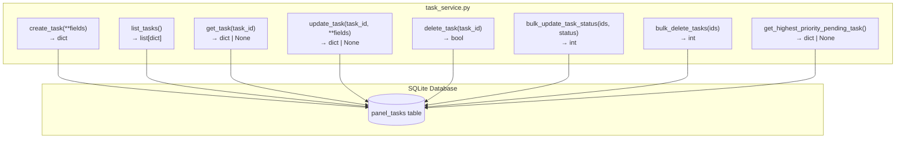

**Sources:** [backend/web/services/task_service.py:66-175]()

### Task Creation

`create_task()` accepts optional fields and generates a UUID for the task ID:

```python
# From task_service.py:89-120
def create_task(**fields: Any) -> dict[str, Any]:
    now = int(time.time() * 1000)
    tid = uuid.uuid4().hex
    # Inserts into panel_tasks with defaults:
    # - status: "pending"
    # - progress: 0
    # - source: fields.get("source", "manual")
    # - tags: fields.get("tags", []) serialized as JSON
```

All fields are optional except `title` (defaults to "新任务"). Tags are stored as JSON-serialized arrays and deserialized by `_deserialize_row()` in [backend/web/services/task_service.py:57-63]().

**Sources:** [backend/web/services/task_service.py:89-120](), [backend/web/services/task_service.py:57-63]()

### Task Update and Bulk Operations

The `update_task()` function allows partial updates with field validation:

- Allowed fields: `title`, `description`, `assignee_id`, `status`, `priority`, `progress`, `deadline`, `thread_id`, `source`, `cron_job_id`, `result`, `started_at`, `completed_at`, `tags`
- Tags are automatically JSON-serialized if provided
- Returns `None` if task not found

Bulk operations optimize multi-task status changes:

- `bulk_update_task_status()`: Updates status for multiple tasks, auto-adjusts progress for `completed`/`pending`
- `bulk_delete_tasks()`: Deletes multiple tasks in single query

**Sources:** [backend/web/services/task_service.py:122-175]()

---

## Cron Jobs and Scheduled Tasks

The cron job system enables scheduled, recurring task creation. Cron jobs are stored in the `cron_jobs` table and managed by `CronService`, which runs a background loop checking for due jobs.

### Cron Job Data Model

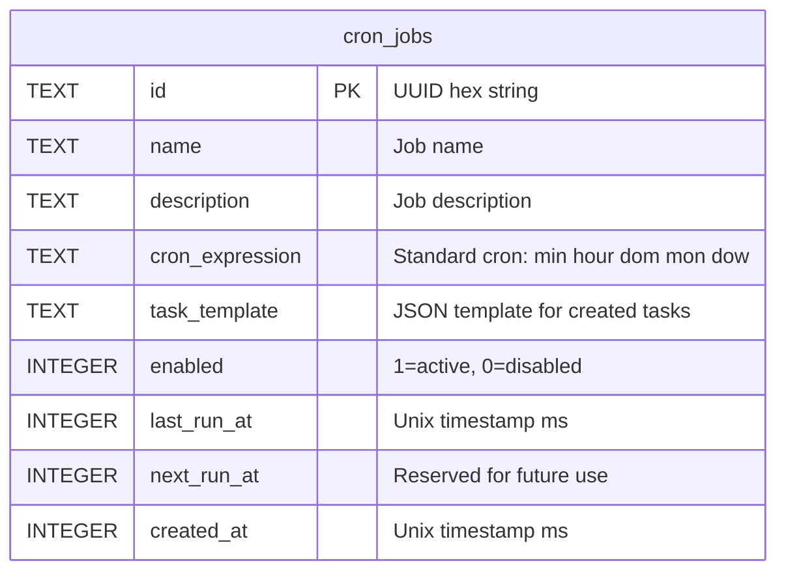

**Sources:** [backend/web/services/cron_job_service.py:11-24]()

### CronService Architecture

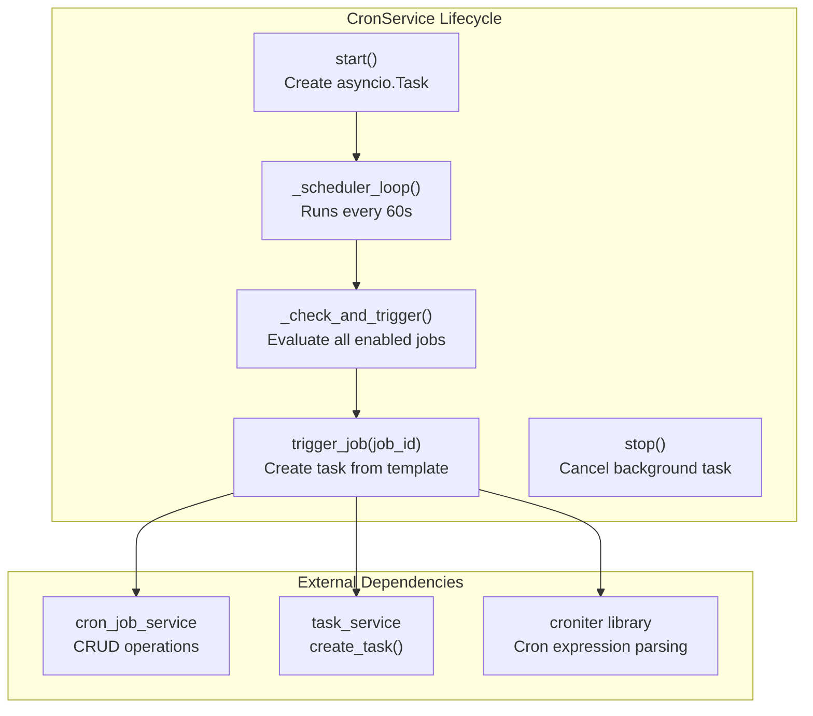

**Sources:** [backend/web/services/cron_service.py:26-147]()

### Cron Expression Evaluation

The `is_due()` method determines if a job should fire:

1. Check if job is enabled
2. Parse cron expression using `croniter`
3. Get previous scheduled fire time relative to now
4. Compare with `last_run_at` timestamp
5. Job is due if it hasn't run since last scheduled fire time

**Sources:** [backend/web/services/cron_service.py:93-119]()

### Task Template System

When a cron job triggers, `trigger_job()` creates a task by parsing the `task_template` JSON field:

```python
# From cron_service.py:55-91
async def trigger_job(self, job_id: str) -> dict[str, Any] | None:
    # Parse template JSON
    template = json.loads(job.get("task_template", "{}"))
    
    # Extract allowed fields: title, description, priority, assignee_id, deadline, tags
    task_fields = {k: v for k, v in template.items() if k in _ALLOWED_TEMPLATE_KEYS}
    
    # Add metadata
    task_fields["source"] = "cron"
    task_fields["cron_job_id"] = job_id
    
    # Create task via task_service
    task = await asyncio.to_thread(task_service.create_task, **task_fields)
```

The allowed template keys are restricted to prevent injection attacks: `title`, `description`, `priority`, `assignee_id`, `deadline`, `tags`.

**Sources:** [backend/web/services/cron_service.py:55-91](), [backend/web/services/cron_service.py:23]()

### Scheduler Loop

The `_scheduler_loop()` runs continuously in background:

1. Sleep for 60 seconds (`_CHECK_INTERVAL_SEC`)
2. Call `_check_and_trigger()` to evaluate all jobs
3. For each due job, call `trigger_job()`
4. Update job's `last_run_at` timestamp
5. Log errors but continue on failure

The loop is started during FastAPI lifespan with `app.state.cron_service.start()` and stopped on shutdown.

**Sources:** [backend/web/services/cron_service.py:123-146](), [backend/web/services/cron_service.py:22]()

---

## TaskBoard Middleware for Agents

The `TaskBoardMiddleware` class provides agent tools for interacting with the task board during agent execution. Agents can query tasks, claim work, update progress, and mark tasks complete or failed.

### Tool Registration

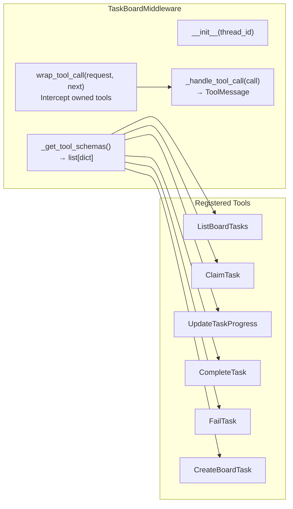

**Sources:** Tests indicate middleware exists at [backend/taskboard/middleware.py]() (referenced in [tests/test_taskboard_middleware.py:19-22]())

### Tool Implementations

Based on test specifications:

| Tool Name | Parameters | Action |
|-----------|------------|--------|
| `ListBoardTasks` | `Status?`, `Priority?` | Query tasks with filters |
| `ClaimTask` | `TaskId` | Set status=`running`, link thread_id, set started_at |
| `UpdateTaskProgress` | `TaskId`, `Progress`, `Note?` | Update progress 0-100, append note to description |
| `CompleteTask` | `TaskId`, `Result` | Set status=`completed`, progress=100, result, completed_at |
| `FailTask` | `TaskId`, `Reason` | Set status=`failed`, result=reason, completed_at |
| `CreateBoardTask` | `Title`, `Description?`, `Priority?` | Create task with source=`agent` |

**Sources:** [tests/test_taskboard_middleware.py:38-255]()

### Middleware Integration Pattern

The middleware follows the chain-of-responsibility pattern:

```python
def wrap_tool_call(self, request, next):
    if request.tool_call["name"] in self._owned_tools:
        return self._handle_tool_call(request.tool_call)
    return next(request)  # Pass through to next middleware
```

Agents in threads can claim tasks and update their status as work progresses, enabling coordination between the task board and active conversations.

**Sources:** [tests/test_taskboard_middleware.py:262-286]()

---

## Frontend Task Management UI

The `TasksPage` component provides a comprehensive UI for managing tasks and cron jobs, with dual-view modes (table and kanban) and real-time polling.

### Component Architecture

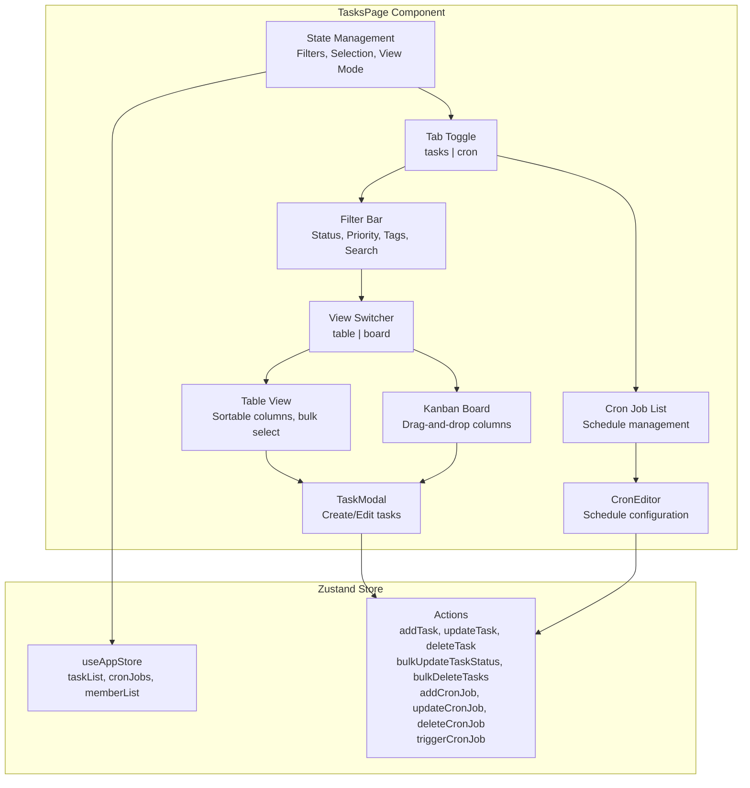

**Sources:** [frontend/app/src/pages/TasksPage.tsx:58-749]()

### Task Display and Filtering

The page maintains filter state and derives a filtered task list:

```typescript
// From TasksPage.tsx:87-96
const [search, setSearch] = useState("");
const [statusFilter, setStatusFilter] = useState<TaskStatus | "all">("all");
const [priorityFilter, setPriorityFilter] = useState<Priority | "all">("all");
const [tagFilter, setTagFilter] = useState<string | null>(null);
```

Filtering logic in [frontend/app/src/pages/TasksPage.tsx:267-276]():

1. Filter by status if not "all"
2. Filter by priority if not "all"
3. Filter by active tag if set
4. Filter by search query (matches title or assignee name)

Sorting is applied after filtering, with support for `title`, `priority`, `created_at` fields and `asc`/`desc` directions.

**Sources:** [frontend/app/src/pages/TasksPage.tsx:87-96](), [frontend/app/src/pages/TasksPage.tsx:267-288]()

### Kanban Board View

The board view renders four columns for task statuses:

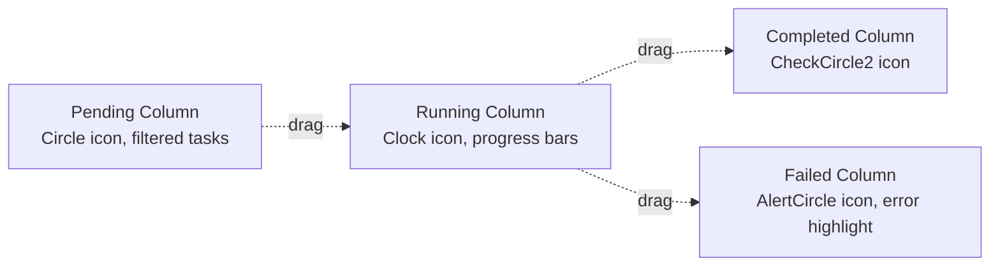

Drag-and-drop is implemented via HTML5 drag API:

- `onDragStart`: Store task ID in `dataTransfer`
- `onDragOver`: Set `dragOverColumn` state for visual feedback
- `onDrop`: Call `storeUpdateTask(taskId, {status: newStatus})` and adjust progress

**Sources:** [frontend/app/src/pages/TasksPage.tsx:320-342](), [frontend/app/src/pages/TasksPage.tsx:493-587]()

### Real-time Polling

Tasks are polled every 5 seconds for updates:

```typescript
// From TasksPage.tsx:80-85
useEffect(() => {
  const interval = setInterval(() => {
    fetchTasks().catch(() => {/* background poll failure */});
  }, 5000);
  return () => clearInterval(interval);
}, [fetchTasks]);
```

This ensures the UI reflects tasks created by cron jobs or agents without requiring manual refresh.

**Sources:** [frontend/app/src/pages/TasksPage.tsx:80-85]()

### Task Modal

The unified `TaskModal` component handles both task creation/editing and cron job creation:

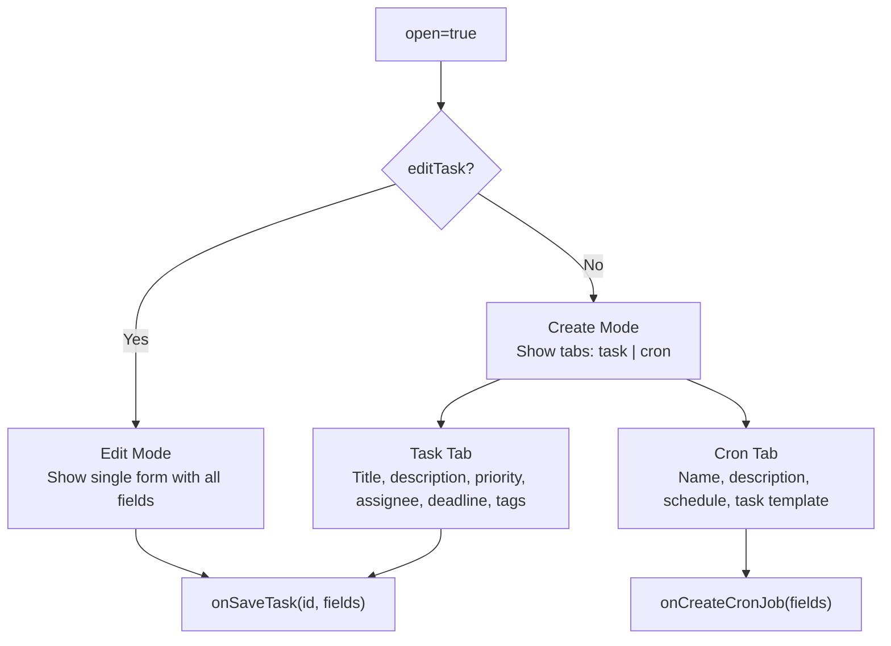

The modal is controlled by `taskModalOpen` state and `editingTask` determines the mode. In edit mode, status and progress are editable. In create mode, tabs allow choosing between one-time task or scheduled cron job.

**Sources:** [frontend/app/src/components/task-modal.tsx:154-583]()

### Tag System

Tasks support multiple tags for categorization. The `TagInput` component provides autocomplete:

- Existing tags from all tasks are aggregated
- User can type to filter suggestions
- Enter key adds tag
- Backspace removes last tag when input empty
- Click tag in filters to toggle filter state

**Sources:** [frontend/app/src/components/task-modal.tsx:11-93](), [frontend/app/src/pages/TasksPage.tsx:261-265]()

---

## Cron Editor UI

The `CronEditor` component provides a visual schedule builder that generates standard 5-field cron expressions.

### Schedule Builder Interface

```mermaid
graph TB
    freq["Frequency Selector<br/>interval | daily | weekdays | weekly | monthly"]
    
    interval["Interval Mode<br/>Select hours: 1,2,3,4,6,8,12"]
    fixed["Fixed Time Mode<br/>Hour (0-23), Minute (0,5,10...55)"]
    weekly["Weekly Picker<br/>Toggle weekday buttons"]
    monthly["Monthly Picker<br/>Select day 1-31"]
    
    freq --> interval
    freq --> fixed
    
    fixed --> weekly
    fixed --> monthly
    
    expr["Cron Expression<br/>min hour dom mon dow"]
    human["Human-readable<br/>e.g. '工作日 09:00'"]
    
    interval --> expr
    fixed --> expr
    weekly --> expr
    monthly --> expr
    
    expr --> human
```

**Sources:** [frontend/app/src/components/cron-editor.tsx:47-103]()

### Cron Expression Generation

The `buildCron()` function generates standard 5-field expressions:

| Frequency | Expression Pattern | Example |
|-----------|-------------------|---------|
| `interval` | `{min} */{hours} * * *` | `0 */2 * * *` (every 2 hours) |
| `daily` | `{min} {hour} * * *` | `0 9 * * *` (daily at 9:00) |
| `weekdays` | `{min} {hour} * * 1-5` | `0 9 * * 1-5` (Mon-Fri 9:00) |
| `weekly` | `{min} {hour} * * {days}` | `0 9 * * 1,3,5` (Mon/Wed/Fri 9:00) |
| `monthly` | `{min} {hour} {day} * *` | `0 9 1 * *` (1st of month 9:00) |

The human-readable label is shown alongside the cron expression for clarity.

**Sources:** [frontend/app/src/components/cron-editor.tsx:85-103]()

### Task Template Configuration

The cron editor includes a task preview section where users configure the template:

- **Task title** and **description**: Free text fields
- **Category tags**: Predefined categories with color indicators (code-review, report, backup, security, cleanup, monitoring, other)
- **Priority**: High, medium, low buttons

The template is serialized to JSON and stored in the `task_template` field:

```json
{
  "title": "Daily backup",
  "description": "Backup database",
  "priority": "high",
  "tags": ["backup"]
}
```

**Sources:** [frontend/app/src/components/cron-editor.tsx:106-122](), [frontend/app/src/components/cron-editor.tsx:334-395]()

---

## REST API Endpoints

The panel router exposes task and cron job endpoints at `/api/panel/*`.

### Task Endpoints

| Method | Path | Request Body | Response | Description |
|--------|------|--------------|----------|-------------|
| `GET` | `/api/panel/tasks` | - | `{items: Task[]}` | List all tasks |
| `POST` | `/api/panel/tasks` | `CreateTaskRequest` | `Task` | Create new task |
| `PUT` | `/api/panel/tasks/{task_id}` | `UpdateTaskRequest` | `Task` | Update task fields |
| `DELETE` | `/api/panel/tasks/{task_id}` | - | `{success: bool}` | Delete task |
| `PUT` | `/api/panel/tasks/bulk-status` | `BulkTaskStatusRequest` | `{updated: int}` | Bulk status update |
| `POST` | `/api/panel/tasks/bulk-delete` | `BulkDeleteTasksRequest` | `{deleted: int}` | Bulk delete |

**Sources:** [backend/web/routers/panel.py:84-123]()

### Cron Job Endpoints

| Method | Path | Request Body | Response | Description |
|--------|------|--------------|----------|-------------|
| `GET` | `/api/panel/cron-jobs` | - | `{items: CronJob[]}` | List all cron jobs |
| `POST` | `/api/panel/cron-jobs` | `CreateCronJobRequest` | `{item: CronJob}` | Create cron job |
| `PUT` | `/api/panel/cron-jobs/{job_id}` | `UpdateCronJobRequest` | `{item: CronJob}` | Update cron job |
| `DELETE` | `/api/panel/cron-jobs/{job_id}` | - | `{ok: bool}` | Delete cron job |
| `POST` | `/api/panel/cron-jobs/{job_id}/run` | - | `{item: Task}` | Manually trigger job |

The `/run` endpoint allows manual triggering of a cron job without waiting for the scheduled time. It validates the job is enabled and creates a task immediately.

**Sources:** [backend/web/routers/panel.py:125-175]()

### Request/Response Models

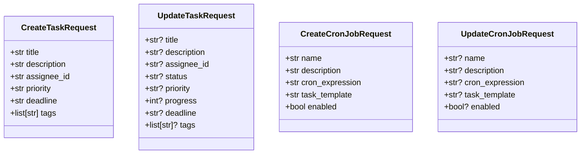

All request models use Pydantic for validation. Cron expression validation uses `croniter.is_valid()`, and task template validation ensures valid JSON.

**Sources:** [backend/web/models/panel.py:51-142]()

### Validation Rules

The API enforces validation at multiple layers:

1. **Pydantic validators**: Check cron expression and JSON template format
2. **Service layer**: `cron_job_service.create_cron_job()` validates non-empty name and expression
3. **Field restrictions**: `task_service.update_task()` only allows whitelisted fields

Cron expression validation example from [backend/web/models/panel.py:9-12]():

```python
def _check_cron_expr(v: str | None) -> str | None:
    if v is not None and not croniter.is_valid(v):
        raise ValueError(f"Invalid cron expression: {v!r}")
    return v
```

**Sources:** [backend/web/models/panel.py:9-21](), [backend/web/services/cron_job_service.py:46-50]()

---

## System Integration Flow

### Task Creation Flow (Manual)

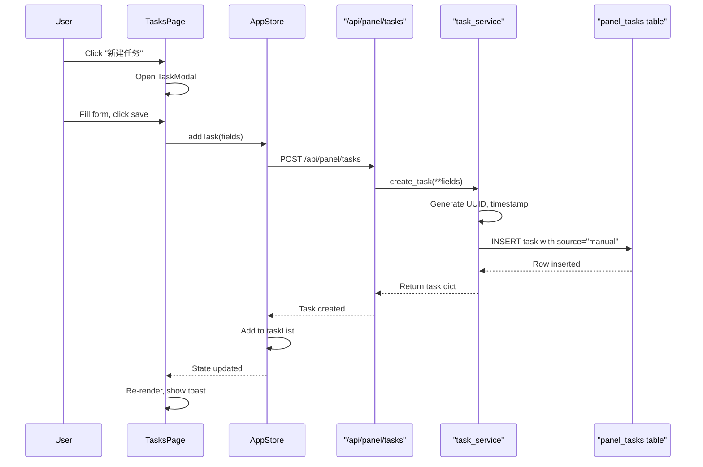

**Sources:** [frontend/app/src/pages/TasksPage.tsx:130-138](), [backend/web/routers/panel.py:92-94](), [backend/web/services/task_service.py:89-120]()

### Cron Job Triggering Flow

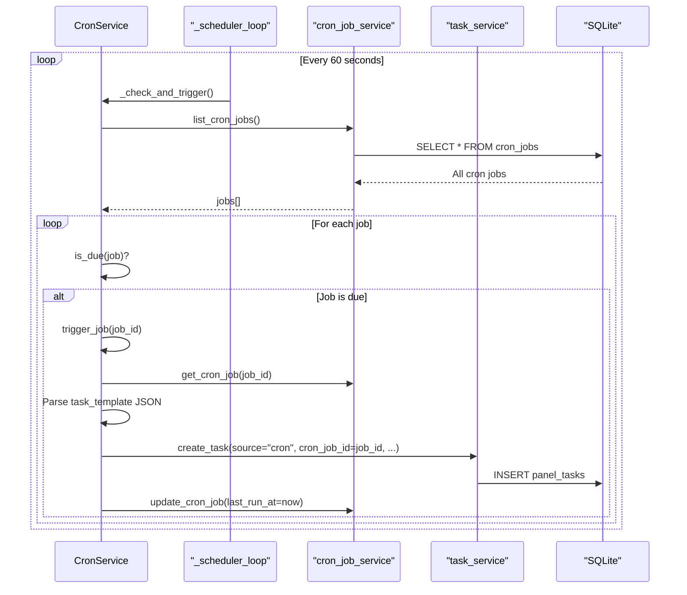

**Sources:** [backend/web/services/cron_service.py:123-146](), [backend/web/services/cron_service.py:55-91]()

### Agent Task Interaction Flow

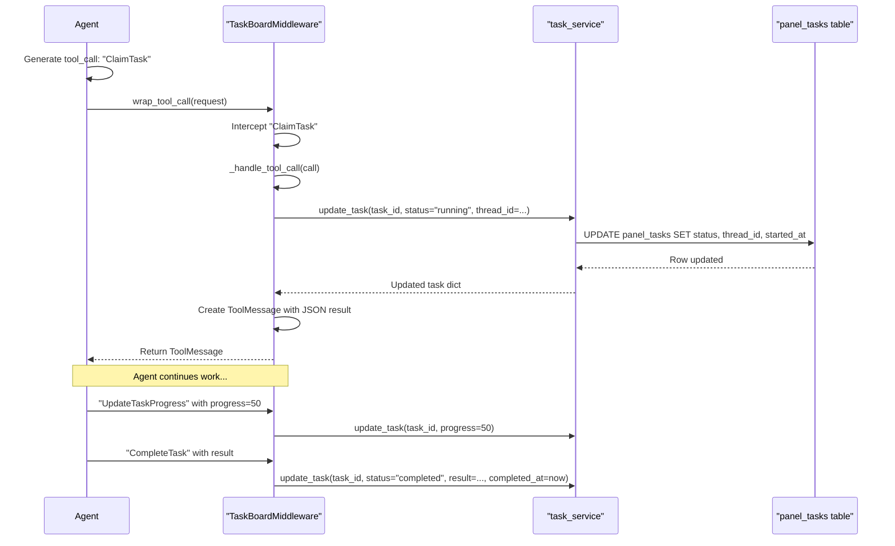

**Sources:** [tests/test_taskboard_middleware.py:105-151]()

---

## Testing Strategy

The task management system includes comprehensive test coverage across multiple layers:

### Service Layer Tests

| Test File | Coverage | Key Tests |
|-----------|----------|-----------|
| `tests/test_task_service.py` | `task_service` CRUD | Schema validation, create/update/delete, bulk operations, column migration |
| `tests/test_cron_job_service.py` | `cron_job_service` CRUD | Validation, lifecycle, field updates |
| `tests/test_cron_service.py` | `CronService` scheduler | `trigger_job()`, `is_due()`, lifecycle, error handling |
| `tests/test_taskboard_middleware.py` | Agent tools | All 6 tools, passthrough behavior, error cases |

All tests use `pytest` with `autouse` fixtures that redirect SQLite to temporary paths via `monkeypatch`, ensuring test isolation.

**Sources:** [tests/test_task_service.py:10-14](), [tests/test_cron_service.py:13-17](), [tests/test_taskboard_middleware.py:11-14]()

### API Validation Tests

The `tests/test_cron_api.py` file validates Pydantic models:

- `CreateCronJobRequest`: Required fields, defaults, validation errors
- `UpdateCronJobRequest`: Optional fields, `model_dump(exclude_none=True)`, bool→int conversion pattern

These tests ensure the API contract is correctly enforced before reaching service layer.

**Sources:** [tests/test_cron_api.py:1-90]()

### Frontend Testing Considerations

While frontend tests are not present in the provided files, the UI components follow testable patterns:

- Pure filter/sort logic can be unit tested
- API calls abstracted via `useAppStore` actions (mockable)
- Component state isolated from business logic
- Drag-and-drop interactions testable via Testing Library

---

## Configuration and Deployment

### Database Path

All services use the path from `backend.web.core.config.DB_PATH`. In production, this defaults to `~/.leon/data/mycel.db`. Tests override via monkeypatch.

### CronService Initialization

The `CronService` is initialized during FastAPI lifespan and stored in `app.state.cron_service`:

```python
# From main.py lifespan context
cron_service = CronService()
await cron_service.start()
app.state.cron_service = cron_service

# ... later on shutdown
await app.state.cron_service.stop()
```

The service must be started before the app begins serving requests to ensure scheduled jobs fire.

### Polling Interval Configuration

Frontend polling interval is hardcoded to 5000ms in [frontend/app/src/pages/TasksPage.tsx:82](). Scheduler check interval is 60s in [backend/web/services/cron_service.py:22]().

For production deployment with high task volume, consider:

- Implementing SSE for real-time task updates instead of polling
- Adjusting scheduler interval based on minimum cron frequency
- Adding database indexes on `status`, `priority`, `created_at` for query performance

---

## Common Patterns and Best Practices

### Source Tracking

Always set the `source` field when creating tasks programmatically:

- Manual UI creation: `source="manual"` (default)
- Cron jobs: `source="cron"` (set by `CronService`)
- Agent tools: `source="agent"` (set by `TaskBoardMiddleware`)

This enables filtering and analytics on task origin.

### Thread Linking

When agents claim tasks via `ClaimTask` tool, the `thread_id` is automatically set, creating a bidirectional link:

- Task → Thread: `task.thread_id` references conversation
- Thread → Tasks: Query `panel_tasks WHERE thread_id = ?`

The UI displays thread details when expanding a task row in [frontend/app/src/pages/TasksPage.tsx:214-251]().

### Progress Tracking

For running tasks, update progress incrementally using `UpdateTaskProgress` tool or API:

```python
# Via middleware
UpdateTaskProgress(TaskId="abc", Progress=30, Note="Analyzing files...")
UpdateTaskProgress(TaskId="abc", Progress=60, Note="Generating report...")
CompleteTask(TaskId="abc", Result="Report ready: /path/to/report.pdf")
```

Notes are appended to the description field for audit trail.

### Tag Usage

Tags enable flexible categorization without schema changes. Use conventions:

- Priority indicators: `urgent`, `blocked`
- Work type: `code-review`, `documentation`, `testing`
- Ownership: `team:backend`, `team:frontend`
- Phases: `sprint-1`, `q1-2024`

Tags are indexed for filtering but not enforced, allowing organic taxonomy.

---

