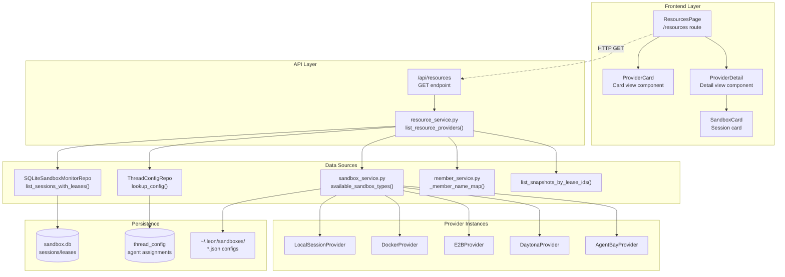
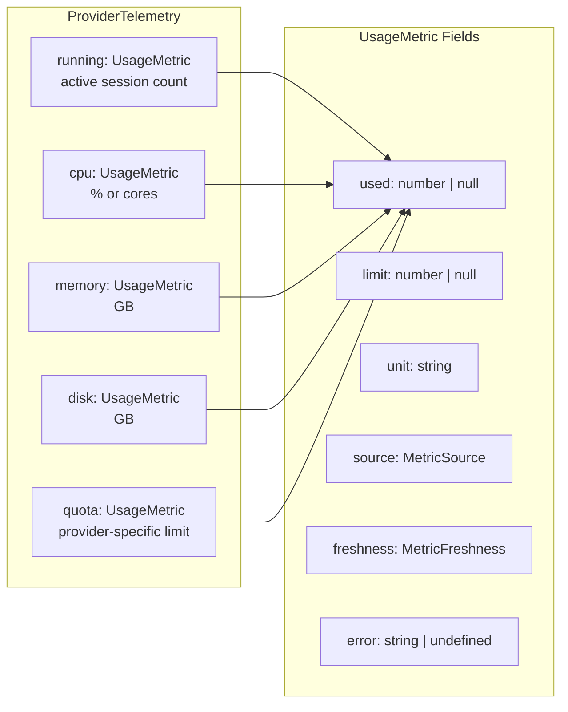
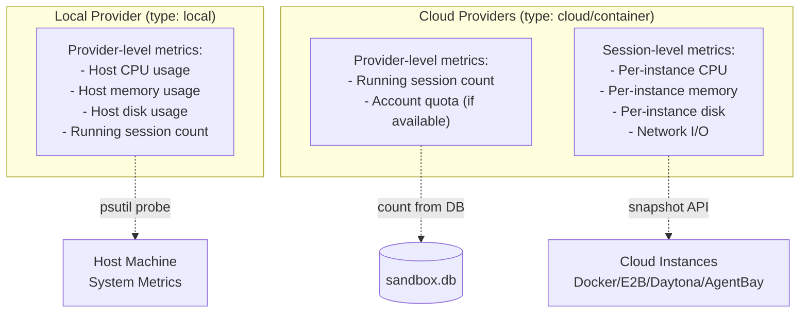
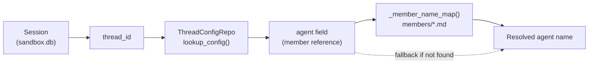
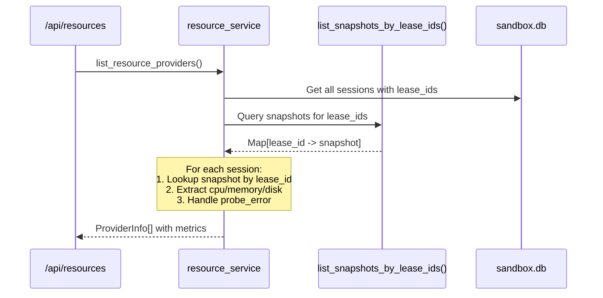
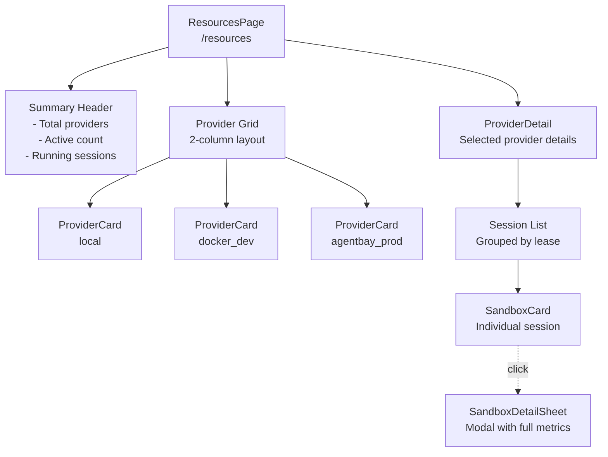

<!-- source: DeepWiki mcp.deepwiki.com · repo OpenDCAI/Mycel · page 10.2 Resource Monitoring · fetched 2026-11-02 -->

# Resource Monitoring

<details>
<summary>Relevant source files</summary>

The following files were used as context for generating this wiki page:

- [backend/web/services/sandbox_service.py](backend/web/services/sandbox_service.py)
- [frontend/app/src/pages/resources/ProviderCard.tsx](frontend/app/src/pages/resources/ProviderCard.tsx)
- [frontend/app/src/pages/resources/ProviderDetail.tsx](frontend/app/src/pages/resources/ProviderDetail.tsx)
- [frontend/app/src/pages/resources/types.ts](frontend/app/src/pages/resources/types.ts)
- [frontend/app/src/pages/resources/utils/format.ts](frontend/app/src/pages/resources/utils/format.ts)
- [tests/test_monitor_core_overview.py](tests/test_monitor_core_overview.py)

</details>


Resource Monitoring provides visibility into sandbox provider health, session status, and resource utilization across all execution environments. This system tracks running sandboxes, collects telemetry metrics (CPU, memory, disk), and displays real-time provider status through the Resources page in the web UI.

For information about configuring sandbox providers, see [Sandbox Configuration](#9.2). For details on sandbox session orchestration and lifecycle, see [Session Management and Orchestration](#6.3).

## Overview

The Resource Monitoring system consists of three layers:

1. **Data Collection Layer**: Backend services that query sandbox providers, databases, and telemetry APIs to gather provider status, session state, and resource metrics
2. **API Layer**: FastAPI endpoints that aggregate monitoring data and expose it to the frontend via `/api/resources`
3. **Visualization Layer**: React components that render provider cards, session details, and real-time metrics in the Resources page

The system supports monitoring multiple provider types simultaneously (local host, Docker containers, cloud VMs) and provides both provider-level metrics (e.g., host CPU usage) and session-level metrics (e.g., per-instance resource consumption).

**Sources:** [frontend/app/src/pages/resources/types.ts](), [backend/web/services/resource_service.py](), [tests/test_monitor_core_overview.py]()

## Resource Monitoring Architecture



**Data Flow:**
1. `ResourcesPage` fetches monitoring data via `GET /api/resources`
2. `resource_service.list_resource_providers()` orchestrates data collection from multiple sources
3. Provider availability is determined by scanning config files and instantiating providers
4. Session data is loaded from `sandbox.db` via `SQLiteSandboxMonitorRepo`
5. Thread-to-agent mappings are resolved through `ThreadConfigRepo` and `member_service`
6. Telemetry metrics are collected from snapshot storage and provider APIs
7. Aggregated data is returned as structured JSON to the frontend

**Sources:** [backend/web/routers/resources.py](), [backend/web/services/resource_service.py](), [frontend/app/src/pages/resources/ResourcesPage.tsx]()

## Provider Status and Telemetry

### Provider Status Model

Each provider has one of three statuses:

| Status | Condition | Display |
|--------|-----------|---------|
| `active` | Provider available AND has running sessions | Green pulse indicator |
| `ready` | Provider available AND no running sessions | Gray indicator |
| `unavailable` | Provider initialization failed OR required daemon down | Red X icon |

**Sources:** [frontend/app/src/pages/resources/types.ts:1-2](), [tests/test_monitor_core_overview.py:150-171]()

### Telemetry Metrics Structure



**Metric Sources:**
- `api`: Real-time data from provider API (e.g., AgentBay telemetry endpoint)
- `sandbox_db`: Session counts from SQLite database
- `derived`: Computed metrics (e.g., sum of per-instance snapshots)
- `plan`: Account-level quotas from provider console
- `console`: Manual limits from config files
- `unknown`: No data source available

**Metric Freshness:**
- `live`: Real-time API data (< 5s old)
- `cached`: Recently fetched snapshot data (< 60s old)
- `stale`: No recent data available

**Sources:** [frontend/app/src/pages/resources/types.ts:21-39](), [backend/web/services/resource_service.py]()

### Provider-Level vs Session-Level Metrics



The distinction is important:
- **Local provider**: Shows host machine metrics (all terminals share one physical host)
- **Non-local providers**: Show per-session metrics (each session is an isolated instance)

This is enforced in [frontend/app/src/pages/resources/ProviderDetail.tsx:74-139]().

**Sources:** [frontend/app/src/pages/resources/ProviderDetail.tsx:122-139](), [tests/test_monitor_core_overview.py:198-237]()

## Session Tracking and Ownership

### Session Data Model

```typescript
interface ResourceSession {
  id: string;                    // session_id from sandbox DB
  leaseId?: string;              // lease_id (groups terminals)
  threadId: string;              // conversation context
  agentId: string;               // member config reference
  agentName: string;             // resolved member name
  status: "running" | "paused" | "stopped" | "destroying";
  startedAt: string;             // ISO timestamp
  metrics?: SessionMetrics;      // per-instance telemetry
}
```

**Sources:** [frontend/app/src/pages/resources/types.ts:55-65]()

### Thread Ownership Resolution

The system resolves thread → agent → member name mappings to display which agent owns each session:



**Fallback behavior:**
- If thread config not found: `agentId = null`, `agentName = "未绑定Agent"`
- If member name not found: `agentName = agentId` (use reference as display name)

**Sources:** [tests/test_monitor_core_overview.py:279-316](), [backend/web/services/resource_service.py]()

### Session Status Mapping

Sessions in `sandbox.db` have `observed_state` and `desired_state` fields. The monitoring system maps these to display status:

| Observed State | Desired State | Display Status |
|----------------|---------------|----------------|
| `running` | `running` | `running` |
| `paused` | `paused` | `paused` |
| `stopped` | `stopped` | `stopped` |
| `destroying` | * | `destroying` |
| `detached` | `running` | `running` |
| `paused` | `running` | `paused` (resuming) |

**Sources:** [tests/test_monitor_core_overview.py:106-147]()

## Provider Capabilities

Each provider declares its capabilities via `ProviderCapability` and `ResourceCapabilities`:

```typescript
interface ProviderCapabilities {
  filesystem: boolean;   // Read/write files
  terminal: boolean;     // Execute commands
  metrics: boolean;      // CPU/memory/disk telemetry
  screenshot: boolean;   // Screenshot support (AgentBay)
  web: boolean;          // Web server support (AgentBay)
  process: boolean;      // Process management (AgentBay)
  hooks: boolean;        // Lifecycle hooks (Daytona)
  snapshot: boolean;     // Snapshot/restore (E2B)
}
```

**Provider-Specific Capabilities:**

| Provider | filesystem | terminal | metrics | screenshot | web | process | hooks | snapshot |
|----------|-----------|----------|---------|-----------|-----|---------|-------|----------|
| local | ✓ | ✓ | ✗ | ✗ | ✗ | ✗ | ✗ | ✗ |
| docker | ✓ | ✓ | ✓ | ✗ | ✗ | ✗ | ✗ | ✗ |
| e2b | ✓ | ✓ | ✗ | ✗ | ✗ | ✗ | ✗ | ✓ |
| daytona | ✓ | ✓ | ✗ | ✗ | ✗ | ✗ | ✓ | ✗ |
| agentbay | ✓ | ✓ | ✓ | ✓ | ✓ | ✓ | ✗ | ✗ |

Capabilities are displayed as icon strips in `ProviderCard` via `CapabilityStrip` component.

**Sources:** [frontend/app/src/pages/resources/types.ts:5-14](), [tests/test_monitor_core_overview.py:46-67](), [frontend/app/src/pages/resources/CapabilityIcons.tsx]()

## Snapshot-Based Metrics Collection

For cloud providers with metrics capabilities (Docker, AgentBay), the system collects per-instance telemetry via snapshot storage:



**Snapshot Schema:**
```python
{
  "lease_id": str,
  "cpu_used": float | None,      # % or cores
  "cpu_limit": float | None,
  "memory_used_mb": float | None,
  "memory_total_mb": float | None,
  "disk_used_gb": float | None,
  "disk_total_gb": float | None,
  "probe_error": str | None,     # Error message if metrics unavailable
  "collected_at": str            # ISO timestamp
}
```

When `probe_error` is present, metrics are set to `null` and the error is propagated to the UI via `UsageMetric.error` field.

**Sources:** [tests/test_monitor_core_overview.py:198-277](), [backend/web/services/resource_service.py]()

## Resources Page UI

### Page Structure



**Sources:** [frontend/app/src/pages/resources/ResourcesPage.tsx](), [frontend/app/src/pages/resources/ProviderCard.tsx](), [frontend/app/src/pages/resources/ProviderDetail.tsx]()

### ProviderCard Display

The `ProviderCard` component renders a compact card with:

1. **Status indicator**: Pulsing green (active) / gray (ready) / red X (unavailable)
2. **Provider name**: Displayed prominently
3. **Type label**: 本地 (local), 云端 (cloud), or 容器 (container)
4. **Metrics center**: Shows `MetricCircle` components:
   - Running session count (always shown)
   - CPU usage ring (if `cardCpu.used` and `cardCpu.limit` available)
5. **Capability icons**: Horizontal strip showing enabled features
6. **Session dots**: Up to 5 colored dots indicating session status
   - Green pulsing: running
   - Yellow: paused
   - Gray: stopped
   - Red pulsing: destroying

The `cardCpu` field is a computed metric that:
- For local provider: Shows host CPU from psutil probe
- For cloud providers: Aggregates CPU from snapshot data
- Includes `error` field if metrics unavailable

**Sources:** [frontend/app/src/pages/resources/ProviderCard.tsx:25-170](), [frontend/app/src/pages/resources/QuotaRing.tsx]()

### ProviderDetail Display

When a provider is selected, `ProviderDetail` shows:

1. **Provider header**: Name, description, vendor, type, status, console URL link
2. **Overview section**:
   - **Local provider**: Inline strip with running/CPU/RAM/Disk pills
   - **Non-local providers**: Running/paused/stopped session counts
3. **Quota section** (if available): Display provider-level quota metric
4. **Sandbox grid**: 2-4 column grid of `SandboxCard` components grouped by lease

**Unavailable State:**
If provider status is `unavailable`, renders a lock icon with:
- Unavailable reason message
- Error details (if available)
- Link to `/settings` page to configure the provider

**Sources:** [frontend/app/src/pages/resources/ProviderDetail.tsx:32-186]()

### Session Grouping by Lease

Sessions are grouped by `leaseId` for display. Multiple terminals within one thread share a single lease, so they appear as one logical "sandbox" with multiple session entries:

```typescript
interface LeaseGroup {
  leaseId: string | null;
  sessions: ResourceSession[];
  primarySession: ResourceSession;  // Most recently created
  totalSessions: number;
  status: "running" | "paused" | "stopped" | "destroying";
  metrics?: SessionMetrics;         // From primary session
}
```

Grouping logic in [frontend/app/src/pages/resources/SessionList.tsx]():
1. Group sessions by `leaseId` (null leases get unique groups)
2. Sort sessions within group by `createdAt` descending
3. Select first session as `primarySession`
4. Determine group status: running > destroying > paused > stopped

**Sources:** [frontend/app/src/pages/resources/SessionList.tsx](), [frontend/app/src/pages/resources/SandboxCard.tsx]()

## API Endpoint: GET /api/resources

### Request

```
GET /api/resources
```

No query parameters required. Returns monitoring data for all configured providers.

### Response Schema

```typescript
{
  "summary": {
    "total_providers": number,
    "active_providers": number,      // status === "active"
    "unavailable_providers": number, // status === "unavailable"
    "running_sessions": number       // across all providers
  },
  "providers": ProviderInfo[]
}

interface ProviderInfo {
  "id": string,                      // Config name (e.g., "docker_dev")
  "name": string,                    // Display name
  "description": string,
  "vendor": string | undefined,      // Provider vendor
  "type": "local" | "cloud" | "container",
  "status": "active" | "ready" | "unavailable",
  "unavailableReason": string | undefined,
  "error": {
    "code": string,
    "message": string
  } | null,
  "capabilities": ProviderCapabilities,
  "telemetry": ProviderTelemetry,
  "cardCpu": UsageMetric,            // Computed CPU metric for card display
  "consoleUrl": string | undefined,  // Link to provider console
  "sessions": ResourceSession[]
}
```

**Sources:** [backend/web/routers/resources.py](), [frontend/app/src/pages/resources/types.ts:67-86]()

### Provider Type Mapping

The backend determines provider type from config:

```python
def resolve_provider_type(provider_name: str) -> str:
    if provider_name == "local":
        return "local"
    config = SandboxConfig.load(provider_name)
    if config.provider in ["docker"]:
        return "container"
    return "cloud"  # e2b, daytona, agentbay
```

**Sources:** [backend/web/services/resource_service.py]()

### Console URL Resolution

Console URLs follow this priority:
1. **Config override**: `console_url` field in `~/.leon/sandboxes/{name}.json`
2. **Provider default**: Default console URL for provider type
   - E2B: `https://e2b.dev/dashboard`
   - Daytona: Derived from `api_url` config
   - AgentBay: `https://agentbay.ai/dashboard`
3. **None**: If no console available

**Sources:** [tests/test_monitor_core_overview.py:174-195]()

## Error Handling

### Provider Unavailability

Providers become unavailable when:
- Configuration file is invalid or missing required fields
- API credentials are missing or invalid
- Required daemon is not running (e.g., Docker daemon for docker provider)
- Provider initialization raises an exception

Error structure:
```typescript
{
  "status": "unavailable",
  "unavailableReason": "Docker daemon is not running",
  "error": {
    "code": "PROVIDER_UNAVAILABLE",
    "message": "Cannot connect to Docker daemon at unix:///var/run/docker.sock"
  }
}
```

The UI displays these errors in `ProviderDetail` with guidance to fix configuration.

**Sources:** [tests/test_monitor_core_overview.py:91-148]()

### Metric Collection Failures

When telemetry probes fail:
- `UsageMetric.used` is set to `null`
- `UsageMetric.error` contains error message
- `UsageMetric.source` indicates where failure occurred
- `UsageMetric.freshness` is set to `"stale"`

Example:
```typescript
{
  "cpu": {
    "used": null,
    "limit": null,
    "unit": "%",
    "source": "api",
    "freshness": "stale",
    "error": "API rate limit exceeded"
  }
}
```

The UI gracefully degrades: shows "--" placeholder and displays error in tooltip.

**Sources:** [tests/test_monitor_core_overview.py:239-277](), [frontend/app/src/pages/resources/ProviderCard.tsx:140-169]()

## Metric Formatting Utilities

The frontend uses standardized formatting functions for displaying metrics:

**formatNumber(value, nullText)**
- Integers: Display as-is
- Floats: Round to 1 decimal, strip trailing `.0`
- Null: Display `nullText` (default: `"--"`)

**formatMetric(value, unit)**
- Auto-scales GB to MB for values < 1 GB (e.g., `0.03 GB` → `31MB`)
- Otherwise: `{value}{unit}`

**formatLimit(limit, unit, nullText)**
- Returns `"limit: {limit} {unit}"` or `"limit: {nullText} {unit}"` if null

**Sources:** [frontend/app/src/pages/resources/utils/format.ts:1-30]()

## Performance Considerations

### Data Freshness

The Resources page does not auto-refresh. Users must manually refresh to see updated metrics. This is intentional to:
- Avoid hammering provider APIs with high-frequency requests
- Prevent database contention from concurrent monitoring queries
- Give users control over when to pay the cost of metrics collection

### Query Optimization

The backend aggregates all monitoring data in a single API call to minimize round-trips:
1. Load all sessions with leases in one DB query via `list_sessions_with_leases()`
2. Batch-fetch snapshots by lease IDs via `list_snapshots_by_lease_ids()`
3. Batch-resolve thread configs via `ThreadConfigRepo`
4. Build member name map once via `_member_name_map()`

This ensures O(1) API calls regardless of number of providers or sessions.

**Sources:** [backend/web/services/resource_service.py](), [tests/test_monitor_core_overview.py:91-148]()

### Database Schema

Session monitoring relies on denormalized `sandbox.db` schema with joins pre-computed:
- `sessions` table stores `thread_id`, `lease_id`, `observed_state`, `desired_state`
- `leases` table stores `instance_id`, `provider_name`, `status`
- Join performed in `SQLiteSandboxMonitorRepo.list_sessions_with_leases()` for efficient bulk reads

**Sources:** [backend/web/services/resource_service.py](), [sandbox/monitor/sqlite_repo.py]()

---

