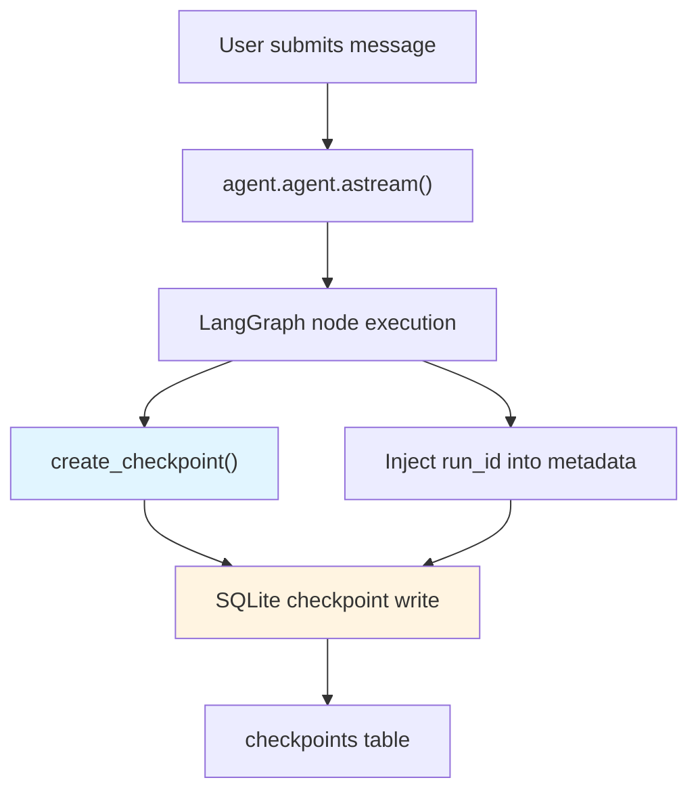
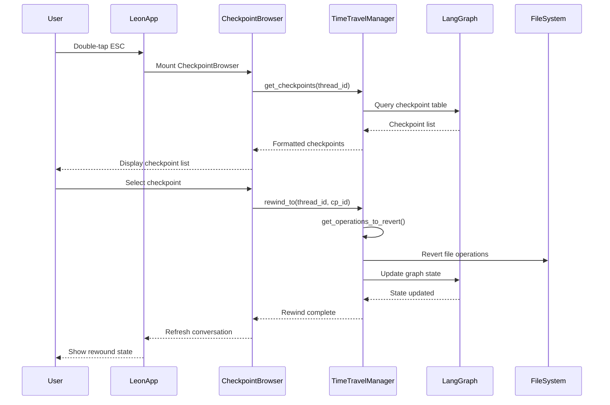
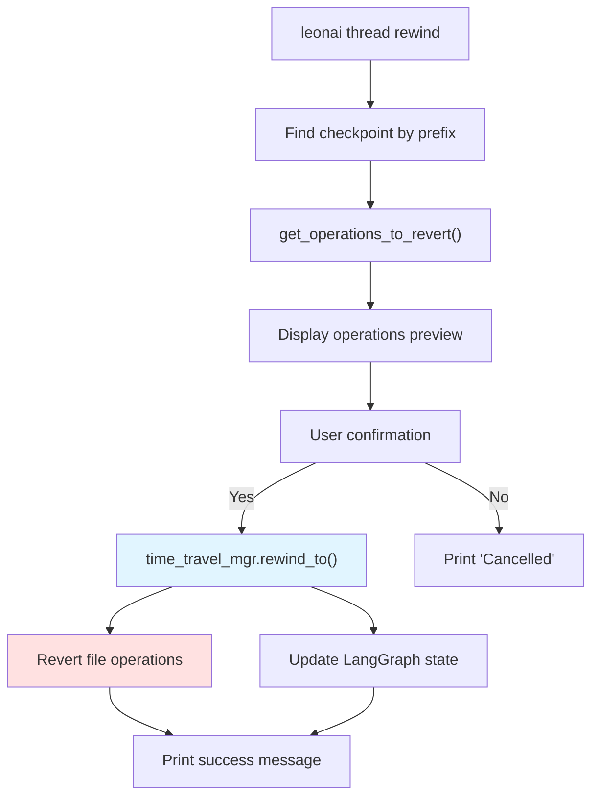
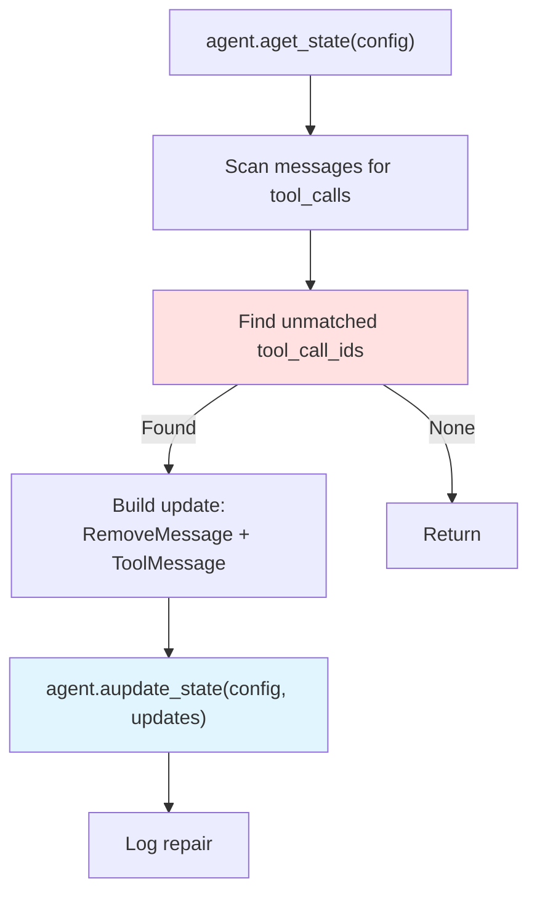

<!-- source: DeepWiki mcp.deepwiki.com · repo OpenDCAI/Mycel · page 10.3 Time Travel and Checkpointing · fetched 2026-11-02 -->

# Time Travel and Checkpointing

<details>
<summary>Relevant source files</summary>

The following files were used as context for generating this wiki page:

- [agent.py](agent.py)
- [backend/web/core/lifespan.py](backend/web/core/lifespan.py)
- [backend/web/models/thread_config.py](backend/web/models/thread_config.py)
- [backend/web/routers/threads.py](backend/web/routers/threads.py)
- [backend/web/services/agent_pool.py](backend/web/services/agent_pool.py)
- [backend/web/services/streaming_service.py](backend/web/services/streaming_service.py)
- [backend/web/utils/helpers.py](backend/web/utils/helpers.py)
- [pyproject.toml](pyproject.toml)
- [tui/app.py](tui/app.py)
- [tui/leon_cli.py](tui/leon_cli.py)
- [tui/runner.py](tui/runner.py)
- [tui/widgets/status.py](tui/widgets/status.py)
- [uv.lock](uv.lock)

</details>


This page explains the time travel and checkpointing system in Mycel, which enables users to inspect conversation history, rewind to previous states, and recover from interrupted operations. This feature leverages LangGraph's persistent checkpoint system combined with Mycel-specific state management for file operations and conversation context.

For information about the agent runtime and message processing, see [Agent Runtime](#5). For details on the TUI interface that provides the time travel UI, see [Terminal UI](#3.2).

---

## Overview and Purpose

The time travel system provides three core capabilities:

1. **Checkpoint History Viewing**: Inspect past conversation states, including user messages, assistant responses, and tool executions
2. **State Rewind**: Roll back conversations to previous checkpoints, reverting both conversation history and filesystem changes
3. **Checkpoint Repair**: Automatically detect and fix incomplete checkpoint states caused by server restarts or interruptions

The system operates at two levels:
- **LangGraph Checkpoints**: Persistent state snapshots of the conversation graph, stored in SQLite via `langgraph-checkpoint-sqlite`
- **File Operation Tracking**: Per-run file operation logs that enable filesystem reversion during rollback

**Sources:** [tui/leon_cli.py:99-202](), [tui/app.py:189-197]()

---

## LangGraph Checkpoint System

### Checkpoint Structure and Storage

LangGraph automatically creates checkpoints after each graph node execution. Each checkpoint captures:

```
checkpoint = {
    "channel_values": {
        "messages": [...],  # Full message history
        "metadata": {...}
    },
    "channel_versions": {...},
    "metadata": {
        "step": N,
        "source": "update"
    }
}
```

Checkpoints are stored in SQLite database (`~/.leon/leon.db`) using the `langgraph-checkpoint-sqlite` backend configured during agent creation. The checkpoint ID format is `{thread_id}-{uuid}`.

**Diagram: Checkpoint Creation Flow**



**Sources:** [backend/web/services/streaming_service.py:350-364](), [pyproject.toml:33]()

### Checkpoint Configuration

Checkpoints are initialized when creating a `LeonAgent` via the `create_leon_agent()` function. The agent's LangGraph instance includes a `checkpointer` that persists to SQLite:

```python
config = {"configurable": {"thread_id": thread_id, "run_id": run_id}}
```

The `thread_id` scopes checkpoints to a conversation thread, while `run_id` tracks individual agent execution runs within that thread.

**Sources:** [backend/web/services/streaming_service.py:383-388](), [agent.py:1-8]()

---

## Time Travel Manager (TUI)

### TimeTravelManager Class

The `TimeTravelManager` class (in `tui/time_travel.py`, referenced but not provided) provides the core time travel API:

| Method | Purpose |
|--------|---------|
| `get_checkpoints(thread_id, user_turns_only)` | Retrieve checkpoint list for a thread |
| `rewind_to(thread_id, checkpoint_id)` | Rewind thread state to target checkpoint |
| `get_operations_to_revert(thread_id, checkpoint_id)` | List file operations that will be undone |

### Checkpoint Browser Widget

The `CheckpointBrowser` widget (TUI) provides interactive checkpoint selection:

- **Activation**: Double-tap ESC key in TUI
- **Display**: Shows checkpoint list with timestamps, user messages, and file operation counts
- **Selection**: Navigate with arrow keys, select with Enter

**Diagram: Time Travel User Flow (TUI)**



**Sources:** [tui/app.py:189-197](), [tui/leon_cli.py:112-143]()

---

## CLI Commands for Time Travel

### Thread History Command

View checkpoint history for a thread:

```bash
leonai thread history <thread_id>
```

Output shows:
- Checkpoint index and ID
- Timestamp (relative: "2 hours ago")
- User message preview
- File operation count

**Sources:** [tui/leon_cli.py:99-143]()

### Thread Rewind Command

Rewind a thread to a specific checkpoint:

```bash
leonai thread rewind <thread_id> <checkpoint_id> [-y]
```

The command:
1. Finds the target checkpoint (supports prefix matching)
2. Calculates operations to revert via `get_operations_to_revert()`
3. Prompts for confirmation (unless `-y` flag provided)
4. Executes rewind via `TimeTravelManager.rewind_to()`

**Diagram: CLI Rewind Flow**



**Sources:** [tui/leon_cli.py:146-202]()

---

## Checkpoint State Management

### Run ID Injection

Each agent run generates a unique `run_id` (UUID) that gets injected into message metadata. This enables:
- Grouping events by run in the event store
- Tracking file operations per run
- Associating tool calls with specific execution runs

The injection happens in two places:

1. **During streaming** ([backend/web/services/streaming_service.py:617-653]()):
   ```python
   if hasattr(msg, "metadata") and isinstance(msg.metadata, dict):
       msg.metadata["run_id"] = run_id
   ```

2. **Post-stream checkpoint patching** ([backend/web/services/streaming_service.py:728-743]()):
   ```python
   # Patch checkpoint to inject run_id into messages
   state = await agent.agent.aget_state(config)
   to_patch = []
   for msg in state.values.get("messages", []):
       if msg.metadata.get("run_id") is None:
           msg.metadata["run_id"] = run_id
           to_patch.append(msg)
   if to_patch:
       await agent.agent.aupdate_state(config, {"messages": to_patch})
   ```

The post-stream patch ensures `run_id` persistence in the checkpoint, as in-stream mutations only affect Python objects, not the serialized checkpoint.

**Sources:** [backend/web/services/streaming_service.py:617-653](), [backend/web/services/streaming_service.py:728-743]()

### Checkpoint Context Variables

The sandbox system uses context variables to track the current thread and run:

```python
from sandbox.thread_context import set_current_thread_id, set_current_run_id

set_current_thread_id(thread_id)
set_current_run_id(checkpoint_id)
```

These context variables enable:
- File operation recording to associate operations with specific runs
- Sandbox session lookup by thread
- Per-thread resource isolation

**Sources:** [backend/web/services/streaming_service.py:386-388](), [tui/app.py:353-363]()

---

## File Operation Recording and Reversion

### Operation Recording

File operations (read, write, edit, delete) are recorded per-run through the `FileOperationRecorder` (in `core/operations`, not provided). Each operation stores:

- Operation type (`read`, `write`, `edit`, `delete`)
- File path
- Run ID
- Timestamp
- Optional: file content snapshot (for reversion)

### Reversion During Rollback

When rewinding to a checkpoint, `TimeTravelManager.rewind_to()`:

1. Queries all file operations after the target checkpoint
2. Reverses operations in chronological order:
   - `write` → delete file
   - `edit` → restore previous content
   - `delete` → restore from snapshot
   - `read` → no-op
3. Reports success/failure for each operation

**Example output:**
```
将撤销 5 个文件操作:
  - write: /workspace/new_file.py
  - edit: /workspace/existing.py
  - delete: /workspace/old_file.py
  ... 还有 2 个操作
```

**Sources:** [tui/leon_cli.py:177-185]()

---

## Checkpoint Repair and Recovery

### Incomplete Tool Call Detection

The `_repair_incomplete_tool_calls()` function detects broken checkpoint state caused by server restarts or timeouts. It identifies `AIMessage` instances with `tool_calls` that lack corresponding `ToolMessage` responses.

**Diagram: Checkpoint Repair Process**



**Algorithm** ([backend/web/services/streaming_service.py:127-223]()):

1. **Collect pending tool calls**: Scan `AIMessage` objects, extract all `tool_call.id`
2. **Collect answered tool calls**: Scan `ToolMessage` objects, extract all `tool_call_id`
3. **Compute unmatched**: `unmatched = pending - answered`
4. **Strategy**: Remove messages after the broken `AIMessage`, insert synthetic `ToolMessage` errors, re-add remaining messages

```python
# Synthetic error message for interrupted tool calls
ToolMessage(
    content="Error: task was interrupted (server restart or timeout). Results unavailable.",
    tool_call_id=tc_id,
    name=tool_name,
)
```

**Sources:** [backend/web/services/streaming_service.py:127-223]()

### Cancellation Markers

When a user cancels an active run, `write_cancellation_markers()` updates the checkpoint to mark pending tool calls as cancelled:

**Process** ([backend/web/services/streaming_service.py:55-124]()):

1. Retrieve current checkpoint via `checkpointer.aget_tuple(config)`
2. Create `ToolMessage` instances with cancellation content for each pending tool call
3. Append cancellation messages to `checkpoint["channel_values"]["messages"]`
4. Increment channel versions
5. Write updated checkpoint via `checkpointer.aput()`

```python
ToolMessage(
    content="任务被用户取消",
    tool_call_id=tc_id,
    name=tc_info["name"],
)
```

This prevents LangGraph from rejecting the checkpoint due to unanswered tool calls.

**Sources:** [backend/web/services/streaming_service.py:55-124]()

---

## Integration with Web Backend

### Thread Deletion and Checkpoint Cleanup

When deleting a thread via `DELETE /api/threads/{thread_id}`, the system must clean up checkpoints along with other thread resources. The `delete_thread_in_db()` helper purges:

1. **Storage-managed repos**: Event store, thread config, file operations (via `StorageContainer.purge_thread()`)
2. **Sandbox tables**: Terminals, leases, sessions (manual deletion from `sandbox.db`)

LangGraph checkpoints are stored in the main SQLite database and are purged via the storage container.

**Sources:** [backend/web/utils/helpers.py:196-212](), [backend/web/routers/threads.py:122-156]()

### Checkpoint Access via API

While the Web UI does not currently expose time travel features, checkpoint state is accessible via:

```python
config = {"configurable": {"thread_id": thread_id}}
state = await agent.agent.aget_state(config)
messages = state.values.get("messages", [])
```

This enables future API endpoints for checkpoint history viewing or programmatic rewind operations.

**Sources:** [backend/web/routers/threads.py:98-119]()

---

## Summary Table: Time Travel Components

| Component | Location | Purpose |
|-----------|----------|---------|
| `TimeTravelManager` | `tui/time_travel.py` | Core checkpoint query and rewind logic |
| `CheckpointBrowser` | `tui/widgets/checkpoint_browser.py` | TUI widget for interactive checkpoint selection |
| `_repair_incomplete_tool_calls()` | `backend/web/services/streaming_service.py:127-223` | Detect and fix incomplete checkpoint state |
| `write_cancellation_markers()` | `backend/web/services/streaming_service.py:55-124` | Mark cancelled tool calls in checkpoints |
| `get_checkpoints()` | `tui/time_travel.py` | Query checkpoint list from SQLite |
| `rewind_to()` | `tui/time_travel.py` | Execute rewind: revert files + update state |
| `cmd_thread_history()` | `tui/leon_cli.py:99-143` | CLI command to view checkpoints |
| `cmd_thread_rewind()` | `tui/leon_cli.py:146-202` | CLI command to rewind thread |
| `agent.aget_state()` | LangGraph API | Retrieve current checkpoint state |
| `agent.aupdate_state()` | LangGraph API | Modify checkpoint (add/remove messages) |

**Sources:** [tui/leon_cli.py:99-202](), [backend/web/services/streaming_service.py:55-223]()

---

