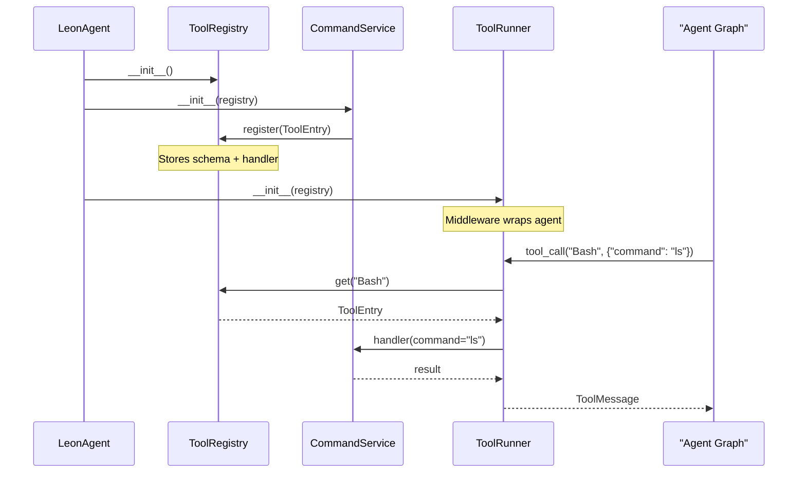
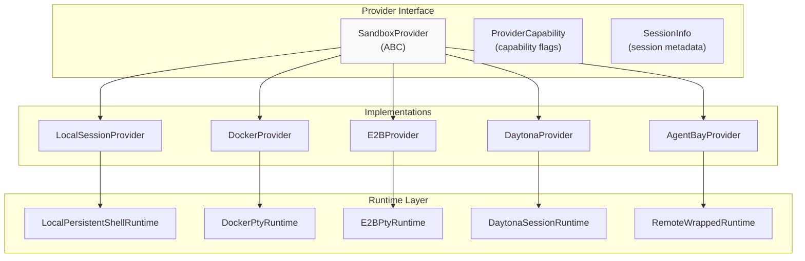
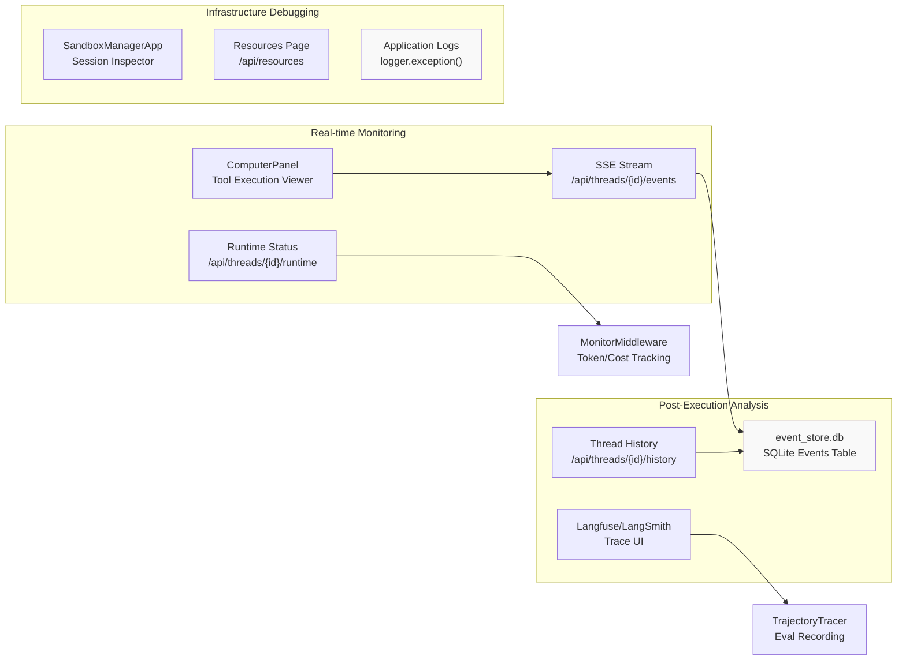
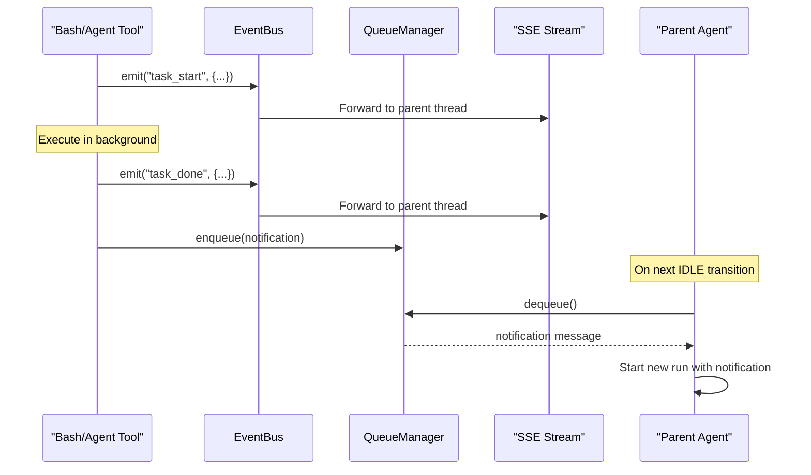

<!-- source: DeepWiki mcp.deepwiki.com · repo OpenDCAI/Mycel · page 10.5 Development and Debugging · fetched 2026-11-02 -->

# Development and Debugging

<details>
<summary>Relevant source files</summary>

The following files were used as context for generating this wiki page:

- [backend/taskboard/middleware.py](backend/taskboard/middleware.py)
- [backend/taskboard/service.py](backend/taskboard/service.py)
- [backend/web/core/lifespan.py](backend/web/core/lifespan.py)
- [backend/web/models/thread_config.py](backend/web/models/thread_config.py)
- [backend/web/routers/threads.py](backend/web/routers/threads.py)
- [backend/web/services/agent_pool.py](backend/web/services/agent_pool.py)
- [backend/web/services/member_service.py](backend/web/services/member_service.py)
- [backend/web/services/streaming_service.py](backend/web/services/streaming_service.py)
- [backend/web/utils/helpers.py](backend/web/utils/helpers.py)
- [config/defaults/tool_catalog.py](config/defaults/tool_catalog.py)
- [core/agents/communication/service.py](core/agents/communication/service.py)
- [core/agents/service.py](core/agents/service.py)
- [core/runtime/agent.py](core/runtime/agent.py)
- [core/runtime/registry.py](core/runtime/registry.py)
- [core/tools/command/service.py](core/tools/command/service.py)
- [sandbox/capability.py](sandbox/capability.py)
- [sandbox/provider.py](sandbox/provider.py)
- [sandbox/providers/__init__.py](sandbox/providers/__init__.py)
- [sandbox/providers/agentbay.py](sandbox/providers/agentbay.py)
- [sandbox/providers/daytona.py](sandbox/providers/daytona.py)
- [sandbox/providers/docker.py](sandbox/providers/docker.py)
- [sandbox/providers/e2b.py](sandbox/providers/e2b.py)
- [sandbox/providers/local.py](sandbox/providers/local.py)

</details>


This document provides a guide for developers working on the Mycel codebase. It covers project structure, how to add new tools and sandbox providers, debugging techniques, and testing strategies. For operational monitoring and resource tracking, see [Resource Monitoring](#10.2). For configuration details, see [Configuration and Settings](#9).

---

## Project Structure

The Mycel codebase follows a multi-layered architecture with clear separation of concerns:

**Directory Layout**

```mermaid
graph TB
    root["mycel/"]
    
    backend["backend/<br/>FastAPI Server"]
    core["core/<br/>Agent Runtime"]
    sandbox["sandbox/<br/>Execution Environments"]
    config["config/<br/>Configuration System"]
    storage["storage/<br/>Persistence Layer"]
    tui["tui/<br/>Terminal UI"]
    frontend["frontend/<br/>React Web UI"]
    
    root --> backend
    root --> core
    root --> sandbox
    root --> config
    root --> storage
    root --> tui
    root --> frontend
    
    backend --> web["web/<br/>Routers + Services"]
    backend --> taskboard["taskboard/<br/>Task Management"]
    
    core --> agents["agents/<br/>Multi-agent System"]
    core --> runtime["runtime/<br/>Agent Engine"]
    core --> tools["tools/<br/>Tool Services"]
    
    sandbox --> providers["providers/<br/>Local/Docker/E2B/etc"]
    sandbox --> manager_mod["manager.py<br/>Session Orchestration"]
    
    config --> defaults["defaults/<br/>Built-in Configs"]
    config --> loader_mod["loader.py<br/>Config Resolution"]
    
    storage --> contracts["contracts/<br/>Repository Interfaces"]
    storage --> providers_storage["providers/<br/>SQLite/Supabase"]
```



**Key Modules by Layer**

| Layer | Key Files | Purpose |
|-------|-----------|---------|
| **Backend** | [backend/web/routers/threads.py]() | HTTP endpoints for thread operations |
| | [backend/web/services/streaming_service.py]() | SSE event streaming & agent execution |
| | [backend/web/services/agent_pool.py]() | Per-thread agent management |
| **Runtime** | [core/runtime/agent.py]() | `LeonAgent` class & initialization |
| | [core/runtime/runner.py]() | Tool execution dispatcher |
| | [core/runtime/registry.py]() | Tool catalog |
| **Middleware** | [core/runtime/middleware/monitor.py]() | Token tracking & cost calculation |
| | [core/runtime/middleware/queue.py]() | Message queue & steering |
| **Tools** | [core/tools/command/service.py]() | `CommandService` - Bash tool |
| | [core/agents/service.py]() | `AgentService` - Sub-agent spawning |
| **Sandbox** | [sandbox/manager.py]() | `SandboxManager` - session lifecycle |
| | [sandbox/providers/e2b.py](), [sandbox/providers/daytona.py]() | Provider implementations |

Sources: [core/runtime/agent.py:1-600](), [backend/web/routers/threads.py:1-50](), [sandbox/manager.py:1-100]()

---

## Adding New Tools

Tools are registered via service classes that interact with `ToolRegistry`. Each tool follows the registry pattern introduced in the new architecture.

**Tool Registration Flow**



**Step-by-Step: Adding a New Tool**

1. **Create a Service Class**

   Create a new file in `core/tools/<category>/service.py`:

   ```python
   from core.runtime.registry import ToolEntry, ToolMode, ToolRegistry
   
   class MyToolService:
       def __init__(self, registry: ToolRegistry):
           self._register(registry)
       
       def _register(self, registry: ToolRegistry):
           registry.register(ToolEntry(
               name="MyTool",
               mode=ToolMode.INLINE,
               schema={
                   "name": "MyTool",
                   "description": "What this tool does",
                   "parameters": {
                       "type": "object",
                       "properties": {
                           "param1": {
                               "type": "string",
                               "description": "Parameter description"
                           }
                       },
                       "required": ["param1"]
                   }
               },
               handler=self._handle_mytool,
               source="MyToolService"
           ))
       
       async def _handle_mytool(self, param1: str) -> str:
           # Implementation here
           return f"Result: {param1}"
   ```

2. **Register in `LeonAgent._init_services()`**

   Add your service to [core/runtime/agent.py:220-250]():

   ```python
   def _init_services(self):
       # ... existing services ...
       from core.tools.mytool.service import MyToolService
       MyToolService(self._tool_registry)
   ```

3. **Add to Tool Catalog**

   Register in [config/defaults/tool_catalog.py:48-85]():

   ```python
   ToolDef(name="MyTool", desc="Tool description", group=ToolGroup.SYSTEM)
   ```

4. **Test the Tool**

   Tools are automatically available to agents once registered:

   ```bash
   leonai chat "Use MyTool to process 'test data'"
   ```

**Tool Modes**

- `ToolMode.INLINE`: Injected into every model call (most tools)
- `ToolMode.DEFERRED`: Only available via `tool_search` (rarely-used tools like TaskBoard)

Sources: [core/tools/command/service.py:1-97](), [core/runtime/registry.py:1-80](), [core/runtime/agent.py:220-250]()

---

## Implementing New Sandbox Providers

Sandbox providers implement the `SandboxProvider` interface and create provider-specific runtimes for command execution.

**Provider Architecture**



**Required Interface Methods**

| Method | Purpose | Example |
|--------|---------|---------|
| `get_capability()` | Declare provider features | Pause/resume support, metrics |
| `create_session(context_id)` | Provision new instance | Create container/VM |
| `destroy_session(session_id)` | Clean up instance | Remove container |
| `pause_session(session_id)` | Suspend instance | Stop container |
| `resume_session(session_id)` | Reactivate instance | Start container |
| `get_session_status(session_id)` | Check instance state | `"running"`, `"paused"`, `"deleted"` |
| `execute(session_id, command)` | Run one-shot command | For probing/setup |
| `read_file(session_id, path)` | Read file content | For FileSystemService |
| `write_file(session_id, path, content)` | Write file content | For FileSystemService |
| `list_dir(session_id, path)` | List directory entries | For FileSystemService |
| `get_metrics(session_id)` | Fetch resource usage | CPU/memory/disk stats |
| `create_runtime(terminal, lease)` | Instantiate runtime | Provider-specific PTY handler |

**Implementation Example: Docker Provider**

Key design patterns from [sandbox/providers/docker.py:42-450]():

1. **Session Management**

   ```python
   def create_session(self, context_id: str | None = None) -> SessionInfo:
       session_id = f"leon-{uuid.uuid4().hex[:12]}"
       # Create container with volume if context_id provided
       cmd = ["docker", "run", "-d", "--name", session_id]
       if context_id:
           cmd.extend(["-v", f"{context_id}:{self.mount_path}"])
       cmd.extend([self.image, "sleep", "infinity"])
       container_id = self._run(cmd).stdout.strip()
       self._sessions[session_id] = container_id
       return SessionInfo(session_id=session_id, provider="docker", status="running")
   ```

2. **Runtime Creation**

   ```python
   def create_runtime(self, terminal, lease) -> PhysicalTerminalRuntime:
       return DockerPtyRuntime(terminal, lease, self)
   ```

3. **Metrics via Shell Commands**

   For providers without native metrics APIs, use [sandbox/provider.py:165-227]():

   ```python
   def get_metrics(self, session_id: str) -> Metrics | None:
       return self.get_metrics_via_commands(session_id)
   ```

**Provider-Specific Runtime**

Runtimes handle PTY-based command execution. Example from [sandbox/providers/docker.py:429-680]():

```python
class DockerPtyRuntime(_RemoteRuntimeBase):
    async def execute(self, command: str, timeout: float | None = None) -> ExecuteResult:
        async with self._session_lock:
            # Ensure PTY session exists
            pty_session = await self._ensure_pty_session()
            # Run command with marker-based termination detection
            result = await asyncio.to_thread(
                self._run_pty_command_sync, pty_session, command, timeout
            )
            # Update terminal state snapshot
            await self._sync_terminal_state()
            return result
```

**Testing a New Provider**

1. Create `sandbox/providers/myprovider.py` implementing `SandboxProvider`
2. Add catalog entry: `CATALOG_ENTRY = {"vendor": "...", "description": "...", "provider_type": "cloud"}`
3. Register in `sandbox/config.py` provider resolution logic
4. Test with: `leonai chat --sandbox myprovider "ls"`

Sources: [sandbox/provider.py:104-164](), [sandbox/providers/docker.py:42-450](), [sandbox/providers/e2b.py:35-274](), [sandbox/providers/daytona.py:32-612]()

---

## Debugging Agent Runs

Mycel provides multiple debugging facilities for inspecting agent behavior and troubleshooting issues.

**Debugging Flow**



### Thread History API

Use `/api/threads/{thread_id}/history` for compact conversation debugging without LangChain noise.

**Example Request**

```bash
curl "http://localhost:8000/api/threads/{thread_id}/history?limit=50&truncate=500"
```

**Response Format** (from [backend/web/routers/threads.py:215-285]()):

```json
{
  "thread_id": "abc123",
  "total": 150,
  "showing": 50,
  "messages": [
    {"role": "human", "text": "List files in /workspace"},
    {"role": "tool_call", "tool": "Bash", "args": "{\"command\": \"ls\"}"},
    {"role": "tool_result", "tool": "Bash", "text": "file1.txt\nfile2.py"},
    {"role": "assistant", "text": "Found 2 files: file1.txt and file2.py"}
  ]
}
```

### Event Store Inspection

All SSE events are persisted to `~/.leon/event_store.db` for replay and debugging.

**Schema** (from [backend/web/services/event_store.py:35-60]()):

```sql
CREATE TABLE IF NOT EXISTS run_events (
    id INTEGER PRIMARY KEY AUTOINCREMENT,
    thread_id TEXT NOT NULL,
    run_id TEXT NOT NULL,
    seq INTEGER NOT NULL,
    event TEXT NOT NULL,
    data TEXT,
    message_id TEXT,
    timestamp REAL NOT NULL,
    UNIQUE(thread_id, run_id, seq)
);
```

**Query Recent Events**

```bash
sqlite3 ~/.leon/event_store.db "
  SELECT event, json_extract(data, '$.content') as content
  FROM run_events
  WHERE thread_id = 'your-thread-id'
  ORDER BY seq DESC
  LIMIT 20;
"
```

### Runtime Status Monitoring

Monitor agent state and token usage via [backend/web/routers/threads.py:288-330]():

**Compact Status** (for UI polling):

```bash
curl http://localhost:8000/api/threads/{thread_id}/runtime
```

```json
{
  "state": {"state": "active", "flags": {}},
  "model": "gpt-4",
  "tokens": 15234,
  "cost": 0.45,
  "calls": 12,
  "ctx_percent": 68.5,
  "last_seq": 142
}
```

**Verbose Status** (for debugging):

```bash
curl "http://localhost:8000/api/threads/{thread_id}/runtime?stream=true"
```

Includes cache tokens, context breakdown, error details.

### Observation Providers

Enable LLM tracing via Langfuse or LangSmith for comprehensive debugging.

**Configuration** (see [Configuration and Settings](#9.3)):

```json
{
  "observation": {
    "active": "langfuse",
    "langfuse": {
      "public_key": "pk-...",
      "secret_key": "sk-...",
      "host": "https://cloud.langfuse.com"
    }
  }
}
```

**Integration Points** (from [backend/web/services/streaming_service.py:410-461]()):

- Reads per-thread `observation_provider` from thread config
- Initializes callback handler during agent run
- Sets `session_id` metadata to `thread_id` for filtering
- Flushes traces on run completion

### Sandbox Session Debugging

Use the Sandbox Manager TUI to inspect active sessions, terminals, and leases:

```bash
python -m sandbox.tui_manager
```

**Key Views**:
- Active sessions by provider
- Terminal state (cwd, env_delta)
- Lease status and instance binding
- Command history per terminal

Sources: [backend/web/routers/threads.py:215-330](), [backend/web/services/event_store.py:1-150](), [backend/web/services/streaming_service.py:410-461]()

---

## Common Development Patterns

### Hot-Reloading Model Config

Agents support runtime model switching without restart via [backend/web/services/agent_pool.py:114-179]():

```bash
# Update all agents
curl -X PUT http://localhost:8000/api/settings/model \
  -H "Content-Type: application/json" \
  -d '{"model": "gpt-4"}'

# Update specific thread
curl -X PUT http://localhost:8000/api/settings/model \
  -H "Content-Type: application/json" \
  -d '{"model": "gpt-4", "thread_id": "abc123"}'
```

**Implementation**: Uses `agent.update_config(model=model)` which rebuilds the LLM instance while preserving middleware state.

### Adding Middleware

Middleware wraps the agent graph bidirectionally (before/after model calls). To add new middleware:

1. Create class in `core/runtime/middleware/<name>.py` implementing `AgentMiddleware`
2. Add to middleware stack in [core/runtime/agent.py:228-245]():

   ```python
   def _build_middleware_stack(self) -> list:
       middleware = [
           SpillBufferMiddleware(),
           MonitorMiddleware(...),
           PromptCachingMiddleware(),
           MemoryMiddleware(),
           SteeringMiddleware(...),
           ToolRunner(self._tool_registry),  # Must be innermost
       ]
       return middleware
   ```

**Order matters**: Outer middleware sees requests first, responses last. `ToolRunner` must be innermost to intercept tool calls.

### Background Task Notifications

Background tasks (bash commands, sub-agents) emit lifecycle events and queue notifications.

**Event Flow** (from [core/tools/command/service.py:158-225](), [core/agents/service.py:282-370]()):



**Notification Format** (XML for reliable parsing):

```xml
<CommandNotification task_id="abc123" status="completed">
  <Status>completed</Status>
  <Description>Build project</Description>
  <CommandLine>make build</CommandLine>
</CommandNotification>
```

Sources: [core/tools/command/service.py:158-225](), [core/agents/service.py:254-393](), [backend/web/event_bus.py:1-100]()

---

## Testing Strategies

### Unit Testing Tools

Test tool handlers in isolation by mocking dependencies:

```python
import pytest
from core.runtime.registry import ToolRegistry
from core.tools.command.service import CommandService

@pytest.mark.asyncio
async def test_bash_tool():
    registry = ToolRegistry()
    service = CommandService(registry, workspace_root="/tmp")
    
    # Tool registered successfully
    entry = registry.get("Bash")
    assert entry is not None
    
    # Handler works
    result = await entry.handler(command="echo hello")
    assert "hello" in result
```

### Integration Testing Providers

Test provider lifecycle with real instances:

```python
import pytest
from sandbox.providers.docker import DockerProvider

@pytest.mark.integration
def test_docker_provider_lifecycle():
    provider = DockerProvider(image="ubuntu:latest")
    
    # Create session
    info = provider.create_session()
    assert info.status == "running"
    
    # Execute command
    result = provider.execute(info.session_id, "echo test")
    assert result.exit_code == 0
    assert "test" in result.output
    
    # Pause/resume
    assert provider.pause_session(info.session_id)
    assert provider.get_session_status(info.session_id) == "paused"
    assert provider.resume_session(info.session_id)
    
    # Cleanup
    provider.destroy_session(info.session_id)
```

### Testing Streaming Events

Verify SSE event emission using the event buffer:

```python
import asyncio
from backend.web.services.event_buffer import ThreadEventBuffer

@pytest.mark.asyncio
async def test_event_streaming():
    buffer = ThreadEventBuffer()
    
    # Producer
    await buffer.put({"event": "text", "data": '{"content": "hello"}'})
    
    # Consumer
    events = []
    async for event in buffer.observe(after=0):
        events.append(event)
        if len(events) >= 1:
            break
    
    assert events[0]["event"] == "text"
    assert "hello" in events[0]["data"]
```

### Provider Metrics Testing

Validate metrics implementation across providers:

```python
@pytest.mark.parametrize("provider_type", ["docker", "e2b", "agentbay"])
def test_metrics_availability(provider_type, provider_instance):
    session = provider_instance.create_session()
    metrics = provider_instance.get_metrics(session.session_id)
    
    # All providers should return basic metrics
    assert metrics is not None
    assert metrics.cpu_percent is not None or metrics.memory_used_mb is not None
    
    provider_instance.destroy_session(session.session_id)
```

Sources: [core/tools/command/service.py:32-140](), [sandbox/providers/docker.py:42-450](), [backend/web/services/event_buffer.py:1-150]()

---

## Debugging Checklist

When investigating issues, follow this systematic approach:

**Agent Not Responding**
- [ ] Check runtime state: `GET /api/threads/{id}/runtime`
- [ ] Verify no pending queue items blocking: `GET /api/threads/{id}/queue`
- [ ] Review last 20 SSE events from event store
- [ ] Check agent pool for thread: `app.state.agent_pool` contains `{thread_id}:{sandbox}`

**Tool Execution Failing**
- [ ] Verify tool is registered: Check `ToolRegistry.list_all()`
- [ ] Check tool not blocked: Inspect member's `runtime.json` for `tools:{name}.enabled=false`
- [ ] Review command hooks: Dangerous command filter may be rejecting
- [ ] Sandbox session active: `GET /api/threads/{id}/terminal` returns valid state

**Sandbox Session Issues**
- [ ] Verify provider status: `GET /api/resources` shows provider reachable
- [ ] Check lease binding: Terminal has valid `lease_id`, lease has `instance_id`
- [ ] Inspect terminal state: `cwd` and `env_delta` valid (absolute path, no prompt noise)
- [ ] Review runtime error recovery: Look for "infra error" retries in logs

**SSE Stream Disconnects**
- [ ] Check `Last-Event-ID` header on reconnect for resume
- [ ] Verify `ThreadEventBuffer` not garbage collected (persists in `app.state`)
- [ ] Review proxy buffering: `X-Accel-Buffering: no` set in response
- [ ] Inspect event store for sequence gaps

**High Token Usage**
- [ ] Enable compact runtime view: Check `ctx_percent` approaching 100
- [ ] Review memory middleware: Large conversation history not pruned
- [ ] Inspect prompt caching: Anthropic caching headers present in requests
- [ ] Check spill buffer: Large tool outputs moved to separate messages

Sources: [backend/web/routers/threads.py:1-654](), [core/runtime/registry.py:28-80](), [sandbox/manager.py:1-500]()