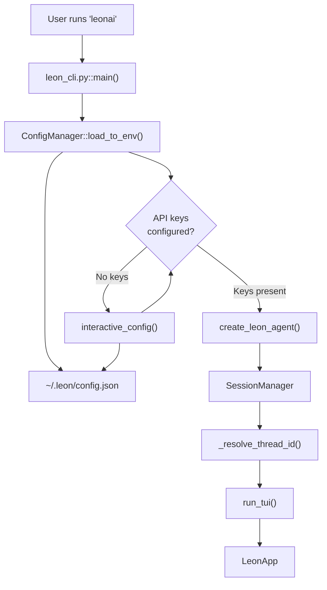
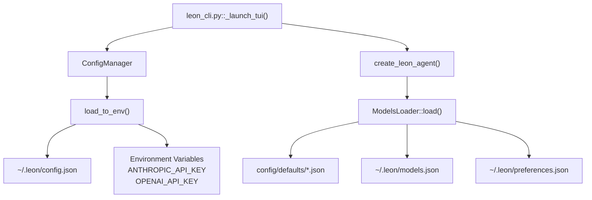
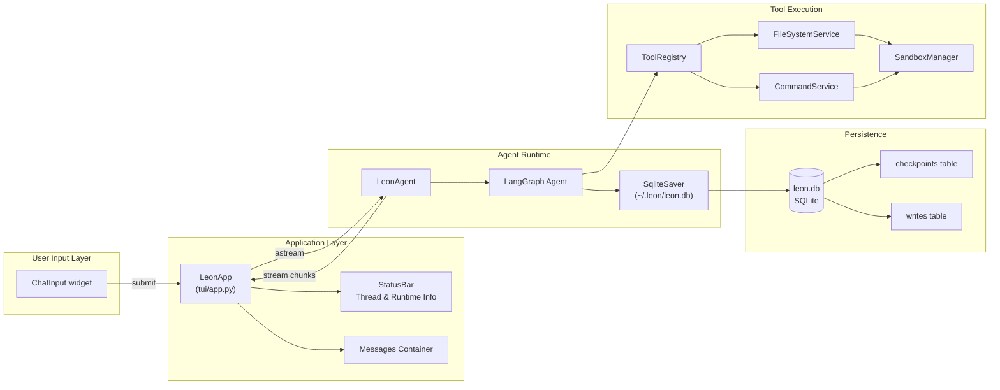
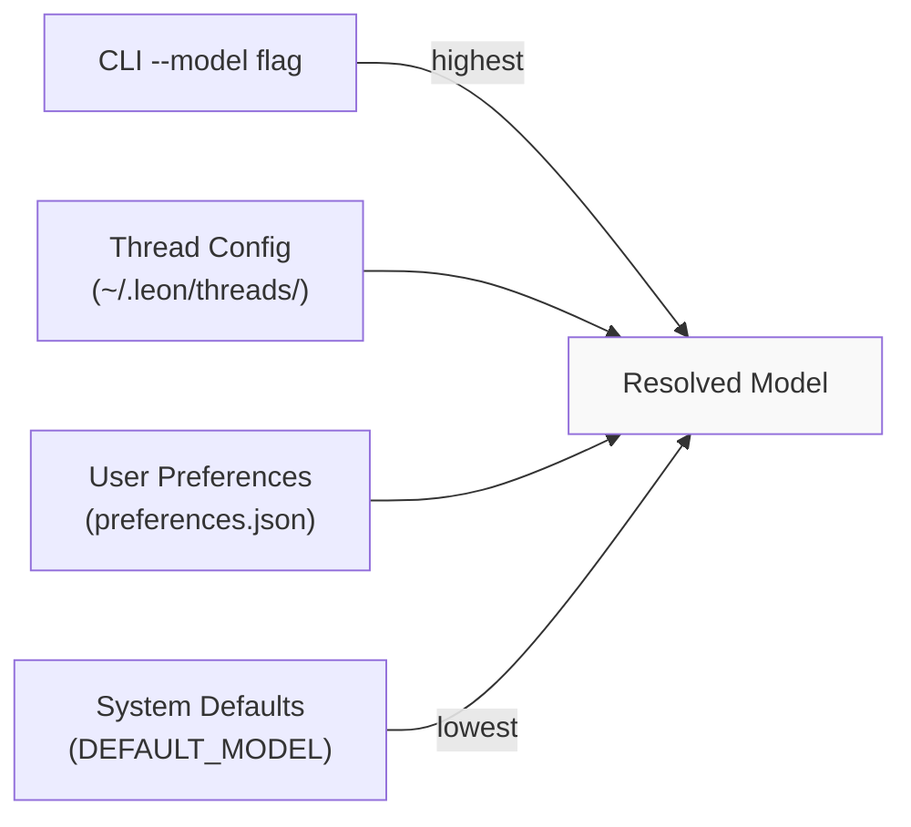

<!-- source: DeepWiki mcp.deepwiki.com · repo OpenDCAI/Mycel · page 2 Getting Started · fetched 2026-11-02 -->

# Getting Started

<details>
<summary>Relevant source files</summary>

The following files were used as context for generating this wiki page:

- [agent.py](agent.py)
- [backend/web/routers/settings.py](backend/web/routers/settings.py)
- [config/models_schema.py](config/models_schema.py)
- [core/runtime/middleware/monitor/cost.py](core/runtime/middleware/monitor/cost.py)
- [core/runtime/middleware/monitor/models.json](core/runtime/middleware/monitor/models.json)
- [frontend/app/index.html](frontend/app/index.html)
- [frontend/app/public/favicon.svg](frontend/app/public/favicon.svg)
- [frontend/app/src/components/ModelMappingSection.tsx](frontend/app/src/components/ModelMappingSection.tsx)
- [frontend/app/src/components/ModelPoolSection.tsx](frontend/app/src/components/ModelPoolSection.tsx)
- [frontend/app/src/components/ObservationSection.tsx](frontend/app/src/components/ObservationSection.tsx)
- [frontend/app/src/components/ProvidersSection.tsx](frontend/app/src/components/ProvidersSection.tsx)
- [frontend/app/src/components/SandboxSection.tsx](frontend/app/src/components/SandboxSection.tsx)
- [frontend/app/src/pages/SettingsPage.tsx](frontend/app/src/pages/SettingsPage.tsx)
- [pyproject.toml](pyproject.toml)
- [tests/test_model_config_enrichment.py](tests/test_model_config_enrichment.py)
- [tui/app.py](tui/app.py)
- [tui/leon_cli.py](tui/leon_cli.py)
- [tui/runner.py](tui/runner.py)
- [tui/widgets/status.py](tui/widgets/status.py)
- [uv.lock](uv.lock)

</details>


This guide covers installing Mycel, configuring it for first use, and running your first chat session. For detailed information about specific interfaces, see [User Interfaces](#3). For configuration options beyond initial setup, see [Configuration and Settings](#9).

## Prerequisites

**System Requirements:**
- Python 3.12 or higher (3.13+ also supported)
- Operating System: Linux, macOS, or Windows
- Internet connection for API access

**Required Credentials:**
At minimum, you need an API key from one of these providers:
- Anthropic (Claude models)
- OpenAI (GPT models)
- OpenRouter (access to multiple providers)

Sources: [pyproject.toml:10](), [pyproject.toml:29-44]()

## Installation

### From PyPI (Recommended)

```bash
# Basic installation
pip install leonai

# With all optional dependencies
pip install "leonai[all]"

# With specific features
pip install "leonai[sandbox]"  # AgentBay support
pip install "leonai[e2b]"       # E2B sandbox support
pip install "leonai[langfuse]"  # Langfuse tracing
```

### From Source

```bash
git clone https://github.com/OpenDCAI/Mycel.git
cd Mycel
pip install -e .
```

The installation registers the `leonai` CLI command, which serves as the main entry point for all interfaces.

Sources: [pyproject.toml:6](), [pyproject.toml:46-58](), [pyproject.toml:59-60]()

## System Initialization Flow



**Initialization Components:**

| Component | File Location | Purpose |
|-----------|--------------|---------|
| `main()` | [tui/leon_cli.py:572-612]() | CLI entry point, command routing |
| `ConfigManager` | [tui/config.py]() | Load/save API keys and preferences |
| `SessionManager` | [tui/session.py]() | Track conversation threads |
| `create_leon_agent()` | [agent.py:2-5]() | Initialize agent runtime |
| `LeonApp` | [tui/app.py:62-115]() | Main TUI application class |

Sources: [tui/leon_cli.py:572-761](), [agent.py:1-7](), [tui/app.py:62-176]()

## Initial Configuration

### Interactive Configuration Wizard

On first run without API keys, Leon automatically launches the configuration wizard:

```bash
leonai config
```

The wizard prompts for:
1. **Primary API Provider** - Choose Anthropic, OpenAI, or OpenRouter
2. **API Key** - Enter your credentials
3. **Default Model** (optional) - Select from `leon:mini`, `leon:medium`, `leon:large`, `leon:max`

Configuration is saved to `~/.leon/config.json` and automatically loaded on subsequent runs.

### Manual Configuration

You can also set API keys via environment variables:

```bash
# Anthropic
export ANTHROPIC_API_KEY="sk-ant-..."

# OpenAI
export OPENAI_API_KEY="sk-..."

# OpenRouter
export OPENROUTER_API_KEY="sk-or-..."
```

### Configuration File Structure

```
~/.leon/
├── config.json          # API keys (from ConfigManager)
├── preferences.json     # User preferences (workspace, default model)
├── models.json          # Model configuration (mapping, pool)
├── observation.json     # Tracing configuration (Langfuse/LangSmith)
└── sandboxes/          # Sandbox provider configs
    ├── agentbay.json
    ├── docker.json
    └── e2b.json
```

Sources: [tui/leon_cli.py:709-719](), [backend/web/routers/settings.py:19-20](), [backend/web/routers/settings.py:547-548]()

## Configuration Loading Flow



**Configuration Merge Priority:** System defaults → User config (`~/.leon/`) → Environment variables → CLI arguments

Sources: [tui/leon_cli.py:707-719](), [config/models_schema.py:81-93](), [backend/web/routers/settings.py:84-86]()

## Running Your First Session

### Launch the TUI (Default)

The simplest way to start:

```bash
leonai
```

This launches the Textual-based terminal UI with:
- Full-screen chat interface
- Real-time streaming responses
- Tool execution visualization
- Command palette for advanced features

### Command-Line Options

```bash
# Continue last conversation
leonai -c

# Use specific model
leonai --model leon:large

# Use specific agent preset
leonai --agent coder

# Set workspace directory
leonai --workspace ~/projects/myapp

# Resume specific thread
leonai --thread tui-abc12345
```

### Non-Interactive Mode

For scripting and automation:

```bash
# Single message
leonai run "Explain what this project does"

# Read from stdin (messages separated by blank lines)
echo -e "First message\n\nSecond message" | leonai run --stdin

# Interactive mode (simple readline, no TUI)
leonai run -i

# With debug output
leonai run -d "What files are in the current directory?"
```

Sources: [tui/leon_cli.py:614-650](), [tui/leon_cli.py:707-761](), [tui/runner.py:21-343]()

## First Session Components



**Key Components:**

| Component | Type | Location | Purpose |
|-----------|------|----------|---------|
| `LeonApp` | Textual App | [tui/app.py:62]() | Main TUI container |
| `ChatInput` | Widget | [tui/widgets/chat_input.py]() | Message input field |
| `LeonAgent` | Runtime | [core/runtime/agent.py]() | Agent orchestration |
| `SqliteSaver` | Checkpointer | External (langgraph) | Conversation persistence |
| `ToolRegistry` | Service | [core/tools/registry.py]() | Tool management |
| `SandboxManager` | Service | [sandbox/manager.py]() | Execution environment |

Sources: [tui/app.py:62-176](), [tui/app.py:298-527](), [core/runtime/agent.py]()

## Understanding Your First Interaction

### Message Flow

When you type a message and press Enter:

1. **User Input** → `ChatInput.on_submit()` emits `ChatInput.Submitted` event
2. **Event Handler** → `LeonApp.on_chat_input_submitted()` receives event
3. **User Message Rendering** → Immediately mount `UserMessage` widget (visible before agent starts)
4. **Agent Execution** → Start async worker calling `agent.astream()`
5. **Streaming Updates** → Process chunks: text content, tool calls, tool results
6. **Real-time Display** → Update `AssistantMessage`, `ToolCallMessage`, `ToolResultMessage` widgets
7. **State Transition** → AgentState: IDLE → ACTIVE → IDLE

### Thread Management

Each conversation is identified by a `thread_id`:
- **Format**: `"tui-{8-char-hex}"` (TUI) or `"chat-{8-char-hex}"` (Web)
- **Persistence**: Stored in SQLite checkpointer at `~/.leon/leon.db`
- **Session Tracking**: `SessionManager` maintains thread list in `~/.leon/sessions.json`

View all threads:
```bash
leonai thread ls
```

Resume a thread:
```bash
leonai --thread tui-abc12345
```

Sources: [tui/app.py:198-212](), [tui/app.py:298-527](), [tui/leon_cli.py:47-96](), [tui/leon_cli.py:763-778]()

## Model Selection

### Virtual Models

Leon uses virtual model aliases that map to concrete models:

| Virtual Model | Default Mapping | Use Case |
|--------------|----------------|----------|
| `leon:mini` | Fast, economical model | Quick tasks, high throughput |
| `leon:medium` | Balanced performance | General-purpose work |
| `leon:large` | High capability | Complex reasoning, coding |
| `leon:max` | Most capable | Difficult problems, research |

### Model Configuration Priority



Change model mid-conversation (Web UI):
- Model selector in header
- Per-thread model persistence
- Hot-reload without restarting agent

Sources: [backend/web/routers/settings.py:226-236](), [backend/web/routers/settings.py:249-268](), [config/models_schema.py:94-148]()

## Workspace and Sandbox

### Workspace Directory

The **workspace** is the root directory the agent operates in:
- Default: Current working directory (`cwd`)
- Set via: `--workspace` flag or Settings page
- All file operations are scoped to this directory

### Sandbox Providers

For code execution, Leon uses sandbox providers:

| Provider | Location | Use Case |
|----------|----------|----------|
| `local` | Host machine | Development, trusted code |
| `docker` | Local containers | Isolation, reproducibility |
| `e2b` | Cloud sandbox | Production, scalability |
| `agentbay` | Cloud sandbox | Managed infrastructure |
| `daytona` | Cloud IDE | Development environments |

Default provider is `local`. Configure others via Settings page or `~/.leon/sandboxes/*.json`.

Sources: [tui/leon_cli.py:720-722](), [tui/leon_cli.py:226-301](), [sandbox/providers]()

## TUI Key Bindings

Essential keyboard shortcuts:

| Key | Action |
|-----|--------|
| `Enter` | Send message |
| `Shift+Enter` | New line in input |
| `ESC ESC` | Time travel (checkpoint browser) |
| `Ctrl+C` | Interrupt agent (or exit if not running) |
| `Ctrl+D` | Quit immediately |
| `Ctrl+L` | Clear conversation history |
| `Ctrl+E` | Export conversation to markdown |
| `Ctrl+Y` | Copy last assistant message |
| `Ctrl+↑/↓` | Navigate input history |

Sources: [tui/app.py:105-114]()

## Next Steps

Now that you have Leon running, explore:

- **[User Interfaces](#3)** - Learn about Web UI, TUI, and CLI in depth
- **[Core Concepts](#4)** - Understand threads, agents, sandboxes, and tools
- **[Configuration and Settings](#9)** - Customize models, providers, and workspaces
- **[Agent Runtime](#5)** - Deep dive into how the agent works
- **[Sandbox System](#6)** - Configure execution environments

For troubleshooting:
- Check `~/.leon/config.json` exists and has valid API keys
- Verify Python version: `python --version` (must be ≥3.12)
- Test model access: `leonai run "hi"` with `-d` flag for debug output
- View logs: Check console output for errors during startup

Sources: [tui/leon_cli.py:572-797](), [tui/app.py:1-797]()

---

