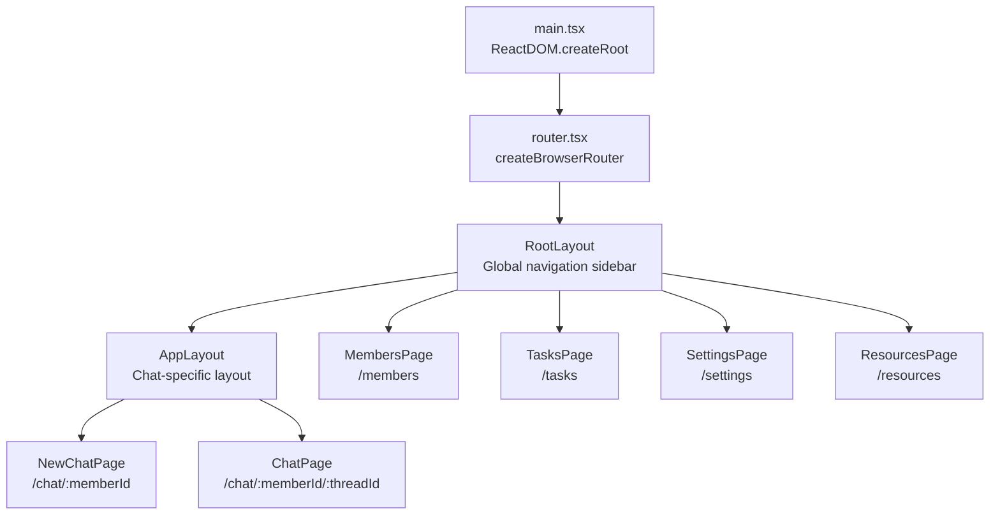
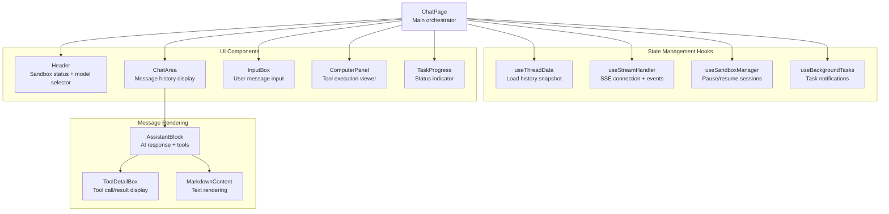
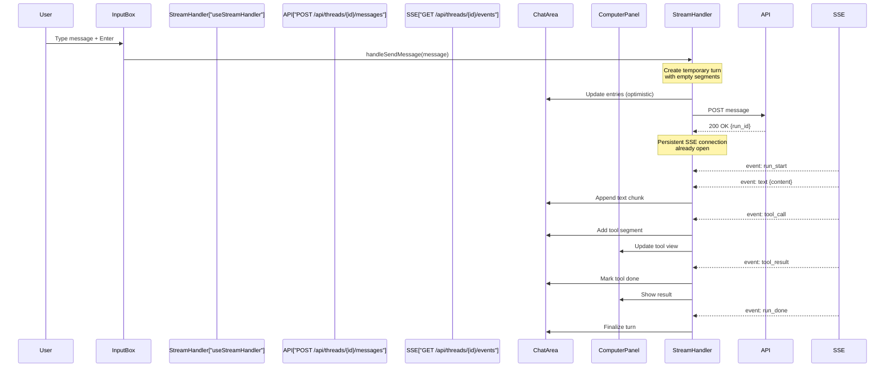
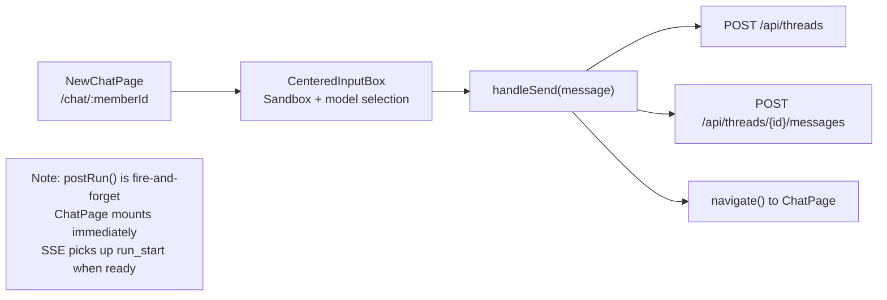
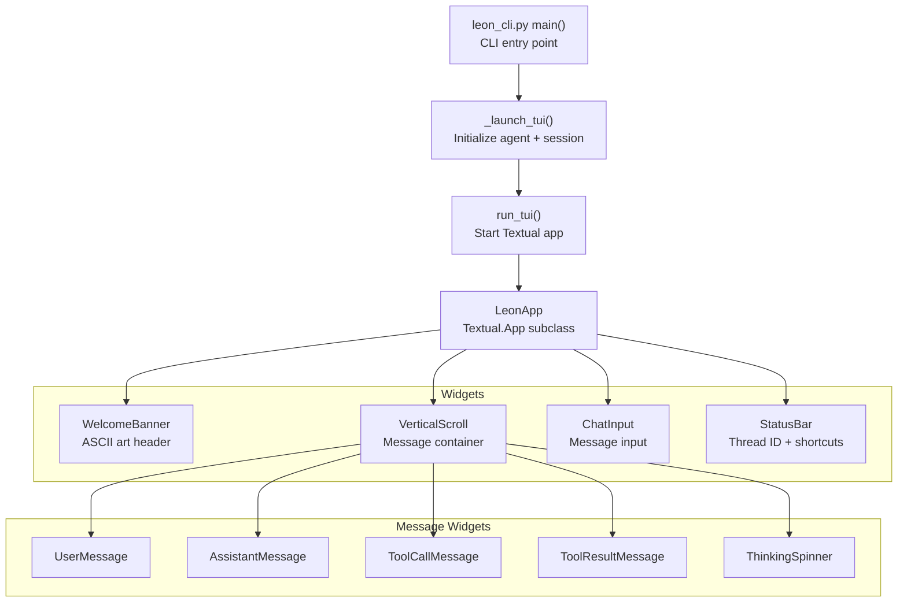
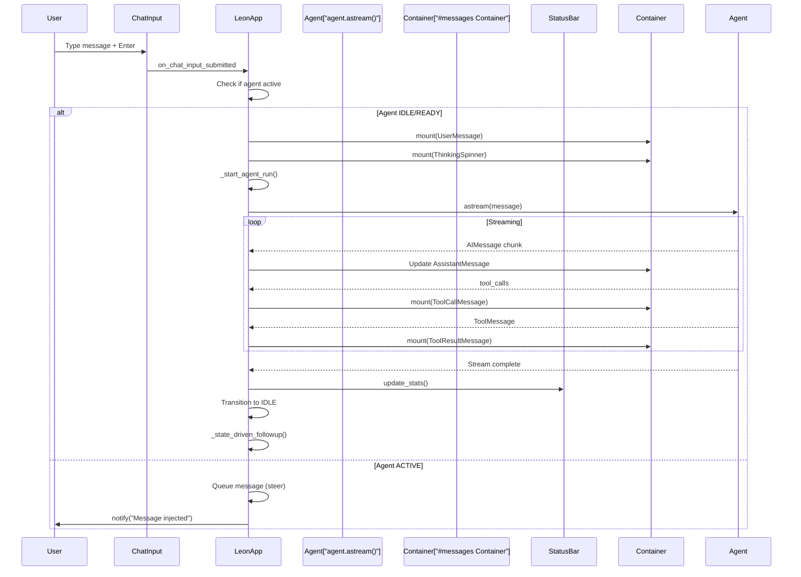
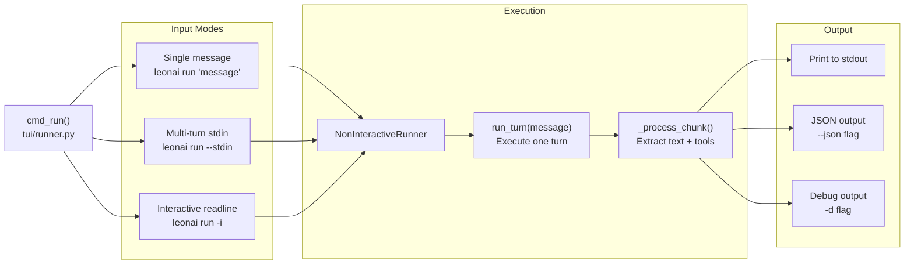
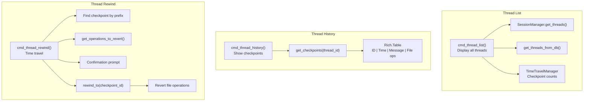
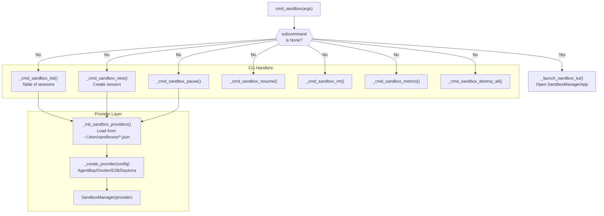

<!-- source: DeepWiki mcp.deepwiki.com · repo OpenDCAI/Mycel · page 3 User Interfaces · fetched 2026-11-02 -->

# User Interfaces

<details>
<summary>Relevant source files</summary>

The following files were used as context for generating this wiki page:

- [agent.py](agent.py)
- [frontend/app/src/api/message-mapper.ts](frontend/app/src/api/message-mapper.ts)
- [frontend/app/src/api/types.ts](frontend/app/src/api/types.ts)
- [frontend/app/src/components/CenteredInputBox.tsx](frontend/app/src/components/CenteredInputBox.tsx)
- [frontend/app/src/components/DragHandle.tsx](frontend/app/src/components/DragHandle.tsx)
- [frontend/app/src/components/ModelSelector.tsx](frontend/app/src/components/ModelSelector.tsx)
- [frontend/app/src/components/NewChatDialog.tsx](frontend/app/src/components/NewChatDialog.tsx)
- [frontend/app/src/components/Sidebar.tsx](frontend/app/src/components/Sidebar.tsx)
- [frontend/app/src/components/chat-area/AssistantBlock.tsx](frontend/app/src/components/chat-area/AssistantBlock.tsx)
- [frontend/app/src/components/chat-area/NoticeBubble.tsx](frontend/app/src/components/chat-area/NoticeBubble.tsx)
- [frontend/app/src/hooks/stream-event-handlers.ts](frontend/app/src/hooks/stream-event-handlers.ts)
- [frontend/app/src/hooks/use-stream-handler.ts](frontend/app/src/hooks/use-stream-handler.ts)
- [frontend/app/src/hooks/use-thread-manager.ts](frontend/app/src/hooks/use-thread-manager.ts)
- [frontend/app/src/hooks/use-workspace-settings.ts](frontend/app/src/hooks/use-workspace-settings.ts)
- [frontend/app/src/main.tsx](frontend/app/src/main.tsx)
- [frontend/app/src/pages/AppLayout.tsx](frontend/app/src/pages/AppLayout.tsx)
- [frontend/app/src/pages/ChatPage.tsx](frontend/app/src/pages/ChatPage.tsx)
- [frontend/app/src/pages/NewChatPage.tsx](frontend/app/src/pages/NewChatPage.tsx)
- [frontend/app/src/pages/RootLayout.tsx](frontend/app/src/pages/RootLayout.tsx)
- [frontend/app/src/router.tsx](frontend/app/src/router.tsx)
- [pyproject.toml](pyproject.toml)
- [tui/app.py](tui/app.py)
- [tui/leon_cli.py](tui/leon_cli.py)
- [tui/runner.py](tui/runner.py)
- [tui/widgets/status.py](tui/widgets/status.py)
- [uv.lock](uv.lock)

</details>


Mycel provides three distinct user interfaces for interacting with AI agents, each optimized for different use cases and environments. This page documents the architecture, entry points, and key components of each interface.

For detailed information about the backend APIs that power these interfaces, see [Backend Architecture](#8). For information about real-time streaming architecture, see [Real-time Streaming and Event Handling](#7.3).

---

## Overview of Interface Options

Mycel supports three user interfaces that share the same agent runtime and backend services:

| Interface | Entry Point | Primary Use Case | Key Technologies |
|-----------|-------------|------------------|------------------|
| **Web UI** | `http://localhost:8000` | Rich visual interaction, multi-tab workflows | React, TypeScript, Server-Sent Events |
| **Terminal UI (TUI)** | `leonai` command | Local terminal sessions, keyboard-driven workflows | Textual, Python |
| **CLI** | `leonai run`, `leonai thread`, etc. | Scripting, automation, non-interactive execution | argparse, Python asyncio |

All three interfaces communicate with the same FastAPI backend and share thread state through SQLite persistence.

**Sources**: [pyproject.toml:1-137](), [tui/leon_cli.py:1-797](), [frontend/app/src/main.tsx:1-55]()

---

## Web Interface Architecture

The web interface is a React single-page application (SPA) that provides the richest visual experience for interacting with Leon agents.

### Application Entry and Routing



**Application Bootstrap Flow**:

1. [frontend/app/src/main.tsx:49-54]() - React strict mode mount
2. [frontend/app/src/router.tsx:13-66]() - Browser router configuration with nested routes
3. [frontend/app/src/pages/RootLayout.tsx:24-178]() - Global navigation shell
4. [frontend/app/src/pages/AppLayout.tsx:15-101]() - Chat layout with sidebar and thread management

**Sources**: [frontend/app/src/main.tsx:1-55](), [frontend/app/src/router.tsx:1-67](), [frontend/app/src/pages/RootLayout.tsx:1-200](), [frontend/app/src/pages/AppLayout.tsx:1-140]()

---

### Chat Interface Components

The chat interface (`ChatPage`) is the core interaction point, orchestrating multiple sub-components and real-time streaming.



**Key Component Responsibilities**:

- **ChatPage** [frontend/app/src/pages/ChatPage.tsx:28-220]() - Root component, mounts with `key={threadId}` to reset state on thread change
- **ChatArea** - Renders message history, handles scrolling, displays `AssistantBlock` and `UserMessage` entries
- **AssistantBlock** [frontend/app/src/components/chat-area/AssistantBlock.tsx:92-170]() - Renders assistant turns with text segments, tool calls, and streaming indicators
- **InputBox** - Text input with sandbox/model selectors, handles Enter to send, Shift+Enter for newline
- **ComputerPanel** - Side panel showing tool execution details, agent hierarchy, and step-by-step flow

**Sources**: [frontend/app/src/pages/ChatPage.tsx:1-221](), [frontend/app/src/components/chat-area/AssistantBlock.tsx:1-171]()

---

### Real-Time Event Flow

The web interface uses Server-Sent Events (SSE) for real-time streaming of agent responses.



**Event Processing Pipeline**:

1. [frontend/app/src/hooks/use-stream-handler.ts:72-268]() - `useStreamHandler` hook manages connection and turn state
2. [frontend/app/src/hooks/use-thread-stream.ts]() - `useThreadStream` maintains persistent SSE connection
3. [frontend/app/src/hooks/stream-event-handlers.ts:233-267]() - `processStreamEvent()` routes events to handlers
4. [frontend/app/src/api/message-mapper.ts:169-180]() - `mapBackendEntries()` converts history snapshots to UI format

**Critical Implementation Details**:

- **Persistent Connection**: SSE connection stays open across multiple runs (no reconnect on each message)
- **Turn Grouping**: Events with same `run_id` are grouped into a single `AssistantTurn`
- **Optimistic UI**: User message and empty assistant turn created immediately, then populated by events
- **State Synchronization**: `flushSync()` used to ensure turn ID is set before processing batched events

**Sources**: [frontend/app/src/hooks/use-stream-handler.ts:1-269](), [frontend/app/src/hooks/stream-event-handlers.ts:1-268]()

---

### New Chat Creation Flow



**Flow Explanation**:

1. User types message in `CenteredInputBox` [frontend/app/src/components/CenteredInputBox.tsx:80-93]()
2. `handleSend()` in `NewChatPage` [frontend/app/src/pages/NewChatPage.tsx:28-46]():
   - Creates thread via `handleCreateThread()`
   - Fires `postRun()` without awaiting (fire-and-forget)
   - Navigates immediately to `ChatPage` with state `{runStarted: true}`
3. `ChatPage` mounts with optimistic user message + empty assistant turn
4. SSE connection starts at `seq=0` to catch buffered events
5. Agent creation completes (3-5s), `run_start` event arrives

**Sources**: [frontend/app/src/pages/NewChatPage.tsx:1-106](), [frontend/app/src/components/CenteredInputBox.tsx:1-280]()

---

## Terminal UI (TUI)

The Terminal UI provides a full-screen interactive experience using the Textual framework.

### TUI Application Structure



**TUI Entry Point Flow**:

1. [tui/leon_cli.py:572-612]() - `main()` parses arguments and routes to subcommands
2. [tui/leon_cli.py:707-761]() - `_launch_tui()` creates agent and session manager
3. [tui/app.py:116-165]() - `LeonApp.__init__()` sets up state and registers callbacks
4. [tui/app.py:157-176]() - `LeonApp.on_mount()` loads history and registers wake handler

**Sources**: [tui/leon_cli.py:572-797](), [tui/app.py:1-800]()

---

### TUI Message Handling



**Message Processing Details**:

- [tui/app.py:198-212]() - `on_chat_input_submitted()` routes based on agent state
- [tui/app.py:298-332]() - `_handle_submission()` mounts user message with `await` for immediate render
- [tui/app.py:333-528]() - `_process_message()` streams agent response and mounts widgets
- [tui/app.py:530-534]() - `_state_driven_followup()` processes queued messages when agent becomes IDLE

**TUI-Specific Features**:

- **Refocus Input**: [tui/app.py:178-187]() - Click anywhere refocuses input after processing events
- **Double ESC**: [tui/app.py:189-196]() - Opens time-travel checkpoint browser
- **Keyboard Shortcuts**: Ctrl+Y (copy), Ctrl+E (export), Ctrl+L (clear), Ctrl+↑/↓ (history)
- **Command Mode**: [tui/app.py:214-246]() - `/help`, `/clear`, `/history`, `/resume`, `/rollback N`, `/compact`

**Sources**: [tui/app.py:157-800](), [tui/widgets/status.py:1-70]()

---

## Command Line Interface (CLI)

The CLI provides non-interactive and scripting capabilities through `leonai` commands.

### CLI Command Structure

```mermaid
graph TB
    main["main()<br/>Argument parser"]
    
    subgraph "Commands"
        launchTui["Launch TUI<br/>(default, no command)"]
        config["config [show]<br/>Interactive setup"]
        thread["thread ls|history|rewind|rm"]
        sandbox["sandbox ls|new|pause|resume|rm"]
        run["run [message]<br/>Non-interactive execution"]
    end
    
    subgraph "Thread Management"
        threadList["cmd_thread_list()<br/>List all threads"]
        threadHistory["cmd_thread_history()<br/>Show checkpoints"]
        threadRewind["cmd_thread_rewind()<br/>Time travel"]
        threadRm["cmd_thread_rm()<br/>Delete thread"]
    end
    
    subgraph "Sandbox Management"
        sandboxList["_cmd_sandbox_list()<br/>List sessions"]
        sandboxNew["_cmd_sandbox_new()<br/>Create session"]
        sandboxPause["_cmd_sandbox_pause()"]
        sandboxResume["_cmd_sandbox_resume()"]
        sandboxMetrics["_cmd_sandbox_metrics()"]
    end
    
    subgraph "Run Modes"
        runSingle["Single message"]
        runStdin["stdin (blank line separator)"]
        runInteractive["Interactive readline"]
    end
    
    main --> launchTui
    main --> config
    main --> thread
    main --> sandbox
    main --> run
    
    thread --> threadList
    thread --> threadHistory
    thread --> threadRewind
    thread --> threadRm
    
    sandbox --> sandboxList
    sandbox --> sandboxNew
    sandbox --> sandboxPause
    sandbox --> sandboxResume
    sandbox --> sandboxMetrics
    
    run --> runSingle
    run --> runStdin
    run --> runInteractive
```



**Command Categories**:

| Command | Subcommands | Purpose |
|---------|-------------|---------|
| `leonai` | *(none)* | Launch TUI with optional `--thread`, `--model`, `--sandbox`, `--agent` flags |
| `leonai config` | `show` | Interactive API key setup, display current configuration |
| `leonai thread` | `ls`, `history <id>`, `rewind <id> <checkpoint>`, `rm <id>` | Thread lifecycle and time-travel management |
| `leonai sandbox` | *(none)*, `ls`, `new [provider]`, `pause <id>`, `resume <id>`, `rm <id>`, `metrics <id>` | Sandbox session management (TUI or CLI) |
| `leonai run` | `"message"`, `--stdin`, `-i`, `-d` | Non-interactive execution modes |

**Sources**: [tui/leon_cli.py:572-797]()

---

### CLI Run Modes

The `leonai run` command supports multiple execution patterns for automation and scripting.



**Run Mode Details**:

1. **Single Message** [tui/runner.py:246-279]() - Execute one turn, print response, exit
   ```bash
   leonai run "Explain the agent architecture"
   ```

2. **Multi-Turn via stdin** [tui/runner.py:281-311]() - Read messages separated by blank lines
   ```bash
   echo -e "First question\n\nSecond question" | leonai run --stdin
   ```

3. **Interactive Mode** [tui/runner.py:313-349]() - Simple readline loop (no TUI)
   ```bash
   leonai run -i
   ```

4. **Debug Output** [tui/runner.py:39-42]() - Show tool calls, token stats, runtime state
   ```bash
   leonai run -d "Complex task"
   ```

**NonInteractiveRunner Implementation**:

- [tui/runner.py:21-40]() - Constructor initializes agent and debug flags
- [tui/runner.py:44-109]() - `run_turn()` executes one conversation turn with timing
- [tui/runner.py:174-233]() - `_process_chunk()` extracts AIMessage content and tool calls
- [tui/runner.py:111-172]() - Debug output shows tokens, cost, context usage, memory stats

**Sources**: [tui/runner.py:1-349](), [tui/leon_cli.py:700-705]()

---

### CLI Thread Management

Thread management commands provide programmatic access to conversation history and checkpointing.



**Thread Command Examples**:

```bash
# List all threads with message counts and last active time
leonai thread ls

# Show checkpoint history for a specific thread
leonai thread history tui-abc12345

# Rewind to a previous checkpoint (time travel)
leonai thread rewind tui-abc12345 checkpoint-xyz -y

# Delete a thread
leonai thread rm tui-abc12345 -y
```

**Implementation Details**:

- [tui/leon_cli.py:47-96]() - `cmd_thread_list()` displays threads with Rich table
- [tui/leon_cli.py:99-143]() - `cmd_thread_history()` shows checkpoints with file operation counts
- [tui/leon_cli.py:146-202]() - `cmd_thread_rewind()` performs time travel with confirmation
- [tui/leon_cli.py:204-224]() - `cmd_thread_rm()` deletes thread from session manager

**Sources**: [tui/leon_cli.py:47-224]()

---

### CLI Sandbox Management

The `leonai sandbox` command provides both CLI and TUI interfaces for managing sandbox sessions.



**Sandbox Command Examples**:

```bash
# Launch interactive TUI for managing sessions
leonai sandbox

# List all active sandbox sessions
leonai sandbox ls

# Create new session with default provider
leonai sandbox new

# Create session with specific provider
leonai sandbox new agentbay

# Pause a running session
leonai sandbox pause abc123

# Resume a paused session
leonai sandbox resume abc123

# Show resource metrics for a session
leonai sandbox metrics abc123

# Destroy all sessions (confirmation required)
leonai sandbox destroy-all-sessions
```

**Implementation Details**:

- [tui/leon_cli.py:334-372]() - `cmd_sandbox()` dispatches to subcommand handlers
- [tui/leon_cli.py:374-387]() - `_launch_sandbox_tui()` starts Textual sandbox manager
- [tui/leon_cli.py:226-251]() - `_init_sandbox_providers()` loads configs and creates providers
- [tui/leon_cli.py:253-302]() - `_create_provider()` instantiates provider from config
- [tui/leon_cli.py:389-409]() - `_cmd_sandbox_list()` displays session table
- [tui/leon_cli.py:506-539]() - `_cmd_sandbox_metrics()` shows CPU/memory/disk/network stats

**Sources**: [tui/leon_cli.py:226-570]()

---

## Interface Comparison

| Feature | Web UI | TUI | CLI |
|---------|--------|-----|-----|
| **Launch Command** | `uvicorn` or production server | `leonai` | `leonai run [options]` |
| **Primary Use Case** | Visual exploration, multi-tab workflows | Local terminal, keyboard-driven | Scripting, automation, CI/CD |
| **Message Display** | Rich HTML/CSS rendering | Textual widgets | Plain text or JSON |
| **Real-Time Updates** | SSE streaming | Async widget updates | Buffered output |
| **Tool Visualization** | ComputerPanel with collapsible steps | ToolCallMessage/ToolResultMessage widgets | Text output with optional debug |
| **Thread Management** | Sidebar with search | `/history` command + time travel | `leonai thread ls/history/rewind/rm` |
| **Sandbox Management** | Header status + modal dialogs | `/resume` command | `leonai sandbox [subcommand]` |
| **Multi-Threading** | Yes (browser tabs) | No (single thread per session) | Yes (separate process per thread) |
| **Offline Support** | No | Yes (local mode) | Yes (local mode) |
| **Mobile Support** | Yes (responsive design) | No | No |

**Sources**: [frontend/app/src/pages/ChatPage.tsx:1-221](), [tui/app.py:1-800](), [tui/runner.py:1-349]()

---

## Shared Backend Communication

All three interfaces communicate with the same FastAPI backend through REST and SSE endpoints.

```mermaid
graph TB
    subgraph "User Interfaces"
        webUI["Web UI<br/>React SPA"]
        tui["TUI<br/>Textual App"]
        cli["CLI<br/>Non-interactive"]
    end
    
    subgraph "Backend API Endpoints"
        threads["/api/threads"]
        messages["/api/threads/{id}/messages"]
        events["/api/threads/{id}/events"]
        settings["/api/settings"]
        panel["/api/panel"]
        resources["/api/resources"]
    end
    
    subgraph "Backend Services"
        streamingSvc["streaming_service.py<br/>SSE & Agent Execution"]
        agentPool["agent_pool.py<br/>Per-thread Agents"]
        taskSvc["task_service.py<br/>Task CRUD"]
        sandboxSvc["sandbox_service.py<br/>Session Management"]
    end
    
    subgraph "Persistence"
        sqlite[("SQLite<br/>threads.db")]
        filesystem[("File System<br/>~/.leon/")]
    end
    
    webUI -->|HTTP + SSE| threads
    webUI -->|HTTP + SSE| messages
    webUI -->|SSE| events
    
    tui -->|No HTTP<br/>Direct agent.astream()| agentPool
    cli -->|No HTTP<br/>Direct agent.astream()| agentPool
    
    webUI -->|HTTP| settings
    webUI -->|HTTP| panel
    webUI -->|HTTP| resources
    
    threads --> streamingSvc
    messages --> streamingSvc
    events --> streamingSvc
    
    streamingSvc --> agentPool
    streamingSvc --> sqlite
    
    settings --> filesystem
    panel --> taskSvc
    resources --> sandboxSvc
    
    taskSvc --> sqlite
    sandboxSvc --> sqlite
```

**Key Differences**:

- **Web UI**: Uses HTTP/SSE for all communication, requires backend server running
- **TUI/CLI**: Bypass backend, call `agent.astream()` directly, write to SQLite directly

**Sources**: [frontend/app/src/api/index.ts](), [tui/app.py:333-528](), [tui/runner.py:44-109]()

---

