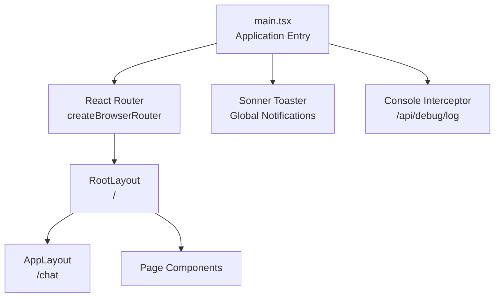
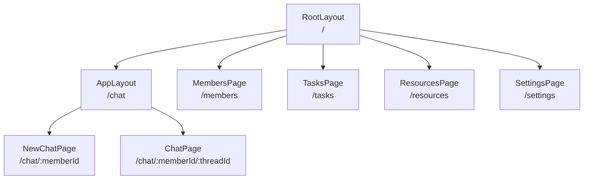
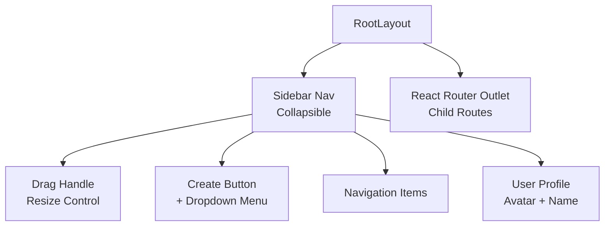
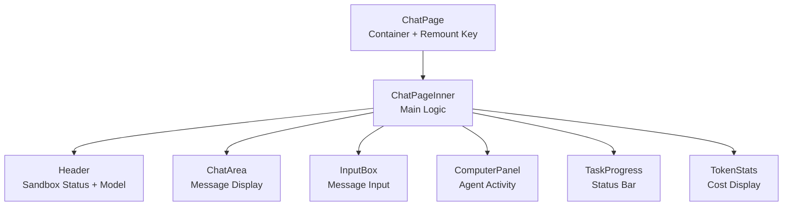
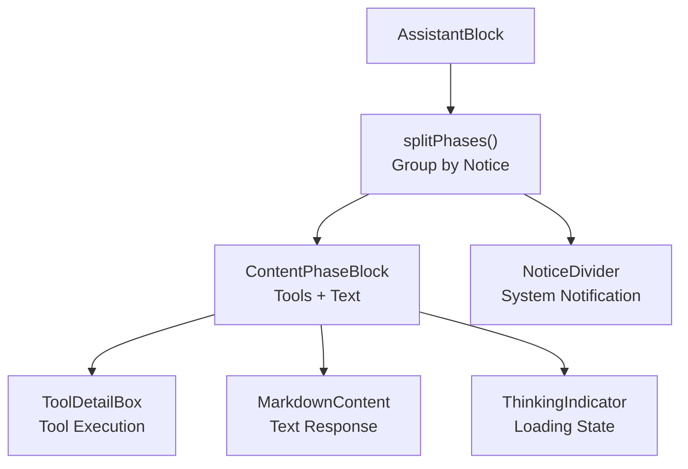
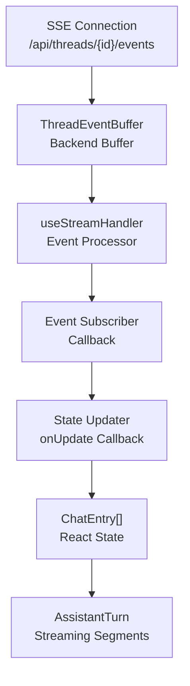
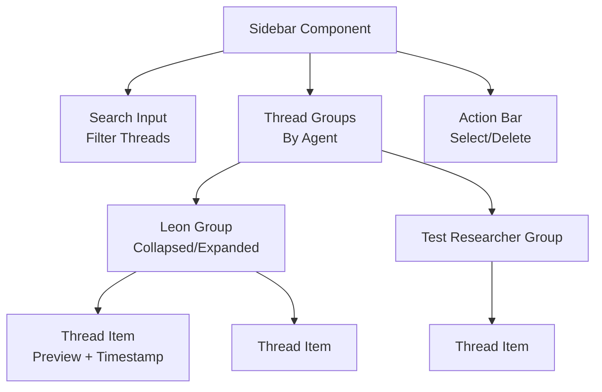
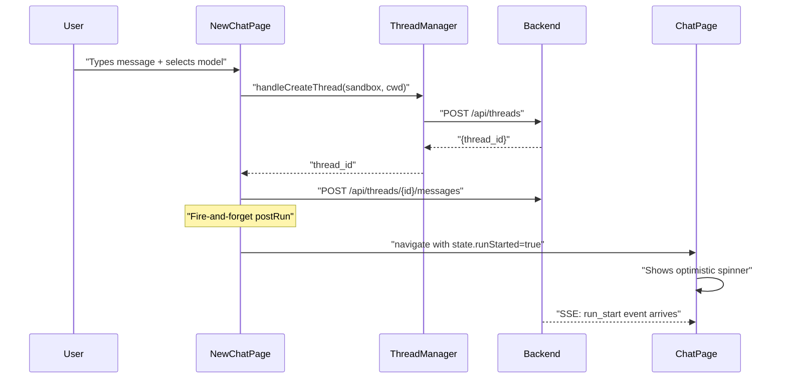
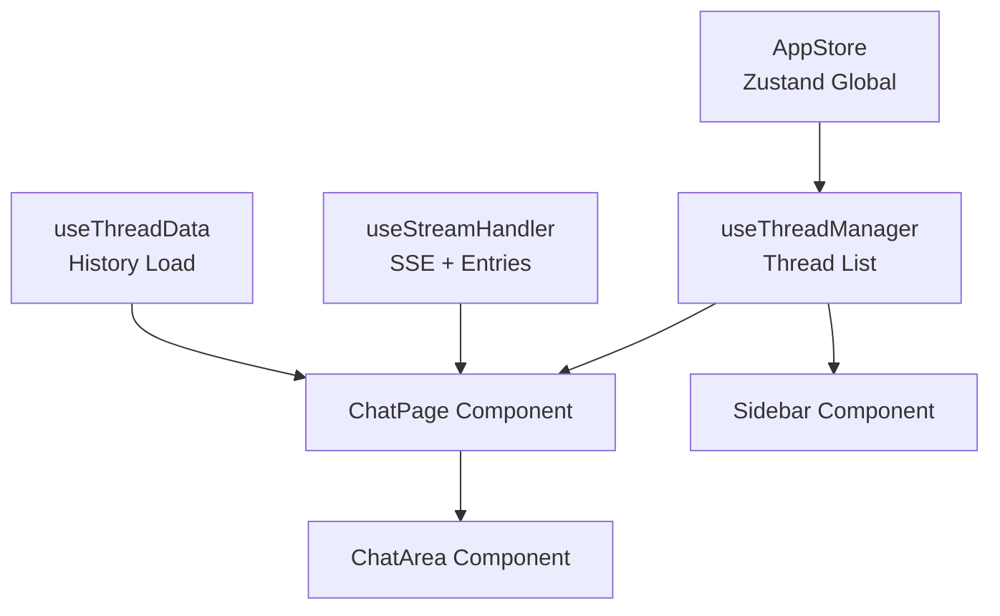
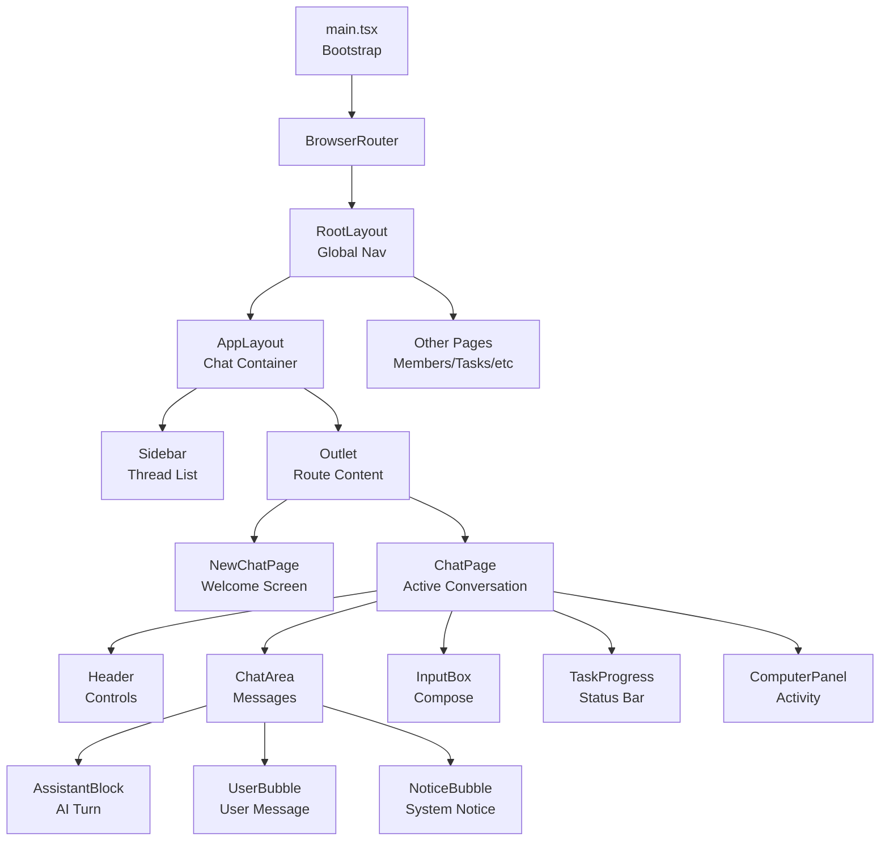

<!-- source: DeepWiki mcp.deepwiki.com · repo OpenDCAI/Mycel · page 3.1 Web Interface · fetched 2026-11-02 -->

# Web Interface

Relevant source files

The following files were used as context for generating this wiki page:

- [frontend/app/src/api/message-mapper.ts](frontend/app/src/api/message-mapper.ts)
- [frontend/app/src/api/types.ts](frontend/app/src/api/types.ts)
- [frontend/app/src/components/CenteredInputBox.tsx](frontend/app/src/components/CenteredInputBox.tsx)
- [frontend/app/src/components/ChatArea.tsx](frontend/app/src/components/ChatArea.tsx)
- [frontend/app/src/components/ComputerPanel.tsx](frontend/app/src/components/ComputerPanel.tsx)
- [frontend/app/src/components/DragHandle.tsx](frontend/app/src/components/DragHandle.tsx)
- [frontend/app/src/components/Header.tsx](frontend/app/src/components/Header.tsx)
- [frontend/app/src/components/InputBox.tsx](frontend/app/src/components/InputBox.tsx)
- [frontend/app/src/components/ModelSelector.tsx](frontend/app/src/components/ModelSelector.tsx)
- [frontend/app/src/components/NewChatDialog.tsx](frontend/app/src/components/NewChatDialog.tsx)
- [frontend/app/src/components/NewThreadModal.tsx](frontend/app/src/components/NewThreadModal.tsx)
- [frontend/app/src/components/SandboxSessionsModal.tsx](frontend/app/src/components/SandboxSessionsModal.tsx)
- [frontend/app/src/components/Sidebar.tsx](frontend/app/src/components/Sidebar.tsx)
- [frontend/app/src/components/TaskProgress.tsx](frontend/app/src/components/TaskProgress.tsx)
- [frontend/app/src/components/chat-area/AssistantBlock.tsx](frontend/app/src/components/chat-area/AssistantBlock.tsx)
- [frontend/app/src/components/chat-area/NoticeBubble.tsx](frontend/app/src/components/chat-area/NoticeBubble.tsx)
- [frontend/app/src/hooks/stream-event-handlers.ts](frontend/app/src/hooks/stream-event-handlers.ts)
- [frontend/app/src/hooks/use-stream-handler.ts](frontend/app/src/hooks/use-stream-handler.ts)
- [frontend/app/src/hooks/use-thread-manager.ts](frontend/app/src/hooks/use-thread-manager.ts)
- [frontend/app/src/hooks/use-workspace-settings.ts](frontend/app/src/hooks/use-workspace-settings.ts)
- [frontend/app/src/main.tsx](frontend/app/src/main.tsx)
- [frontend/app/src/pages/AppLayout.tsx](frontend/app/src/pages/AppLayout.tsx)
- [frontend/app/src/pages/ChatPage.tsx](frontend/app/src/pages/ChatPage.tsx)
- [frontend/app/src/pages/NewChatPage.tsx](frontend/app/src/pages/NewChatPage.tsx)
- [frontend/app/src/pages/RootLayout.tsx](frontend/app/src/pages/RootLayout.tsx)
- [frontend/app/src/router.tsx](frontend/app/src/router.tsx)
- [frontend/app/vite.config.ts](frontend/app/vite.config.ts)

This page documents the React-based web application for Mycel, including its architecture, navigation structure, chat interface, real-time streaming features, and component organization. For information about the Terminal UI, see [Terminal UI (TUI)](#3.2). For CLI usage, see [Command Line Interface](#3.3).

## Application Architecture

The web interface is a single-page React application built with TypeScript, React Router, and Zustand for state management. The application follows a hierarchical layout structure with persistent navigation and dynamic route-based content.

### Technology Stack

| Technology | Purpose |
|------------|---------|
| React 18 | UI framework with concurrent features |
| TypeScript | Type-safe development |
| React Router | Client-side routing |
| Zustand | Global state management |
| Vite | Build tool and dev server |
| Tailwind CSS | Styling framework |
| Lucide React | Icon library |

**Sources:** [frontend/app/vite.config.ts:1-48](), [frontend/app/src/main.tsx:1-55]()

### Application Entry Point

The application bootstraps in `main.tsx`, which:
1. Intercepts `console.log` to send logs to backend at `/api/debug/log`
2. Renders the router with StrictMode enabled
3. Provides a global toast notification system

**Diagram: Application Bootstrap Flow**

**Sources:** [frontend/app/src/main.tsx:1-55](), [frontend/app/src/router.tsx:1-67]()

## Navigation Structure

### Route Hierarchy

The application defines a nested route structure with two main layouts: `RootLayout` for global navigation and `AppLayout` for chat-specific features.

**Diagram: Route Hierarchy**

**Sources:** [frontend/app/src/router.tsx:13-66]()

### RootLayout Component

`RootLayout` provides the application shell with:

- **Collapsible sidebar** with drag-to-resize functionality ([frontend/app/src/pages/RootLayout.tsx:83-113]())
- **Navigation items**: Messages, Members, Tasks, Resources, Library
- **User profile** display with avatar
- **Create button** with dropdown menu for new chat/member/task
- **Mobile-responsive** layout with bottom tab bar

The sidebar auto-collapses when entering `/chat` routes and expands when leaving, optimizing screen space for conversations.

**Diagram: RootLayout Component Structure**

**Sources:** [frontend/app/src/pages/RootLayout.tsx:24-271]()

### AppLayout Component

`AppLayout` wraps chat-related routes and provides:

- **Thread sidebar** ([Sidebar.tsx]()) with thread list grouped by agent
- **Thread management** hooks via `useThreadManager`
- **Modals**: NewThreadModal, SearchModal, SandboxSessionsModal
- **Responsive behavior**: Mobile shows thread list or chat, never both

**Sources:** [frontend/app/src/pages/AppLayout.tsx:1-159]()

## Chat Interface

The chat interface is the primary interaction point, composed of several coordinated components that handle message display, input, and real-time updates.

### ChatPage Component

`ChatPage` ([frontend/app/src/pages/ChatPage.tsx]()) is the main container that orchestrates:

1. **Thread data loading** via `useThreadData` hook
2. **Real-time streaming** via `useStreamHandler` hook
3. **Sandbox management** via `useSandboxManager` hook
4. **Background tasks** via `useBackgroundTasks` hook
5. **UI state** via `useAppActions` hook

**Key Pattern:** The component uses a remount strategy - wrapping the inner component with `key={threadId}` forces a full remount when switching threads, resetting all hook state naturally ([frontend/app/src/pages/ChatPage.tsx:27-32]()).

**Diagram: ChatPage Component Hierarchy**

**Sources:** [frontend/app/src/pages/ChatPage.tsx:1-221]()

### ChatArea Component

`ChatArea` renders the conversation history as a scrollable list. It maps over `entries` and renders different components based on entry type:

| Entry Type | Component | Purpose |
|------------|-----------|---------|
| `"user"` | `UserBubble` | User messages |
| `"assistant"` | `AssistantBlock` | AI responses with tools/text |
| `"notice"` | `NoticeBubble` | System notifications |

The component uses `useStickyScroll` to automatically scroll to bottom during streaming while allowing user to scroll up.

**Sources:** [frontend/app/src/components/ChatArea.tsx:1-50]()

### AssistantBlock Component

`AssistantBlock` renders AI turns with sophisticated phase-based rendering:

1. **Phase splitting**: Segments are split at `notice` boundaries ([frontend/app/src/components/chat-area/AssistantBlock.tsx:17-31]())
2. **Tool visualization**: `ToolDetailBox` shows tool calls and results
3. **Text rendering**: `MarkdownContent` renders final text response
4. **Streaming indicators**: `ThinkingIndicator` shows during initial boot

**Diagram: AssistantBlock Rendering Flow**

**Sources:** [frontend/app/src/components/chat-area/AssistantBlock.tsx:1-171]()

### InputBox Component

The input box provides message composition with:

- **Auto-resize textarea** that grows up to 160px
- **Enter to send**, Shift+Enter for newline
- **Queue message mode**: During streaming, allows sending steer messages
- **Stop button**: Shows when streaming and input is empty

**Sources:** [frontend/app/src/components/InputBox.tsx:1-123]()

### NewChatPage Component

`NewChatPage` provides the welcome screen for new conversations with:

- **Model selector** with virtual models (Mini/Medium/Large/Max) and custom models
- **Sandbox selector** dropdown
- **Workspace picker** for local sandbox (browse/recent/manual tabs)
- **Capability tags** showing what the agent can do

The page fires `postRun` immediately on send, then navigates to `ChatPage` with `runStarted: true` state, allowing the chat page to show optimistic UI while the backend prepares the agent.

**Sources:** [frontend/app/src/pages/NewChatPage.tsx:1-106]()

## Real-time Streaming

The web interface uses Server-Sent Events (SSE) for real-time updates. The streaming architecture ensures that text and tool execution updates appear incrementally as the agent works.

### SSE Connection Management

The `useThreadStream` hook (referenced in `useStreamHandler`) maintains a persistent SSE connection:

1. **Connection lifecycle**: Opens `/api/threads/{threadId}/events` on mount
2. **Automatic reconnection**: Retries with exponential backoff on disconnect
3. **Sequence tracking**: Uses `?from_seq=N` to resume from last received event
4. **Run detection**: Monitors `isRunning` state from status events

**Sources:** [frontend/app/src/hooks/use-stream-handler.ts:72-268]()

### Stream Event Processing

The `useStreamHandler` hook processes events and updates UI state:

**Diagram: Stream Event Flow**

**Event Types and Handlers:**

| Event Type | Handler | Purpose |
|-----------|---------|---------|
| `text` | `handleText` | Append text chunks to current turn |
| `tool_call` | `handleToolCall` | Create/update tool segment |
| `tool_result` | `handleToolResult` | Mark tool as done with result |
| `task_start` | `handleTaskStart` | Initialize subagent stream |
| `task_done` | `handleTaskDone` | Mark subagent complete |
| `error` | `handleError` | Append error message |
| `cancelled` | `handleCancelled` | Mark tools as cancelled |
| `retry` | `handleRetry` | Show retry indicator |
| `notice` | special handling | Insert notice entry or segment |
| `run_start` | lifecycle | Ensure turn exists |
| `run_done` | lifecycle | Finalize turn |
| `status` | lifecycle | Update runtime status |

**Sources:** [frontend/app/src/hooks/stream-event-handlers.ts:1-268](), [frontend/app/src/api/types.ts:1-234]()

### Turn Grouping and Message Binding

The system implements sophisticated turn grouping logic:

1. **Temporary ID assignment**: User sends message → creates temp turn ID
2. **Server ID binding**: First event with `message_id` binds to temp ID ([frontend/app/src/hooks/use-stream-handler.ts:188-200]())
3. **Run-based grouping**: Backend injects `run_id` in metadata to group messages
4. **Notice folding**: System messages with same `run_id` fold into the current turn as notice segments

This ensures that multi-step agent runs (LLM call → tool → LLM call) render as a single cohesive turn.

**Sources:** [frontend/app/src/hooks/use-stream-handler.ts:44-70](), [frontend/app/src/api/message-mapper.ts:99-121]()

### Reconnection and Resume

When the SSE connection drops mid-run, the system:

1. **Detects reconnection**: `useThreadStream` re-establishes connection
2. **Reuses last turn**: `applyReconnectTurn` marks the last assistant turn as streaming ([frontend/app/src/hooks/use-stream-handler.ts:44-70]())
3. **Requests from last seq**: Uses `?from_seq=N` to get missed events
4. **Prevents duplication**: `hasBoundRef` ensures message ID binds only once

**Sources:** [frontend/app/src/hooks/use-stream-handler.ts:114-202]()

## Thread Management

### Sidebar Component

The `Sidebar` component provides thread navigation with:

- **Agent grouping**: Threads grouped by agent name
- **Collapsible groups**: Chevron toggles expand/collapse
- **Live status indicators**: Running spinner, updated timestamps
- **Bulk operations**: Select mode for multi-delete
- **Responsive width**: Drag-to-resize handle

**Diagram: Sidebar Thread Organization**

**Key Features:**

- **Auto-expand**: Most recent agent group expands on first load ([frontend/app/src/components/Sidebar.tsx:254-259]())
- **Active indicator**: Left border line marks current thread
- **Delete confirmation**: Two-step delete (click → confirm) for single threads
- **Select mode**: Long-press or click "管理" enters bulk mode ([frontend/app/src/components/Sidebar.tsx:184-215]())

**Sources:** [frontend/app/src/components/Sidebar.tsx:1-449]()

### Thread Creation Flow

**Diagram: Thread Creation Flow**

The create-then-navigate pattern allows instant navigation while the agent initializes in the background (3-5s for first call).

**Sources:** [frontend/app/src/pages/NewChatPage.tsx:28-46](), [frontend/app/src/hooks/use-thread-manager.ts:53-59]()

## Agent Activity Visualization

### ComputerPanel Component

The `ComputerPanel` provides a side panel showing real-time agent execution details:

**Tabs:**
1. **Agents**: Hierarchical view of main agent + sub-agents
2. **Steps**: Flat chronological list of all tool calls
3. **Flow**: Visual flowchart of execution sequence

The panel is toggled via the TaskProgress bar button and resizable via drag handle.

**Sources:** [frontend/app/src/components/ComputerPanel.tsx:1-4]()

### Tool Visualization

Tool execution is visualized with:

- **Tool cards**: Show name, arguments, and result
- **Status indicators**: Calling (spinner), done (checkmark), error (X)
- **Subagent expansion**: Agent tool calls expand to show nested execution
- **Markdown rendering**: Results rendered with syntax highlighting

**Sources:** [frontend/app/src/components/chat-area/AssistantBlock.tsx:57-64]()

## State Management

The web interface uses a hybrid state management approach:

### Global State (Zustand)

`AppStore` ([frontend/app/src/store/app-store.ts]()) maintains:
- **Member list**: Agent configurations
- **User profile**: Name, email, initials
- **Task list**: Background tasks
- **Settings**: Workspace, models

**Sources:** Referenced in [frontend/app/src/pages/RootLayout.tsx:32-35]()

### Local State (React Hooks)

**Custom Hooks:**

| Hook | Purpose |
|------|---------|
| `useThreadManager` | Thread list, CRUD operations |
| `useStreamHandler` | SSE connection, event processing |
| `useThreadData` | Load thread history, sandbox info |
| `useSandboxManager` | Pause/resume sandbox controls |
| `useBackgroundTasks` | Poll background task status |
| `useAppActions` | ComputerPanel toggle, agent focus |
| `useWorkspaceSettings` | Workspace configuration |

**Sources:** [frontend/app/src/hooks/use-thread-manager.ts:1-75](), [frontend/app/src/hooks/use-stream-handler.ts:1-269]()

### State Flow Pattern

**Diagram: State Management Pattern**

**Sources:** [frontend/app/src/pages/ChatPage.tsx:82-113]()

## Component Hierarchy

**Complete Component Tree:**

**Sources:** [frontend/app/src/main.tsx:49-54](), [frontend/app/src/pages/RootLayout.tsx:191-270](), [frontend/app/src/pages/AppLayout.tsx:56-100](), [frontend/app/src/pages/ChatPage.tsx:151-219]()

## Mobile Responsiveness

The interface adapts to mobile devices:

- **Bottom tab navigation**: Replaces sidebar with tab bar
- **Full-screen chat**: Thread list and chat never shown simultaneously
- **Touch-optimized**: Larger tap targets, swipe gestures
- **Safe area handling**: Respects notch/home indicator with `env(safe-area-inset-bottom)`

**Sources:** [frontend/app/src/pages/RootLayout.tsx:156-187](), [frontend/app/src/pages/AppLayout.tsx:34-54]()

---

**Key Takeaways:**

1. The web interface uses a **persistent SSE connection** for real-time updates
2. **Turn grouping** by `run_id` ensures multi-step agent executions render cohesively
3. **Remount strategy** (key={threadId}) simplifies state management when switching threads
4. **Phase-based rendering** allows notices to split assistant turns into logical sections
5. **Optimistic UI** shows spinners immediately while agent initializes in background

---

