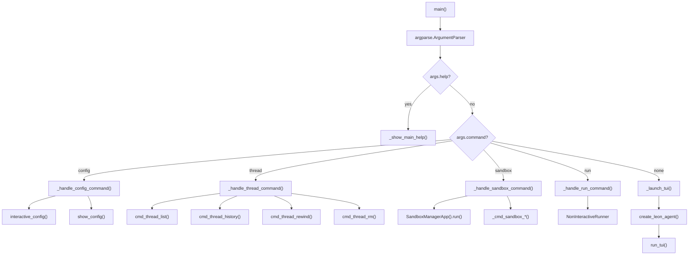
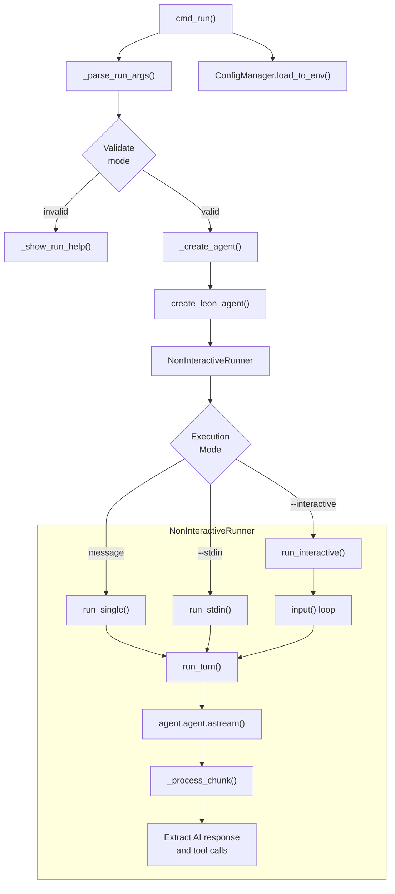
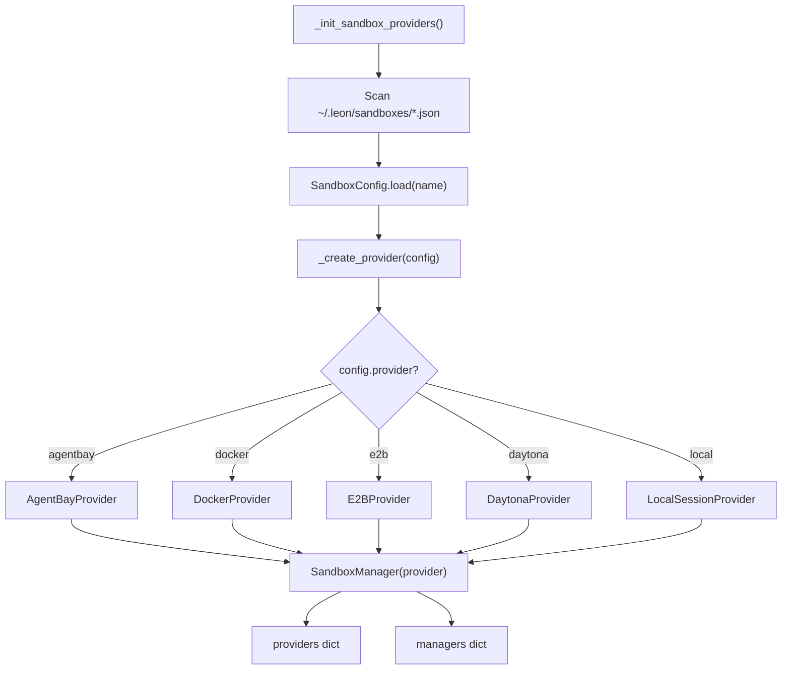

<!-- source: DeepWiki mcp.deepwiki.com · repo OpenDCAI/Mycel · page 3.3 Command Line Interface · fetched 2026-11-02 -->

# Command Line Interface

<details>
<summary>Relevant source files</summary>

The following files were used as context for generating this wiki page:

- [agent.py](agent.py)
- [pyproject.toml](pyproject.toml)
- [tui/app.py](tui/app.py)
- [tui/leon_cli.py](tui/leon_cli.py)
- [tui/runner.py](tui/runner.py)
- [tui/widgets/status.py](tui/widgets/status.py)
- [uv.lock](uv.lock)

</details>


This page documents the `leonai` command-line interface (CLI), which provides terminal-based access to Mycel's agent capabilities. The CLI supports multiple execution modes: interactive TUI, non-interactive runs, thread management, sandbox operations, and configuration. For the full-screen Terminal UI experience, see [Terminal UI (TUI)](#3.2). For the web-based interface, see [Web Interface](#3.1).

## Installation and Entry Point

The CLI is installed as the `leonai` command via the package's entry point configuration. When installed, the command becomes globally available in your shell.

**Entry Point Registration:**
- Package name: `leonai`
- Command: `leonai`
- Entry function: `tui.leon_cli:main`

Sources: [pyproject.toml:59-60]()

## Command Architecture

The CLI follows a hierarchical command structure with a main command and multiple subcommands, each with their own options and arguments.

### Command Hierarchy Diagram

```mermaid
graph TB
    leonai["leonai"]
    
    subgraph "Default Mode"
        tui["Launch TUI<br/>(no command)"]
    end
    
    subgraph "Configuration"
        config["config"]
        config_show["config show"]
    end
    
    subgraph "Thread Management"
        thread["thread"]
        thread_ls["thread ls/list"]
        thread_history["thread history &lt;id&gt;"]
        thread_rewind["thread rewind &lt;id&gt; &lt;checkpoint&gt;"]
        thread_rm["thread rm &lt;id&gt;"]
    end
    
    subgraph "Sandbox Management"
        sandbox["sandbox"]
        sandbox_tui["sandbox<br/>(no subcommand)"]
        sandbox_ls["sandbox ls/list"]
        sandbox_new["sandbox new [provider]"]
        sandbox_rm["sandbox rm &lt;id&gt;"]
        sandbox_pause["sandbox pause &lt;id&gt;"]
        sandbox_resume["sandbox resume &lt;id&gt;"]
        sandbox_metrics["sandbox metrics &lt;id&gt;"]
        sandbox_destroy["sandbox destroy-all-sessions"]
    end
    
    subgraph "Non-Interactive Execution"
        run["run"]
        run_single["run &quot;message&quot;"]
        run_stdin["run --stdin"]
        run_interactive["run -i"]
    end
    
    leonai --> tui
    leonai --> config
    leonai --> thread
    leonai --> sandbox
    leonai --> run
    
    config --> config_show
    
    thread --> thread_ls
    thread --> thread_history
    thread --> thread_rewind
    thread --> thread_rm
    
    sandbox --> sandbox_tui
    sandbox --> sandbox_ls
    sandbox --> sandbox_new
    sandbox --> sandbox_rm
    sandbox --> sandbox_pause
    sandbox --> sandbox_resume
    sandbox --> sandbox_metrics
    sandbox --> sandbox_destroy
    
    run --> run_single
    run --> run_stdin
    run --> run_interactive
```



Sources: [tui/leon_cli.py:572-611](), [tui/leon_cli.py:614-650]()

### Main Execution Flow



Sources: [tui/leon_cli.py:572-611](), [tui/leon_cli.py:614-761]()

## Default Mode: Interactive TUI

When invoked without any command, `leonai` launches the full-screen Textual-based Terminal User Interface (TUI). This provides a rich interactive experience with chat history, real-time streaming, keyboard shortcuts, and visual feedback.

**Usage:**
```bash
leonai                          # Start new conversation
leonai -c                       # Continue last conversation
leonai --model claude-3-5-sonnet-20241022  # Use specific model
leonai --agent coder            # Use specific agent preset
leonai --workspace ~/myproject  # Set working directory
leonai --sandbox docker         # Use Docker sandbox
leonai --thread abc123          # Resume specific thread
```

**Common Options:**
| Option | Description |
|--------|-------------|
| `--model <name>` | Override model (e.g., `claude-3-5-sonnet-20241022`, `gpt-4`) |
| `--agent <name>` | Agent preset: `default`, `coder`, `researcher`, `tester` |
| `--workspace <dir>` | Working directory for file operations |
| `--sandbox <name>` | Sandbox configuration from `~/.leon/sandboxes/<name>.json` |
| `--thread <id>` | Resume specific conversation thread |
| `-c, --continue` | Continue last conversation |
| `--profile <path>` | Custom profile configuration file |

**Thread Resolution:**
The system automatically resolves the thread ID in priority order:
1. Explicit `--thread <id>`
2. `--continue` flag (loads last active thread from `SessionManager`)
3. Auto-generate new thread ID with format `tui-{uuid[:8]}`

**Sandbox Auto-Detection:**
When resuming a thread (`--thread` or `--continue`), the CLI automatically detects and loads the sandbox provider used in previous sessions by querying the sandbox database.

Sources: [tui/leon_cli.py:707-761](), [tui/leon_cli.py:763-792]()

For full TUI documentation, see [Terminal UI (TUI)](#3.2).

## Configuration Management

The `config` command provides interactive setup and display of API keys, model preferences, and observation providers.

### Commands

**Interactive Configuration:**
```bash
leonai config
```
Launches an interactive wizard that prompts for:
- API keys (OpenAI, Anthropic)
- Default model preference
- Observation providers (Langfuse, LangSmith)

**Show Current Configuration:**
```bash
leonai config show
```
Displays current configuration values from `~/.leon/config.json` without exposing sensitive keys.

### Configuration Flow

The `interactive_config()` function uses `ConfigManager` to read/write configuration to `~/.leon/config.json`. The configuration is then loaded into environment variables at startup via `config_manager.load_to_env()`.

Sources: [tui/leon_cli.py:652-657](), [tui/leon_cli.py:709-716]()

## Thread Management

Thread commands enable inspection, navigation, and manipulation of conversation history stored in the SQLite checkpoint database.

### Thread List

```bash
leonai thread ls        # List all threads
leonai thread list      # Alias for ls
```

**Output Format:**
```
┏━━━━━━━━━━━━┳━━━━━━┳━━━━━━━━━━━━━━━━━━━━━━━━━━━━┳━━━━━━━━━━━━┳━━━━━━━━┓
┃ Thread ID  ┃ 消息  ┃ 首条消息                    ┃ 最后活跃    ┃ 状态    ┃
┡━━━━━━━━━━━━╇━━━━━━╇━━━━━━━━━━━━━━━━━━━━━━━━━━━━╇━━━━━━━━━━━━╇━━━━━━━━┩
│ tui-a1b2c3 │ 5    │ Read the README.md file     │ 2 小时前   │ (当前) │
│ tui-d4e5f6 │ 12   │ List all Python files       │ 1 天前     │        │
└────────────┴──────┴─────────────────────────────┴────────────┴────────┘
```

**Implementation Details:**
- Retrieves thread list from `SessionManager.get_threads()` (session tracking)
- Enriches with metadata from `SessionManager.get_threads_from_db()` (SQLite)
- Fetches message counts via `TimeTravelManager.get_checkpoints()`
- Displays first message preview and relative time formatting

Sources: [tui/leon_cli.py:47-96]()

### Thread History

```bash
leonai thread history <thread_id>
```

Displays checkpoint history for a specific thread, showing user turns and file operations.

**Output Format:**
```
┏━━━┳━━━━━━━━━━━━━━━┳━━━━━━━━┳━━━━━━━━━━━━━━━━━━━━━━┳━━━━━━━━━━┓
┃ # ┃ Checkpoint ID ┃ 时间    ┃ 消息                  ┃ 文件操作  ┃
┡━━━╇━━━━━━━━━━━━━━━╇━━━━━━━━╇━━━━━━━━━━━━━━━━━━━━━━╇━━━━━━━━━━┩
│ 1 │ abc123...     │ 3 分钟前│ Read the README       │ -        │
│ 2 │ def456...     │ 2 分钟前│ List all files        │ 2        │
│ 3 │ ghi789... (当前)│ 1 分钟前│ Update main.py        │ 1        │
└───┴───────────────┴────────┴───────────────────────┴──────────┘
```

**Data Source:**
Uses `TimeTravelManager.get_checkpoints(thread_id, user_turns_only=True)` to retrieve checkpoint metadata including:
- Checkpoint ID
- Timestamp
- User message
- File operation count
- Current checkpoint indicator

Sources: [tui/leon_cli.py:99-143]()

### Thread Rewind

```bash
leonai thread rewind <thread_id> <checkpoint_id> [-y]
```

Rewinds a thread to a previous checkpoint, reverting file operations and conversation state.

**Interactive Confirmation:**
Without the `-y` flag, displays operations that will be reverted:
```
将撤销 3 个文件操作:
  - write: src/main.py
  - create: src/utils.py
  - edit: README.md
  
确认回退? [y/N]
```

**Execution:**
1. `TimeTravelManager.get_operations_to_revert()` - Identifies file operations to undo
2. User confirmation (unless `-y` provided)
3. `TimeTravelManager.rewind_to()` - Executes rewind operation
4. Displays success/error messages

Sources: [tui/leon_cli.py:146-202]()

### Thread Delete

```bash
leonai thread rm <thread_id> [-y]
```

Permanently deletes a thread from session storage. Requires confirmation unless `-y` flag is provided.

**Safety Mechanism:**
- Prompts for confirmation: `确认删除对话 {thread_id}? [y/N]`
- `-y` or `--yes` flag bypasses confirmation
- Uses `SessionManager.delete_thread()` for deletion

Sources: [tui/leon_cli.py:204-223]()

## Sandbox Management

Sandbox commands provide terminal-based control over execution environment sessions across multiple providers (local, Docker, E2B, Daytona, AgentBay).

### Sandbox TUI Manager

```bash
leonai sandbox
```

Launches the full-screen `SandboxManagerApp` TUI for visual session management. This provides a rich interface for monitoring sessions, viewing metrics, and controlling lifecycle.

Sources: [tui/leon_cli.py:374-386]()

See [Sandbox Manager TUI](#6.5) for detailed documentation.

### Sandbox List

```bash
leonai sandbox ls
leonai sandbox list     # Alias
```

**Output Format:**
```
┏━━━━━━━━━━━━━━━━┳━━━━━━━━┳━━━━━━━━━━━┳━━━━━━━━━━━━┓
┃ Session ID     ┃ Status ┃ Provider  ┃ Thread     ┃
┡━━━━━━━━━━━━━━━━╇━━━━━━━━╇━━━━━━━━━━━╇━━━━━━━━━━━━┩
│ ab12cd34...    │ running│ docker    │ tui-abc123 │
│ ef56gh78...    │ paused │ agentbay  │ tui-def456 │
└────────────────┴────────┴───────────┴────────────┘
```

**Implementation:**
- Loads all sandbox providers from `~/.leon/sandboxes/*.json` via `_init_sandbox_providers()`
- Creates `SandboxManager` instances for each provider
- Parallel fetches session lists via `ThreadPoolExecutor`
- Aggregates and displays sessions across all providers

Sources: [tui/leon_cli.py:389-408](), [tui/leon_cli.py:226-251](), [tui/leon_cli.py:304-323]()

### Sandbox Session Creation

```bash
leonai sandbox new [provider]
```

Creates a new sandbox session. If no provider specified, auto-selects first available from: `agentbay`, `e2b`, `docker`, `daytona`.

**Process:**
1. Load provider configurations from `~/.leon/sandboxes/`
2. Select provider (explicit or auto-detect)
3. Generate thread ID: `sandbox-{random_hex}`
4. Call `SandboxManager.get_or_create_session(thread_id)`
5. Display session ID and thread ID

Sources: [tui/leon_cli.py:411-436]()

### Sandbox Session Control

**Pause:**
```bash
leonai sandbox pause <session_id>
```
Pauses a running session (frees resources while preserving state).

**Resume:**
```bash
leonai sandbox resume <session_id>
```
Resumes a paused session.

**Delete:**
```bash
leonai sandbox rm <session_id>
leonai sandbox delete <session_id>   # Alias
```
Permanently destroys a session and its resources.

**Implementation Pattern:**
All control commands follow the same pattern:
1. Load all sessions via `_load_all_sessions()`
2. Find target session by ID or prefix via `_find_session()`
3. Get appropriate `SandboxManager` for provider
4. Execute operation (`pause_session()`, `resume_session()`, `destroy_session()`)

Sources: [tui/leon_cli.py:439-503]()

### Sandbox Metrics

```bash
leonai sandbox metrics <session_id>
```

Displays resource usage metrics for a session.

**Output Example:**
```
Session: ab12cd34ef56gh78
  CPU:     15.3%
  Memory:  512MB / 2048MB
  Disk:    1.2GB / 10.0GB
  Network: RX 125.0 KB/s | TX 45.3 KB/s
  URL:     https://ab12cd34.agentbay.dev
```

**Data Source:**
Calls `provider.get_metrics(session_id)` which returns a `SessionMetrics` object with CPU, memory, disk, and network statistics. AgentBay provider also includes web URL.

Sources: [tui/leon_cli.py:506-538]()

### Bulk Destroy

```bash
leonai sandbox destroy-all-sessions
```

**Safety Mechanism:**
1. Lists all active sessions
2. Requires explicit confirmation: `Type 'yes' to confirm:`
3. Parallel destruction via `ThreadPoolExecutor`
4. Reports each destroyed session

**Use Case:**
Cleanup utility for development/testing environments with multiple abandoned sessions.

Sources: [tui/leon_cli.py:541-569]()

## Non-Interactive Execution (Run Mode)

The `run` command enables headless, scriptable execution of agent tasks without the TUI. This supports CI/CD integration, batch processing, and programmatic agent invocation.

### Run Mode Architecture



Sources: [tui/runner.py:345-398](), [tui/runner.py:21-110]()

### Single Message Execution

```bash
leonai run "message text"
```

Executes a single message and exits. Output defaults to assistant response only (clean mode).

**Example:**
```bash
$ leonai run "List files in current directory"
Here are the files in the current directory:
- main.py
- README.md
- requirements.txt
```

**With Debug Output:**
```bash
$ leonai run -d "Read README.md"

==================================================
=== Turn 1 ===
[USER] Read README.md

[TOOL_CALL] read_file
  path: README.md

[TOOL_RESULT]
  # My Project
  This is a demo project...

[ASSISTANT]
The README.md file contains a project description...

[STATE] IDLE
[TOKENS] total=1234 (in=800, out=434, cache_r=0, cache_w=0, reasoning=0)
[COST] $0.0123
[LLM_CALLS] 1
[CONTEXT] ~1500 tokens (15% of limit)
[MEMORY] summary_cached=no

[TURN] Duration: 2.34s

==================================================
[SUMMARY]
  Thread: run-a1b2c3d4
  Total turns: 1
  Total tool calls: 1
```

Sources: [tui/runner.py:317-332]()

### Stdin Mode (Batch Processing)

```bash
echo -e "First message\n\nSecond message" | leonai run --stdin -d
```

Reads multiple messages from stdin, separated by blank lines. Each message executes as a separate turn within the same conversation thread.

**Use Case:**
- Batch processing workflows
- CI/CD test scenarios
- Scripted multi-turn interactions

**Processing:**
1. Read full stdin content
2. Split by `\n\n` (blank lines)
3. Execute each message sequentially via `run_turn()`
4. Print summary statistics

Sources: [tui/runner.py:301-315]()

### Interactive Readline Mode

```bash
leonai run -i
```

Provides a simple readline-based interactive loop without TUI overhead. Useful for:
- Remote SSH sessions with limited terminal support
- Debugging/testing
- Integration with other terminal tools

**Commands:**
| Command | Action |
|---------|--------|
| `/exit`, `/quit` | Exit the session |
| `/clear` | Start new conversation (new thread ID) |
| `/thread` | Display current thread ID |

**Features:**
- Persistent conversation context
- Simple input/output (no TUI)
- Compatible with pipe/redirect
- Ctrl+C or Ctrl+D to exit

Sources: [tui/runner.py:266-299]()

### Run Mode Options

| Option | Description |
|--------|-------------|
| `MESSAGE` | Single message to execute |
| `--stdin` | Read messages from stdin (blank-line separated) |
| `-i, --interactive` | Interactive readline mode |
| `-d, --debug` | Enable debug output (tool calls, tokens, state) |
| `--json` | JSON output format (single message mode only) |
| `--thread <id>` | Thread ID for multi-turn persistence |
| `--workspace <dir>` | Working directory |
| `--model <name>` | Model override |
| `--sandbox <name>` | Sandbox configuration |

Sources: [tui/runner.py:400-448](), [tui/runner.py:451-471]()

### NonInteractiveRunner Implementation

The `NonInteractiveRunner` class orchestrates agent execution and provides structured output.

**Key Methods:**

| Method | Purpose |
|--------|---------|
| `run_turn(message)` | Execute single conversation turn |
| `run_single(message)` | Single-shot execution |
| `run_stdin()` | Batch stdin processing |
| `run_interactive()` | Interactive readline loop |
| `_process_chunk()` | Extract data from streaming chunks |
| `_print_runtime_state()` | Display token stats and context |

**State Tracking:**
- Turn count
- Total tool call count
- Per-turn tool calls
- Assistant responses
- Duration metrics

**Debug Output:**
When `-d` flag is enabled, displays:
- User messages
- Tool call names and arguments
- Tool result previews
- Token statistics (input, output, cache read/write, reasoning)
- Cost calculations
- Context usage percentage
- Memory middleware state
- Queue sizes (steer/followup)
- Runtime state (ACTIVE/IDLE)

Sources: [tui/runner.py:21-343]()

### Thread Persistence in Run Mode

The `--thread` option enables multi-turn conversations across separate CLI invocations:

```bash
# First message
leonai run --thread task-123 "Create a new Python file called utils.py"

# Continue same conversation
leonai run --thread task-123 "Add a function to read JSON files"

# Further continuation
leonai run --thread task-123 "Write tests for the JSON reader"
```

Each invocation shares the same conversation history stored in the SQLite checkpoint database. The agent maintains context across runs.

**Auto-Detection:**
When resuming a thread, the CLI automatically detects and loads the sandbox provider used previously via `lookup_sandbox_for_thread()`.

Sources: [tui/runner.py:473-484]()

## Global Options

These options apply across all commands and modes:

| Option | Scope | Description |
|--------|-------|-------------|
| `--model <name>` | Agent creation | Override default model (e.g., `claude-3-5-sonnet-20241022`, `gpt-4`) |
| `--agent <name>` | Agent creation | Agent preset: `default`, `coder`, `researcher`, `tester` |
| `--workspace <dir>` | Agent creation | Working directory for file operations (default: `cwd`) |
| `--sandbox <name>` | Agent creation | Sandbox config from `~/.leon/sandboxes/<name>.json` (default: `local`) |
| `--thread <id>` | Thread context | Thread ID for conversation persistence |
| `--profile <path>` | Agent creation | Custom profile configuration file |
| `-c, --continue` | TUI mode only | Continue last conversation |
| `-h, --help` | All | Show help message |

**Model Resolution:**
Priority order: `--model` flag → `MODEL_NAME` env var → `DEFAULT_MODEL` constant

Sources: [tui/leon_cli.py:574-585](), [tui/runner.py:487-513]()

## Provider Configuration Loading

Sandbox providers are loaded dynamically from configuration files at runtime.

### Configuration Discovery Flow



**Configuration File Format:**
```json
{
  "provider": "docker",
  "docker": {
    "image": "leonai/sandbox:latest",
    "mount_path": "/workspace"
  }
}
```

**API Key Resolution:**
Providers check configuration files first, then fall back to environment variables:
- AgentBay: `config.agentbay.api_key` → `$AGENTBAY_API_KEY`
- E2B: `config.e2b.api_key` → `$E2B_API_KEY`
- Daytona: `config.daytona.api_key` → `$DAYTONA_API_KEY`

Sources: [tui/leon_cli.py:226-251](), [tui/leon_cli.py:253-301]()

## Exit Codes and Error Handling

The CLI uses Python's default exit code behavior:
- **0**: Successful execution
- **1**: Error (exception, invalid config, missing API key)
- **130**: Interrupted (Ctrl+C)

**Common Error Scenarios:**
- Missing API key → Launches interactive configuration
- Invalid thread ID → Error message, exit 1
- Invalid sandbox config → Warning message, skip provider
- Agent initialization failure → Error message, exit 1

Sources: [tui/leon_cli.py:712-718](), [tui/runner.py:510-513]()

---

