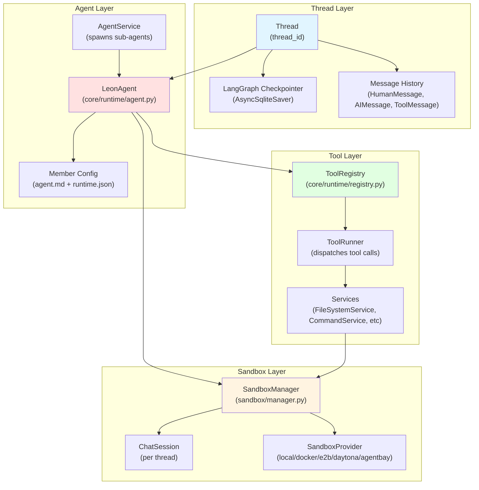
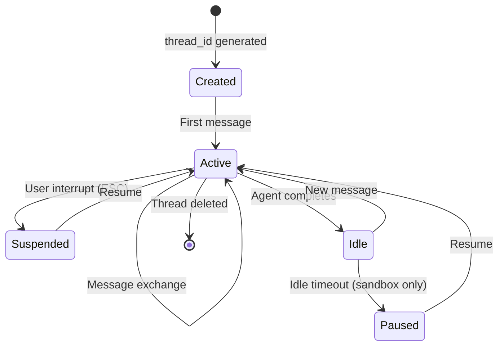
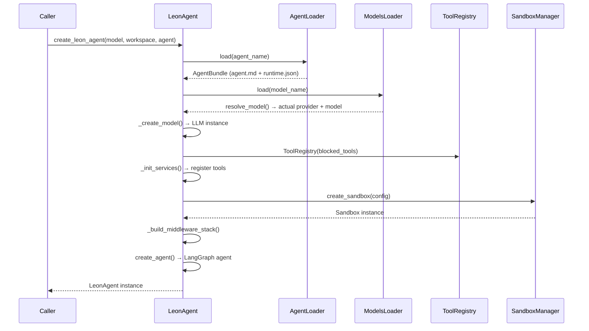
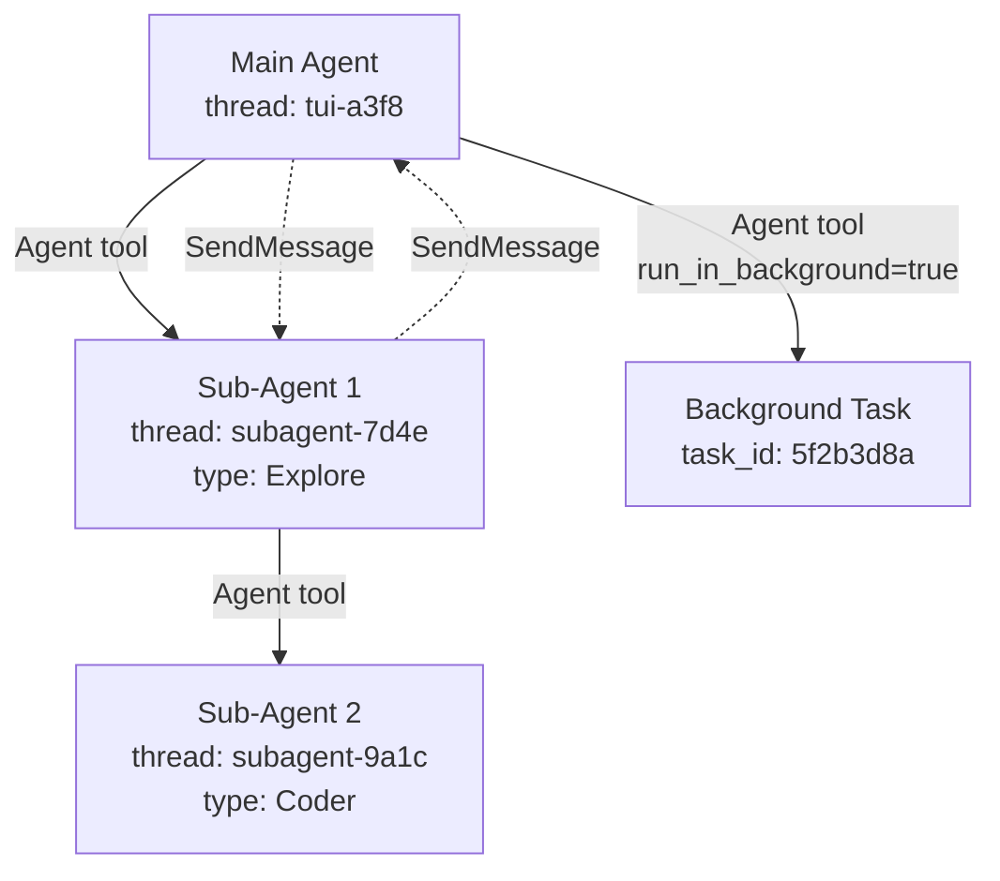
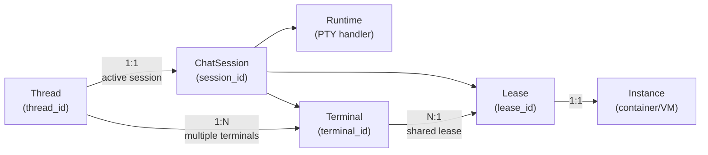
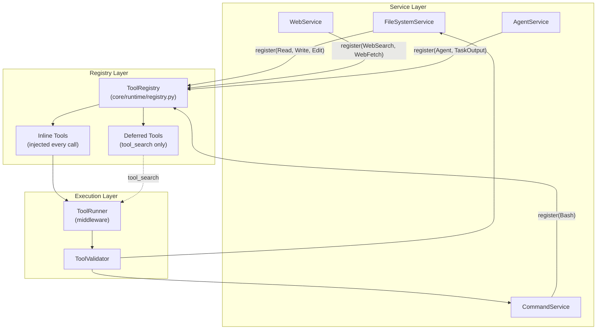
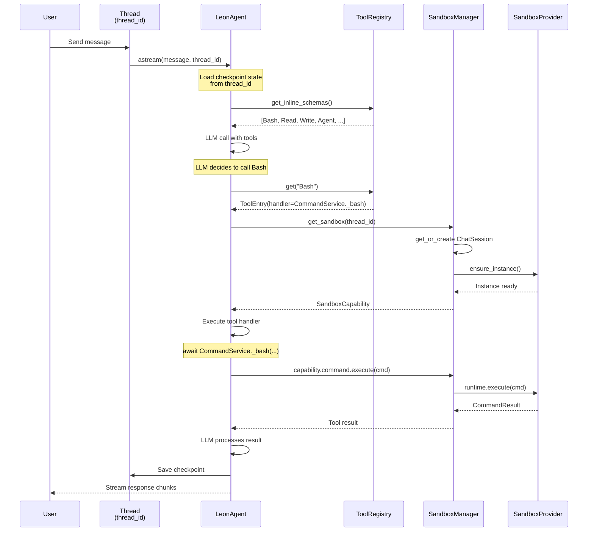

<!-- source: DeepWiki mcp.deepwiki.com · repo OpenDCAI/Mycel · page 4 Core Concepts · fetched 2026-11-02 -->

# Core Concepts

<details>
<summary>Relevant source files</summary>

The following files were used as context for generating this wiki page:

- [agent.py](agent.py)
- [backend/taskboard/middleware.py](backend/taskboard/middleware.py)
- [backend/taskboard/service.py](backend/taskboard/service.py)
- [backend/web/services/member_service.py](backend/web/services/member_service.py)
- [config/defaults/tool_catalog.py](config/defaults/tool_catalog.py)
- [core/agents/communication/service.py](core/agents/communication/service.py)
- [core/agents/service.py](core/agents/service.py)
- [core/runtime/agent.py](core/runtime/agent.py)
- [core/runtime/registry.py](core/runtime/registry.py)
- [core/tools/command/service.py](core/tools/command/service.py)
- [pyproject.toml](pyproject.toml)
- [sandbox/capability.py](sandbox/capability.py)
- [sandbox/manager.py](sandbox/manager.py)
- [tui/app.py](tui/app.py)
- [tui/leon_cli.py](tui/leon_cli.py)
- [tui/runner.py](tui/runner.py)
- [tui/widgets/status.py](tui/widgets/status.py)
- [uv.lock](uv.lock)

</details>


This page introduces the four fundamental abstractions that form the foundation of Mycel's architecture: **Threads**, **Agents**, **Sandboxes**, and **Tools**. Understanding these concepts is essential for working with Mycel, whether as a user configuring agents or a developer extending the system.

For detailed implementation information, see the child pages: [Threads and Chat Sessions](#4.1), [Agents and Members](#4.2), [Sandboxes and Execution Environments](#4.3), and [Tools and Capabilities](#4.4).

---

## System Architecture Overview

The diagram below shows how the four core concepts relate to each other in the system architecture:

**Architecture: Four Core Concepts and Their Relationships**



Sources: [core/runtime/agent.py:92-268](), [sandbox/manager.py:46-133](), [core/runtime/registry.py:1-80](), [core/agents/service.py:150-199]()

---

## Threads: Conversation Contexts

A **thread** is a persistent conversation context identified by a unique `thread_id` (e.g., `"tui-a3f8b2c1"`, `"subagent-7d4e9a1b"`). Threads serve as:

1. **State isolation** — Each thread has independent conversation history and checkpoint state
2. **Persistence boundary** — All messages, tool calls, and agent state are saved per-thread
3. **Routing key** — Queue messages, sandbox sessions, and sub-agents are associated with threads

### Thread Lifecycle



Sources: [tui/leon_cli.py:763-777](), [tui/app.py:116-177](), [core/runtime/middleware/monitor:1-100]()

### Checkpointing and Persistence

Thread state is persisted via LangGraph's `AsyncSqliteSaver` checkpointer stored in `~/.leon/leon.db`. Each user interaction creates a checkpoint that can be restored for time-travel debugging.

| Component | Storage Location | Purpose |
|-----------|-----------------|---------|
| `AsyncSqliteSaver` | `~/.leon/leon.db` | Message history, agent state, LangGraph checkpoints |
| `TerminalStore` | `~/.leon/sandbox.db` | Terminal state (cwd, env_delta) per thread |
| `LeaseStore` | `~/.leon/sandbox.db` | Sandbox instance bindings per thread |

Sources: [core/runtime/agent.py:293-320](), [sandbox/manager.py:57-64]()

---

## Agents: Intelligent Workers

An **agent** is an autonomous AI worker powered by a Large Language Model (LLM) with access to tools. In Mycel, agents are implemented as `LeonAgent` instances.

### LeonAgent Class

The `LeonAgent` class ([core/runtime/agent.py:92-268]()) is the core agent implementation. Each instance represents one agent with:

- **Model** — LLM configuration resolved from `models.json` (supports virtual names like `leon:mini`, `leon:large`)
- **Workspace** — Root directory for file operations (all paths are absolute)
- **Middleware Stack** — SpillBuffer → Monitor → PromptCaching → Memory → Steering → ToolRunner
- **Tool Registry** — Available capabilities (filesystem, command, web, agents, etc.)
- **Sandbox** — Execution environment (local, Docker, E2B, Daytona, AgentBay)

**Agent Initialization Flow**



Sources: [core/runtime/agent.py:107-268](), [config/loader.py:1-50]()

### Members: Agent Configurations

**Members** are pre-configured agent templates stored in `~/.leon/members/{member_name}/`. Each member directory contains:

```
~/.leon/members/researcher/
├── agent.md          # YAML frontmatter + system prompt
├── meta.json         # status, version, timestamps
├── runtime.json      # tools/skills enabled + descriptions
├── rules/            # *.md rule files
├── agents/           # *.md sub-agent definitions
└── .mcp.json         # MCP server configurations
```

The `agent.md` file defines the member's identity:

```markdown
---
name: Researcher
description: Expert at information gathering
model: leon:large
tools: ["*"]  # or specific tool list
---

You are a research specialist...
```

Sources: [backend/web/services/member_service.py:96-156](), [config/loader.py:1-50]()

### Agent Hierarchy

Agents can spawn **sub-agents** for parallel task execution:



Sources: [core/agents/service.py:96-253](), [core/agents/communication/service.py:98-118]()

---

## Sandboxes: Execution Environments

A **sandbox** is an isolated execution environment where agents run shell commands and access filesystems. Mycel abstracts sandbox providers behind a unified interface, supporting local execution and remote cloud providers.

### Sandbox Architecture Layers

The sandbox system uses a multi-layer architecture to map threads to physical instances:

**Sandbox Hierarchy: Thread → Instance Mapping**



Sources: [sandbox/manager.py:1-133](), [sandbox/capability.py:26-70]()

### SandboxProvider Interface

All sandbox providers implement the `SandboxProvider` abstract interface:

| Provider | Implementation | Use Case |
|----------|---------------|----------|
| `LocalSessionProvider` | [sandbox/providers/local:1-100]() | Direct host access (development) |
| `DockerProvider` | [sandbox/providers/docker:1-150]() | Container isolation (local) |
| `E2BProvider` | [sandbox/providers/e2b:1-200]() | Cloud sandbox (E2B.dev) |
| `DaytonaProvider` | [sandbox/providers/daytona:1-200]() | Cloud IDE workspaces |
| `AgentBayProvider` | [sandbox/providers/agentbay:1-250]() | Agent Cloud VMs |

Each provider declares its capabilities via `ProviderCapability`:

```python
@dataclass
class ProviderCapability:
    pause_resume: bool           # Can pause/resume instances
    metrics: bool                # Provides CPU/memory metrics
    screenshot: bool             # Supports GUI screenshots
    eager_instance_binding: bool # Binds instance on lease creation
    inspect_visible: bool        # Visible in web UI
```

Sources: [sandbox/provider.py:1-100](), [sandbox/capability.py:1-70]()

### Sandbox Manager Orchestration

`SandboxManager` ([sandbox/manager.py:46-593]()) orchestrates the sandbox lifecycle:

1. **get_sandbox(thread_id)** → Returns `SandboxCapability` wrapping `ChatSession`
2. **Lazy initialization** → Creates Terminal → Lease → Instance on first access
3. **Resume-on-demand** → Paused sessions auto-resume on new activity
4. **Idle timeout enforcement** → Pauses expired remote sessions to save costs

Sources: [sandbox/manager.py:134-181](), [sandbox/manager.py:284-368]()

---

## Tools: Agent Capabilities

**Tools** are functions that agents can call to interact with the world. Mycel uses a service-based architecture where each tool domain registers its tools into a central `ToolRegistry`.

### Tool Registry Architecture

**ToolRegistry Flow: Registration to Execution**



Sources: [core/runtime/registry.py:28-80](), [core/runtime/runner.py:1-100](), [core/runtime/agent.py:224-227]()

### Tool Modes

Tools are registered with one of two modes:

| Mode | Description | Injection |
|------|-------------|-----------|
| `ToolMode.INLINE` | Always available to agent | Every LLM call |
| `ToolMode.DEFERRED` | Discoverable via search | Via `tool_search` tool |

**Inline tools** ([core/runtime/registry.py:58-61]()) are injected into the model's function schema on every call. **Deferred tools** ([core/runtime/registry.py:63-76]()) are only loaded when the agent explicitly searches for them using the `tool_search` tool, enabling dynamic tool loading without context pollution.

Sources: [core/runtime/registry.py:11-14](), [core/tools/tool_search/service.py:1-50]()

### Service Pattern

Each tool domain is implemented as a **Service** class that registers tools into `ToolRegistry`:

```python
class CommandService:
    def __init__(self, registry: ToolRegistry, workspace_root: Path, ...):
        self._register(registry)
    
    def _register(self, registry: ToolRegistry):
        registry.register(ToolEntry(
            name="Bash",
            mode=ToolMode.INLINE,
            schema={...},
            handler=self._bash,
            source="CommandService",
        ))
    
    async def _bash(self, command: str, ...) -> str:
        # Tool implementation
```

**Available Services:**

- `FileSystemService` — Read, Write, Edit, list_dir ([core/tools/filesystem/service.py:1-100]())
- `SearchService` — Grep, Glob ([core/tools/search/service.py:1-100]())
- `CommandService` — Bash ([core/tools/command/service.py:32-59]())
- `WebService` — WebSearch, WebFetch ([core/tools/web/service.py:1-100]())
- `AgentService` — Agent, TaskOutput, TaskStop ([core/agents/service.py:150-199]())
- `SendMessageService` — SendMessage ([core/agents/communication/service.py:98-118]())
- `TaskBoardService` — ListBoardTasks, ClaimTask, CompleteTask ([backend/taskboard/service.py:31-206]())

Sources: [core/runtime/agent.py:224-227](), [core/tools/command/service.py:32-96]()

---

## How the Concepts Work Together

The four core concepts interact in every agent execution. Here's how they work together in a typical user interaction:

**Complete Interaction Flow: User Message → Agent Response**



Sources: [tui/app.py:298-527](), [core/runtime/agent.py:92-268](), [sandbox/manager.py:134-181](), [core/runtime/runner.py:1-100]()

### Key Invariants

The system maintains several critical invariants:

1. **One lease per thread** — All terminals created for a thread share a single `Lease` ([sandbox/manager.py:109-122]())
2. **Thread-provider binding** — Once a thread uses a provider, it cannot switch ([sandbox/manager.py:82-88]())
3. **Active terminal pointer** — Each thread has exactly one active terminal ([sandbox/manager.py:90-98]())
4. **Checkpoint persistence** — Every message exchange creates a checkpoint ([core/runtime/agent.py:293-320]())
5. **Tool isolation** — Blocked tools are silently filtered at registry level ([core/runtime/registry.py:48-53]())

Sources: [sandbox/manager.py:82-122](), [core/runtime/registry.py:35-53]()

---

## Summary

The four core concepts form a cohesive system:

- **Threads** provide conversation persistence and state isolation
- **Agents** orchestrate LLM reasoning with tool access
- **Sandboxes** isolate command execution in configurable environments  
- **Tools** expose capabilities through a pluggable registry system

Together, these abstractions enable Mycel to run multiple concurrent agents, each with their own conversation context, isolated execution environment, and customized tool access — all while maintaining clean separation of concerns and extensibility.

For implementation details on each concept, see the child pages: [Threads and Chat Sessions](#4.1), [Agents and Members](#4.2), [Sandboxes and Execution Environments](#4.3), and [Tools and Capabilities](#4.4).

---

