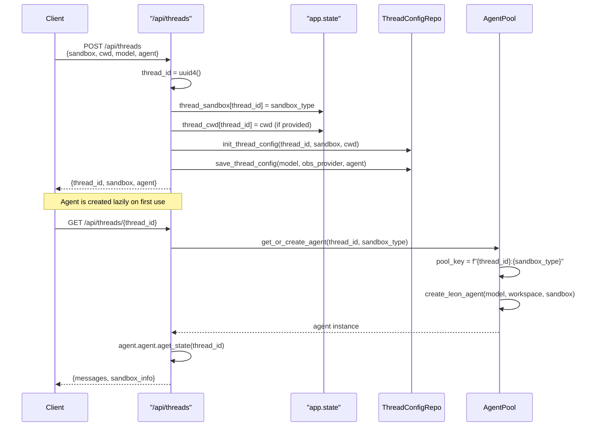
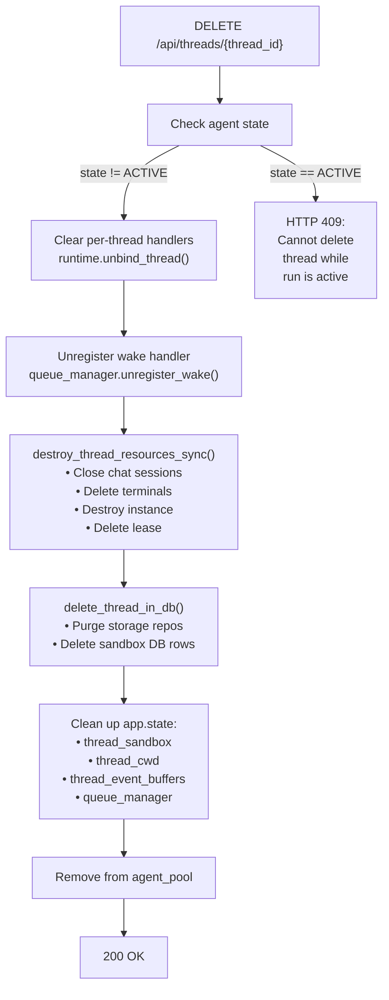
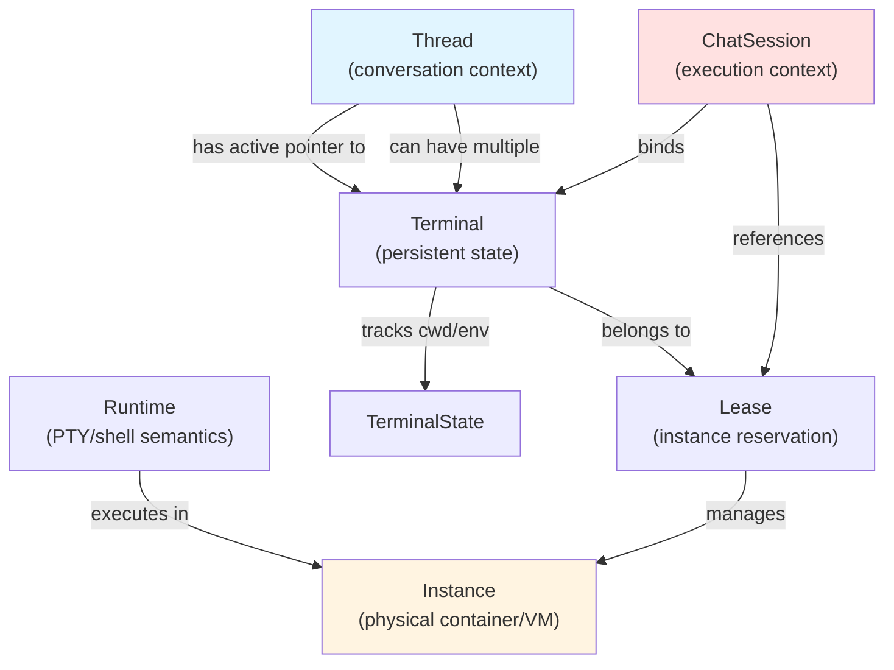
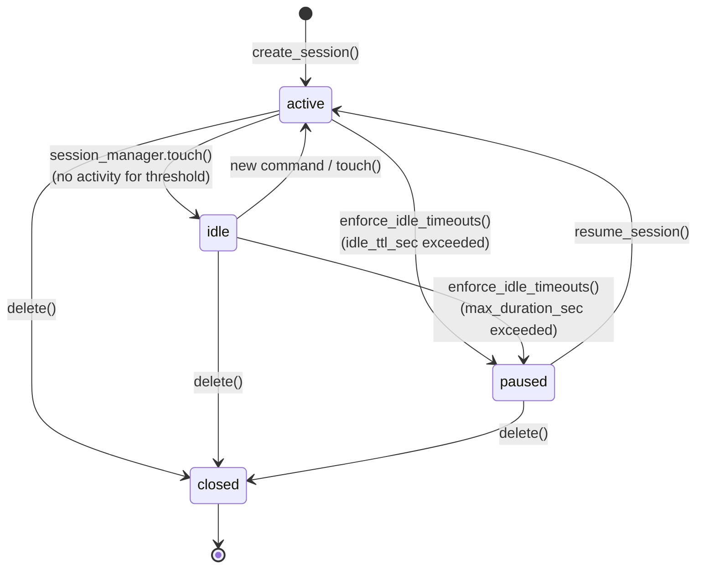
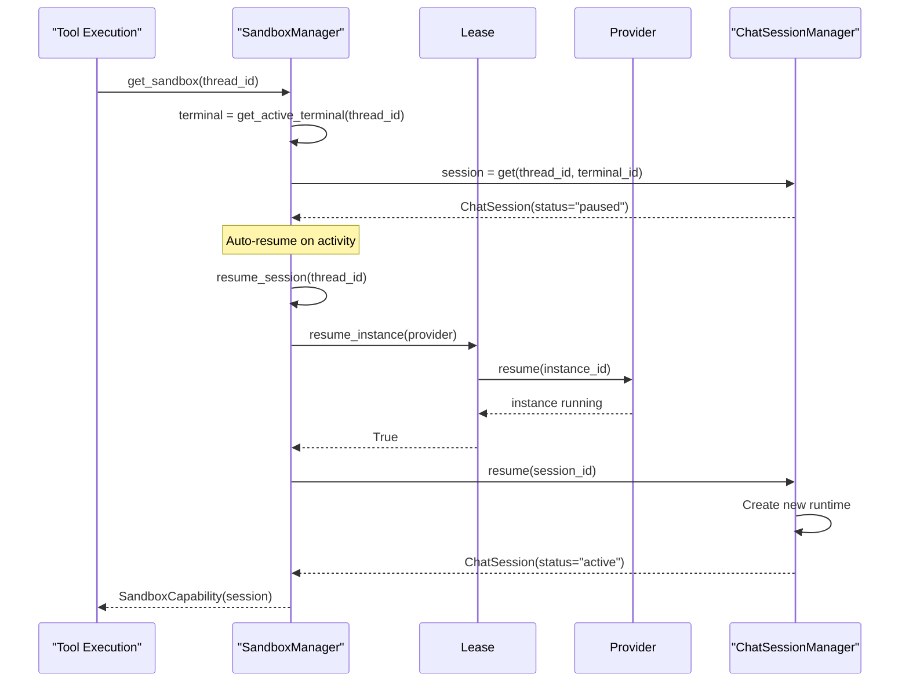
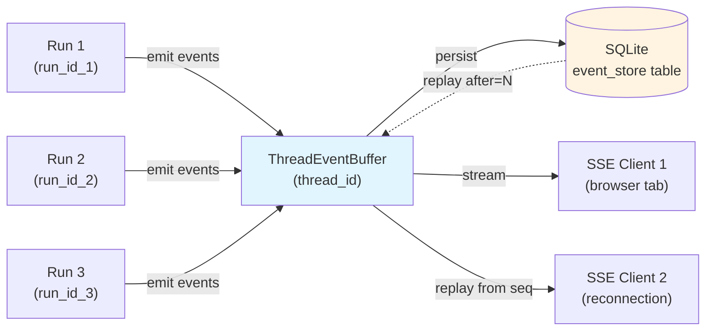
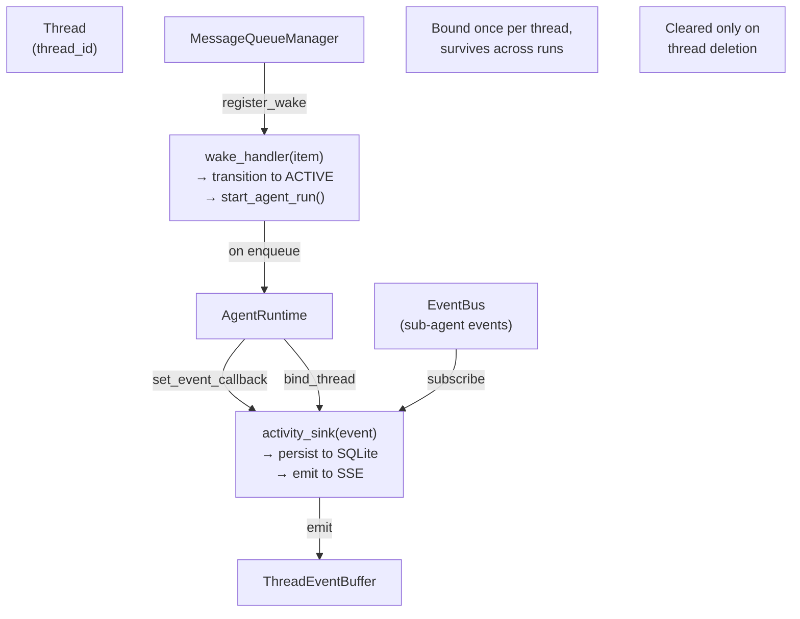

<!-- source: DeepWiki mcp.deepwiki.com · repo OpenDCAI/Mycel · page 4.1 Threads and Chat Sessions · fetched 2026-11-02 -->

# Threads and Chat Sessions

<details>
<summary>Relevant source files</summary>

The following files were used as context for generating this wiki page:

- [backend/web/core/lifespan.py](backend/web/core/lifespan.py)
- [backend/web/models/thread_config.py](backend/web/models/thread_config.py)
- [backend/web/routers/threads.py](backend/web/routers/threads.py)
- [backend/web/services/agent_pool.py](backend/web/services/agent_pool.py)
- [backend/web/services/streaming_service.py](backend/web/services/streaming_service.py)
- [backend/web/utils/helpers.py](backend/web/utils/helpers.py)
- [sandbox/manager.py](sandbox/manager.py)

</details>


This page explains the core abstractions for organizing conversations and execution contexts in Mycel. A **thread** represents a conversation context with persistent message history, while a **chat session** represents an execution context that manages sandbox lifecycle and resource allocation.

For information about sandbox providers and execution environments, see [Sandboxes and Execution Environments](#4.3). For details about agent initialization and tool execution, see [Agent Runtime](#5).

---

## Overview

Mycel organizes user interactions around two primary abstractions:

- **Thread**: A persistent conversation context identified by a UUID `thread_id`. Threads store message history via LangGraph checkpointing and maintain per-thread configuration (model, sandbox type, workspace root, observation provider).

- **ChatSession**: An execution context that manages the lifecycle of a sandbox connection for a thread. Chat sessions enforce resource policies (idle timeout, max duration) and orchestrate the hierarchy: Thread → ChatSession → Runtime → Terminal → Lease → Instance.

**Key relationships:**
- Each thread is mapped to exactly one `LeonAgent` instance in the agent pool (key: `{thread_id}:{sandbox_type}`)
- Each thread can have multiple terminals (for background commands), but all share a single lease (single physical instance)
- The "active" terminal pointer identifies which terminal receives interactive commands
- Chat sessions are ephemeral and managed by `SandboxManager`; threads are persistent and stored in SQLite

**Sources:** [backend/web/routers/threads.py:1-654](), [sandbox/manager.py:1-593](), [backend/web/services/agent_pool.py:1-180]()

---

## Thread Lifecycle

### Thread Creation

Threads are created via `POST /api/threads` with optional parameters for sandbox type, initial working directory, model, and agent member.



**Thread configuration hierarchy:**
- **In-memory cache**: `app.state.thread_sandbox`, `app.state.thread_cwd` (ephemeral, survives until server restart)
- **SQLite storage**: `thread_config` table via `ThreadConfigRepo` (persistent)
- **Sandbox database**: `abstract_terminals` and `sandbox_leases` tables (persistent, provider-specific)

**Sources:** [backend/web/routers/threads.py:55-84](), [backend/web/services/agent_pool.py:40-92](), [backend/web/utils/helpers.py:86-130]()

### Thread Configuration

Each thread stores persistent configuration in the `thread_config` table:

| Field | Type | Description |
|-------|------|-------------|
| `thread_id` | UUID | Primary key |
| `sandbox_type` | string | Provider name: `"local"`, `"docker"`, `"e2b"`, `"daytona"`, `"agentbay"` |
| `cwd` | string | Initial working directory for local sandbox |
| `model` | string | Model name (supports `leon:*` virtual names) |
| `observation_provider` | string | `"langfuse"`, `"langsmith"`, or `null` |
| `agent` | string | Member name (display only, not used for agent type selection) |

Configuration is accessed via helper functions:

```python
# Load full config
config = load_thread_config(thread_id)  # Returns ThreadConfig or None

# Update specific fields
save_thread_config(thread_id, model="gpt-4", observation_provider="langfuse")

# Resolve sandbox type with fallback chain: memory → SQLite → sandbox DB → "local"
sandbox_type = resolve_thread_sandbox(app, thread_id)
```

**Sources:** [backend/web/models/thread_config.py:1-15](), [backend/web/utils/helpers.py:86-156](), [backend/web/services/agent_pool.py:94-112]()

### Thread Deletion

Deleting a thread involves coordinated cleanup across multiple subsystems:



**Deletion invariants:**
- Thread must not be running (agent state must be `IDLE`, not `ACTIVE`)
- All sandbox resources (sessions, terminals, leases, instances) are destroyed before database cleanup
- Per-thread handlers (`activity_sink`, `wake_handler`) are unregistered before agent removal
- Event buffers and message queues are cleared to prevent memory leaks

**Sources:** [backend/web/routers/threads.py:122-156](), [backend/web/services/sandbox_service.py](), [backend/web/utils/helpers.py:196-212]()

---

## Chat Session Architecture

The chat session system implements a five-layer hierarchy for managing sandbox execution contexts:



### Layer Responsibilities

| Layer | Responsibility | Persistence | Lifetime |
|-------|---------------|-------------|----------|
| **Thread** | Conversation grouping, message history | SQLite (via LangGraph checkpointer) | User-controlled (created/deleted via API) |
| **ChatSession** | Resource policy enforcement, status tracking | SQLite (`chat_sessions` table) | Ephemeral (auto-closed on idle timeout) |
| **Runtime** | PTY connection, command execution | In-memory (provider-specific) | Matches ChatSession |
| **Terminal** | Working directory, environment variables | SQLite (`abstract_terminals` table) | Persistent (survives pause/resume) |
| **Lease** | Instance reservation, provider binding | SQLite (`sandbox_leases` table) | Persistent (survives pause/resume) |
| **Instance** | Physical compute resource | Provider-managed | Provider-dependent (paused on idle) |

**Sources:** [sandbox/manager.py:46-182](), [sandbox/chat_session.py](), [sandbox/terminal.py](), [sandbox/lease.py]()

### Thread-to-Session Mapping

The `SandboxManager` orchestrates the hierarchy with these key methods:

```python
class SandboxManager:
    def get_sandbox(self, thread_id: str) -> SandboxCapability:
        """Get or create active sandbox capability for a thread.
        
        Flow:
        1. Look up active terminal via thread_pointer table
        2. If chat session exists and status == "paused", resume before returning
        3. If no session, create new session with new/existing terminal
        4. Ensure lease has bound instance (for eager providers)
        5. Return SandboxCapability wrapper
        """
        
    def create_background_command_session(self, thread_id: str, initial_cwd: str):
        """Fork a new terminal for background command execution.
        
        - Inherits env/cwd state from default terminal
        - Shares the same lease (single instance per thread)
        - Used by CommandService for non-blocking commands
        """
```

**Key invariants enforced by SandboxManager:**

- **Single lease per thread**: All terminals within a thread share one lease (verified at [sandbox/manager.py:114-117]())
- **Active terminal pointer**: If terminals exist, exactly one must be marked active (verified at [sandbox/manager.py:90-98]())
- **Provider consistency**: All terminals for a thread must reference leases from the same provider (verified at [sandbox/manager.py:82-88]())

**Sources:** [sandbox/manager.py:134-182](), [sandbox/manager.py:183-218]()

---

## Session Lifecycle Management

### Session Status States

Chat sessions transition through the following states:



**Status definitions:**

- **`active`**: Session has a running runtime and recently received commands
- **`idle`**: Session runtime is alive but no commands for some time (eligible for timeout)
- **`paused`**: Session runtime closed, lease instance paused (remote providers only), can be resumed
- **`closed`**: Session permanently terminated, runtime destroyed

**Sources:** [sandbox/chat_session.py](), [sandbox/manager.py:284-368]()

### Idle Timeout Enforcement

The `enforce_idle_timeouts()` method runs periodically in the background (`idle_reaper_loop`) to pause expired sessions:

**Timeout rules:**
- **Idle timeout**: `(now - last_active_at) > idle_ttl_sec`
- **Max duration**: `(now - started_at) > max_duration_sec`
- **Local sandbox exemption**: Local provider never times out (no cost to keep running)

**Pause conditions (all must be true):**
```python
# 1. Session is expired
idle_elapsed > idle_ttl_sec or total_elapsed > max_duration_sec

# 2. Terminal has no running commands
not _terminal_is_busy(terminal_id)

# 3. No other sessions on same lease are active/non-expired
not has_other_active_sessions_on_lease

# 4. Lease has no running commands across all terminals
not _lease_is_busy(lease_id)
```

**Pause actions:**
1. Call `lease.pause_instance(provider)` to pause the physical instance
2. Call `session_manager.delete(session_id, reason="idle_timeout")` to close runtime and mark session closed
3. Terminal and lease records persist in SQLite for future resume

**Sources:** [sandbox/manager.py:284-368](), [backend/web/services/idle_reaper.py]()

### Resume-on-Demand

When a thread receives new activity after being paused, the system automatically resumes:



**Resume trigger points:**
- `SandboxManager.get_sandbox()` checks session status and resumes if paused ([sandbox/manager.py:134-148]())
- `prime_sandbox()` before agent runs resumes paused sessions ([backend/web/services/streaming_service.py:31-52]())

**Sources:** [sandbox/manager.py:403-424](), [backend/web/services/streaming_service.py:31-52]()

---

## Event Streaming and Real-time Updates

### ThreadEventBuffer Architecture

Each thread has a persistent `ThreadEventBuffer` that survives across multiple runs:



**Key design principles:**

- **Persistent buffer per thread**: `app.state.thread_event_buffers[thread_id]` is never marked "done" or cleared ([backend/web/services/event_buffer.py:ThreadEventBuffer]())
- **In-band run lifecycle**: `run_start` and `run_done` are regular events in the stream, not connection lifecycle signals
- **Reconnection via sequence numbers**: Clients send `?after=N` or `Last-Event-ID` header to replay missed events from SQLite ([backend/web/routers/threads.py:429-482]())

**Event types:**
- `run_start`, `run_done`: Run lifecycle markers
- `text`: LLM text chunks
- `tool_call`, `tool_result`: Tool execution
- `status`: Agent runtime status updates
- `notice`: System notifications (queue items, command completion)
- `error`, `cancelled`, `retry`: Error handling

**Sources:** [backend/web/services/event_buffer.py](), [backend/web/routers/threads.py:429-482](), [backend/web/services/streaming_service.py:230-238]()

### Per-Thread Handler Binding

Each thread has persistent handlers bound via `_ensure_thread_handlers()` that survive across runs:



**Handler lifecycle:**

- **Binding**: Idempotent, called at the start of every run via `_ensure_thread_handlers()` ([backend/web/services/streaming_service.py:245-337]())
- **Persistence**: Handlers remain bound across runs, not cleared in `finally` block
- **Unbinding**: Only when thread is deleted via `runtime.unbind_thread()` ([backend/web/routers/threads.py:138]())

**Activity sink responsibilities:**
- Persist events to SQLite via `append_event()`
- Inject `_seq` sequence number into event data
- Emit to thread's SSE stream via `ThreadEventBuffer.put()`
- Handle sub-agent events from `EventBus`

**Wake handler responsibilities:**
- Triggered when `queue_manager.enqueue()` adds an item
- Transition agent from `IDLE` → `ACTIVE`
- Dequeue the item and start a new run with `start_agent_run()`
- Emit notice immediately if agent is already `ACTIVE` (no run started)

**Sources:** [backend/web/services/streaming_service.py:245-337](), [core/runtime/middleware/queue.py]()

---

## Thread-Agent Mapping and Isolation

### Agent Pool Architecture

The agent pool maintains one `LeonAgent` instance per `{thread_id}:{sandbox_type}` combination:

```python
# Agent pool key format
pool_key = f"{thread_id}:{sandbox_type}"

# Example keys:
# "abc123-...:local"
# "abc123-...:docker"
# "def456-...:e2b"
```

**Isolation guarantees:**

- **Separate middleware state**: Each agent has independent `MemoryMiddleware`, `MonitorMiddleware`, `SteeringMiddleware`, etc.
- **Separate sandbox manager**: Each agent has its own `SandboxManager` with provider-specific state
- **Separate file operation context**: Each agent has isolated `FileOperationRecorder` for workspace operations
- **Separate LangGraph checkpointer**: Each agent references a different thread_id in checkpoint config

**Agent creation is lazy**: Agents are created on first use (GET `/api/threads/{thread_id}` or POST `/api/threads/{thread_id}/messages`), not at thread creation time.

**Sources:** [backend/web/services/agent_pool.py:40-92](), [backend/web/routers/threads.py:98-119]()

### Per-Request Model Override

Threads support lightweight per-request model override without rebuilding the agent:

```python
# POST /api/threads/{thread_id}/runs with {"model": "gpt-4"}
await asyncio.to_thread(agent.update_config, model="gpt-4")
```

This updates the agent's model configuration in-place without clearing middleware state or LangGraph checkpoints. The new model takes effect for subsequent LLM calls within the same run.

**Sources:** [backend/web/routers/threads.py:486-509](), [backend/web/services/agent_pool.py:114-179]()

---

## Persistence and State Management

### Database Schema

Mycel uses three SQLite databases for thread and session persistence:

**1. Main database (`backend/data/myceldb.sqlite`):**
- `thread_config`: Per-thread configuration (model, sandbox_type, cwd, observation_provider)
- `event_store`: Run events for SSE reconnection and history replay
- `file_operations`: Workspace file operation audit log

**2. Sandbox database (`sandbox/data/sandbox.sqlite`):**
- `abstract_terminals`: Terminal state (cwd, env_delta, lease_id, thread_id)
- `sandbox_leases`: Instance reservations (provider_name, instance_id, observed_state)
- `chat_sessions`: Execution context lifecycle (status, started_at, last_active_at, idle_ttl_sec)
- `terminal_commands`: Command execution history for busy-state checks
- `thread_pointer`: Active terminal pointer for each thread

**3. LangGraph checkpointer (`~/.leon/checkpoints.sqlite` or in-memory):**
- Message history for conversation threads
- Checkpoint states for time-travel and resumption

**Sources:** [backend/web/core/config.py](), [sandbox/config.py](), [storage/contracts.py]()

### State Consistency Guarantees

The system enforces the following consistency invariants:

**Thread-level invariants:**
```python
# If terminals exist for a thread, exactly one must be active
terminals = terminal_store.list_by_thread(thread_id)
if terminals:
    assert terminal_store.get_active(thread_id) is not None  # Line 96-97

# All terminals for a thread share exactly one lease
lease_ids = {t.lease_id for t in terminals}
assert len(lease_ids) == 1  # Line 115-116

# Lease provider must match SandboxManager provider
assert lease.provider_name == self.provider.name  # Line 83-88
```

**Session-level invariants:**
- Chat session must reference an existing terminal and lease
- Paused sessions must have runtime closed but terminal/lease preserved
- Resume must restore runtime with same terminal state (cwd, env)

**Event stream invariants:**
- `_seq` numbers are monotonically increasing per thread
- Each event is persisted to SQLite before emission to SSE
- Replay from `?after=N` includes all events with `seq > N`

**Sources:** [sandbox/manager.py:90-122](), [backend/web/services/event_store.py]()

---

## API Reference

### Thread Management Endpoints

| Endpoint | Method | Description |
|----------|--------|-------------|
| `/api/threads` | POST | Create new thread with optional sandbox/cwd/model/agent |
| `/api/threads` | GET | List all threads with metadata and running status |
| `/api/threads/{thread_id}` | GET | Get messages and sandbox info for a thread |
| `/api/threads/{thread_id}` | DELETE | Delete thread and destroy all resources |
| `/api/threads/{thread_id}/messages` | POST | Send message (auto-routes to new run or steer queue) |
| `/api/threads/{thread_id}/queue` | POST | Enqueue followup message (consumed when agent reaches IDLE) |
| `/api/threads/{thread_id}/queue` | GET | List pending followup messages |
| `/api/threads/{thread_id}/history` | GET | Get compact conversation history for debugging |
| `/api/threads/{thread_id}/runtime` | GET | Get runtime status (state, model, tokens, cost, context) |

### Run and Streaming Endpoints

| Endpoint | Method | Description |
|----------|--------|-------------|
| `/api/threads/{thread_id}/runs` | POST | Start agent run (returns `run_id`, observe via SSE) |
| `/api/threads/{thread_id}/runs/cancel` | POST | Cancel active run for thread |
| `/api/threads/{thread_id}/events` | GET | SSE stream for thread events (supports `?after=N` reconnection) |

### Session Control Endpoints

| Endpoint | Method | Description |
|----------|--------|-------------|
| `/api/threads/{thread_id}/sandbox/pause` | POST | Pause sandbox instance for thread |
| `/api/threads/{thread_id}/sandbox/resume` | POST | Resume paused sandbox instance |
| `/api/threads/{thread_id}/sandbox` | DELETE | Destroy sandbox session (keeps thread and history) |
| `/api/threads/{thread_id}/session` | GET | Get ChatSession status |
| `/api/threads/{thread_id}/terminal` | GET | Get Terminal state (cwd, env) |
| `/api/threads/{thread_id}/lease` | GET | Get Lease status (instance_id, observed_state) |

**Sources:** [backend/web/routers/threads.py:1-654]()

---

