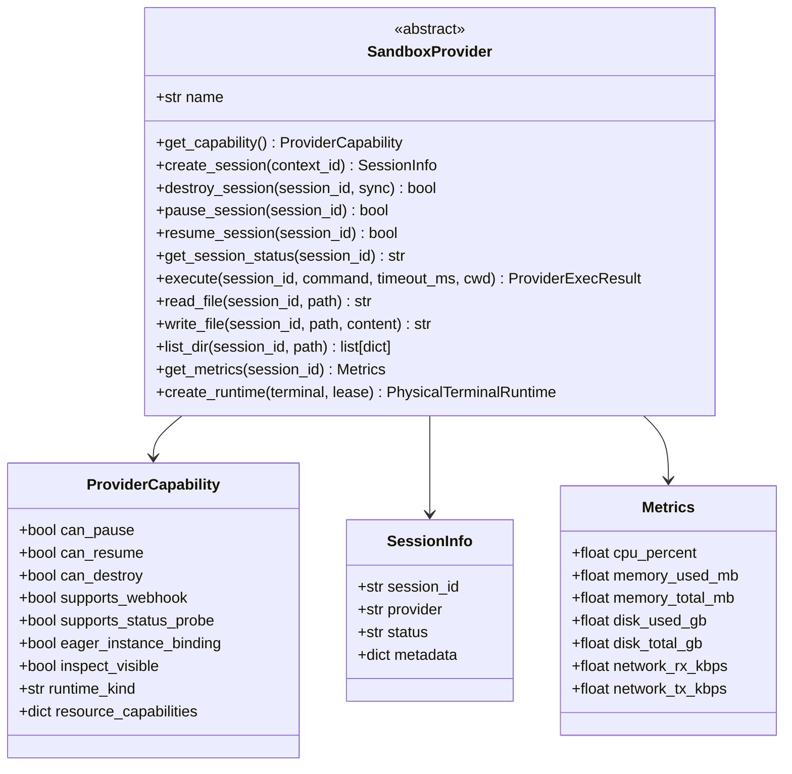
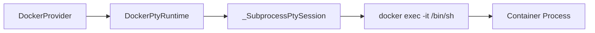
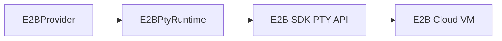
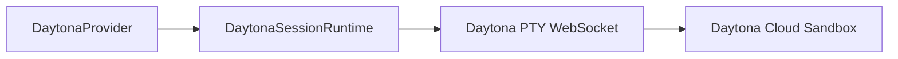
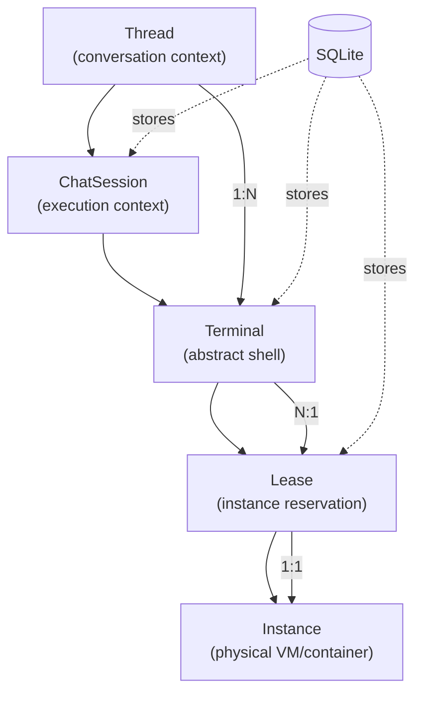
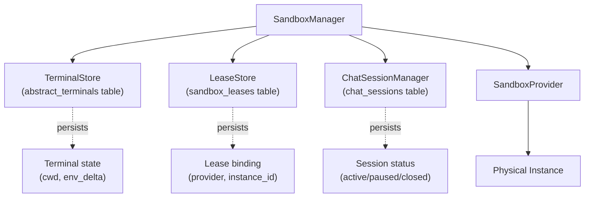
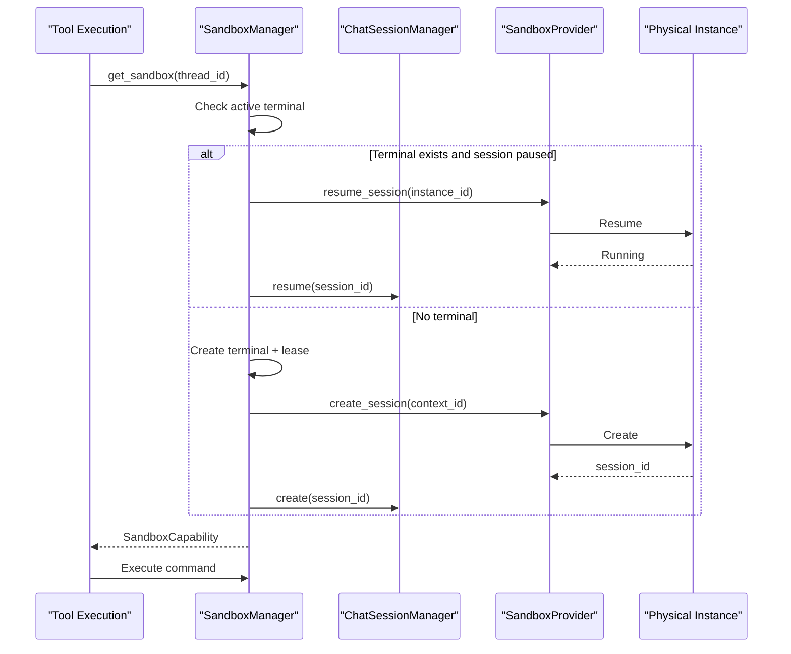

<!-- source: DeepWiki mcp.deepwiki.com · repo OpenDCAI/Mycel · page 4.3 Sandboxes and Execution Environments · fetched 2026-11-02 -->

# Sandboxes and Execution Environments

<details>
<summary>Relevant source files</summary>

The following files were used as context for generating this wiki page:

- [sandbox/manager.py](sandbox/manager.py)
- [sandbox/provider.py](sandbox/provider.py)
- [sandbox/providers/__init__.py](sandbox/providers/__init__.py)
- [sandbox/providers/agentbay.py](sandbox/providers/agentbay.py)
- [sandbox/providers/daytona.py](sandbox/providers/daytona.py)
- [sandbox/providers/docker.py](sandbox/providers/docker.py)
- [sandbox/providers/e2b.py](sandbox/providers/e2b.py)
- [sandbox/providers/local.py](sandbox/providers/local.py)
- [tui/widgets/sandbox_manager.py](tui/widgets/sandbox_manager.py)

</details>


This page explains the sandbox abstraction layer in Mycel, which provides isolated execution environments for running agent tools. Mycel supports multiple sandbox providers (local, Docker, E2B, Daytona, AgentBay), each with different capabilities and lifecycle management. The sandbox system orchestrates a hierarchy of resources: threads map to chat sessions, which manage terminals, which are backed by leases that control physical instances.

For sandbox configuration details, see [Sandbox Configuration](#9.2). For the terminal runtime implementations, see [Terminal Runtimes and PTY Handling](#6.4). For the overall agent architecture that uses sandboxes, see [Agent Runtime](#5).

## Provider Abstraction Layer

Mycel defines a unified `SandboxProvider` interface that all execution environments must implement. This abstraction allows tools to execute commands, read/write files, and inspect resources without knowing which provider is active.

### Core Provider Interface

The `SandboxProvider` abstract class [sandbox/provider.py:104-209]() defines the contract for all providers:



**Sources:** [sandbox/provider.py:104-209](), [sandbox/provider.py:60-76](), [sandbox/provider.py:78-84](), [sandbox/provider.py:93-102]()

### Provider Capabilities

Each provider declares its capabilities via `ProviderCapability` [sandbox/provider.py:60-76](). Capabilities fall into two categories:

**Lifecycle Capabilities:**
- `can_pause`: Provider supports pausing instances to save costs
- `can_resume`: Provider can resume paused instances
- `can_destroy`: Provider can destroy instances
- `supports_webhook`: Provider can notify on lifecycle events
- `supports_status_probe`: Provider can query instance status
- `eager_instance_binding`: Instance is created immediately on session creation

**Resource Capabilities** [sandbox/provider.py:14-57]():

| Capability | Description |
|------------|-------------|
| `filesystem` | Read/write files, list directories |
| `terminal` | Execute shell commands |
| `metrics` | CPU, memory, disk, network metrics |
| `screenshot` | Capture visual output (GUI environments) |
| `web` | Provide web UI access URL |
| `process` | List running processes |
| `hooks` | Support lifecycle hooks/webhooks |
| `snapshot` | Save/restore workspace state |

**Sources:** [sandbox/provider.py:60-76](), [sandbox/provider.py:14-57]()

## Available Providers

Mycel includes five built-in sandbox providers. Each has different trade-offs for performance, isolation, cost, and features.

### Provider Comparison

| Provider | Type | Isolation | Pause/Resume | Metrics | Best For |
|----------|------|-----------|--------------|---------|----------|
| **LocalSessionProvider** | Host | None | In-memory only | Yes (macOS/Linux) | Development, testing |
| **DockerProvider** | Container | Process + filesystem | Yes | Yes | Local isolation |
| **E2BProvider** | Cloud VM | Full VM | Yes | Yes | Cloud execution |
| **DaytonaProvider** | Cloud IDE | Full VM | Yes | Yes | Remote development |
| **AgentBayProvider** | Cloud VM | Full VM | Yes (tier-dependent) | Yes | Production cloud |

**Sources:** [sandbox/providers/local.py:30-211](), [sandbox/providers/docker.py:42-460](), [sandbox/providers/e2b.py:35-274](), [sandbox/providers/daytona.py:32-290](), [sandbox/providers/agentbay.py:27-253]()

### LocalSessionProvider

Direct host access with no isolation. Executes commands using the host's shell [sandbox/providers/local.py:30-211]().


**Key Characteristics:**
- `runtime_kind`: `"local"` [sandbox/providers/local.py:43]()
- No actual isolation; runs directly on host
- Pause/resume is in-memory state only (not cross-process) [sandbox/providers/local.py:76-106]()
- `eager_instance_binding`: `True` - no lazy instance creation [sandbox/providers/local.py:41]()
- `supports_status_probe`: `False` - status is in-memory only [sandbox/providers/local.py:40]()
- Platform-specific metrics: fast macOS native commands, falls back to Linux commands [sandbox/providers/local.py:156-206]()

**Sources:** [sandbox/providers/local.py:30-211](), [sandbox/providers/local.py:228-336]()

### DockerProvider

Runs each session in a Docker container [sandbox/providers/docker.py:42-393]().



**Key Characteristics:**
- `runtime_kind`: `"docker_pty"` [sandbox/providers/docker.py:60]()
- Uses `docker run` with named containers [sandbox/providers/docker.py:92-120]()
- Optional volume mounting for context persistence [sandbox/providers/docker.py:106-110]()
- Pause via `docker pause`, resume via `docker unpause` [sandbox/providers/docker.py:130-138]()
- Metrics from `docker stats` for CPU/memory, `df` inside container for disk [sandbox/providers/docker.py:249-315]()
- Paused containers still report disk usage via `docker ps --size` [sandbox/providers/docker.py:317-342]()

**Sources:** [sandbox/providers/docker.py:42-460](), [sandbox/providers/docker.py:465-566]()

### E2BProvider

Cloud sandbox using E2B's SDK [sandbox/providers/e2b.py:35-274]().



**Key Characteristics:**
- `runtime_kind`: `"e2b_pty"` [sandbox/providers/e2b.py:46]()
- Creates sandboxes with `Sandbox.beta_create(auto_pause=True)` [sandbox/providers/e2b.py:84-89]()
- Pause via `beta_pause()`, resume via `Sandbox.connect()` [sandbox/providers/e2b.py:112-135]()
- No persistent storage; pause is the only way to preserve state [sandbox/providers/e2b.py:8-10]()
- Workspace snapshot/restore via recursive file download/upload [sandbox/providers/e2b.py:222-252]()
- Batch status check via `Sandbox.list()` paginator [sandbox/providers/e2b.py:152-166]()
- Uses persistent PTY handle with marker-based output parsing [sandbox/providers/e2b.py:297-421]()

**Sources:** [sandbox/providers/e2b.py:35-274](), [sandbox/providers/e2b.py:297-421]()

### DaytonaProvider

Daytona cloud IDE sandbox [sandbox/providers/daytona.py:32-290]().



**Key Characteristics:**
- `runtime_kind`: `"daytona_pty"` [sandbox/providers/daytona.py:43]()
- Uses Daytona Python SDK for lifecycle and filesystem [sandbox/providers/daytona.py:59-79]()
- PTY-backed runtime for both SaaS and self-hosted [sandbox/providers/daytona.py:6-7]()
- Websocket-based PTY with JSON control messages [sandbox/providers/daytona.py:369-398]()
- Background state snapshot to avoid blocking command streaming [sandbox/providers/daytona.py:528-611]()
- Metrics via cgroup v2 (`/sys/fs/cgroup/cpu.stat`, `/sys/fs/cgroup/memory.current`) [sandbox/providers/daytona.py:190-274]()
- Workspace usage via `du -sm` (no per-container disk quota) [sandbox/providers/daytona.py:212-222]()
- Automatic PTY recovery on infrastructure errors [sandbox/providers/daytona.py:536-548]()

**Sources:** [sandbox/providers/daytona.py:32-290](), [sandbox/providers/daytona.py:318-633]()

### AgentBayProvider

Alibaba Cloud AgentBay sandbox [sandbox/providers/agentbay.py:27-253]().

**Key Characteristics:**
- Uses AgentBay Python SDK [sandbox/providers/agentbay.py:71-75]()
- Context sync for persistent storage [sandbox/providers/agentbay.py:84-96]()
- Rich inspection: metrics, screenshot, process list [sandbox/providers/agentbay.py:205-234]()
- Web UI access via `resource_url` [sandbox/providers/agentbay.py:236-239]()
- Account tier may disable pause/resume; capability override supported [sandbox/providers/agentbay.py:68-82]()
- Pause/resume failures raise RuntimeError for explicit handling [sandbox/providers/agentbay.py:118-132]()
- Uses `RemoteWrappedRuntime` (non-PTY shell wrapper) [sandbox/providers/agentbay.py:250-252]()

**Sources:** [sandbox/providers/agentbay.py:27-253]()

## Session Orchestration

The `SandboxManager` class [sandbox/manager.py:46-593]() orchestrates the mapping between logical threads and physical execution resources.

### Resource Hierarchy



**Sources:** [sandbox/manager.py:1-4](), [sandbox/manager.py:46-65]()

### SandboxManager Architecture

The `SandboxManager` coordinates three storage layers and one runtime layer:



**Sources:** [sandbox/manager.py:46-65]()

### Core Operations

**Getting a Sandbox** [sandbox/manager.py:134-182]():

The `get_sandbox(thread_id)` method resolves or creates the full hierarchy:

1. Check for active terminal → if exists, get associated session
2. If session exists and is paused, resume it automatically [sandbox/manager.py:139-146]()
3. If no terminal exists, create new terminal + lease + session
4. Ensure instance binding if provider requires eager binding [sandbox/manager.py:78-81]()
5. Return `SandboxCapability` wrapper for tool execution

**Thread-Single-Lease Invariant** [sandbox/manager.py:114-117]():

All terminals within a thread must share a single lease. This ensures consistent resource management and prevents resource fragmentation. The manager enforces this invariant during session creation.

**Background Command Sessions** [sandbox/manager.py:183-217]():

Tools can fork background terminals that share the lease but inherit state from the default terminal [sandbox/manager.py:203-210](). This enables non-blocking command execution while maintaining state consistency.

**Sources:** [sandbox/manager.py:134-182](), [sandbox/manager.py:183-217](), [sandbox/manager.py:114-122]()

### Idle Timeout Enforcement

The `enforce_idle_timeouts()` method [sandbox/manager.py:284-368]() implements cost optimization by pausing idle sessions:

**Timeout Rules:**
- Sessions idle longer than `idle_ttl_sec` are paused
- Sessions older than `max_duration_sec` are paused
- Local provider is exempt (no cost to keep running) [sandbox/manager.py:293-295]()
- Terminals with running commands are not paused [sandbox/manager.py:326-328]()
- Shared leases are not paused if any session is still active [sandbox/manager.py:330-348]()

**Sources:** [sandbox/manager.py:284-368]()

### Lifecycle Management



**Sources:** [sandbox/manager.py:134-182](), [sandbox/manager.py:374-424]()

## Provider Selection and Configuration

Threads are bound to a provider when the first terminal is created. The provider name is stored in the lease and cannot be changed [sandbox/manager.py:82-88]().

### Provider Lookup

The `lookup_sandbox_for_thread()` function [sandbox/manager.py:23-43]() queries the database to determine which provider a thread is bound to:

```python
# Query joins abstract_terminals and sandbox_leases
SELECT sl.provider_name
FROM abstract_terminals at
JOIN sandbox_leases sl ON at.lease_id = sl.lease_id
WHERE at.thread_id = ?
```

This enables the system to initialize the correct `SandboxManager` when resuming a thread.

**Sources:** [sandbox/manager.py:23-43]()

### Configuration Files

Sandbox providers are configured via JSON files in `~/.leon/sandboxes/`. Each provider has specific configuration options detailed in [Sandbox Configuration](#9.2).

**Sources:** [tui/widgets/sandbox_manager.py:79-133]()

## Sandbox Manager TUI

The `SandboxManagerApp` [tui/widgets/sandbox_manager.py:21-438]() provides a terminal UI for managing sandbox sessions interactively.

### TUI Features

**Session List View:**
- Shows all active sessions across all configured providers
- Displays session ID, status, provider, and thread ID
- Auto-refresh to track session lifecycle

**Actions:**
- **Create**: Spawn new sandbox session [tui/widgets/sandbox_manager.py:209-229]()
- **Delete**: Destroy session and cleanup resources [tui/widgets/sandbox_manager.py:186-207]()
- **Pause**: Pause running session (if provider supports) [tui/widgets/sandbox_manager.py:231-253]()
- **Resume**: Resume paused session [tui/widgets/sandbox_manager.py:255-277]()
- **Metrics**: Display CPU, memory, disk usage [tui/widgets/sandbox_manager.py:279-315]()
- **Open URL**: Open AgentBay web UI in browser [tui/widgets/sandbox_manager.py:317-343]()

**Pause/Resume Capability Detection:**

The TUI detects if pause/resume is unavailable (e.g., AgentBay account tier restriction) and mutes the buttons [tui/widgets/sandbox_manager.py:248-253](), [tui/widgets/sandbox_manager.py:359-379]().

**Launch Command:**
```bash
leonai sandbox [--api-key AGENTBAY_KEY]
```

**Sources:** [tui/widgets/sandbox_manager.py:21-438](), [tui/widgets/sandbox_manager.py:79-133](), [tui/widgets/sandbox_manager.py:161-173]()

### Session Discovery

The TUI discovers sessions via two methods [tui/widgets/sandbox_manager.py:161-173]():

1. **Lease-based sessions**: Query `sandbox_leases` + `abstract_terminals` tables
2. **Provider-orphan sessions**: Call `provider.list_provider_sessions()` for sessions not tracked in the database

This ensures all provider sessions are visible, even those created outside Mycel.

**Sources:** [tui/widgets/sandbox_manager.py:161-173](), [sandbox/manager.py:484-592]()

## Session States and Transitions

Sandbox sessions have the following states:

| State | Description |
|-------|-------------|
| `running` | Instance is active and ready for commands |
| `paused` | Instance is suspended (provider-specific) |
| `deleted` | Instance has been destroyed |
| `unknown` | Status probe failed or provider unavailable |
| `detached` | Session reference removed (local provider only) |

**Activity-Resume Rule** [sandbox/manager.py:139-146]():

Any tool execution against a paused thread automatically resumes the session before executing the command. This ensures transparent recovery from cost-optimized paused state.

**Sources:** [sandbox/manager.py:139-146](), [sandbox/provider.py:130-133]()

## Provider Implementation Guide

To add a new sandbox provider:

1. **Subclass `SandboxProvider`** [sandbox/provider.py:104-209]()
2. **Declare `ProviderCapability`** with lifecycle and resource capabilities
3. **Implement lifecycle methods**: `create_session`, `pause_session`, `resume_session`, `destroy_session`, `get_session_status`
4. **Implement resource methods**: `execute`, `read_file`, `write_file`, `list_dir`, `get_metrics`
5. **Implement `create_runtime`** to return a `PhysicalTerminalRuntime` for persistent shell semantics
6. **Set `CATALOG_ENTRY`** class attribute for provider discovery

**Runtime Kinds:**
- `"local"`: Direct host access (no runtime, uses `LocalPersistentShellRuntime`)
- `"docker_pty"`: Docker containers with PTY shell
- `"e2b_pty"`: E2B cloud with native PTY API
- `"daytona_pty"`: Daytona websocket PTY
- `"remote"`: Generic remote wrapper (AgentBay)

**Sources:** [sandbox/provider.py:104-209](), [sandbox/provider.py:60-76](), [sandbox/providers/local.py:208-210](), [sandbox/providers/docker.py:344-345](), [sandbox/providers/e2b.py:271-273](), [sandbox/providers/daytona.py:287-289](), [sandbox/providers/agentbay.py:250-252]()

---

