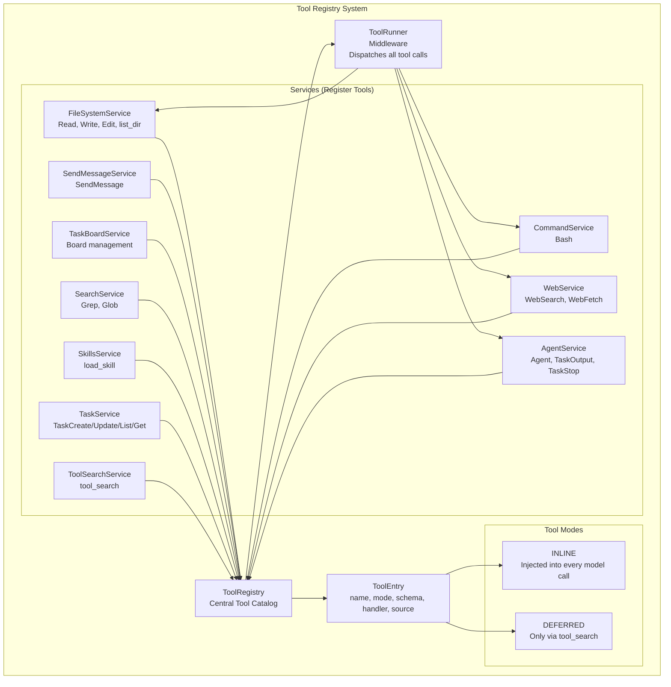
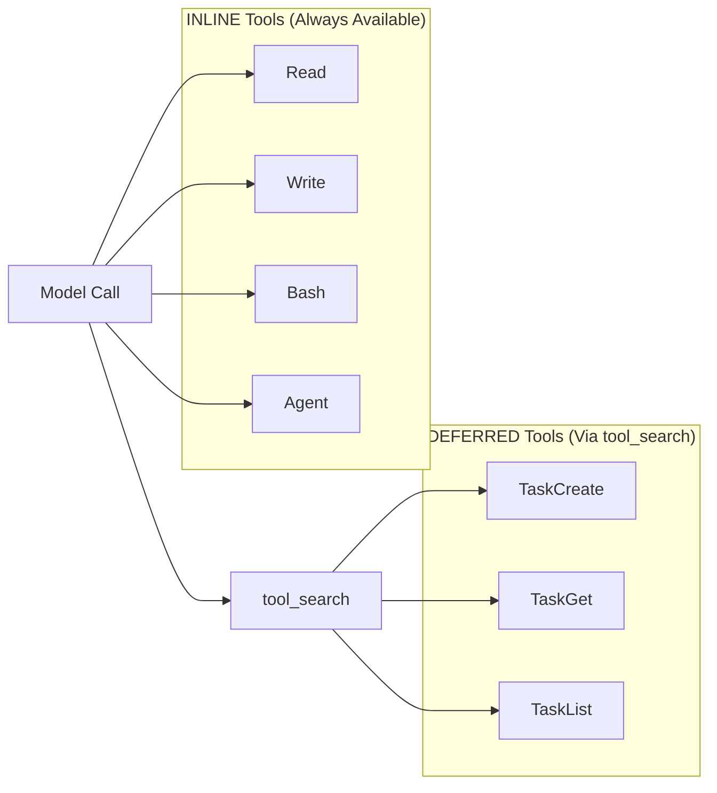
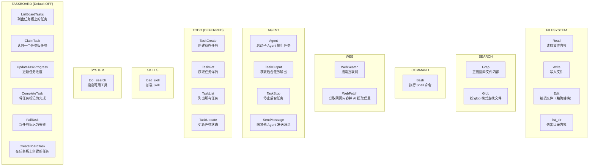
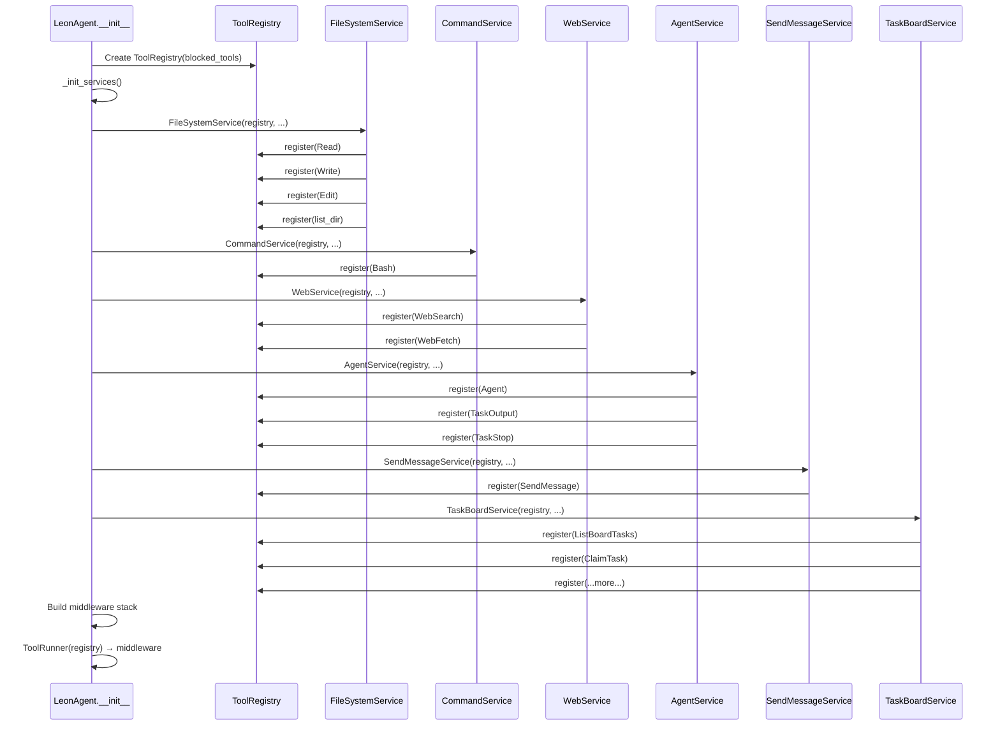
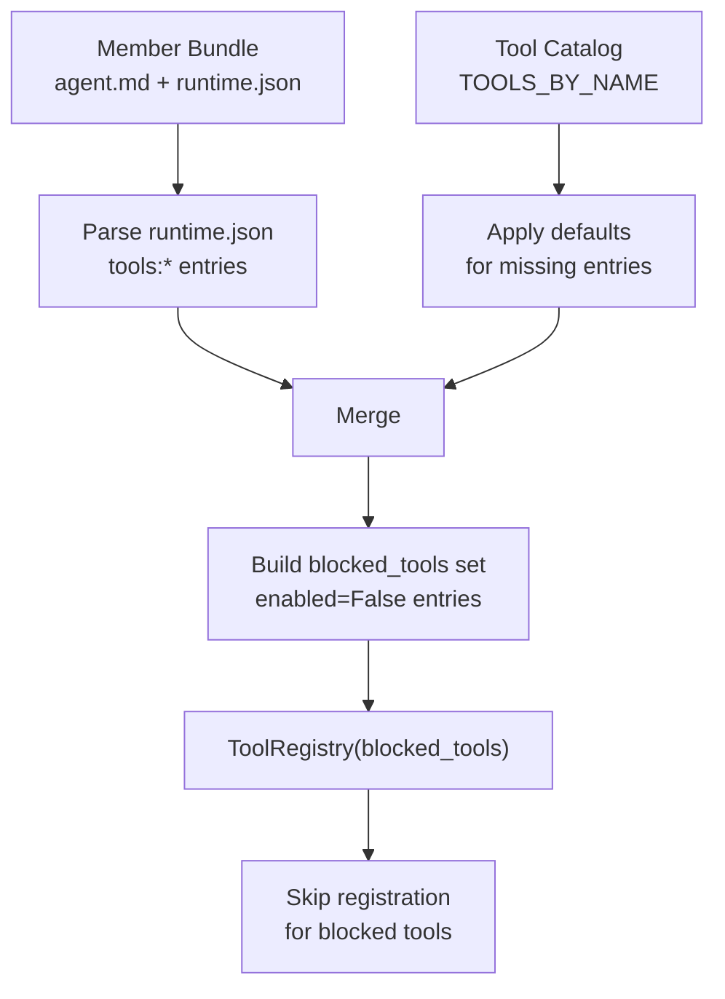
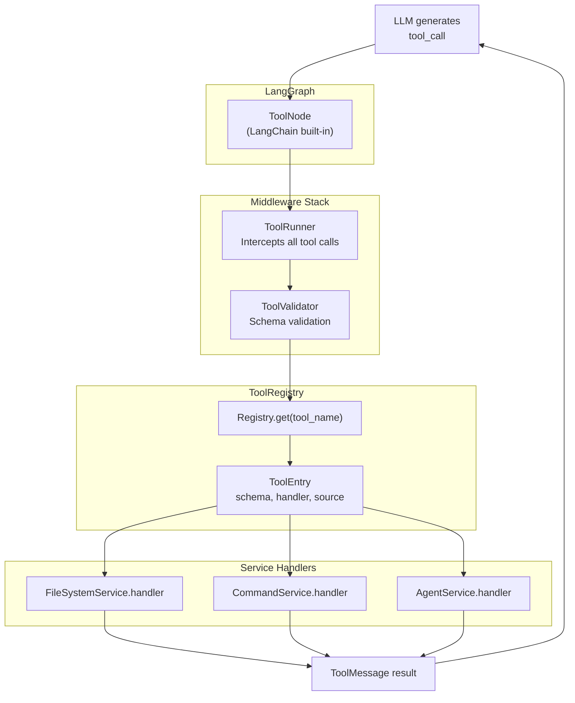
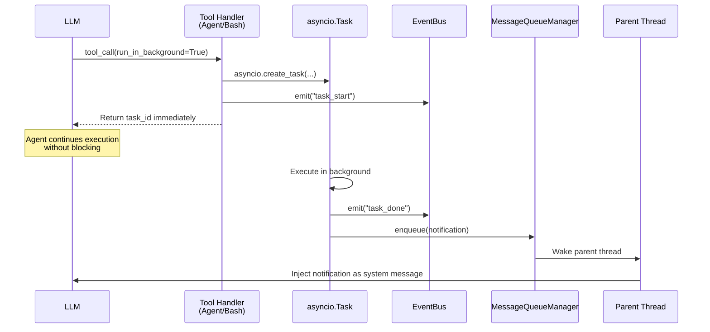
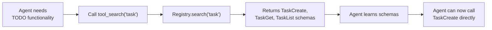

<!-- source: DeepWiki mcp.deepwiki.com · repo OpenDCAI/Mycel · page 4.4 Tools and Capabilities · fetched 2026-11-02 -->

# Tools and Capabilities

<details>
<summary>Relevant source files</summary>

The following files were used as context for generating this wiki page:

- [backend/taskboard/middleware.py](backend/taskboard/middleware.py)
- [backend/taskboard/service.py](backend/taskboard/service.py)
- [backend/web/services/member_service.py](backend/web/services/member_service.py)
- [config/defaults/tool_catalog.py](config/defaults/tool_catalog.py)
- [core/agents/communication/service.py](core/agents/communication/service.py)
- [core/agents/service.py](core/agents/service.py)
- [core/runtime/agent.py](core/runtime/agent.py)
- [core/runtime/registry.py](core/runtime/registry.py)
- [core/tools/command/service.py](core/tools/command/service.py)
- [sandbox/capability.py](sandbox/capability.py)

</details>


This page documents Mycel's tool system: the available tools, how they're organized, registered, and executed. Tools are the primary mechanism by which agents interact with their environment—reading files, executing commands, spawning sub-agents, or searching the web.

For information about how tools are invoked during agent execution, see [Agent Runtime](#5). For details on tool-specific middleware (SpillBuffer, ToolRunner), see [Middleware Stack](#5.3).

---

## Overview

Mycel provides a plugin-based tool system where each tool is:
- **Registered** by a Service into the `ToolRegistry`
- **Categorized** by group (filesystem, command, web, agent, etc.)
- **Mode-classified** as either `INLINE` (always available) or `DEFERRED` (discoverable via `tool_search`)
- **Configurable** per member (can be enabled/disabled in member configuration)

All tool execution flows through the `ToolRunner` middleware, which handles validation, dispatch, and error handling uniformly for all tools.

Sources: [core/runtime/registry.py:1-80](), [config/defaults/tool_catalog.py:1-87]()

---

## Tool Registry Architecture

The tool system is built around three core components:

### ToolRegistry

The `ToolRegistry` is the central catalog of all available tools. It maintains a mapping of tool names to `ToolEntry` objects and provides methods for registration, lookup, and search.



**Key Classes:**

| Class | File | Purpose |
|-------|------|---------|
| `ToolRegistry` | [core/runtime/registry.py:28-80]() | Central registry, tool lookup/search |
| `ToolEntry` | [core/runtime/registry.py:16-26]() | Tool metadata (name, schema, handler, mode) |
| `ToolMode` | [core/runtime/registry.py:11-14]() | INLINE or DEFERRED classification |
| `ToolRunner` | [core/runtime/runner.py]() | Middleware that dispatches tool calls |

Sources: [core/runtime/registry.py:1-80](), [core/runtime/agent.py:847-910]()

### ToolEntry Structure

Each tool is represented by a `ToolEntry` with:

- **name**: Tool identifier (e.g. "Read", "Bash", "Agent")
- **mode**: `ToolMode.INLINE` or `ToolMode.DEFERRED`
- **schema**: OpenAI function schema (dict or callable returning dict)
- **handler**: Async or sync function that executes the tool
- **source**: Service that registered the tool (for debugging)

Sources: [core/runtime/registry.py:16-26]()

### Tool Modes

**INLINE Tools** are injected into every model call's function schema. The model can call them directly without discovery. Most tools are INLINE.

**DEFERRED Tools** are hidden by default and only discoverable via the `tool_search` tool. This prevents schema bloat for rarely-used tools. Currently only TODO tools (TaskCreate, TaskGet, TaskList, TaskUpdate) are DEFERRED.



The agent must first call `tool_search` to discover deferred tools, then use the returned schemas to call them.

Sources: [core/runtime/registry.py:11-14](), [core/runtime/registry.py:58-76]()

---

## Tool Catalog

Mycel maintains an authoritative tool catalog in [config/defaults/tool_catalog.py:48-83](). This is the single source of truth for all available tools.

### Tool Groups

Tools are organized into groups for UI display:

| Group | Purpose | Tools |
|-------|---------|-------|
| `FILESYSTEM` | File operations | Read, Write, Edit, list_dir |
| `SEARCH` | Content search | Grep, Glob |
| `COMMAND` | Shell execution | Bash |
| `WEB` | Internet access | WebSearch, WebFetch |
| `AGENT` | Multi-agent coordination | Agent, TaskOutput, TaskStop, SendMessage |
| `TODO` | Task management | TaskCreate, TaskGet, TaskList, TaskUpdate |
| `SKILLS` | Dynamic tool loading | load_skill |
| `SYSTEM` | Meta tools | tool_search |
| `TASKBOARD` | Board task management | ListBoardTasks, ClaimTask, UpdateTaskProgress, CompleteTask, FailTask, CreateBoardTask |

Sources: [config/defaults/tool_catalog.py:19-29](), [config/defaults/tool_catalog.py:48-83]()

### Complete Tool List



Sources: [config/defaults/tool_catalog.py:48-83]()

---

## Tool Descriptions

### Filesystem Tools

**Read** - Read file contents from the workspace.
- **Parameters**: `path` (string)
- **Returns**: File content as text
- **Service**: `FileSystemService`

**Write** - Write content to a file in the workspace.
- **Parameters**: `path` (string), `content` (string)
- **Returns**: Success/error message
- **Service**: `FileSystemService`

**Edit** - Edit a file using precise search-and-replace.
- **Parameters**: `path` (string), `original` (string), `modified` (string)
- **Returns**: Success/error message with applied changes
- **Service**: `FileSystemService`

**list_dir** - List directory contents.
- **Parameters**: `path` (string)
- **Returns**: Array of directory entries with name, type, size
- **Service**: `FileSystemService`

Sources: [core/tools/filesystem/service.py]()

### Search Tools

**Grep** - Search file contents using regex patterns (powered by ripgrep).
- **Parameters**: `pattern` (string), `path` (string, optional)
- **Returns**: Matching lines with file paths and line numbers
- **Service**: `SearchService`

**Glob** - Find files matching glob patterns.
- **Parameters**: `pattern` (string), `path` (string, optional)
- **Returns**: List of matching file paths
- **Service**: `SearchService`

Sources: [core/tools/search/service.py]()

### Command Tools

**Bash** - Execute shell commands in the sandbox environment.
- **Parameters**: 
  - `command` (string): Command to execute
  - `description` (string, optional): Human-readable description (required for background runs)
  - `run_in_background` (boolean, default false): Fire-and-forget execution
  - `timeout` (integer, default 120000): Timeout in milliseconds
- **Returns**: Command output (stdout/stderr) or task_id for background runs
- **Service**: `CommandService`
- **Background execution**: Returns task_id immediately, agent continues without blocking

Sources: [core/tools/command/service.py:1-238]()

### Web Tools

**WebSearch** - Search the internet using configured search providers (Tavily, Exa).
- **Parameters**: `query` (string)
- **Returns**: Search results with titles, URLs, snippets
- **Service**: `WebService`

**WebFetch** - Fetch web page content and extract information using AI.
- **Parameters**: `url` (string), `extraction_prompt` (string, optional)
- **Returns**: Extracted content based on prompt
- **Service**: `WebService`

Sources: [core/tools/web/service.py]()

### Agent Tools

**Agent** - Spawn a sub-agent to handle complex tasks autonomously.
- **Parameters**:
  - `prompt` (string): Task for the agent
  - `subagent_type` (string, optional): Type of agent to spawn (e.g. 'Explore', 'Coder')
  - `name` (string, optional): Agent name for SendMessage routing
  - `description` (string, optional): Short description (required for background runs)
  - `run_in_background` (boolean, default false): Fire-and-forget execution
  - `max_turns` (integer, optional): Maximum agent turns
- **Returns**: Agent output text or task_id for background runs
- **Service**: `AgentService`

**TaskOutput** - Get output of a background task (agent or bash).
- **Parameters**: `task_id` (string)
- **Returns**: Task status and result (if completed)
- **Service**: `AgentService`

**TaskStop** - Stop a running background task.
- **Parameters**: `task_id` (string)
- **Returns**: Cancellation confirmation
- **Service**: `AgentService`

**SendMessage** - Send messages between agents for coordination.
- **Parameters**:
  - `type` (string): message, broadcast, shutdown_request, shutdown_response, plan_approval_response
  - `recipient` (string): Target agent name
  - `content` (string): Message content
  - `summary` (string, optional): 5-10 word preview
  - `approve` (boolean, optional): For responses
  - `request_id` (string, optional): For responses
- **Returns**: Delivery confirmation
- **Service**: `SendMessageService`

Sources: [core/agents/service.py:1-434](), [core/agents/communication/service.py:1-225]()

### TODO Tools (DEFERRED)

**TaskCreate** - Create a personal todo task.
- **Mode**: DEFERRED (discoverable via tool_search)
- **Parameters**: `title` (string), `description` (string, optional)
- **Service**: `TaskService`

**TaskGet** - Get task details by ID.
- **Mode**: DEFERRED
- **Parameters**: `task_id` (string)
- **Service**: `TaskService`

**TaskList** - List all personal todo tasks.
- **Mode**: DEFERRED
- **Parameters**: None
- **Service**: `TaskService`

**TaskUpdate** - Update task status or fields.
- **Mode**: DEFERRED
- **Parameters**: `task_id` (string), fields to update
- **Service**: `TaskService`

Sources: [core/tools/task/service.py]()

### Skills Tools

**load_skill** - Dynamically load a skill (custom tool) from the workspace.
- **Parameters**: `skill_name` (string)
- **Returns**: Success message, skill tools become available
- **Service**: `SkillsService`
- **Note**: Skills are Python modules with tool definitions in `~/.leon/members/{member}/skills/`

Sources: [core/tools/skills/service.py]()

### System Tools

**tool_search** - Search for available tools (including deferred tools).
- **Parameters**: `query` (string)
- **Returns**: Matching tool schemas
- **Service**: `ToolSearchService`
- **Purpose**: Allows agents to discover DEFERRED tools dynamically

Sources: [core/tools/tool_search/service.py]()

### TaskBoard Tools (Default OFF)

These tools manage the shared task board for multi-agent coordination. They are disabled by default and should only be enabled on dedicated scheduler agents.

**ListBoardTasks** - List tasks on the board with optional filters.
- **Parameters**: `Status` (string, optional), `Priority` (string, optional)

**ClaimTask** - Claim a board task for execution.
- **Parameters**: `TaskId` (string)

**UpdateTaskProgress** - Update task progress percentage.
- **Parameters**: `TaskId` (string), `Progress` (integer 0-100), `Note` (string, optional)

**CompleteTask** - Mark task as completed with result.
- **Parameters**: `TaskId` (string), `Result` (string)

**FailTask** - Mark task as failed with reason.
- **Parameters**: `TaskId` (string), `Reason` (string)

**CreateBoardTask** - Create a new board task for dispatching to other agents.
- **Parameters**: `Title` (string), `Description` (string, optional), `Priority` (string)

Sources: [backend/taskboard/service.py:1-335]()

---

## Tool Registration Flow

Tools are registered during `LeonAgent` initialization through Service classes:



Each Service:
1. Receives `ToolRegistry` instance
2. Creates `ToolEntry` objects with schemas and handlers
3. Calls `registry.register(entry)` for each tool

The registry checks `blocked_tools` during registration—if a tool is blocked for this member, it's silently skipped.

Sources: [core/runtime/agent.py:847-910](), [core/tools/filesystem/service.py](), [core/tools/command/service.py:59-96]()

---

## Tool Configuration per Member

Members can customize which tools are available by configuring `runtime.json` in their member directory:

```json
{
  "tools:Read": { "enabled": true, "desc": "读取文件内容" },
  "tools:Write": { "enabled": true, "desc": "写入文件" },
  "tools:Bash": { "enabled": false, "desc": "" },
  "tools:WebSearch": { "enabled": true, "desc": "" }
}
```

### Tool Defaults

The tool catalog defines default enabled states via `ToolDef.default`:

- **default=True**: Enabled by default unless explicitly disabled in member config
- **default=False**: Disabled by default unless explicitly enabled in member config

Currently only TaskBoard tools have `default=False`:

```python
ToolDef(name="ListBoardTasks", desc="...", group=ToolGroup.TASKBOARD, default=False)
```

Sources: [config/defaults/tool_catalog.py:36-44]()

### Loading Blocked Tools

When creating a `LeonAgent`, the system:

1. Loads member bundle via `AgentLoader.load_bundle()` [config/loader.py]()
2. Reads `runtime.json` to get tool overrides
3. Applies catalog defaults for tools not in runtime.json
4. Builds `blocked_tools` set for tools with `enabled=False`
5. Passes `blocked_tools` to `ToolRegistry` constructor

The registry then skips registration for any tool in the blocked set.



Sources: [core/runtime/agent.py:337-369](), [backend/web/services/member_service.py:173-183]()

---

## Tool Execution Pipeline

When an agent calls a tool, the request flows through the following pipeline:



### Execution Steps

1. **LLM Call**: Model generates a `tool_call` with name and arguments
2. **ToolNode**: LangChain's `ToolNode` receives the tool call
3. **ToolRunner**: Middleware intercepts via `wrap_tool_call()`
4. **Validation**: `ToolValidator` checks argument schema
5. **Registry Lookup**: `registry.get(tool_name)` retrieves `ToolEntry`
6. **Handler Dispatch**: Calls `entry.handler(**args)` 
7. **Async Handling**: If handler is async, awaits it
8. **Result**: Returns `ToolMessage` with result string
9. **Model Response**: Result flows back to LLM for next turn

Sources: [core/runtime/runner.py](), [core/runtime/validator.py]()

### Background Task Execution

Tools with `run_in_background=True` (Agent, Bash) follow a different flow:



The agent receives the task_id immediately and can:
- Continue with other work
- Poll status via `TaskOutput(task_id)`
- Stop the task via `TaskStop(task_id)`
- Wait for automatic notification when task completes

Sources: [core/agents/service.py:200-253](), [core/tools/command/service.py:141-198]()

---

## Tool Discovery and DEFERRED Tools

DEFERRED tools are not included in the model's function schema by default. Agents discover them via `tool_search`:



**Implementation**: `ToolSearchService` queries the registry and returns matching tool schemas as formatted text. The LLM reads these schemas and can then call the tools.

This prevents cluttering the function schema with rarely-used tools, reducing context window usage and improving model performance.

Sources: [core/tools/tool_search/service.py](), [core/runtime/registry.py:63-76]()

---

## Summary

Mycel's tool system provides:

- **28 built-in tools** across 8 categories
- **Plugin architecture** via Service-based registration
- **Dual-mode system**: INLINE (always available) vs DEFERRED (discoverable)
- **Member-level configuration** for fine-grained control
- **Background execution** for long-running operations
- **Unified execution pipeline** via ToolRunner middleware

All tools share the same registration, validation, and dispatch mechanisms, making the system extensible and maintainable.

Sources: [core/runtime/registry.py:1-80](), [config/defaults/tool_catalog.py:1-87](), [core/runtime/agent.py:847-910]()

---

