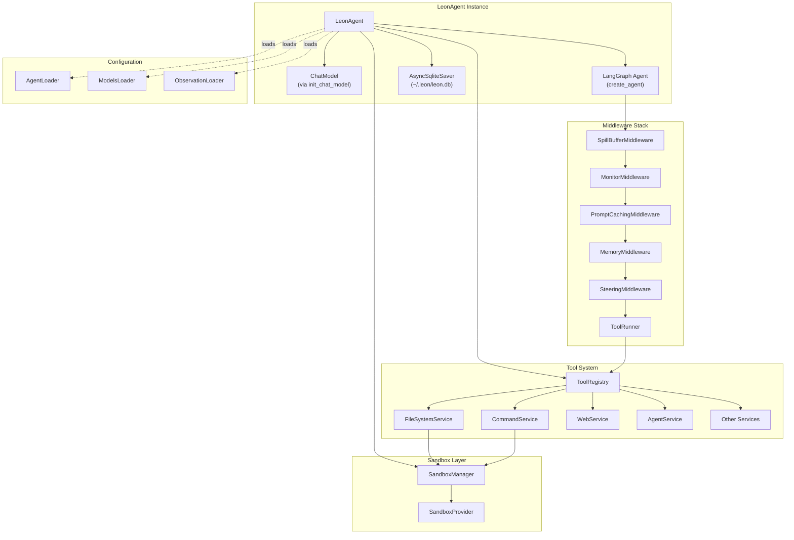
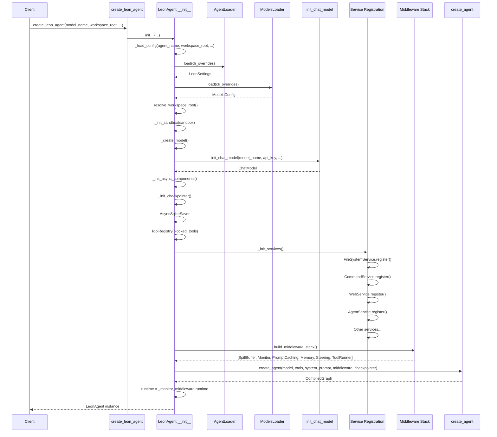
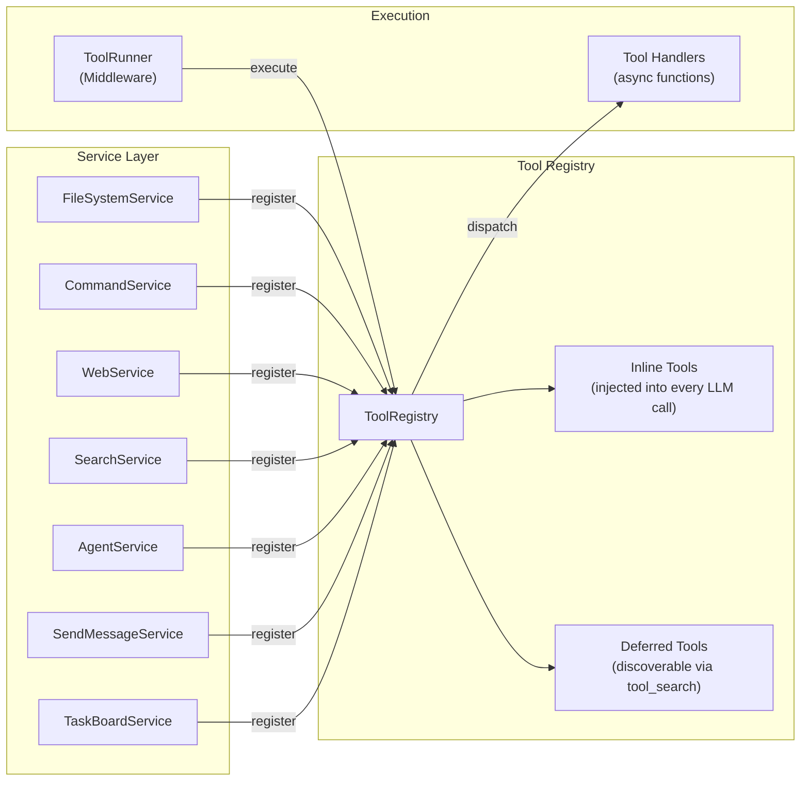
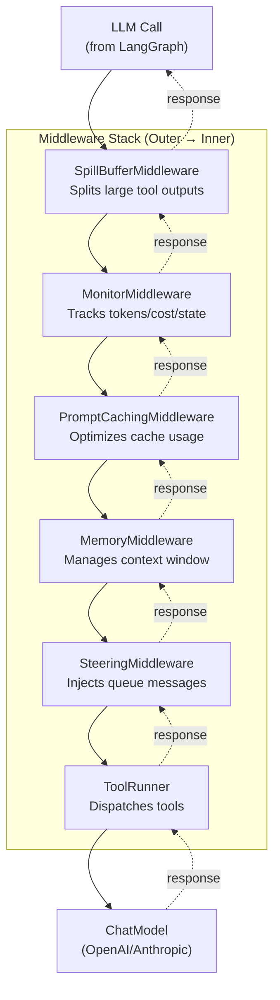
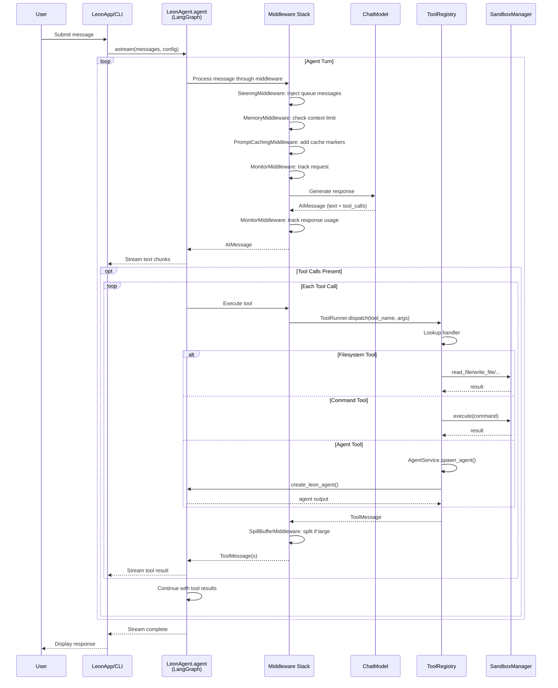
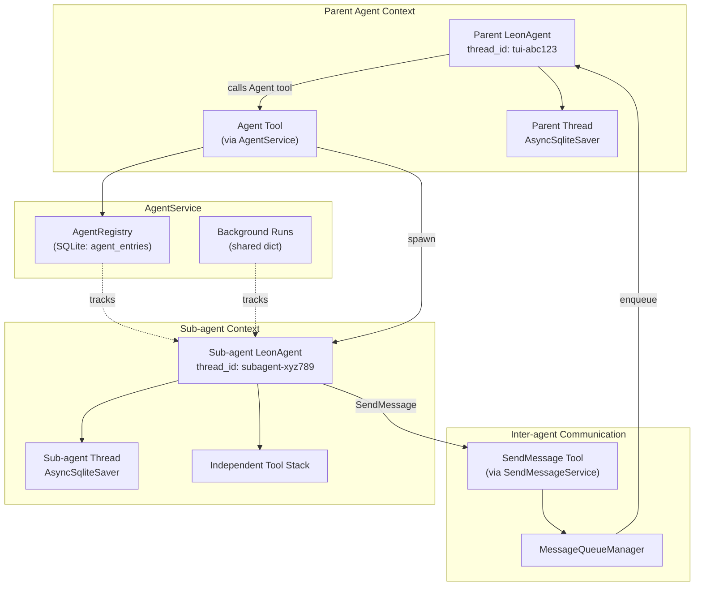

<!-- source: DeepWiki mcp.deepwiki.com · repo OpenDCAI/Mycel · page 5 Agent Runtime · fetched 2026-11-02 -->

# Agent Runtime

<details>
<summary>Relevant source files</summary>

The following files were used as context for generating this wiki page:

- [agent.py](agent.py)
- [backend/taskboard/middleware.py](backend/taskboard/middleware.py)
- [backend/taskboard/service.py](backend/taskboard/service.py)
- [backend/web/services/member_service.py](backend/web/services/member_service.py)
- [config/defaults/tool_catalog.py](config/defaults/tool_catalog.py)
- [core/agents/communication/service.py](core/agents/communication/service.py)
- [core/agents/service.py](core/agents/service.py)
- [core/runtime/agent.py](core/runtime/agent.py)
- [core/runtime/registry.py](core/runtime/registry.py)
- [core/tools/command/service.py](core/tools/command/service.py)
- [pyproject.toml](pyproject.toml)
- [sandbox/capability.py](sandbox/capability.py)
- [tui/app.py](tui/app.py)
- [tui/leon_cli.py](tui/leon_cli.py)
- [tui/runner.py](tui/runner.py)
- [tui/widgets/status.py](tui/widgets/status.py)
- [uv.lock](uv.lock)

</details>


**Purpose and Scope**: This page provides a comprehensive overview of the Agent Runtime system, which is the core execution engine of Mycel. The runtime is built around the `LeonAgent` class and integrates LangGraph for agent orchestration, a tool registry system for capability management, and a middleware stack for cross-cutting concerns. This page covers the high-level architecture and execution lifecycle; for detailed implementation specifics, see [Agent Architecture and Initialization](#5.1), [Tool Registry and Execution](#5.2), [Middleware Stack](#5.3), and [Sub-agents and Inter-agent Communication](#5.4).

---

## LeonAgent Architecture

The `LeonAgent` class [core/runtime/agent.py:92-760]() is the primary runtime component that orchestrates all agent capabilities. It provides a unified interface for creating, configuring, and executing AI agents with persistent state, tool access, and memory management.

### Core Responsibilities

The agent runtime handles:

- **Model Management**: Initializes and configures LLM models via `init_chat_model` with support for virtual model names (`leon:mini`, `leon:medium`, `leon:large`, `leon:max`) that resolve to actual provider models
- **Tool Registration**: Maintains a `ToolRegistry` where services register tools that the agent can invoke
- **Middleware Orchestration**: Builds and manages a middleware stack that wraps the LangGraph agent
- **State Persistence**: Uses LangGraph checkpointing with SQLite (`AsyncSqliteSaver`) for conversation history
- **Sandbox Integration**: Provides isolated execution environments through the sandbox abstraction layer
- **Configuration Loading**: Resolves configuration from multiple sources (defaults, workspace, CLI overrides)

### Key Components Diagram



**Sources**: [core/runtime/agent.py:92-267](), [core/runtime/registry.py:28-80]()

---

## Agent Initialization Flow

The initialization process involves multiple stages, each responsible for loading and configuring different aspects of the runtime.

### Configuration Resolution

Configuration is loaded from multiple sources with explicit precedence:

1. **Built-in Defaults**: System defaults from `config/defaults/`
2. **Workspace Config**: Files in `~/.leon/` and workspace root
3. **CLI Overrides**: Parameters passed to `create_leon_agent()`

The `AgentLoader` [config/loader.py]() and `ModelsLoader` [config/models_loader.py]() handle this layered configuration system.



**Sources**: [core/runtime/agent.py:106-267](), [core/runtime/agent.py:371-442]()

### Model Resolution

The system supports **virtual model names** that map to actual provider models:

| Virtual Name | Default Resolution |
|--------------|-------------------|
| `leon:mini` | `gpt-4o-mini` or `claude-3-5-haiku-20241022` |
| `leon:medium` | `gpt-4o` |
| `leon:large` | `claude-3-5-sonnet-20241022` |
| `leon:max` | `claude-3-7-sonnet-20250219` |

Model resolution happens in [core/runtime/agent.py:164-180](), where the `ModelsConfig.resolve_model()` method translates virtual names to concrete model identifiers and retrieves provider-specific configuration.

**Sources**: [core/runtime/agent.py:164-180](), [config/models_schema.py]()

---

## Tool System Overview

The tool system is based on a **service registration pattern** where each capability area provides a service that registers tools into a central `ToolRegistry`.

### Tool Service Architecture



Each service registers one or more `ToolEntry` objects [core/runtime/registry.py:16-26]():

```python
@dataclass
class ToolEntry:
    name: str                    # Tool name (e.g., "Read", "Bash")
    mode: ToolMode              # INLINE or DEFERRED
    schema: SchemaProvider      # OpenAI function schema
    handler: Handler            # Async function to execute tool
    source: str                 # Service name for debugging
```

### Tool Registration Example

The `CommandService` [core/tools/command/service.py:32-96]() demonstrates the registration pattern:

```python
class CommandService:
    def __init__(self, registry: ToolRegistry, workspace_root: Path, ...):
        self._register(registry)
    
    def _register(self, registry: ToolRegistry) -> None:
        registry.register(ToolEntry(
            name="Bash",
            mode=ToolMode.INLINE,
            schema={
                "name": "Bash",
                "description": "Execute shell command...",
                "parameters": {
                    "type": "object",
                    "properties": {
                        "command": {"type": "string", ...},
                        "run_in_background": {"type": "boolean", ...},
                        "timeout": {"type": "integer", ...}
                    },
                    "required": ["command"]
                }
            },
            handler=self._bash,
            source="CommandService"
        ))
```

The `ToolRegistry` filters tools based on `blocked_tools` configuration [core/runtime/agent.py:337-369](), allowing member-specific tool enablement.

**Sources**: [core/runtime/agent.py:224-226](), [core/runtime/registry.py:28-80](), [core/tools/command/service.py:32-96]()

### Available Tools by Service

| Service | Tools | Mode | Purpose |
|---------|-------|------|---------|
| `FileSystemService` | `Read`, `Write`, `Edit`, `list_dir` | INLINE | File operations within workspace |
| `CommandService` | `Bash` | INLINE | Shell command execution with hooks |
| `SearchService` | `Grep`, `Glob` | INLINE | Code search and file finding |
| `WebService` | `WebSearch`, `WebFetch` | INLINE | Internet search and content extraction |
| `AgentService` | `Agent`, `TaskOutput`, `TaskStop` | INLINE | Sub-agent spawning and management |
| `SendMessageService` | `SendMessage` | INLINE | Inter-agent communication |
| `TaskService` | `TaskCreate`, `TaskUpdate`, `TaskList`, `TaskGet` | DEFERRED | Personal task management |
| `TaskBoardService` | `ListBoardTasks`, `ClaimTask`, `CompleteTask`, etc. | INLINE | Shared task board operations |
| `SkillsService` | `load_skill` | INLINE | Dynamic tool loading from Library |
| `ToolSearchService` | `tool_search` | INLINE | Deferred tool discovery |

**Sources**: [core/runtime/agent.py:634-758](), [config/defaults/tool_catalog.py:48-83]()

---

## Middleware Stack Architecture

The middleware stack provides cross-cutting concerns through a **Russian doll** wrapping pattern, where each middleware wraps the next, processing requests and responses bidirectionally.

### Middleware Execution Order



Each middleware implements two methods:
- `wrap_model_call()` / `awrap_model_call()`: Intercepts and modifies model requests/responses
- `wrap_tool_call()` / `awrap_tool_call()`: Intercepts and executes tool calls

The middleware stack is built in [core/runtime/agent.py:761-851]():

```python
def _build_middleware_stack(self) -> list:
    middleware = []
    
    # Outer layer: SpillBuffer splits large outputs
    middleware.append(SpillBufferMiddleware())
    
    # Monitor tracks usage and state transitions
    self._monitor_middleware = MonitorMiddleware(...)
    middleware.append(self._monitor_middleware)
    
    # PromptCaching optimizes cache regions
    middleware.append(PromptCachingMiddleware())
    
    # Memory manages context window
    if memory_config.enabled:
        self._memory_middleware = MemoryMiddleware(...)
        middleware.append(self._memory_middleware)
    
    # Steering injects queue messages
    middleware.append(SteeringMiddleware(queue_manager, thread_id))
    
    # Inner layer: ToolRunner dispatches to registry
    middleware.append(ToolRunner(self._tool_registry))
    
    return middleware
```

### Middleware Responsibilities Summary

| Middleware | Purpose | Key Methods |
|------------|---------|-------------|
| `SpillBufferMiddleware` | Splits tool outputs >100KB into separate messages to avoid context overflow | `awrap_tool_call()` |
| `MonitorMiddleware` | Tracks token usage, cost, state transitions (IDLE/ACTIVE/SUSPENDED/ERROR), and provides runtime status | `wrap_model_call()`, `awrap_model_call()` |
| `PromptCachingMiddleware` | Adds `cache_control` markers for Anthropic prompt caching to reduce costs | `wrap_model_call()` |
| `MemoryMiddleware` | Compacts conversation history when context limit is reached via summarization | `wrap_model_call()`, `awrap_model_call()` |
| `SteeringMiddleware` | Injects messages from `MessageQueueManager` queues (steer, followup, agent notifications) | `wrap_model_call()` |
| `ToolRunner` | Dispatches tool calls to registered handlers in `ToolRegistry` | `awrap_tool_call()` |

**Sources**: [core/runtime/agent.py:761-851](), [core/runtime/middleware/]()

---

## Agent Execution Lifecycle

When a user sends a message, the agent runtime coordinates multiple components to process the request, invoke tools, and generate responses.

### Message Processing Flow



### State Transitions

The `MonitorMiddleware` manages agent state through an `AgentState` enum [core/runtime/middleware/monitor/state.py]():

```
IDLE → ACTIVE (on message submit)
ACTIVE → IDLE (on successful completion)
ACTIVE → SUSPENDED (on user interrupt/ESC)
ACTIVE → ERROR (on exception)
ERROR → RECOVERING → READY → ACTIVE (on retry)
SUSPENDED → ACTIVE (on resume)
```

State transitions trigger callbacks registered via `runtime.state.on_state_changed()` [tui/app.py:140-144](), enabling queue-driven followup processing.

**Sources**: [core/runtime/agent.py:1-20](), [tui/app.py:298-528](), [core/runtime/middleware/monitor/]()

---

## Sub-agent System Overview

The agent runtime supports **hierarchical agent systems** where agents can spawn independent sub-agents to delegate complex tasks. Sub-agents run as asyncio tasks with their own thread IDs and checkpointer state.

### Sub-agent Architecture



### Blocking vs Background Execution

The `Agent` tool [core/agents/service.py:200-252]() supports two execution modes:

1. **Blocking (default)**: Parent waits for sub-agent completion, receives output as tool result
2. **Background (`run_in_background=True`)**: Returns `task_id` immediately, use `TaskOutput` to poll for results

Background execution enables long-running sub-agents that notify the parent via `MessageQueueManager` when complete [core/agents/service.py:361-370]().

### Inter-agent Communication

The `SendMessage` tool [core/agents/communication/service.py:98-207]() enables agents to communicate via message types:

- `message`: Direct message to named agent
- `broadcast`: Message to all running agents
- `shutdown_request`: Request another agent to terminate
- `shutdown_response`: Respond to shutdown request
- `plan_approval_response`: Approve/reject a plan from another agent

Messages are routed through `MessageQueueManager` and resolved via `AgentRegistry` name lookups [core/agents/communication/service.py:141-156]().

**Sources**: [core/agents/service.py:1-434](), [core/agents/communication/service.py:1-207](), [core/agents/registry.py]()

---

## Runtime Context Variables

The runtime uses Python's `contextvars` to track thread-scoped state across async boundaries:

| Context Var | Module | Purpose |
|-------------|--------|---------|
| `current_thread_id` | `core.operations` | Tracks active thread ID for file operation recording |
| Sandbox thread context | `sandbox.thread_context` | Tracks thread ID and run ID for sandbox session management |

These are set at the start of each agent run [tui/app.py:352-363]() and used by services to associate operations with the correct thread/session.

**Sources**: [tui/app.py:352-363](), [sandbox/thread_context.py](), [core/operations.py]()

---

## Agent Factory Function

While `LeonAgent` can be instantiated directly, the recommended entry point is the `create_leon_agent()` factory [core/runtime/agent.py:865-932]():

```python
def create_leon_agent(
    model_name: str | None = None,
    api_key: str | None = None,
    workspace_root: str | Path | None = None,
    *,
    profile: str | None = None,        # Path to profile YAML
    agent: str | None = None,          # Member name to load
    sandbox: Any = None,               # Sandbox name or instance
    storage_container: StorageContainer | None = None,
    queue_manager: MessageQueueManager | None = None,
    verbose: bool = False,
    **kwargs
) -> LeonAgent:
```

This factory:
1. Validates the sandbox configuration
2. Loads profile configuration if specified
3. Creates the `LeonAgent` instance with merged configuration
4. Returns the initialized agent ready for use

**Sources**: [core/runtime/agent.py:865-932]()

---

## Integration with User Interfaces

The agent runtime is interface-agnostic and supports multiple interaction modes:

| Interface | Module | Integration Point |
|-----------|--------|-------------------|
| **TUI** | `tui.app.LeonApp` | `agent.agent.astream()` with Textual UI updates |
| **CLI** | `tui.runner.NonInteractiveRunner` | `agent.agent.astream()` with stdio output |
| **Web** | `backend.web.services.streaming_service` | `agent.agent.astream()` with SSE events |

All interfaces use the same streaming API (`agent.astream()`) and receive identical chunk structures, ensuring consistent behavior across modes.

**Sources**: [tui/app.py:298-528](), [tui/runner.py:44-109](), [backend/web/services/streaming_service.py]()

---

## Summary

The Agent Runtime provides a modular, extensible architecture for AI agent execution:

- **LeonAgent** serves as the orchestration layer, integrating model, tools, middleware, and state
- **Tool services** register capabilities into a central `ToolRegistry` using a standardized pattern
- **Middleware stack** provides cross-cutting concerns (monitoring, memory, caching) without coupling to business logic
- **Sub-agent system** enables hierarchical delegation with independent execution contexts
- **State persistence** via LangGraph checkpointing ensures conversation continuity across sessions

For implementation details on specific subsystems, see:
- [Agent Architecture and Initialization](#5.1) - Detailed initialization process and configuration loading
- [Tool Registry and Execution](#5.2) - Tool registration patterns, validation, and execution pipeline
- [Middleware Stack](#5.3) - In-depth middleware behavior and request/response processing
- [Sub-agents and Inter-agent Communication](#5.4) - Sub-agent lifecycle and messaging protocols

---

