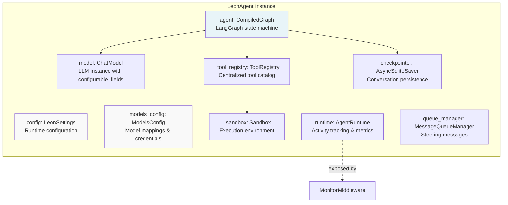
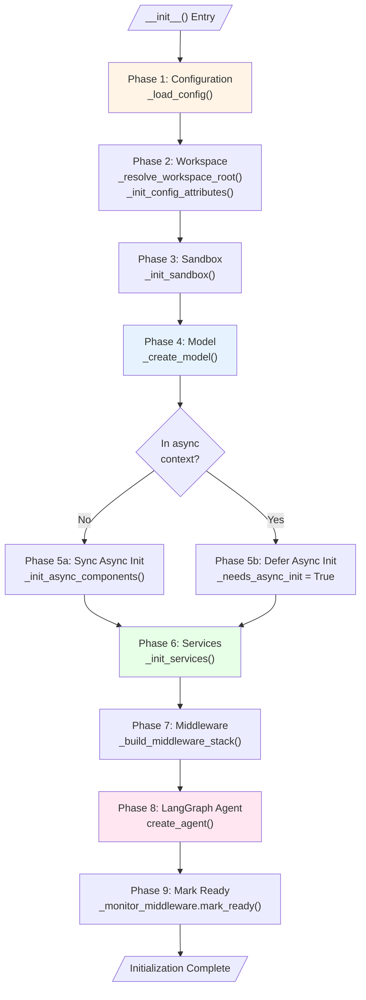
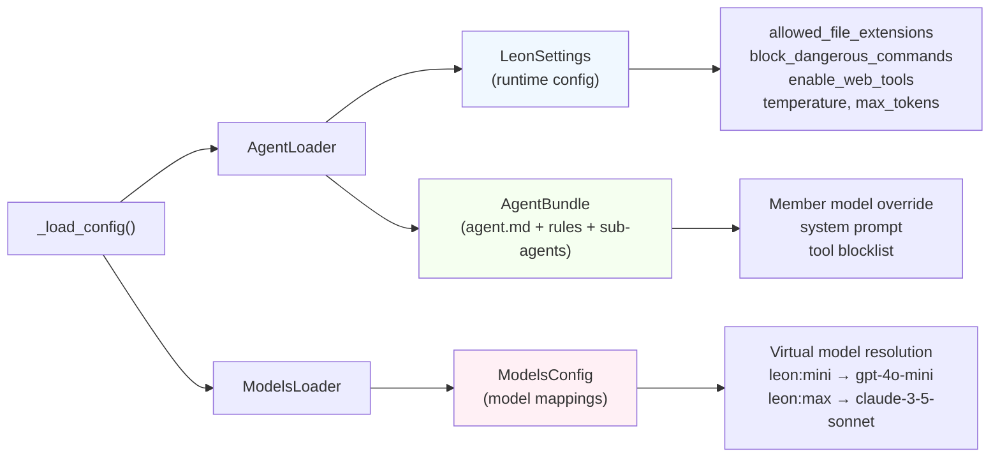
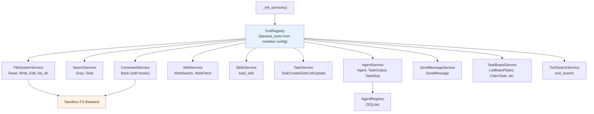
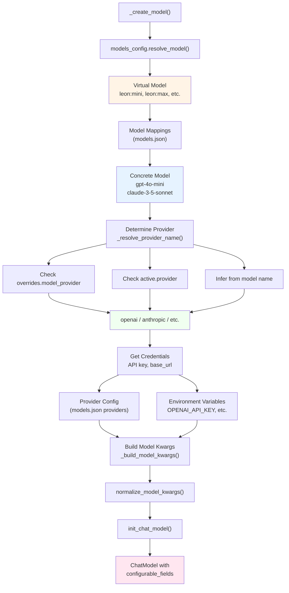
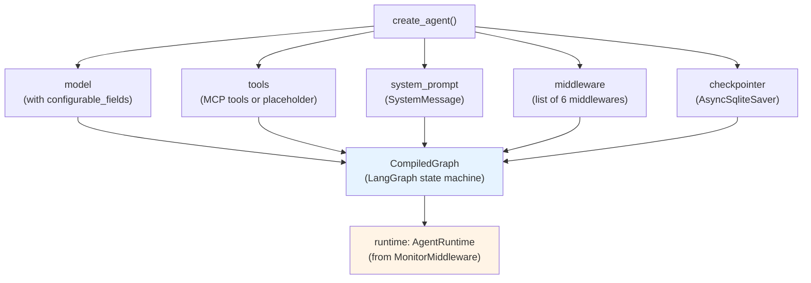
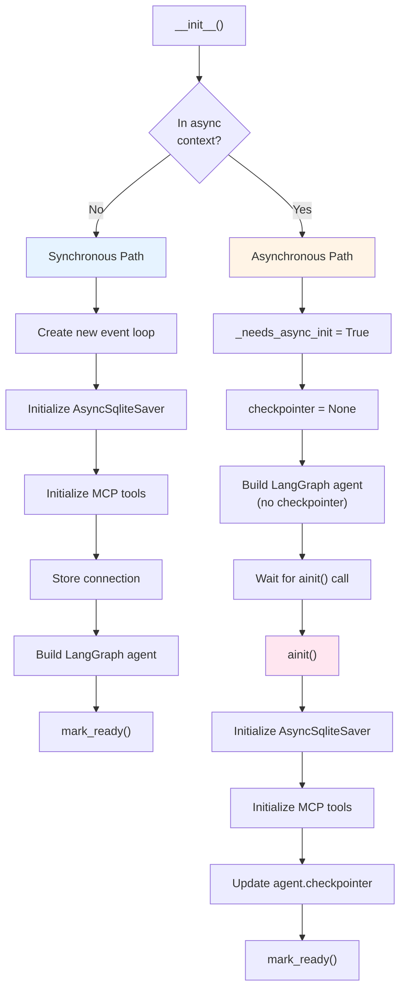
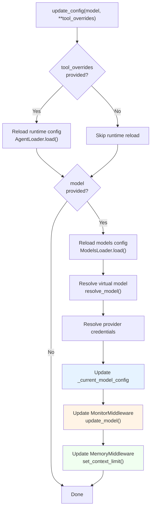

<!-- source: DeepWiki mcp.deepwiki.com · repo OpenDCAI/Mycel · page 5.1 Agent Architecture and Initialization · fetched 2026-11-02 -->

# Agent Architecture and Initialization

<details>
<summary>Relevant source files</summary>

The following files were used as context for generating this wiki page:

- [backend/taskboard/middleware.py](backend/taskboard/middleware.py)
- [backend/taskboard/service.py](backend/taskboard/service.py)
- [backend/web/services/member_service.py](backend/web/services/member_service.py)
- [config/defaults/tool_catalog.py](config/defaults/tool_catalog.py)
- [core/agents/communication/service.py](core/agents/communication/service.py)
- [core/agents/service.py](core/agents/service.py)
- [core/runtime/agent.py](core/runtime/agent.py)
- [core/runtime/registry.py](core/runtime/registry.py)
- [core/tools/command/service.py](core/tools/command/service.py)
- [sandbox/capability.py](sandbox/capability.py)

</details>


This page documents the `LeonAgent` class structure, its initialization pipeline, configuration loading system, and model setup process. The `LeonAgent` class is the core runtime component that orchestrates LLM interactions, tool execution, and middleware processing.

For information about the middleware stack built during initialization, see [Middleware Stack](#5.3). For details on tool registration and execution, see [Tool Registry and Execution](#5.2). For sub-agent spawning mechanics, see [Sub-agents and Inter-agent Communication](#5.4).

---

## LeonAgent Class Overview

The `LeonAgent` class ([core/runtime/agent.py:92-267]()) is the primary agent runtime that coordinates all aspects of agent execution. It serves as the container for model instances, tool registries, middleware stacks, sandbox integrations, and configuration state.

**Key Responsibilities:**
- **Configuration Loading**: Load and merge agent definitions, model configurations, and runtime settings from multiple sources
- **Model Management**: Resolve virtual model names (e.g., `leon:mini`) to concrete models and instantiate LLM clients
- **Service Initialization**: Register all tool services (filesystem, command, web, agent, etc.) into the `ToolRegistry`
- **Middleware Assembly**: Build the middleware stack (SpillBuffer → Monitor → PromptCaching → Memory → Steering → ToolRunner)
- **LangGraph Agent Creation**: Construct the LangGraph state machine with model, tools, system prompt, and middleware
- **Sandbox Integration**: Connect to execution environments (local, Docker, E2B, etc.) via the sandbox abstraction
- **Checkpointer Management**: Initialize SQLite-backed LangGraph checkpointer for conversation persistence

**Class Structure:**



Sources: [core/runtime/agent.py:92-267]()

---

## Initialization Pipeline

Agent initialization follows a multi-phase process that handles both synchronous and asynchronous contexts. The pipeline resolves configuration, prepares the execution environment, initializes services, and constructs the LangGraph agent.

### Initialization Phases



Sources: [core/runtime/agent.py:107-267]()

### Phase 1: Configuration Loading

The configuration system loads agent definitions, model mappings, and runtime settings from multiple sources with a clear precedence hierarchy.

**Configuration Sources (highest to lowest precedence):**
1. CLI overrides (passed to `__init__`)
2. Member-specific configs (`~/.leon/members/{id}/`)
3. Workspace configs (`{workspace}/.leon/`)
4. User home configs (`~/.leon/`)
5. System defaults (`config/defaults/`)



**Configuration Loading Logic:**

The `_load_config` method ([core/runtime/agent.py:371-442]()) orchestrates configuration loading:

1. **Runtime Config**: `AgentLoader` loads `LeonSettings` by merging:
   - `runtime.json` (command hooks, context limits, temperature)
   - CLI overrides (passed as `cli_overrides` dict)
   
2. **Models Config**: `ModelsLoader` loads `ModelsConfig` by merging:
   - `models.json` (virtual model mappings, provider credentials)
   - CLI overrides (active model selection)

3. **Member Config**: If `agent` parameter specified (e.g., `agent="bash"`):
   - Load agent definition from `config/defaults/agents/{agent}.md` or `~/.leon/members/{id}/agents/{agent}.md`
   - Parse YAML frontmatter (name, description, tools, model)
   - Load full bundle if member source directory exists (rules, sub-agents, skills, MCP servers)
   - Store in `_agent_override` and `_agent_bundle`

**Model Resolution:**

Virtual model names are resolved through the models config ([core/runtime/agent.py:163-174]()):

```
leon:mini   → gpt-4o-mini (or mapped model)
leon:medium → gpt-4o (or mapped model)
leon:large  → claude-3-5-sonnet-20241022 (or mapped model)
leon:max    → claude-3-5-sonnet-20241022 (or mapped model)
```

Member-defined model overrides take precedence over global config ([core/runtime/agent.py:169-171]()).

Sources: [core/runtime/agent.py:371-442](), [config/loader.py](), [config/models_loader.py]()

---

## Service Initialization

After configuration loading, the agent initializes all tool services and registers them with the `ToolRegistry`. This phase establishes the agent's tool capabilities.

### Service Registration Flow



**Service Initialization Logic:**

The `_init_services` method ([core/runtime/agent.py:847-1046]()) instantiates each service with its dependencies and registers tools into the `ToolRegistry`:

1. **Create ToolRegistry** with member-defined blocked tools ([core/runtime/agent.py:225]())
2. **Extract Sandbox Backends**: Get filesystem and command backends from sandbox ([core/runtime/agent.py:777-778]())
3. **Initialize Core Services**:
   - `FileSystemService`: File operations (Read, Write, Edit, list_dir)
   - `SearchService`: Content search (Grep, Glob)
   - `CommandService`: Shell execution (Bash) with command hooks
4. **Initialize Optional Services** (based on config):
   - `WebService`: Web search and content fetching (if `enable_web_tools=True`)
   - `SkillsService`: Dynamic tool loading from workspace skills
   - `TaskService`: Deferred task management (TaskCreate, TaskGet, TaskList, TaskUpdate)
   - `TaskBoardService`: Panel task board management (if not blocked)
   - `ToolSearchService`: Tool discovery (tool_search)
5. **Initialize Multi-Agent Services**:
   - `AgentRegistry`: Track running agents in SQLite
   - `AgentService`: Sub-agent spawning (Agent, TaskOutput, TaskStop)
   - `SendMessageService`: Inter-agent messaging (SendMessage)

**Tool Blocking:**

Member configurations can disable tools by adding entries to `runtime.json`:

```json
{
  "tools:WebSearch": {"enabled": false},
  "tools:Bash": {"enabled": false}
}
```

The `_get_member_blocked_tools` method ([core/runtime/agent.py:337-369]()) builds the blocklist by:
1. Collecting tools with `enabled=false` in runtime.json
2. Adding tools with catalog `default=false` unless explicitly enabled in runtime.json

Blocked tools are passed to `ToolRegistry`, which silently skips registration ([core/runtime/registry.py:48-53]()).

Sources: [core/runtime/agent.py:847-1046](), [core/runtime/registry.py:28-80](), [config/defaults/tool_catalog.py:48-86]()

---

## Model Creation and Resolution

Model creation involves resolving virtual model names, determining the provider, constructing credentials, and instantiating the LLM client with configurable fields.

### Model Resolution Pipeline



**Model Resolution Steps:**

1. **Virtual Model Resolution** ([core/runtime/agent.py:163-174]()):
   - Input: `leon:mini` or custom model name
   - Member model override checked first ([core/runtime/agent.py:169-171]())
   - Resolve through `models_config.resolve_model()` ([config/models_loader.py]())
   - Output: Concrete model name (e.g., `gpt-4o-mini`) + overrides dict

2. **Provider Determination** ([core/runtime/agent.py:488-498]()):
   - Check `overrides.model_provider` from mapping
   - Check `active.provider` from models config
   - Infer from model name using `_attempt_infer_model_provider()`
   - Look up in environment variables as fallback

3. **Credential Resolution** ([core/runtime/agent.py:176-188]()):
   - Get provider config from `models_config.get_provider(provider_name)`
   - Extract `api_key` from provider config or environment
   - Extract `base_url` from provider config or environment
   - Normalize base URL ([core/runtime/agent.py:508-541]()):
     - OpenAI/OpenRouter: ensure `/v1` suffix
     - Anthropic: no `/v1` (SDK adds `/v1/messages`)

4. **Model Instantiation** ([core/runtime/agent.py:543-555]()):
   - Build kwargs dict with provider, base_url, temperature, max_tokens
   - Call `normalize_model_kwargs()` to apply provider-specific transformations
   - Call `init_chat_model()` with `configurable_fields=("model", "model_provider", "api_key", "base_url")`
   - Store in `self.model` and `self._current_model_config`

**Configurable Fields:**

The model is created with configurable fields ([core/runtime/agent.py:553]()), allowing per-request overrides without rebuilding the graph:

```python
model = init_chat_model(
    model_name,
    api_key=api_key,
    configurable_fields=("model", "model_provider", "api_key", "base_url"),
    **kwargs
)
```

This enables hot-reloading via `update_config()` ([core/runtime/agent.py:606-663]()) by updating `_current_model_config` without reconstructing the LangGraph agent.

Sources: [core/runtime/agent.py:163-174](), [core/runtime/agent.py:488-555](), [core/runtime/agent.py:576-604](), [config/models_loader.py]()

---

## Middleware Stack Construction

After service initialization, the agent builds the middleware stack in the correct order. Middleware wraps the model call, allowing interception of requests and responses for cross-cutting concerns.

**Middleware Order (outer → inner):**

```mermaid
graph LR
    Request["Model Request"] --> SpillBuffer
    SpillBuffer["0. SpillBufferMiddleware<br/>Catches oversized outputs"] --> Monitor
    Monitor["1. MonitorMiddleware<br/>Metrics & cost tracking"] --> PromptCaching
    PromptCaching["2. PromptCachingMiddleware<br/>Cache control markers"] --> Memory
    Memory["3. MemoryMiddleware<br/>Context pruning/compaction"] --> Steering
    Steering["4. SteeringMiddleware<br/>Inject queued messages"] --> ToolRunner
    ToolRunner["5. ToolRunner<br/>Dispatch tool calls"] --> Model["LLM Model"]
    Model --> Response["Model Response"]
    
    Response --> ToolRunner
    ToolRunner --> Steering
    Steering --> Memory
    Memory --> PromptCaching
    PromptCaching --> Monitor
    Monitor --> SpillBuffer
    SpillBuffer --> FinalResponse["Final Response"]
    
    style SpillBuffer fill:#fff4e6
    style Monitor fill:#e6f3ff
    style Memory fill:#f0fff0
    style ToolRunner fill:#ffe6f0
```



The `_build_middleware_stack` method ([core/runtime/agent.py:768-824]()) constructs the stack:

1. **MonitorMiddleware** ([core/runtime/agent.py:784-789]()): Tracks token usage, costs, and context window utilization
2. **PromptCachingMiddleware** ([core/runtime/agent.py:792]()): Adds cache_control markers for prompt caching
3. **MemoryMiddleware** ([core/runtime/agent.py:795-797]()): Prunes old messages and compacts context if enabled
4. **SteeringMiddleware** ([core/runtime/agent.py:800]()): Injects queued messages before model call
5. **ToolRunner** ([core/runtime/agent.py:803-807]()): Routes tool calls to registered handlers
6. **SpillBufferMiddleware** ([core/runtime/agent.py:809-822]()): Truncates oversized tool outputs and writes to files

The stack is passed to `create_agent()` ([core/runtime/agent.py:242-248]()).

Sources: [core/runtime/agent.py:768-824]()

---

## LangGraph Agent Creation

The final initialization phase constructs the LangGraph state machine by combining the model, tools, system prompt, middleware stack, and checkpointer.

### Agent Assembly



**Agent Construction** ([core/runtime/agent.py:242-248]()):

```python
self.agent = create_agent(
    model=self.model,
    tools=mcp_tools,
    system_prompt=SystemMessage(content=[{"type": "text", "text": self.system_prompt}]),
    middleware=middleware,
    checkpointer=self.checkpointer if not self._needs_async_init else None,
)
```

**System Prompt Building** ([core/runtime/agent.py:236-240]()):

The base system prompt is loaded from `config/prompts/leon.md`, then member-specific custom instructions are appended:

```python
self.system_prompt = self._build_system_prompt()
custom_prompt = self.config.system_prompt
if custom_prompt:
    self.system_prompt += f"\n\n**Custom Instructions:**\n{custom_prompt}"
```

Member configs can override system prompts via `agent.md` body ([backend/web/services/member_service.py:56-68]()).

**Tool List Construction:**

MCP tools are loaded asynchronously ([core/runtime/agent.py:215]()). If no MCP tools and no middleware tools exist, a placeholder tool is created to ensure LangGraph creates a ToolNode ([core/runtime/agent.py:232-235]()).

**Runtime Extraction:**

The `AgentRuntime` instance is extracted from `MonitorMiddleware` and exposed as `self.runtime` ([core/runtime/agent.py:251]()):

```python
self.runtime = self._monitor_middleware.runtime
```

This runtime is used by:
- Frontend SSE event emitters (activity tracking)
- Sub-agents to emit events to parent streams
- Memory middleware for context tracking

Sources: [core/runtime/agent.py:236-267]()

---

## Async Initialization Pattern

When `LeonAgent` is instantiated in an async context (e.g., within a coroutine), SQLite connection initialization must be deferred to avoid event loop conflicts.

### Dual-Phase Initialization



**Detection Logic** ([core/runtime/agent.py:293-320]()):

```python
def _init_async_components(self):
    try:
        loop = asyncio.get_running_loop()
        return None, []  # Defer to ainit()
    except RuntimeError:
        # Not in async context - initialize synchronously
        loop = asyncio.new_event_loop()
        asyncio.set_event_loop(loop)
        conn = loop.run_until_complete(self._init_checkpointer())
        mcp_tools = loop.run_until_complete(self._init_mcp_tools())
        return conn, mcp_tools
```

**Synchronous Path:**
1. Create new event loop
2. Initialize checkpointer with `run_until_complete()`
3. Initialize MCP tools with `run_until_complete()`
4. Build agent with checkpointer
5. Mark agent as ready

**Asynchronous Path:**
1. Set `_needs_async_init = True` ([core/runtime/agent.py:218]())
2. Build agent without checkpointer ([core/runtime/agent.py:248]())
3. Wait for explicit `ainit()` call
4. Initialize checkpointer asynchronously ([core/runtime/agent.py:280]())
5. Update `agent.checkpointer` ([core/runtime/agent.py:284]())
6. Mark agent as ready ([core/runtime/agent.py:288]())

**Usage in Sub-Agent Creation** ([core/agents/service.py:296-304]()):

Sub-agents are created in async context, so they always follow the asynchronous path:

```python
agent = create_leon_agent(
    model_name=self._model_name,
    workspace_root=self._workspace_root,
    verbose=False,
)
await agent.ainit()  # Complete async initialization
```

Sources: [core/runtime/agent.py:269-292](), [core/runtime/agent.py:293-320](), [core/agents/service.py:296-304]()

---

## Configuration Hot-Reloading

The `update_config` method ([core/runtime/agent.py:606-663]()) enables lightweight model and tool reconfiguration without rebuilding the middleware stack or LangGraph agent.

### Hot-Reload Process



**Key Properties:**

1. **No Graph Rebuild**: The LangGraph agent is NOT reconstructed
2. **Configurable Fields**: Model changes work via `configurable_fields` passed to `init_chat_model()`
3. **Middleware Updates**: Only MonitorMiddleware and MemoryMiddleware are notified of model changes
4. **Lightweight**: Suitable for per-request model overrides in multi-tenant scenarios

**Update Targets:**

- **MonitorMiddleware** ([core/runtime/agent.py:650-651]()): Updates cost calculator and context limit for token tracking
- **MemoryMiddleware** ([core/runtime/agent.py:654-659]()): Updates context limit for pruning/compaction thresholds
- **Current Model Config** ([core/runtime/agent.py:642-647]()): Stored in `_current_model_config` for use in subsequent runs

**Usage in Agent Pool:**

The agent pool ([backend/web/services/agent_pool.py]()) uses hot-reloading to update per-thread agents without destroying instances:

```python
agent.update_config(model=new_model)
```

Sources: [core/runtime/agent.py:606-663]()

---

## Summary

The `LeonAgent` initialization pipeline coordinates multiple systems:

| Phase | Key Operations | Output |
|-------|----------------|--------|
| **Configuration** | Load agent definitions, model mappings, runtime settings | `config`, `models_config`, `_agent_bundle` |
| **Workspace** | Resolve workspace root, initialize attributes | `workspace_root`, sandbox config attributes |
| **Sandbox** | Initialize execution environment | `_sandbox` instance |
| **Model** | Resolve virtual model, determine provider, create LLM client | `model` with configurable fields |
| **Async Components** | Initialize checkpointer and MCP tools (sync or async) | `checkpointer`, MCP tools list |
| **Services** | Instantiate and register all tool services | `_tool_registry` with all tools |
| **Middleware** | Build 6-layer middleware stack | `middleware` list |
| **LangGraph** | Assemble state machine | `agent` (CompiledGraph) |
| **Finalize** | Extract runtime, mark ready | `runtime`, ready flag |

The architecture supports:
- **Multiple Configuration Sources**: System defaults, user home, workspace, member-specific
- **Virtual Model Mapping**: Abstract model tiers (leon:mini/max) to concrete models
- **Member Customization**: Per-agent system prompts, tool blocklists, sub-agents
- **Async-Safe Initialization**: Dual-phase pattern for async contexts
- **Hot-Reloading**: Lightweight model/config updates without graph rebuild

Sources: [core/runtime/agent.py:92-1275](), [config/loader.py](), [config/models_loader.py](), [backend/web/services/member_service.py]()

---

