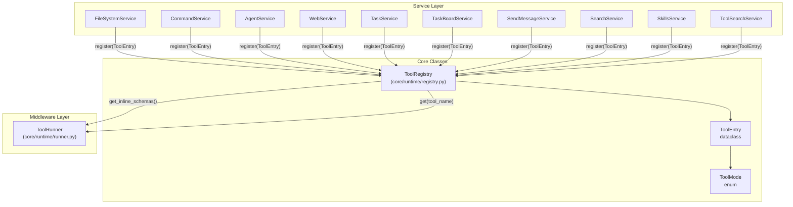
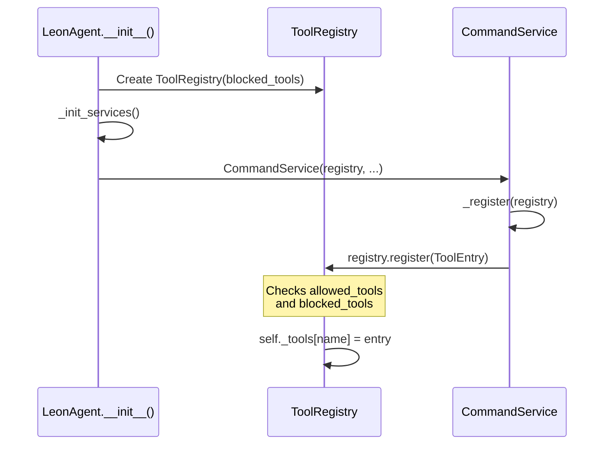
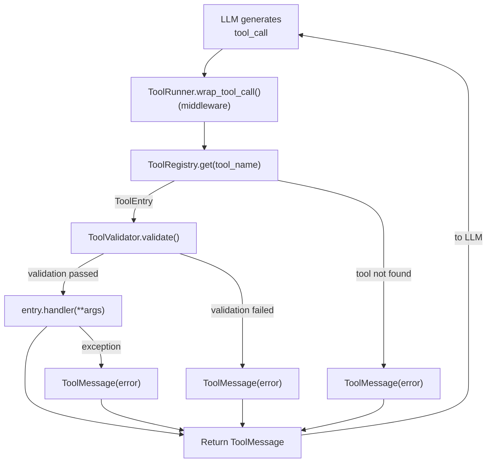
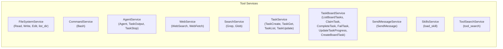

<!-- source: DeepWiki mcp.deepwiki.com · repo OpenDCAI/Mycel · page 5.2 Tool Registry and Execution · fetched 2026-11-02 -->

# Tool Registry and Execution

<details>
<summary>Relevant source files</summary>

The following files were used as context for generating this wiki page:

- [backend/taskboard/middleware.py](backend/taskboard/middleware.py)
- [backend/taskboard/service.py](backend/taskboard/service.py)
- [backend/web/services/member_service.py](backend/web/services/member_service.py)
- [config/defaults/tool_catalog.py](config/defaults/tool_catalog.py)
- [core/agents/communication/service.py](core/agents/communication/service.py)
- [core/agents/service.py](core/agents/service.py)
- [core/runtime/agent.py](core/runtime/agent.py)
- [core/runtime/registry.py](core/runtime/registry.py)
- [core/tools/command/service.py](core/tools/command/service.py)
- [sandbox/capability.py](sandbox/capability.py)

</details>


This document explains the tool registry system in Mycel, which provides a centralized mechanism for registering, discovering, and executing agent tools. The registry acts as a plugin architecture where services register tools with schemas and handlers, and the ToolRunner middleware dispatches tool calls from LLMs to the appropriate handlers.

For information about the middleware stack and how ToolRunner fits into the agent execution flow, see [Middleware Stack](#5.3). For details on implementing specific tool services, see the tool documentation in sections 5.4 and beyond.

---

## ToolRegistry Architecture

The `ToolRegistry` is the central catalog for all agent tools. It maintains a dictionary of tool entries and handles tool filtering, schema retrieval, and discovery queries.



**Sources:** [core/runtime/registry.py:1-80](), [core/runtime/agent.py:847-944]()

### ToolEntry Structure

Each tool is represented by a `ToolEntry` dataclass with five fields:

| Field | Type | Description |
|-------|------|-------------|
| `name` | `str` | Unique tool identifier (e.g., "Read", "Bash", "Agent") |
| `mode` | `ToolMode` | INLINE or DEFERRED execution mode |
| `schema` | `dict \| Callable[[], dict]` | OpenAI function schema or provider function |
| `handler` | `Callable[..., str] \| Callable[..., Awaitable[str]]` | Sync or async function that executes the tool |
| `source` | `str` | Service name that registered the tool (for debugging) |

The schema can be a static dictionary or a callable that returns a schema dynamically (used by `load_skill` for runtime schema generation).

**Sources:** [core/runtime/registry.py:16-26]()

### ToolMode Enum

```python
class ToolMode(Enum):
    INLINE = "inline"    # Injected into every LLM call
    DEFERRED = "deferred" # Only available via tool_search
```

- **INLINE tools** (default) are automatically included in every model request. This includes filesystem operations, commands, web search, and agent spawning.
- **DEFERRED tools** are not injected into model calls but can be discovered via the `tool_search` tool. This reduces token usage for rarely-used tools. Example: TaskCreate/TaskUpdate/TaskList/TaskGet.

**Sources:** [core/runtime/registry.py:11-14](), [config/defaults/tool_catalog.py:31-35]()

---

## Tool Registration Process

Services register tools during LeonAgent initialization in `_init_services()`. Each service receives the `ToolRegistry` instance and calls `registry.register()` with one or more `ToolEntry` instances.



**Sources:** [core/runtime/agent.py:224-227](), [core/runtime/agent.py:847-944]()

### Registration Example: CommandService

The `CommandService` registers a single "Bash" tool:

```python
def _register(self, registry: ToolRegistry) -> None:
    registry.register(ToolEntry(
        name="Bash",
        mode=ToolMode.INLINE,
        schema={
            "name": "Bash",
            "description": "Execute shell command. OS auto-detects shell...",
            "parameters": {
                "type": "object",
                "properties": {
                    "command": {"type": "string", "description": "Command to execute"},
                    "description": {"type": "string", "description": "Human-readable description..."},
                    "run_in_background": {"type": "boolean", "description": "Run in background..."},
                    "timeout": {"type": "integer", "description": "Timeout in milliseconds..."},
                },
                "required": ["command"],
            },
        },
        handler=self._bash,
        source="CommandService",
    ))
```

**Sources:** [core/tools/command/service.py:61-96]()

### Registration Example: AgentService

The `AgentService` registers three tools for hierarchical agent coordination:

| Tool | Purpose | Mode |
|------|---------|------|
| `Agent` | Spawn a sub-agent to execute a task | INLINE |
| `TaskOutput` | Poll output of a background agent task | INLINE |
| `TaskStop` | Cancel a running background task | INLINE |

**Sources:** [core/agents/service.py:178-198]()

---

## Tool Schema Format

Tool schemas follow the OpenAI function calling format with an added wrapper:

```json
{
  "name": "Read",
  "description": "Read the entire contents of a file from the file system.",
  "parameters": {
    "type": "object",
    "properties": {
      "path": {
        "type": "string",
        "description": "The path of the file to read (absolute)"
      }
    },
    "required": ["path"]
  }
}
```

The schema must include:
- `name`: Tool identifier matching the `ToolEntry.name`
- `description`: Natural language explanation of the tool's purpose
- `parameters`: JSON Schema object defining accepted parameters
- `parameters.required`: List of mandatory parameter names

**Sources:** [core/agents/service.py:25-63]()

---

## Tool Execution Pipeline

When the LLM generates a tool call, it flows through the following pipeline:



**Sources:** [core/runtime/runner.py]() (not shown in provided files but referenced in [core/runtime/agent.py:803-807]())

### ToolRunner Dispatch Logic

The ToolRunner middleware intercepts tool calls and:

1. **Lookup**: Retrieves the `ToolEntry` from the registry
2. **Validate**: Checks parameter types and required fields
3. **Execute**: Invokes the handler (sync or async)
4. **Wrap**: Converts result to `ToolMessage` with `tool_call_id`
5. **Error Handling**: Catches exceptions and returns error messages

**Sources:** [core/runtime/agent.py:803-807]()

---

## Tool Filtering and Blocking

The `ToolRegistry` supports two filtering mechanisms:

### Allowed Tools (Whitelist)

```python
ToolRegistry(allowed_tools={"Read", "Write", "Bash"})
```

Only tools in the allowed set are registered. All others are silently skipped during `register()` calls.

### Blocked Tools (Blacklist)

```python
ToolRegistry(blocked_tools={"WebSearch", "WebFetch"})
```

Tools in the blocked set are silently skipped during `register()` calls. This is the primary mechanism for member-based tool configuration.

**Sources:** [core/runtime/registry.py:35-54]()

### Member-Based Tool Configuration

Each member (agent configuration) can enable/disable tools via `runtime.json`:

```json
{
  "tools:WebSearch": {"enabled": false, "desc": ""},
  "tools:Agent": {"enabled": true, "desc": ""}
}
```

The `_get_member_blocked_tools()` method in LeonAgent converts this configuration to a blocked tools set:

```python
def _get_member_blocked_tools(self) -> set[str]:
    blocked = {
        k.split(":", 1)[1]
        for k, v in runtime.items()
        if k.startswith("tools:") and not v.enabled
    }
    # Also block catalog tools with default=False that aren't explicitly enabled
    for tool_name, tool_def in TOOLS_BY_NAME.items():
        if not tool_def.default:
            runtime_key = f"tools:{tool_name}"
            if runtime_key not in runtime:
                blocked.add(tool_name)
    return blocked
```

**Sources:** [core/runtime/agent.py:337-369](), [backend/web/services/member_service.py:173-183]()

---

## Tool Catalog System

The canonical list of all available tools is maintained in `config/defaults/tool_catalog.py` as a typed catalog:

```python
class ToolDef(BaseModel):
    name: str
    desc: str
    group: ToolGroup
    mode: ToolMode = ToolMode.INLINE
    default: bool = True  # False → off by default

TOOLS: list[ToolDef] = [
    ToolDef(name="Read", desc="读取文件内容", group=ToolGroup.FILESYSTEM),
    ToolDef(name="Bash", desc="执行 Shell 命令", group=ToolGroup.COMMAND),
    ToolDef(name="Agent", desc="启动子 Agent 执行任务", group=ToolGroup.AGENT),
    # ...
]

TOOLS_BY_NAME: dict[str, ToolDef] = {t.name: t for t in TOOLS}
```

### Tool Groups

| Group | Purpose | Example Tools |
|-------|---------|---------------|
| FILESYSTEM | File operations | Read, Write, Edit, list_dir |
| COMMAND | Shell execution | Bash |
| AGENT | Multi-agent coordination | Agent, TaskOutput, TaskStop, SendMessage |
| WEB | Internet access | WebSearch, WebFetch |
| SEARCH | Code search | Grep, Glob |
| TODO | Personal task management | TaskCreate, TaskUpdate, TaskList, TaskGet |
| TASKBOARD | Panel task board | ListBoardTasks, ClaimTask, CompleteTask |
| SKILLS | Dynamic skill loading | load_skill |
| SYSTEM | Meta-tools | tool_search |

**Sources:** [config/defaults/tool_catalog.py:1-87]()

---

## Built-in Tool Services

Mycel includes the following tool services, each registering one or more tools:



### FileSystemService

Registers filesystem tools: Read, Write, Edit, list_dir. Uses the sandbox's filesystem backend for isolated file operations.

**Sources:** [core/runtime/agent.py:856-864]()

### CommandService

Registers the Bash tool for shell command execution. Supports blocking/background modes, timeout control, and command hooks for security validation.

**Sources:** [core/tools/command/service.py:32-238]()

### AgentService

Registers tools for hierarchical agent systems:
- `Agent`: Spawns a sub-agent with its own LeonAgent instance and thread
- `TaskOutput`: Polls background agent/bash task results
- `TaskStop`: Cancels running background tasks

Maintains a shared `_tasks` dict (shared with CommandService) for background run tracking.

**Sources:** [core/agents/service.py:150-434]()

### WebService

Registers web access tools:
- `WebSearch`: Search via Tavily/Exa/Google APIs
- `WebFetch`: Fetch webpage content with LLM-based extraction

**Sources:** [core/runtime/agent.py:874-886]()

### SearchService

Registers code search tools:
- `Grep`: Regex search using ripgrep
- `Glob`: File pattern matching

**Sources:** [core/runtime/agent.py:866-872]()

### TaskService

Registers personal todo management tools (DEFERRED mode):
- `TaskCreate`, `TaskGet`, `TaskList`, `TaskUpdate`

These are deferred to reduce token usage—agents must discover them via `tool_search`.

**Sources:** [core/runtime/agent.py:890-898]()

### TaskBoardService

Registers panel task board management tools (INLINE mode, but default=False in catalog):
- `ListBoardTasks`, `ClaimTask`, `UpdateTaskProgress`
- `CompleteTask`, `FailTask`, `CreateBoardTask`

These tools allow agents to act as workers in a task scheduling system. Off by default; enable on dedicated scheduler members.

**Sources:** [backend/taskboard/service.py:31-335]()

### SendMessageService

Registers inter-agent communication:
- `SendMessage`: Send messages between agents via MessageQueueManager and AgentRegistry

Supports message types: direct message, broadcast, shutdown_request, shutdown_response, plan_approval_response.

**Sources:** [core/agents/communication/service.py:98-225]()

### SkillsService

Registers dynamic skill loading:
- `load_skill`: Load a skill definition and generate its tools at runtime

Uses callable schema provider—the schema is generated when first requested based on available skills.

**Sources:** [core/runtime/agent.py:900-908]()

### ToolSearchService

Registers the meta-tool:
- `tool_search`: Search and discover available tools (including DEFERRED tools)

**Sources:** [core/runtime/agent.py:910-918]()

---

## Tool Handler Signatures

Tool handlers accept named parameters matching the schema and return a string result:

### Synchronous Handler

```python
def _bash(
    self,
    command: str,
    description: str = "",
    run_in_background: bool = False,
    timeout: int = DEFAULT_TIMEOUT_MS,
) -> str:
    # Execute command
    return result.to_tool_result()
```

### Asynchronous Handler

```python
async def _handle_agent(
    self,
    prompt: str,
    subagent_type: str = "General",
    name: str | None = None,
    description: str | None = None,
    run_in_background: bool = False,
    max_turns: int | None = None,
) -> str:
    # Spawn agent
    return json.dumps({"task_id": task_id, ...})
```

The ToolRunner automatically detects whether the handler is sync or async and handles invocation appropriately.

**Sources:** [core/tools/command/service.py:110-238](), [core/agents/service.py:200-253]()

---

## Tool Discovery: tool_search

The `tool_search` tool allows agents to discover available tools at runtime:

```python
async def _handle_search(self, query: str) -> str:
    results = self._registry.search(query)
    tools = [
        {
            "name": entry.name,
            "description": entry.get_schema().get("description", ""),
            "mode": entry.mode.value,
            "source": entry.source,
        }
        for entry in results
    ]
    return json.dumps({"tools": tools, "total": len(tools)})
```

The registry's `search()` method matches tools by name or description. If no matches are found, it returns all tools.

**Sources:** [core/runtime/registry.py:63-76]()

---

## Inline vs Deferred Schema Injection

The ToolRunner middleware injects inline tools into every model request:

```python
def wrap_model_call(self, request: ModelRequest, handler: Callable) -> ModelResponse:
    inline_tools = self._registry.get_inline_schemas()
    tools = list(request.tools or []) + inline_tools
    return handler(request.override(tools=tools))
```

Deferred tools are excluded from injection but remain callable—the LLM must discover them via `tool_search` first.

**Sources:** [core/runtime/agent.py:803-807]()

---

## Background Task Management

Both AgentService and CommandService support background execution via a shared `_tasks` dictionary:

```python
# Shared dict: task_id -> BackgroundRun (_RunningTask | _BashBackgroundRun)
shared_runs: dict[str, BackgroundRun] = {}

agent_service = AgentService(registry, ..., shared_runs=shared_runs)
command_service = CommandService(registry, ..., background_runs=shared_runs)
```

This allows `TaskOutput` and `TaskStop` to work with both agent and bash background runs uniformly.

**Sources:** [core/agents/service.py:146-176](), [core/tools/command/service.py:44-50](), [core/agents/service.py:401-433]()

---

## Summary

The tool registry system provides:
- **Centralized registration**: All tools go through `ToolRegistry.register()`
- **Service-based architecture**: Each functional domain has a service that registers tools
- **Flexible execution**: INLINE tools auto-inject; DEFERRED tools require discovery
- **Configuration control**: Member-based enable/disable via blocked_tools
- **Uniform dispatch**: ToolRunner middleware handles validation and execution
- **Background tasks**: Shared run tracking for agent and bash background execution

This architecture enables extensibility—new tool services can be added by implementing the registration pattern—and maintainability—all tool metadata lives in the registry rather than scattered across the codebase.

---

